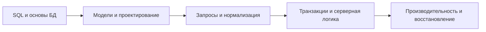

[[index|← Обложка]]

14 лекций: от первого SELECT до восстановления базы после сбоя. В лекциях — объяснения, схемы и вопросы; в практике — отдельные тренировки с проверкой запросов и разборами решений.

## Лекции

| № | Лекция |
|---|---|
| 01 | [[Лекции/01. Основы SQL\|Основы SQL]] |
| 02 | [[Лекции/02. Базы данных и информационные системы\|Базы данных и информационные системы]] |
| 03 | [[Лекции/03. DDL, типы данных и ограничения\|DDL, типы данных и ограничения]] |
| 04 | [[Лекции/04. Архитектуры СУБД и модели данных\|Архитектуры СУБД и модели данных]] |
| 05 | [[Лекции/05. ER-модель — сущности и связи\|ER-модель — сущности и связи]] |
| 06 | [[Лекции/06. Реляционная модель и реляционная алгебра\|Реляционная модель и реляционная алгебра]] |
| 07 | [[Лекции/07. Запросы, JOIN и подзапросы\|Запросы, JOIN и подзапросы]] |
| 08 | [[Лекции/08. Нормализация и физическое хранение\|Нормализация и физическое хранение]] |
| 09 | [[Лекции/09. Транзакции, MVCC и изоляция\|Транзакции, MVCC и изоляция]] |
| 10 | [[Лекции/10. Функции и процедуры PostgreSQL\|Функции и процедуры PostgreSQL]] |
| 11 | [[Лекции/11. Триггеры и планирование задач\|Триггеры и планирование задач]] |
| 12 | [[Лекции/12. Программирование на PLpgSQL\|Программирование на PLpgSQL]] |
| 13 | [[Лекции/13. Производительность и индексы\|Производительность и индексы]] |
| 14 | [[Лекции/14. Резервирование и восстановление\|Резервирование и восстановление]] |

## Практика и повторение

| Раздел | Что внутри |
|---|---|
| [[Практика/00. Тренировки по темам\|Тренировки по темам]] | 86 SQL-заданий в браузере и 40 заданий для PostgreSQL |
| [[Практика/База billing — устройство и запуск\|Учебная база billing]] | Таблицы, связи и запуск PostgreSQL |
| [[Повторение/Перед зачётом\|Перед зачётом]] | 84 карточки, 14 билетов и список тем для проверки |
| [[Справочники/SQL и psql — шпаргалка\|Шпаргалка SQL и psql]] | Команды и примеры синтаксиса |
| [[Справочники/Глоссарий\|Глоссарий]] | Основные термины |
| [[Справочники/Ловушки и уточнения\|Ловушки и уточнения]] | Частые ошибки и важные оговорки |

## Как проходить

Читай лекции по порядку, отвечай на вопросы без подсказки и закрепляй тему в тренировках. Для SQL начни с лекций 1, 3, 6 и 7; перед зачётом переходи к карточкам и билетам.

Браузерные задания используют [[Практика/Учебный набор|небольшой учебный набор]]. Серверные задания выполняются в PostgreSQL; их данные могут отличаться.

