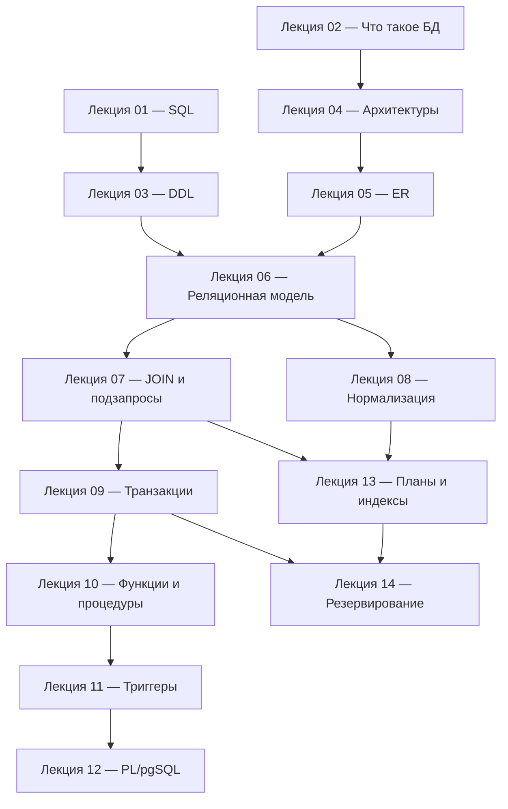

# 🧭 Карта курса

[[index|← Старт]] · [[Повторение/Перед зачётом|Быстрое повторение]]

| № | Конспект | Ключевые темы |
|---|---|---|
| 01 | [[Лекции/01. Основы SQL\|Основы SQL]] | SELECT, DDL/DML, группировка |
| 02 | [[Лекции/02. Базы данных и информационные системы\|Базы данных и информационные системы]] | ИС, БД, СУБД, СХД |
| 03 | [[Лекции/03. DDL, типы данных и ограничения\|DDL, типы данных и ограничения]] | Типы, PK/FK, CHECK, VIEW |
| 04 | [[Лекции/04. Архитектуры СУБД и модели данных\|Архитектуры СУБД и модели данных]] | Компоненты, архитектуры, уровни |
| 05 | [[Лекции/05. ER-модель — сущности и связи\|ER-модель — сущности и связи]] | Сущности, атрибуты, кратности |
| 06 | [[Лекции/06. Реляционная модель и реляционная алгебра\|Реляционная модель и реляционная алгебра]] | Отношения, ключи, алгебра |
| 07 | [[Лекции/07. Запросы, JOIN и подзапросы\|Запросы, JOIN и подзапросы]] | JOIN, EXISTS, CTE |
| 08 | [[Лекции/08. Нормализация и физическое хранение\|Нормализация и физическое хранение]] | 1NF–4NF, зависимости, страницы |
| 09 | [[Лекции/09. Транзакции, MVCC и изоляция\|Транзакции, MVCC и изоляция]] | ACID, MVCC, изоляция |
| 10 | [[Лекции/10. Функции и процедуры PostgreSQL\|Функции и процедуры PostgreSQL]] | SQL-функции, STABLE, CALL |
| 11 | [[Лекции/11. Триггеры и планирование задач\|Триггеры и планирование задач]] | BEFORE/AFTER, NEW/OLD, pg\_cron |
| 12 | [[Лекции/12. Программирование на PLpgSQL\|Программирование на PLpgSQL]] | Блоки, переменные, циклы, ошибки |
| 13 | [[Лекции/13. Производительность и индексы\|Производительность и индексы]] | EXPLAIN, B-tree, BRIN, VACUUM |
| 14 | [[Лекции/14. Резервирование и восстановление\|Резервирование и восстановление]] | RPO/RTO, WAL, PITR, репликация |

## Связи тем

## Три маршрута

**С нуля:** 1 → 2 → 3 → 4 → 5 → 6 → 7 → 8 → 9 → 10 → 11 → 12 → 13 → 14.

**Для практик SQL:** 1 → 3 → схема billing → 6 → 7 → тематические тренировки → 9 → 10–12. Выбрать упражнения: [[Практика/00. Тренировки по темам]]. Теоретические темы помогают объяснять решения и проверять их границы.

**Перед зачётом:** [[Повторение/Перед зачётом]] → [[Справочники/Ловушки и уточнения]] → лекции, вызвавшие затруднения.

## Карта Canvas

[[Карты/Карта курса.canvas|Открыть доску Canvas курса]]

Canvas редактируется в Obsidian. Для публикации на Quartz используй Mermaid выше: нативная интерактивная доска Canvas не обязана поддерживаться генератором сайта.

## Краткие опорные блоки

![[Лекции/01. Основы SQL#^summary-l01]]

![[Лекции/09. Транзакции, MVCC и изоляция#^summary-l09]]

![[Лекции/14. Резервирование и восстановление#^summary-l14]]
