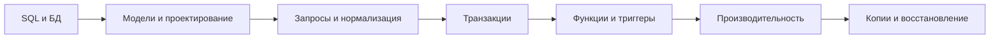

# 🗃️ Базы данных: от первого SELECT до восстановления

> [!abstract] Что внутри
> 14 расширенных конспектов по PDF курса Брагина К. И., 140 тестовых и 168 открытых вопросов, 12 тематических тренировок и 84 карточки перед зачётом. Примеры на billing, Mermaid и Canvas помогают связать идеи. Все исходные PDF сохранены в `lecture/`.

**Начни с [[Лекции/01. Основы SQL|первой лекции]]**, открой [[01. Карта курса|карту курса]] или выбери маршрут ниже.

| Хочу… | Открыть |
|---|---|
| Пройти все темы по порядку | [[01. Карта курса]] |
| Посмотреть, как темы связаны | [[Карты/Карта курса.canvas\|Canvas курса]] |
| Разобраться в учебной БД | [[Практика/База billing — устройство и запуск]] |
| Порешать SQL и серверные задачи | [[Практика/00. Тренировки по темам]] |
| Вспомнить синтаксис | [[Справочники/SQL и psql — шпаргалка]] |
| Разобрать термин | [[Справочники/Глоссарий]] |
| Не попасть в типичную ловушку | [[Справочники/Ловушки и уточнения]] |
| Повторить перед зачётом | [[Повторение/Перед зачётом]] |
| Планировать обучение | [[Повторение/План и прогресс]] |

## Как устроен один учебный заход

1. Прочитай пояснение и схему, затем открой связанный фрагмент PDF.
2. Предскажи результат SQL **до** запуска.
3. Ответь на вопросы лекции, затем выбери отдельную тренировку по теме.
4. Объясни своими словами причину затруднения и повторно реши похожий пример.
5. Отметь чек-лист и поставь `confidence` от 0 до 5 в свойствах лекции.
6. Повтори материал через день, несколько дней и неделю; даты запланируй под свой темп.

> [!tip] Конспект не нужно читать как сплошную книгу
> Пройди темы один раз, а затем возвращайся по связям. Непонятен JOIN — открой реляционную алгебру. Непонятно, зачем триггеру транзакция, — вернись к MVCC и атомарности.

## Два вида SQL-практики

**PostgreSQL 15** — диалект полной учебной базы и серверных примеров. Схема и дамп лежат в `Практика/pr1/`. Дамп получен из указанного репозитория, исходные файлы не переписаны.

**AlaSQL в браузере** — компактная песочница для SELECT, фильтров, JOIN и агрегации. Данные учебные и специально дополнены граничными случаями. Её номера строк и суммы не следует ожидать в полном дампе. [[Практика/Учебный набор|Паспорт набора и отличия]].

## Что работает сразу в Obsidian

Wikilinks, обратные ссылки, граф, теги, свойства, Outline, чек-листы, сворачиваемые callouts, Mermaid, PDF-ссылки, блоковые вставки и Canvas. [[02. Возможности Obsidian|Как этим пользоваться]]. Дополнительный плагин для конспекта не требуется.

В лекциях — вопросы на понимание и тесты. В практике — запросы с автоматической проверкой, песочницы и задания для PostgreSQL с разворачиваемыми решениями. В Obsidian интерактивные блоки видны как код, на сайте становятся виджетами.

## Обзор на одном экране

> [!note] Нумерация
> Конспекты 1–14 соответствуют именам файлов BDC. В PDF 11 есть повтор части предыдущей лекции, а на титульных страницах PDF 12–14 встречаются другие номера. Нумерация здесь следует именам файлов BDC\_1.pdf–BDC\_14.pdf.
