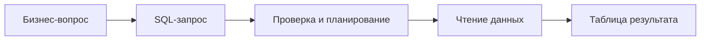
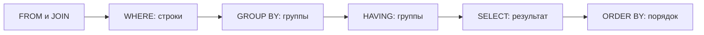
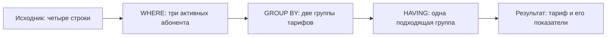
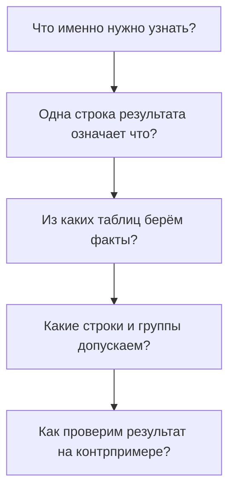

# 01. Основы SQL

[[index|🏠 Старт]] · [[01. Карта курса|🧭 Карта]] · [[Лекции/02. Базы данных и информационные системы|Следующая →]]

> [!abstract] Зачем читать
> SQL описывает нужный результат. SELECT выбирает столбцы, WHERE — строки, GROUP BY собирает группы, HAVING фильтрует группы, ORDER BY задаёт порядок. Данные, структура, права и транзакции управляются разными командами. В PostgreSQL строки заключают в одинарные кавычки, а NULL проверяют через IS NULL.

> [!info] Основа конспекта
> [[lecture/BDC_1.pdf#page=1|Исходная лекция: BDC_1.pdf]], 23 страниц PDF. Пояснения, разборы и упражнения добавлены к материалу курса. Номера страниц ниже — страницы PDF, а не цифры внизу слайдов.

## 1. SQL говорит, какой результат нужен

SQL — язык работы с данными. В запросе мы описываем требуемый результат, а СУБД выбирает способ его получения. Это **декларативный** подход. Запрос «покажи активных абонентов с долгом» не содержит цикла обхода страниц диска и не предписывает использовать индекс.

Представь кафе: ты заказываешь блюдо, а кухня выбирает последовательность приготовления. Однако формулировка заказа важна: запрос без фильтра действительно может вернуть всю таблицу.



Курс использует PostgreSQL. Это название **СУБД**; `billing_database` — имя учебной **базы**, а SQL — **язык**. `psql` — консольный клиент, через который можно отправлять запросы. Небольшой браузерный тренажёр использует AlaSQL и проверяет базовые операции; возможности PostgreSQL у него неполные.

Исторически SQL возник в IBM в 1970-х, а реляционная модель сформировалась в работах Э. Ф. Кодда. Для практики важнее понимать развитие идеи: вместо программ, жёстко привязанных к расположению файлов, появился общий язык запросов к логической структуре данных. Исторический обзор продолжается в [[Лекции/02. Базы данных и информационные системы]].

## 2. Какие бывают команды

| Группа | Что меняет | Примеры | Образ |
|---|---|---|---|
| DDL | Структуру объектов | `CREATE`, `ALTER`, `DROP` | Построить шкаф |
| DML | Данные | `INSERT`, `UPDATE`, `DELETE`, `SELECT` | Разложить вещи |
| DCL | Права доступа | `GRANT`, `REVOKE` | Выдать ключ |
| TCL | Границы транзакций | `BEGIN`, `COMMIT`, `ROLLBACK` | Подтвердить пакет действий |

`SELECT` иногда выделяют в группу DQL. Это различие учебных классификаций: сам синтаксис запроса от него не меняется. В лекции выборка рассматривается вместе с DML.

## 3. Первый SELECT: столбцы, таблица, условие

```sql
SELECT subscriber_id, first_name, balance
FROM subscribers
WHERE status = 'ACTIVE' AND balance < 0
ORDER BY balance, subscriber_id;
```

Разбираем по частям. `SELECT` задаёт столбцы результата; `FROM` — источник; `WHERE` оставляет подходящие строки; `ORDER BY` определяет порядок. В учебном наборе останется Борис с балансом −20. Заблокированная запись с отрицательным балансом не подойдёт: условие требует **одновременно** активный статус и долг.

`SELECT *` означает все столбцы. Он полезен при знакомстве с таблицей, но в постоянных запросах список полей делает результат понятнее и устойчивее к добавлению новых столбцов.

```sql
SELECT plan_name AS tariff, monthly_fee AS fee
FROM tariff_plans
ORDER BY monthly_fee DESC, plan_id;
```

`AS` задаёт псевдоним в результате. Имя столбца в самой таблице при этом не меняется. Псевдонимы таблиц (`subscribers AS s`) понадобятся в соединениях.

## 4. Кавычки, регистр и литералы

| Запись PostgreSQL | Значение |
|---|---|
| `'ACTIVE'` | Строковое значение |
| `"Active"` | Имя объекта с сохранённым регистром |
| `250.30` | Число, десятичный разделитель — точка |
| `TRUE`, `FALSE` | Логические значения |
| `NULL` | Отсутствующее или неизвестное значение |
| `DATE '2025-11-01'` | Типизированная дата |

> [!warning] Уточнение к слайдам 21–22
> В PostgreSQL строки записывают в **одинарных** кавычках. Двойные предназначены для идентификаторов. Для перевода строки можно использовать `E'первая\nвторая'`. Число `20251101` само по себе не становится датой. Конструкция `DIV` из некоторых диалектов не является оператором PostgreSQL.

Ключевые слова регистронезависимы: `select` и `SELECT` равнозначны. Идентификаторы без двойных кавычек приводятся к нижнему регистру. Строковые значения не становятся от этого регистронезависимыми: `'ACTIVE'` и `'active'` могут означать разное.

```sql
SELECT 5 / 2 AS integer_division,
       5.0 / 2 AS decimal_division,
       5 % 2 AS remainder;
```

В PostgreSQL получим `2`, `2.5`, `1`. Типы операндов влияют на результат. Эти детали раскрыты в [[Лекции/03. DDL, типы данных и ограничения]].

## 5. NULL: отдельная логика

`NULL` не равен нулю и не равен пустой строке. Если email неизвестен, его нельзя корректно проверить через `email = NULL`. Результат такого сравнения — неизвестность, а `WHERE` пропускает только истину.

```sql
SELECT subscriber_id, first_name
FROM subscribers
WHERE email IS NULL;
```

Для подстановки удобного значения используют `COALESCE(email, 'не указан')`. Это меняет представление результата, а не сохранённые данные.

## 6. Как меняются данные

```sql
-- PostgreSQL. Пример в транзакции, завершается откатом.
BEGIN;
UPDATE subscribers
SET balance = balance + 100
WHERE subscriber_id = 1;
SELECT subscriber_id, balance
FROM subscribers WHERE subscriber_id = 1;
ROLLBACK;
```

`UPDATE` меняет существующие строки, `INSERT` добавляет новые, `DELETE` удаляет строки. `DROP TABLE` удаляет объект таблицы. Различай уровень действия: удаление данных и удаление структуры — разные операции.

> [!tip] Рабочая привычка
> Сначала выполни `SELECT` с тем же `WHERE` и посмотри, какие строки попадут под изменение. Для упражнений с изменениями используй отдельную учебную копию и явную транзакцию.

При `INSERT` перечисляй столбцы. Тогда перестановка или добавление столбцов в схеме не изменит смысл позиционных значений:

```sql
INSERT INTO service_types (service_name, description)
VALUES ('Video', 'Видеосервис');
```

## 7. Агрегация: из строк делаем показатели

```sql
SELECT plan_id, COUNT(*) AS subscriber_count,
       AVG(balance) AS average_balance
FROM subscribers
WHERE status = 'ACTIVE'
GROUP BY plan_id
HAVING COUNT(*) >= 2
ORDER BY subscriber_count DESC, plan_id;
```

Сначала отбираются активные абоненты; затем они делятся на группы по тарифу; для каждой группы считаются число записей и средний баланс; `HAVING` оставляет достаточно большие группы. В нашем наборе это тариф Basic: Анна и Глеб.

`COUNT(*)` считает строки. `COUNT(email)` считает строки с известным email. `SUM`, `AVG`, `MIN`, `MAX` обычно игнорируют `NULL`. Для пустого набора `COUNT` возвращает 0, а `SUM` — `NULL`, поэтому в отчётах встречается `COALESCE(SUM(...), 0)`.



Это **логический** порядок рассмотрения результата, а не обещание физического плана. В тексте запроса `SELECT` пишется первым.

## 8. Почему SQL-таблица отличается от отношения

В математической модели отношение — множество уникальных кортежей. SQL допускает повторяющиеся строки результата, то есть работает и с **мультимножествами**. Даже если таблица имеет первичный ключ, `SELECT plan_id FROM subscribers` вернёт повторения тарифов. Для уникальных комбинаций есть `DISTINCT`.

Порядок строк без `ORDER BY` не гарантирован. «У меня всегда выводится по ID» — наблюдение за конкретным выполнением, а не свойство запроса. При равных значениях сортировки добавляй дополнительный критерий, например первичный ключ.

## Разбираем запрос как конвейер на маленьких данных

Посмотрим на четыре условных строки. Это отдельная иллюстрация: её числа не нужно переносить в ответы по полному дампу.

| subscriber\_id | plan\_id | status | balance |
|---:|---:|---|---:|
| 1 | 1 | ACTIVE | 250 |
| 2 | 2 | ACTIVE | −20 |
| 3 | 1 | SUSPENDED | 0 |
| 4 | 1 | ACTIVE | 500 |

Нужен средний баланс **активных** абонентов по тарифу, но показывать следует только тарифы с двумя и более активными абонентами. Начинаем не с запоминания синтаксиса, а с определения строки результата: одна строка должна описывать один тариф.

```sql
SELECT plan_id, COUNT(*) AS active_count, AVG(balance) AS average_balance
FROM subscribers
WHERE status = 'ACTIVE'
GROUP BY plan_id
HAVING COUNT(*) >= 2
ORDER BY plan_id;
```

После WHERE остаются ID 1, 2, 4. Группа тарифа 1 содержит балансы 250 и 500; группа тарифа 2 содержит только −20. После HAVING проходит только первая группа: количество 2, среднее 375. Если перенести условие количества в WHERE, запрос станет неверным: на этом логическом этапе группы ещё не существуют.



Полезный способ отладки — временно упростить запрос. Сначала проверь FROM и WHERE. Затем добавь GROUP BY с COUNT(\*). Затем вычисления и HAVING. Если сразу написать десять соединений и пять агрегатов, будет трудно понять, на каком шаге потерялись строки.

## Трёхзначная логика на практике

Условие с неизвестным значением часто даёт UNKNOWN. Это не третья разновидность TRUE и не текстовая строка `'UNKNOWN'`, а результат логического вычисления.

| Выражение | Результат | Пройдёт WHERE? |
|---|---|---|
| `10 > 0` | TRUE | Да |
| `-10 > 0` | FALSE | Нет |
| `NULL > 0` | UNKNOWN | Нет |
| `NULL = NULL` | UNKNOWN | Нет |
| `NULL IS NULL` | TRUE | Да |
| `FALSE AND UNKNOWN` | FALSE | Нет |
| `TRUE OR UNKNOWN` | TRUE | Да |

Отсюда важное следствие: `WHERE NOT (balance > 0)` не является способом выбрать абсолютно все строки, не прошедшие `balance > 0`. Строки с NULL не пройдут ни один вариант, поскольку NOT UNKNOWN остаётся UNKNOWN. Для включения неизвестного баланса это условие надо сформулировать отдельно.

`COALESCE` помогает показать запасное значение, но не доказывает, что неизвестный баланс действительно равен нулю. В отчёте «не указан» может быть честнее, чем искусственный ноль. Различай удобство отображения и решение о смысле данных.

## Порядок, LIMIT и равные значения

Представь запрос «три самых богатых абонента». `LIMIT 3` без ORDER BY выбирает какие-то три строки, а не максимальные балансы. Сортировка `ORDER BY balance DESC` тоже оставляет неоднозначность, если на границе несколько равных балансов. Дополнительный `subscriber_id` задаёт устойчивое разрешение ничьей.

```sql
SELECT subscriber_id, balance
FROM subscribers
WHERE balance IS NOT NULL
ORDER BY balance DESC, subscriber_id ASC
LIMIT 3;
```

В PostgreSQL NULL имеют собственное положение при сортировке, которое при необходимости задают `NULLS FIRST` или `NULLS LAST`. В этой иллюстрации неизвестные балансы исключены явно. Сортировка результата не изменяет расположение строк в самой таблице и не «сохраняется» для следующего запроса.

## Почему запрос должен быть понятен человеку

Указывай единицы величин в псевдониме: `duration_minutes` понятнее, чем `value`. Для длинных имён таблиц применяй короткие осмысленные алиасы. Записывай один смысловой этап на строку. Это помогает проверить бизнес-правило, а не только синтаксис.



В приложении значения пользователя передают параметрами драйвера. Строка SQL, составленная склеиванием пользовательского ввода, может изменить структуру запроса. Не путай параметризацию значений с кавычками для имён столбцов: имя таблицы нельзя просто передать как обычное значение параметра.

## Короткий разбор ошибки

Запрос `SELECT first_name, MAX(balance) FROM subscribers` не выражает задачу «имя владельца максимального баланса». В PostgreSQL без подходящей группировки он завершится ошибкой. Сам агрегат не переносит в результат остальные поля именно той строки, из которой взял максимум. Для выбора конкретной строки используют сортировку с LIMIT или сравнение с подзапросом. Во втором варианте могут вернуться несколько абонентов с одинаковым максимумом — и это другой корректный ответ на немного другую задачу.

## Где это в PDF

[[lecture/BDC_1.pdf#page=3|SQL и декларативность: страницы 3–8]] · [[lecture/BDC_1.pdf#page=9|DDL и изменения: 9–16]] · [[lecture/BDC_1.pdf#page=17|Группировка и HAVING: 17–19]] · [[lecture/BDC_1.pdf#page=20|Типы и литералы: 20–23]].

## Проверь себя без подсказки

Сначала закрой пояснения и ответь вслух. Для сложного ответа приведи свой пример или контрпример.

1. Чем отличаются PostgreSQL, SQL, billing\_database и psql?
2. Что изменится в результате, если убрать WHERE или ORDER BY?
3. Почему COUNT(\*) и COUNT(email) могут дать разные числа?
4. Чем HAVING отличается от WHERE?
5. Почему SELECT plan\_id может вернуть дубликаты при наличии PK в таблице?
6. Проследи промежуточные строки запроса с WHERE, GROUP BY и HAVING на собственных четырёх записях.
7. Почему NOT (balance > 0) не выбирает неизвестный баланс?
8. Сформулируй два разных смысла задачи о максимальном балансе: одна строка и все разделяющие максимум.
9. Какие единицы стоит указать в псевдониме duration\_minutes?
10. Как LIMIT взаимодействует с отсутствием порядка?
11. Какие проверки нужны перед изменением нескольких строк?
12. Почему параметр значения не является параметром имени таблицы?

## Вопросы с выбором ответа

На сайте выбор сразу показывает результат. В Obsidian ответ отмечен знаком `+` в блоке; сначала попробуй ответить, затем проверь себя.

```text
#quiz
? Что в SQL задаёт порядок строк результата?
- PRIMARY KEY
+ ORDER BY
- Порядок вставки
```

```text
#quiz
? Как найти неизвестный email в PostgreSQL?
+ WHERE email IS NULL
- WHERE email = NULL
- WHERE email = ''
```

```text
#quiz
? Что означает одна строка результата запроса с GROUP BY plan_id?
- Всегда одного абонента
+ Одну группу по тарифу
- Всегда один исходный звонок
```

> [!explain]- Почему так
> После группировки зерно результата меняется: несколько исходных строк образуют одну группу.

```text
#quiz
? Почему LIMIT 3 без ORDER BY не находит три максимальных баланса?
- LIMIT всегда сортирует по ID
- MAX автоматически включается
+ Порядок строк не задан
```

> [!explain]- Почему так
> LIMIT ограничивает количество, а критерий выбора первых строк задаётся сортировкой.

```text
#quiz
? Что даст NULL = NULL в PostgreSQL?
+ UNKNOWN
- TRUE
- Всегда ноль
```

> [!explain]- Почему так
> Неизвестность не сравнивается как обычное значение. Для проверки используют IS NULL.

```text
#quiz
? У двух строк одинаковый balance. Как сделать их взаимный порядок определённым?
- Добавить пустой комментарий
+ Добавить subscriber_id в ORDER BY
- Убрать WHERE
```

> [!explain]- Почему так
> Уникальный дополнительный критерий разрешает ничью по основному полю сортировки.

```text
#quiz
? Что изменит AS tariff в SELECT plan_name AS tariff?
- Имя столбца в таблице
- Все значения названий тарифов
+ Название столбца результата
```

> [!explain]- Почему так
> Алиас задаёт интерфейс результата и не является миграцией схемы.

```text
#quiz
? В пустом наборе как соотносятся COUNT(*) и SUM(balance) в PostgreSQL?
+ COUNT равен 0, SUM равна NULL
- Оба обязательно равны 0
- Оба всегда дают ошибку
```

> [!explain]- Почему так
> У агрегатов различаются правила для пустого набора. Для подстановки суммы применяют COALESCE.

```text
#quiz
? Какой фильтр нужен, чтобы включить и неположительные, и неизвестные балансы?
- Только NOT (balance > 0)
+ Явно учесть balance IS NULL
- Считать NULL отрицательным числом
```

> [!explain]- Почему так
> NOT UNKNOWN остаётся UNKNOWN и не проходит WHERE.

```text
#quiz
? Гарантирует ли MAX(balance) вывод имени соответствующего абонента?
- Да, любое соседнее поле берётся из этой строки
- Да, если убрать FROM
+ Нет, выбор строки нужно выразить отдельно
```

> [!explain]- Почему так
> Агрегат возвращает значение; остальные атрибуты подходящей строки не переносятся автоматически.

## Закрепить тему на практике

- [[Практика/01. SELECT и сортировка]]
- [[Практика/02. WHERE, NULL и CASE]]
- [[Практика/03. Агрегаты и HAVING]]

Здесь остаются вопросы на понимание. В тренировках — ввод запросов, проверка результатов и серверные задачи с разбором.

## Чек-лист понимания

- [ ] Прочитал лекцию и разобрал схему.
- [ ] Ответил на вопросы вслух без конспекта.
- [ ] Ответил на десять тестовых вопросов и объяснил неверные варианты.
- [ ] В свойстве `confidence` поставил число от 0 до 5.
- [ ] Поставил дату следующего повторения в `review_next`.

## Суть за минуту

SQL описывает нужный результат. SELECT выбирает столбцы, WHERE — строки, GROUP BY собирает группы, HAVING фильтрует группы, ORDER BY задаёт порядок. Данные, структура, права и транзакции управляются разными командами. В PostgreSQL строки заключают в одинарные кавычки, а NULL проверяют через IS NULL.

^summary-l01

## Куда дальше

Продолжение: [[Лекции/03. DDL, типы данных и ограничения]] и [[Лекции/07. Запросы, JOIN и подзапросы]]. Термины: [[Справочники/Глоссарий]]. Команды: [[Справочники/SQL и psql — шпаргалка]].

[[index|🏠 Старт]] · [[01. Карта курса|🧭 Карта]] · [[Лекции/02. Базы данных и информационные системы|Следующая →]]
