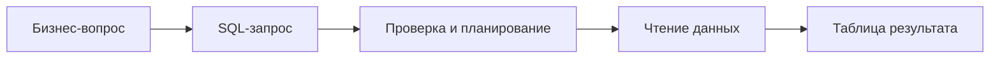
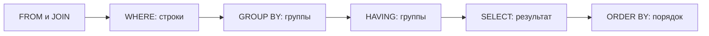

# 01. Основы SQL

[[index|🏠 Старт]] · [[01. Карта курса|🧭 Карта]] · [[Лекции/02. Базы данных и информационные системы|Следующая →]]

> [!abstract] Зачем читать
> SQL описывает нужный результат. SELECT выбирает столбцы, WHERE — строки, GROUP BY собирает группы, HAVING фильтрует группы, ORDER BY задаёт порядок. Данные, структура, права и транзакции управляются разными командами. В PostgreSQL строки заключают в одинарные кавычки, а NULL проверяют через IS NULL.

> [!info] Основа конспекта
> [[lecture/BDC_1.pdf#page=1|Исходная лекция: BDC_1.pdf]], 23 страниц PDF. Пояснения, разборы и упражнения добавлены к материалу курса. Номера страниц ниже — страницы PDF, а не цифры внизу слайдов.

## 1. SQL говорит, какой результат нужен

SQL — язык работы с данными. В запросе мы описываем требуемый результат, а СУБД выбирает способ его получения. Это **декларативный** подход. Запрос «покажи активных абонентов с долгом» не содержит цикла обхода страниц диска и не предписывает использовать индекс.

Представь кафе: ты заказываешь блюдо, а кухня выбирает последовательность приготовления. Однако формулировка заказа важна: запрос без фильтра действительно может вернуть всю таблицу.



Курс использует PostgreSQL. Это название **СУБД**; `billing_database` — имя учебной **базы**, а SQL — **язык**. `psql` — консольный клиент, через который можно отправлять запросы. Небольшой браузерный тренажёр использует AlaSQL и проверяет базовые операции; возможности PostgreSQL у него неполные.

Исторически SQL возник в IBM в 1970-х, а реляционная модель сформировалась в работах Э. Ф. Кодда. Для практики важнее понимать развитие идеи: вместо программ, жёстко привязанных к расположению файлов, появился общий язык запросов к логической структуре данных. Исторический обзор продолжается в [[Лекции/02. Базы данных и информационные системы]].

## 2. Какие бывают команды

| Группа | Что меняет | Примеры | Образ |
|---|---|---|---|
| DDL | Структуру объектов | `CREATE`, `ALTER`, `DROP` | Построить шкаф |
| DML | Данные | `INSERT`, `UPDATE`, `DELETE`, `SELECT` | Разложить вещи |
| DCL | Права доступа | `GRANT`, `REVOKE` | Выдать ключ |
| TCL | Границы транзакций | `BEGIN`, `COMMIT`, `ROLLBACK` | Подтвердить пакет действий |

`SELECT` иногда выделяют в группу DQL. Это различие учебных классификаций: сам синтаксис запроса от него не меняется. В лекции выборка рассматривается вместе с DML.

## 3. Первый SELECT: столбцы, таблица, условие

```sql
SELECT subscriber_id, first_name, balance
FROM subscribers
WHERE status = 'ACTIVE' AND balance < 0
ORDER BY balance, subscriber_id;
```

Разбираем по частям. `SELECT` задаёт столбцы результата; `FROM` — источник; `WHERE` оставляет подходящие строки; `ORDER BY` определяет порядок. В учебном наборе останется Борис с балансом −20. Заблокированная запись с отрицательным балансом не подойдёт: условие требует **одновременно** активный статус и долг.

`SELECT *` означает все столбцы. Он полезен при знакомстве с таблицей, но в постоянных запросах список полей делает результат понятнее и устойчивее к добавлению новых столбцов.

```sql
SELECT plan_name AS tariff, monthly_fee AS fee
FROM tariff_plans
ORDER BY monthly_fee DESC, plan_id;
```

`AS` задаёт псевдоним в результате. Имя столбца в самой таблице при этом не меняется. Псевдонимы таблиц (`subscribers AS s`) понадобятся в соединениях.

## 4. Кавычки, регистр и литералы

| Запись PostgreSQL | Значение |
|---|---|
| `'ACTIVE'` | Строковое значение |
| `"Active"` | Имя объекта с сохранённым регистром |
| `250.30` | Число, десятичный разделитель — точка |
| `TRUE`, `FALSE` | Логические значения |
| `NULL` | Отсутствующее или неизвестное значение |
| `DATE '2025-11-01'` | Типизированная дата |

> [!warning] Уточнение к слайдам 21–22
> В PostgreSQL строки записывают в **одинарных** кавычках. Двойные предназначены для идентификаторов. Для перевода строки можно использовать `E'первая\nвторая'`. Число `20251101` само по себе не становится датой. Конструкция `DIV` из некоторых диалектов не является оператором PostgreSQL.

Ключевые слова регистронезависимы: `select` и `SELECT` равнозначны. Идентификаторы без двойных кавычек приводятся к нижнему регистру. Строковые значения не становятся от этого регистронезависимыми: `'ACTIVE'` и `'active'` могут означать разное.

```sql
SELECT 5 / 2 AS integer_division,
       5.0 / 2 AS decimal_division,
       5 % 2 AS remainder;
```

В PostgreSQL получим `2`, `2.5`, `1`. Типы операндов влияют на результат. Эти детали раскрыты в [[Лекции/03. DDL, типы данных и ограничения]].

## 5. NULL: отдельная логика

`NULL` не равен нулю и не равен пустой строке. Если email неизвестен, его нельзя корректно проверить через `email = NULL`. Результат такого сравнения — неизвестность, а `WHERE` пропускает только истину.

```sql
SELECT subscriber_id, first_name
FROM subscribers
WHERE email IS NULL;
```

Для подстановки удобного значения используют `COALESCE(email, 'не указан')`. Это меняет представление результата, а не сохранённые данные.

## 6. Как меняются данные

```sql
-- PostgreSQL. Пример в транзакции, завершается откатом.
BEGIN;
UPDATE subscribers
SET balance = balance + 100
WHERE subscriber_id = 1;
SELECT subscriber_id, balance
FROM subscribers WHERE subscriber_id = 1;
ROLLBACK;
```

`UPDATE` меняет существующие строки, `INSERT` добавляет новые, `DELETE` удаляет строки. `DROP TABLE` удаляет объект таблицы. Различай уровень действия: удаление данных и удаление структуры — разные операции.

> [!tip] Рабочая привычка
> Сначала выполни `SELECT` с тем же `WHERE` и посмотри, какие строки попадут под изменение. Для упражнений с изменениями используй отдельную учебную копию и явную транзакцию.

При `INSERT` перечисляй столбцы. Тогда перестановка или добавление столбцов в схеме не изменит смысл позиционных значений:

```sql
INSERT INTO service_types (service_name, description)
VALUES ('Video', 'Видеосервис');
```

## 7. Агрегация: из строк делаем показатели

```sql
SELECT plan_id, COUNT(*) AS subscriber_count,
       AVG(balance) AS average_balance
FROM subscribers
WHERE status = 'ACTIVE'
GROUP BY plan_id
HAVING COUNT(*) >= 2
ORDER BY subscriber_count DESC, plan_id;
```

Сначала отбираются активные абоненты; затем они делятся на группы по тарифу; для каждой группы считаются число записей и средний баланс; `HAVING` оставляет достаточно большие группы. В нашем наборе это тариф Basic: Анна и Глеб.

`COUNT(*)` считает строки. `COUNT(email)` считает строки с известным email. `SUM`, `AVG`, `MIN`, `MAX` обычно игнорируют `NULL`. Для пустого набора `COUNT` возвращает 0, а `SUM` — `NULL`, поэтому в отчётах встречается `COALESCE(SUM(...), 0)`.



Это **логический** порядок рассмотрения результата, а не обещание физического плана. В тексте запроса `SELECT` пишется первым.

## 8. Почему SQL-таблица отличается от отношения

В математической модели отношение — множество уникальных кортежей. SQL допускает повторяющиеся строки результата, то есть работает и с **мультимножествами**. Даже если таблица имеет первичный ключ, `SELECT plan_id FROM subscribers` вернёт повторения тарифов. Для уникальных комбинаций есть `DISTINCT`.

Порядок строк без `ORDER BY` не гарантирован. «У меня всегда выводится по ID» — наблюдение за конкретным выполнением, а не свойство запроса. При равных значениях сортировки добавляй дополнительный критерий, например первичный ключ.

## Где это в PDF

[[lecture/BDC_1.pdf#page=3|SQL и декларативность: страницы 3–8]] · [[lecture/BDC_1.pdf#page=9|DDL и изменения: 9–16]] · [[lecture/BDC_1.pdf#page=17|Группировка и HAVING: 17–19]] · [[lecture/BDC_1.pdf#page=20|Типы и литералы: 20–23]].

## Проверь себя без подсказки

1. Чем отличаются PostgreSQL, SQL, billing\_database и psql?
2. Что изменится в результате, если убрать WHERE или ORDER BY?
3. Почему COUNT(\*) и COUNT(email) могут дать разные числа?
4. Чем HAVING отличается от WHERE?
5. Почему SELECT plan\_id может вернуть дубликаты при наличии PK в таблице?

## Мини-тренажёр

> [!tip] Два режима
> В Obsidian это редактируемые блоки с условиями и эталонами. На Quartz блоки превращаются в интерактивные задания после подключения [[Справочники/Интерактив и Quartz|обработчика]]. SQL-песочница использует маленький учебный набор, описанный в [[Практика/Учебный набор|паспорте данных]]. Он отличается от полного дампа.

```sql
-- setup
CREATE TABLE tariff_plans (plan_id INT, plan_name STRING, monthly_fee NUMBER, minutes_included INT, sms_included INT, data_gb_included INT, price_per_minute NUMBER, price_per_sms NUMBER, price_per_gb NUMBER, is_active BOOLEAN);
INSERT INTO tariff_plans VALUES (1,'Basic',300,100,50,5,2,2.5,200,true),(2,'Standard',500,300,100,15,1.5,2,150,true),(3,'Premium',800,1000,500,50,1,1.5,100,true),(4,'Unlimited',1200,999999,999999,100,0,0,50,true),(5,'Student',350,200,100,10,1.8,2,180,true),(6,'Senior',250,150,100,3,2,2,250,false);
CREATE TABLE service_types (service_type_id INT, service_name STRING, description STRING);
INSERT INTO service_types VALUES (1,'Outgoing Call','Исходящий звонок'),(2,'Incoming Call','Входящий звонок'),(3,'SMS','Сообщение'),(4,'MMS','Мультимедийное сообщение'),(5,'Data','Интернет');
CREATE TABLE subscribers (subscriber_id INT, phone_number STRING, first_name STRING, last_name STRING, email STRING, plan_id, registration_date STRING, status STRING, balance NUMBER);
INSERT INTO subscribers VALUES (1,'+79100000001','Анна','Волкова','anna@example.test',1,'2025-09-01','ACTIVE',250),(2,'+79100000002','Борис','Орлов',NULL,2,'2025-09-03','ACTIVE',-20),(3,'+79100000003','Вера','Иванова','vera@example.test',3,'2025-10-01','SUSPENDED',0),(4,'+79100000004','Глеб','Соколов','gleb@example.test',1,'2025-10-10','ACTIVE',500),(5,'+79100000005','Дина','Белова',NULL,5,'2025-11-01','ACTIVE',100),(6,'+79100000006','Егор','Петров','egor@example.test',NULL,'2025-11-02','TERMINATED',-50),(7,'+79100000007','Жанна','Миронова','zhanna@example.test',4,'2025-11-03','ACTIVE',1000),(8,'+79100000008','Зоя','Зайцева',NULL,2,'2025-11-04','SUSPENDED',100);
CREATE TABLE call_records (record_id INT, subscriber_id INT, service_type_id INT, call_date STRING, destination_number STRING, duration_seconds INT, quantity INT, cost NUMBER);
INSERT INTO call_records VALUES (1,1,1,'2025-11-01 10:00:00','+79000000001',60,1,2),(2,1,1,'2025-11-02 10:00:00','+79000000002',120,1,4),(3,2,1,'2025-11-01 11:00:00','+79000000003',30,1,1.5),(4,2,3,'2025-11-03 11:00:00','900',0,1,2),(5,3,1,'2025-11-02 12:00:00','+79000000004',300,1,5),(6,4,1,'2025-11-03 13:00:00','+79000000005',180,1,6),(7,4,1,'2025-11-04 13:00:00','+79000000006',60,1,2),(8,7,1,'2025-11-05 14:00:00','+79000000007',600,1,0);
CREATE TABLE data_usage (usage_id INT, subscriber_id INT, usage_date STRING, data_mb INT, cost NUMBER);
INSERT INTO data_usage VALUES (1,1,'2025-11-01',1024,150),(2,1,'2025-11-02',512,75),(3,2,'2025-11-01',2048,300),(4,4,'2025-11-02',0,0),(5,7,'2025-11-03',4096,200);
CREATE TABLE invoices (invoice_id INT, subscriber_id INT, billing_period STRING, issue_date STRING, due_date STRING, monthly_fee NUMBER, usage_charges NUMBER, total_amount NUMBER, status STRING);
INSERT INTO invoices VALUES (1,1,'2025-11','2025-11-01','2025-11-10',300,6,306,'PAID'),(2,2,'2025-11','2025-11-01','2025-11-10',500,3.5,503.5,'OVERDUE'),(3,3,'2025-11','2025-11-01','2025-11-10',800,5,805,'PENDING'),(4,4,'2025-11','2025-11-01','2025-11-10',300,8,308,'PAID'),(5,7,'2025-11','2025-11-01','2025-11-10',1200,0,1200,'PENDING');
CREATE TABLE payments (payment_id INT, subscriber_id INT, invoice_id, payment_date STRING, amount NUMBER, payment_method STRING, transaction_id STRING);
INSERT INTO payments VALUES (1,1,1,'2025-11-02 09:00:00',200,'CARD','tx-1'),(2,1,1,'2025-11-03 09:00:00',106,'CARD','tx-2'),(3,4,4,'2025-11-04 09:00:00',308,'CARD','tx-3'),(4,5,NULL,'2025-11-05 09:00:00',100,'CASH','tx-4');
CREATE TABLE plan_changes (change_id INT, subscriber_id INT, old_plan_id INT, new_plan_id INT, change_date STRING, reason STRING);
INSERT INTO plan_changes VALUES (1,1,2,1,'2025-10-01','Экономия'),(2,2,1,2,'2025-10-10','Больше минут'),(3,7,3,4,'2025-11-01','Безлимит');
```

```text
#quiz
? Что в SQL задаёт порядок строк результата?
- PRIMARY KEY
+ ORDER BY
- Порядок вставки
```

```text
#quiz
? Как найти неизвестный email в PostgreSQL?
+ WHERE email IS NULL
- WHERE email = NULL
- WHERE email = ''
```

```text
#order
FROM и JOIN — сформировать источник
WHERE — отфильтровать строки
GROUP BY — сформировать группы
HAVING — отфильтровать группы
SELECT — сформировать результат
ORDER BY — упорядочить строки
```

```sql
-- run
SELECT plan_id, COUNT(*) AS subscriber_count
FROM subscribers
GROUP BY plan_id
ORDER BY plan_id;
```

```text
#task
Выведи subscriber_id и first_name активных абонентов с отрицательным балансом.
Отсортируй по subscriber_id.
= SELECT subscriber_id, first_name FROM subscribers WHERE status = 'ACTIVE' AND balance < 0 ORDER BY subscriber_id;
```

## Чек-лист понимания

- [ ] Прочитал лекцию и разобрал схему.
- [ ] Ответил на вопросы вслух без конспекта.
- [ ] Решил задания и разобрал ошибки.
- [ ] В свойстве `confidence` поставил число от 0 до 5.
- [ ] Поставил дату следующего повторения в `review_next`.

## Суть за минуту

SQL описывает нужный результат. SELECT выбирает столбцы, WHERE — строки, GROUP BY собирает группы, HAVING фильтрует группы, ORDER BY задаёт порядок. Данные, структура, права и транзакции управляются разными командами. В PostgreSQL строки заключают в одинарные кавычки, а NULL проверяют через IS NULL.

^summary-l01

## Куда дальше

Продолжение: [[Лекции/03. DDL, типы данных и ограничения]] и [[Лекции/07. Запросы, JOIN и подзапросы]]. Термины: [[Справочники/Глоссарий]]. Команды: [[Справочники/SQL и psql — шпаргалка]].

[[index|🏠 Старт]] · [[01. Карта курса|🧭 Карта]] · [[Лекции/02. Базы данных и информационные системы|Следующая →]]
