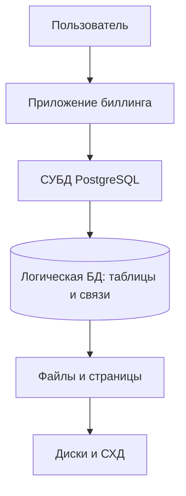
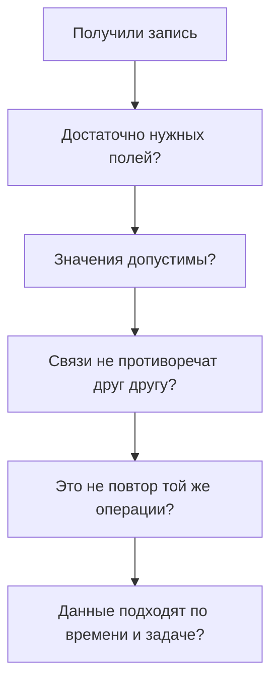

# 02. Базы данных и информационные системы

[[Лекции/01. Основы SQL|← Предыдущая]] · [[index|Обложка]] · [[01. Карта курса|Карта]] · [[Лекции/03. DDL, типы данных и ограничения|Следующая →]]

> [!abstract] Зачем читать
> База данных — организованные взаимосвязанные данные, СУБД — программа управления ими, информационная система — более широкое решение задачи, СХД — физическая инфраструктура. Три уровня описания данных помогают отделить пользовательский вид от общей схемы и физического хранения.

> [!info] Основа конспекта
> [[lecture/BDC_02.pdf#page=1|Исходная лекция: BDC_02.pdf]], 18 страниц PDF. Пояснения, разборы и упражнения добавлены к материалу курса. Номера страниц ниже — страницы PDF, а не цифры внизу слайдов.

## 1. Зачем вообще понадобились базы данных

Представь оператора связи, у которого три файла: `абоненты.csv`, `платежи.xlsx` и `тарифы_финальный_2.xlsx`. Абонент сменил тариф. Один сотрудник обновил таблицу, другой работает со старой копией, третий случайно записал одинаковый платёж дважды. Проблема уже не в том, хватает ли места на диске. Нужны общие правила работы с данными.

База данных — организованная совокупность взаимосвязанных данных о предметной области. Для учебного биллинга область — обслуживание абонентов: тарифы, использование услуг, начисления и платежи. Структура связывает эти факты и позволяет отвечать на вопросы: «Кто должен деньги?», «Какой тариф действует?», «За что начислена сумма?».

Важны четыре свойства подхода: общая структура, связи между фактами, совместное использование и управляемое изменение. Просто собрать файлы в одном каталоге недостаточно, чтобы получить полноценное управление транзакциями и ссылочной целостностью.

## 2. Разложим термины по уровням

| Термин | Простыми словами | Пример в курсе |
|---|---|---|
| Данные | Записанные факты | ID 1, тариф Basic, сумма 200 |
| Информация | Факты с понятным смыслом | Абонент 1 оплатил 200 рублей |
| Информационная база | Организованный информационный ресурс | Файлы или наборы записей организации |
| База данных | Структурированная связанная совокупность данных | `billing_database` |
| СУБД | Программа, которая управляет БД | PostgreSQL |
| Информационная система | Данные, программы и процессы решения задач | Биллинг оператора |
| СХД | Средства физического хранения | Диски, контроллеры, хранилища |
| Банк данных | БД, СУБД и обслуживающая среда | Учебный сервер с приложением и администрированием |

Термин «информационная база» в учебной литературе может применяться широко. Смысл различия здесь: **содержимое**, **управляющая программа** и **физическая инфраструктура** — разные вещи. PostgreSQL может использовать файловую систему, а файловая система — блочное устройство. Это последовательные слои, а не взаимоисключающие технологии.



## 3. Что неудобно в разрозненных файлах

| Проблема | Как проявится | Что даёт СУБД |
|---|---|---|
| Дублирование | Фамилия хранится в десятках отчётов | Общие таблицы и ссылки |
| Противоречия | Один абонент имеет разные статусы | Ограничения и транзакции |
| Зависимость программы от формата | Добавили столбец — сломали парсер | Каталог схемы, стабильные запросы |
| Сложные запросы | Для отчёта нужен новый скрипт | Декларативный SQL |
| Параллельная запись | Два сотрудника затирают изменения | Управление конкуренцией |
| Контроль доступа | Доступен целый файл вместо части данных | Права на объекты и представления |
| Восстановление | После сбоя неизвестно, что записалось | WAL и резервные копии |

> [!warning] Уточнение к страницам 6–10
> Обычные файловые системы могут поддерживать многопользовательский доступ, права и блокировки; файлы не обязательно зашифрованы. Проблема файлового подхода к учёту — в необходимости самостоятельно реализовать правила целостности, запросы и согласование изменений. Объектное хранилище само по себе эти задачи не решает.

Файлы при этом полезны: изображения, PDF и архивы хорошо живут вне реляционных таблиц. В БД можно хранить метаданные и идентификатор объекта, а сам большой файл — в подходящем хранилище.

## 4. Блочное, файловое и объектное хранение

**Блочное** предоставляет адресуемые блоки. Сервер может построить поверх них файловую систему. **Файловое** предоставляет файлы и каталоги с путями. **Объектное** адресует объекты по ключам и обычно добавляет метаданные и API.

Для аналогии: блоки — строительные секции; файлы — документы в папках; объекты — посылки с номерами в камере хранения. Аналогия помогает различить интерфейсы, но не описывает все технические свойства.

СУБД может работать поверх разных способов хранения. Нельзя сделать вывод «объектное хранение быстрее SQL» без задачи и измерений: сравниваются разные уровни системы.

## 5. Как развивалась идея

На слайдах путь начинается с картотек и перфокарт. Механизация переписей показала ценность структурированных записей. Появление накопителей с произвольным доступом позволило искать и менять отдельные части данных без сплошного последовательного прохода носителя.

Ранние СУБД использовали иерархическую и сетевую организацию. Реляционный подход предложил описывать данные отношениями и связывать их по значениям. SQL стал практическим языком работы с такими системами.


Современные системы могут сочетать реляционные таблицы, JSON, поиск по векторам и распределённое выполнение. Новые подходы не отменяют необходимости поддерживать корректность платежа. Биллинг и поиск похожих текстов предъявляют разные требования; выбор модели следует из задачи.

## 6. Три уровня ANSI/SPARC

Эта архитектура объясняет независимость представления данных от реализации.

| Уровень | Кто его видит | Пример |
|---|---|---|
| Внешний | Конкретный пользователь или приложение | Отчёт по платежам без персональных полей |
| Концептуальный | Общая логическая схема организации | Абоненты связаны с тарифами и счетами |
| Внутренний | Механизмы хранения | Страницы, файлы, индексы |

**Физическая независимость**: добавили индекс или перенесли файлы, а смысл запросов сохранился. **Логическая независимость**: изменили общую схему и постарались сохранить внешний интерфейс, например через представление. Второе обычно сложнее: удаление нужного столбца не исправляется само.

Не путай эту тройку с трёхзвенной архитектурой «браузер — сервер приложения — СУБД». Здесь уровни **описания данных**, там — разделение **компонентов приложения**.

## 7. Что СУБД знает о собственной базе

Структура тоже хранится как данные: имена таблиц, типы столбцов, ограничения и права. Это **метаданные**. PostgreSQL предоставляет системные каталоги и стандартные представления `information_schema`.

```sql
-- PostgreSQL: показать описание столбцов учебной таблицы.
SELECT column_name, data_type, is_nullable, column_default
FROM information_schema.columns
WHERE table_schema = 'public' AND table_name = 'subscribers'
ORDER BY ordinal_position;
```

Каталог позволяет клиенту нарисовать дерево объектов, а разработчику — проверить предположения о схеме. Поэтому перед запросом к незнакомой БД полезнее посмотреть реальную структуру, чем угадывать имена из примеров.

## 8. Пример решения на уровне системы

Задача: платёж должен увеличить баланс и попасть в историю. Если приложение выполнит два независимых сохранения, возможен сбой между ними. СУБД позволяет объединить действия в транзакцию. Но сама СУБД не угадает, что эти операции связаны: разработчик должен правильно поставить границы транзакции и ограничения.

> [!tip] Вопрос для любой новой технологии
> Спроси: где лежат данные, кто проверяет правила, что происходит при одновременной записи и как восстановиться после ошибки? Эти четыре вопроса полезнее списка названий продуктов.

## Данные становятся информацией благодаря контексту

Число `300` само по себе почти ничего не объясняет. Это сумма платежа, продолжительность звонка или абонентская плата? Значение приобретает смысл, когда мы знаем атрибут, единицу, владельца, время и правила получения. Поэтому хорошая БД хранит не только набор чисел, но и связи, которые позволяют правильно их интерпретировать.

| Запись без контекста | Контекст, который нужен | Осмысленный факт |
|---|---|---|
| 300 | Поле amount, рубли, ID платежа | Платёж на 300 рублей |
| 300 | duration\_seconds, ID события | Событие длительностью пять минут |
| 300 | monthly\_fee, версия тарифа | Месячная плата по тарифу |

Ошибки единиц иногда опаснее синтаксических ошибок: запрос выполнится, но гигабайты будут посчитаны как мегабайты, а секунды — как минуты. Каталог типов знает, что значение числовое, однако сам по себе не знает, какое преобразование нужно бизнесу. Единицы и смысл должны быть частью модели и документации.

## Жизненный цикл одного платежа

Рассмотрим действие целиком. Пользователь вводит сумму в приложении. Приложение проверяет формат и полномочия. Сервер БД проверяет ограничения, обновляет связанные записи и фиксирует результат. Затем сумма попадает в отчёты и резервные копии. На каждом этапе есть собственный вопрос о корректности.


Проверка интерфейса помогает человеку исправить опечатку, но не заменяет правило БД: другой клиент может отправить запрос напрямую. И наоборот, ограничение БД не заменяет понятное сообщение в приложении. У каждого слоя своя ответственность.

Если клиент не получил ответ из-за обрыва связи, это ещё не означает, что платёж не записан. Операция могла зафиксироваться, а ответ потеряться. Отсюда появляется задача повторного запроса с тем же внешним идентификатором — идемпотентности. Этот пример связывает вводную лекцию с транзакциями и серверным программированием.

## Операционный учёт и аналитика задают разные вопросы

**Операционный сценарий**: провести один платёж, быстро узнать текущий баланс, изменить тариф конкретного абонента. Обычно важны короткий отклик, целостность и параллельная работа множества клиентов. Часто используют термин OLTP.

**Аналитический сценарий**: сравнить выручку по месяцам, найти тенденцию использования услуг, оценить нагрузку на тарифы. Обычно приходится обрабатывать много строк и агрегировать историю. Часто используют термин OLAP.

| Признак | Операционное действие | Аналитический запрос |
|---|---|---|
| Типичный объём результата | Одна или несколько записей | Сводные показатели |
| Объём просмотренных данных | Часто небольшой | Может быть очень большим |
| Основной риск | Некорректное изменение состояния | Неверная интерпретация и тяжёлый запрос |
| Пример | Зачислить 100 рублей | Выручка всех тарифов за год |

Это не запрет анализировать данные в PostgreSQL. Различие помогает понять, почему одна схема, один индекс и один режим нагрузки не обязаны быть лучшими для всех задач. В крупных системах аналитическую копию или витрину отделяют, чтобы отчёт за несколько лет не мешал проведению платежей.

## Качество данных: пять самостоятельных проверок

**Полнота**: достаточно ли сведений для задачи? Неизвестный email допустим для звонка, но может мешать отправке электронного чека. **Корректность**: неотрицательна ли длительность? **Согласованность**: совпадает ли абонент платежа с владельцем указанного счёта? **Уникальность**: не проведена ли одна внешняя операция дважды? **Актуальность**: не строим ли текущий отчёт по вчерашней реплике?

Одно ограничение UNIQUE не делает все данные хорошими. Оно защищает одну конкретную комбинацию полей. Например, уникальный `payment_id` допускает две строки с разными ID, которые отражают один и тот же банковский перевод.



## Независимость данных не равна отсутствию договорённостей

Физическая независимость позволяет поменять способ хранения без переписывания бизнес-смысла запросов. Но изменение имени столбца, единицы или значения статуса — уже изменение контракта. Его нужно согласовать с приложениями и отчётами.

Представление может сохранить старое имя поля после переработки внутренних таблиц. Это помогает миграции, но не делает любое изменение бесплатным. Если старое поле «сумма» означало рубли, а теперь означает копейки, совпавшее имя не спасёт потребителя от ошибки.

> [!example] Как объяснить отличие БД от папки файлов
> Не утверждай, что файлы «совсем не умеют права или совместный доступ». Скажи, какие общие правила придётся реализовывать самостоятельно: атомарный платёж, согласованные ссылки, поиск по нескольким источникам и восстановление после незавершённой записи. Тогда сравнение становится предметным.

## Где это в PDF

[[lecture/BDC_02.pdf#page=3|История и файловый подход: 3–11]] · [[lecture/BDC_02.pdf#page=12|БД, СУБД, банк данных: 12]] · [[lecture/BDC_02.pdf#page=14|Три уровня: 14]] · [[lecture/BDC_02.pdf#page=15|Эволюция систем: 15–18]].

## Проверь себя без подсказки

Сначала закрой пояснения и ответь вслух. Для сложного ответа приведи свой пример или контрпример.

1. Почему единая папка Excel-файлов ещё не обеспечивает согласованность?
2. Чем СУБД отличается от СХД?
3. Как пример с платежом показывает необходимость транзакций?
4. Чем физическая независимость данных отличается от логической?
5. Почему файловое и реляционное хранение нельзя считать прямыми альтернативами?
6. Сравни смысл числа 300 в трёх разных атрибутах биллинга.
7. Что может произойти, если ответ на уже проведённый платёж потерялся?
8. Раздели операционный и аналитический сценарии из практики оператора.
9. Приведи пять независимых критериев качества данных.
10. Почему тип INTEGER не гарантирует правильную единицу величины?
11. Как меняется контракт при переходе от рублей к копейкам?
12. В чём границы сравнения реляционной БД и обычной папки файлов?

## Вопросы с выбором ответа

Выбери ответ: результат появится сразу. Затем раскрой пояснение и разбери, почему остальные варианты не подходят.

```text
#quiz
? Что является СУБД в учебном практикуме?
- billing_database
+ PostgreSQL
- Таблица subscribers
```

```text
#quiz
? К какому уровню ANSI/SPARC относится индекс на диске?
- Внешний
- Концептуальный
+ Внутренний
```

```text
#quiz
? Что отличает данные от информации в примере числа 300?
- Только наличие десятичной точки
- Только размер файла
+ Контекст и смысл значения
```

> [!explain]- Почему так
> Единица, атрибут, владелец и момент определяют интерпретацию значения.

```text
#quiz
? Что характернее для OLTP-сценария?
+ Провести отдельный платёж
- Пересчитать историю всех лет для анализа
- Нарисовать схему без данных
```

> [!explain]- Почему так
> Операционный сценарий меняет конкретное текущее состояние и требует согласованного завершения.

```text
#quiz
? Что характернее для OLAP-сценария?
- Сохранить один новый телефон
+ Сравнить выручку по тарифам за год
- Проверить формат поля формы
```

> [!explain]- Почему так
> Аналитика агрегирует значительные наборы истории для выводов и сравнения.

```text
#quiz
? Уникальный payment_id гарантирует отсутствие повторного банковского перевода?
- Да, любые разные ID означают разные реальные платежи
- Да, если таблица хранится на SSD
+ Нет, нужны правила идентификации внешней операции
```

> [!explain]- Почему так
> Два внутренних ID могут относиться к одной повторно доставленной внешней операции.

```text
#quiz
? Клиент не получил ответ о платеже. Что можно заключить?
+ Нужно выяснить результат операции: она могла зафиксироваться
- Платёж точно не записан
- COMMIT обязательно был отменён
```

> [!explain]- Почему так
> Ответ мог потеряться после фиксации. Идентификатор операции помогает различить повтор доставки.

```text
#quiz
? Что является метаданными?
- Только конкретное значение 100 в balance
+ Тип и обязательность столбца balance
- Только фотография пользователя
```

> [!explain]- Почему так
> Метаданные описывают структуру, ограничения и другие свойства хранимых объектов.

```text
#quiz
? Почему проверка формы не заменяет CHECK в БД?
- CHECK нужен только для цвета поля
- Любая форма автоматически блокирует все другие подключения
+ Другой клиент может обойти эту форму
```

> [!explain]- Почему так
> Ограничение действует на допустимые изменения через разные пути доступа.

```text
#quiz
? Храним мегабайты, но отчёт считает их гигабайтами. Это ошибка чего?
+ Интерпретации и единиц данных
- Только шрифта интерфейса
- Обязательное нарушение PRIMARY KEY
```

> [!explain]- Почему так
> Синтаксически допустимое числовое вычисление может иметь неверный предметный смысл.

## Закрепить тему на практике

- [[Практика/08. DDL и нормализация]]

Здесь остаются вопросы на понимание. В тренировках — ввод запросов, проверка результатов и серверные задачи с разбором.

## Чек-лист понимания

- [ ] Прочитал лекцию и разобрал схему.
- [ ] Ответил на вопросы вслух без конспекта.
- [ ] Ответил на десять тестовых вопросов и объяснил неверные варианты.

## Суть за минуту

База данных — организованные взаимосвязанные данные, СУБД — программа управления ими, информационная система — более широкое решение задачи, СХД — физическая инфраструктура. Три уровня описания данных помогают отделить пользовательский вид от общей схемы и физического хранения.

^summary-l02

## Куда дальше

Далее: [[Лекции/04. Архитектуры СУБД и модели данных]]. Реальная схема: [[Практика/База billing — устройство и запуск]].

[[Лекции/01. Основы SQL|← Предыдущая]] · [[index|Обложка]] · [[01. Карта курса|Карта]] · [[Лекции/03. DDL, типы данных и ограничения|Следующая →]]
