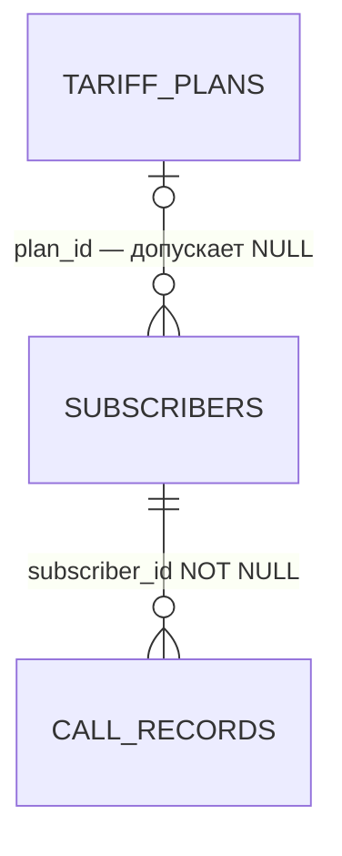

# 03. DDL, типы данных и ограничения

[[Лекции/02. Базы данных и информационные системы|← Предыдущая]] · [[index|🏠 Старт]] · [[01. Карта курса|🧭 Карта]] · [[Лекции/04. Архитектуры СУБД и модели данных|Следующая →]]

> [!abstract] Зачем читать
> Схема задаёт допустимые состояния данных. Тип, DEFAULT, NOT NULL, CHECK, UNIQUE, PK и FK решают разные задачи. В billing внешний ключ идёт от subscribers к tariff\_plans. VIEW хранит запрос, а ALTER TABLE развивает схему с учётом уже накопленных данных.

> [!info] Основа конспекта
> [[lecture/BDC_3.pdf#page=1|Исходная лекция: BDC_3.pdf]], 19 страниц PDF. Пояснения, разборы и упражнения добавлены к материалу курса. Номера страниц ниже — страницы PDF, а не цифры внизу слайдов.

## 1. DDL задаёт правила мира

DDL описывает объекты БД: таблицы, представления, индексы и ограничения. Хорошая схема не просто перечисляет столбцы. Она отделяет допустимые состояния от недопустимых. Например, телефон абонента обязателен и уникален, а `plan_id` должен указывать на существующий тариф.

В исходном `create_billing.sql` сначала создаются справочники, затем абоненты, затем события и платежи. Причина — зависимости внешних ключей: нельзя сослаться на ещё не созданную таблицу. При циклических зависимостях сначала создают таблицы, а затем добавляют связи через `ALTER TABLE`.

## 2. Как выбирать тип столбца

| Тип PostgreSQL | Для чего | Пример в billing |
|---|---|---|
| `integer`, `bigint` | Целые числа | ID, секунды, мегабайты |
| `numeric(p,s)` / `decimal` | Точные десятичные значения | Стоимость и баланс |
| `real`, `double precision` | Приближённые вычисления | Измерения с погрешностью |
| `varchar(n)`, `text` | Текст | Телефон, фамилия, описание |
| `boolean` | Логическое значение | Активен ли тариф |
| `date` | Календарная дата | Регистрация |
| `timestamp` | Дата и время без часового пояса | В исходной схеме — время звонка |
| `timestamptz` | Момент времени с преобразованием часового пояса | Возможное улучшение для распределённой системы |
| Массивы, `jsonb` | Составные значения | Дополнительные возможности PostgreSQL |

Телефон хранят строкой: знак `+`, ведущие нули и формат — часть идентификатора; арифметика над ним не нужна. Деньги в исходной схеме используют `DECIMAL`, чтобы избежать двоичной погрешности дробей. В AlaSQL тренажёра `NUMBER` имеет другие свойства — точный финансовый расчёт там не моделируется.

Тип не заменяет бизнес-правила. `INT` допускает отрицательную длительность, пока не задан `CHECK`. А тип `DATE` не знает, допустима ли будущая дата регистрации.

## 3. CREATE TABLE на понятном примере

```sql
-- PostgreSQL: дополнительная учебная таблица, её нет в исходном дампе.
CREATE TABLE training_adjustments (
    adjustment_id integer GENERATED BY DEFAULT AS IDENTITY PRIMARY KEY,
    subscriber_id integer NOT NULL REFERENCES subscribers(subscriber_id),
    amount numeric(10,2) NOT NULL CHECK (amount <> 0),
    reason text NOT NULL,
    created_at timestamptz NOT NULL DEFAULT CURRENT_TIMESTAMP
);
```

Каждая строка — отдельная корректировка. `IDENTITY` генерирует ID; `PRIMARY KEY` проверяет уникальность и отсутствие `NULL`; внешний ключ проверяет существование абонента; `CHECK` исключает бессмысленную нулевую корректировку. Обязательность причины не гарантирует содержательный текст: пустую строку можно запретить дополнительным правилом.

В исходной БД используется `SERIAL`/`BIGSERIAL`. Это удобная запись создания целочисленного столбца с последовательностью, а не самостоятельный механизм уникальности. Уникальность обеспечивает PK. Пропуски ID после откатов допустимы: последовательность не обещает сплошную нумерацию.

## 4. Ограничения: что именно они проверяют

| Ограничение | Обещание | Частая ловушка |
|---|---|---|
| `NOT NULL` | Значение обязательно | Не запрещает пустую строку |
| `UNIQUE` | Комбинация значений не повторяется | По умолчанию PostgreSQL допускает несколько `NULL` |
| `PRIMARY KEY` | Выбранный идентификатор уникален и определён | Не делает остальные поля уникальными |
| `FOREIGN KEY` | Ссылка ведёт на допустимую строку | Сам по себе не запрещает `NULL` в ссылке |
| `CHECK` | Условие не должно быть ложным | Неизвестный результат из-за `NULL` проходит |
| `DEFAULT` | Значение подставляется при пропуске | Явный `NULL` не заменяется автоматически |

```sql
CREATE TABLE training_prices (
    code text PRIMARY KEY,
    price numeric(10,2) NOT NULL CHECK (price >= 0),
    is_active boolean NOT NULL DEFAULT TRUE
);
```

Здесь `NOT NULL` и `CHECK` дополняют друг друга. Если оставить только `CHECK(price >= 0)`, неизвестная цена пройдёт проверку: условие не ложно. А `DEFAULT TRUE` применяется, когда значение столбца не передано или явно написано `DEFAULT`.

## 5. Направление внешнего ключа



В реальном дампе **`subscribers.plan_id` ссылается на `tariff_plans.plan_id`**. Абонент — ссылающаяся строка, тариф — строка, на которую ссылаются. Один тариф обслуживает многих абонентов, у одного абонента в текущей строке максимум один тариф. История смен хранится отдельно.

> [!warning] Уточнение к страницам 13–14
> В тексте слайдов направление ссылки между абонентами и тарифами перепутано. Проверять нужно DDL базы. Также SQL допускает таблицы без PK и ссылки на подходящие уникальные ключи; наличие PK — хорошее решение схемы, а не обязательное синтаксическое условие создания любой таблицы.

Удаление тарифа, на который ссылаются абоненты, обычно запрещается. `ON DELETE CASCADE` у внешнего ключа может удалять дочерние строки, а `ON DELETE SET NULL` — обнулять ссылку. Выбор зависит от предметной области: история финансовых событий обычно не должна исчезать вслед за удалением абонента.

## 6. Естественный, суррогатный и составной ключи

**Естественный** ключ имеет смысл в предметной области, например телефон. **Суррогатный** создаётся для идентификации, например `subscriber_id`. **Составной** включает несколько атрибутов, например пару «абонент — период» при правиле «один счёт за месяц».

Суррогатный PK не заменяет ограничения на естественные комбинации. В исходном дампе телефон уникален, а `invoices(subscriber_id, billing_period)` уникальностью не защищён. Если бизнес требует один счёт за период, это отдельное правило, которое сначала нужно проверить на существующих данных.

```sql
SELECT subscriber_id, billing_period, COUNT(*) AS copies
FROM invoices
GROUP BY subscriber_id, billing_period
HAVING COUNT(*) > 1;
```

## 7. ALTER TABLE: схема тоже развивается

```sql
-- PostgreSQL: примеры изменений учебной копии.
ALTER TABLE plan_changes ADD COLUMN initiated_by varchar(20);
ALTER TABLE plan_changes
    ALTER COLUMN initiated_by SET DEFAULT 'customer';
ALTER TABLE plan_changes
    ADD CONSTRAINT chk_initiated_by
    CHECK (initiated_by IN ('customer', 'operator'));
```

Установка нового `DEFAULT` сама по себе не заполняет старые `NULL` в уже существующем столбце. Для обязательного поля обычно последовательно добавляют столбец, заполняют старые строки, проверяют данные и устанавливают `NOT NULL`. Новое ограничение может не установиться, если уже есть нарушающие его строки.

> [!tip] Читай ошибку как сообщение о правиле
> `duplicate key` — конфликт уникальности; `foreign key violation` — нарушена ссылка; `not-null violation` — не заполнено обязательное поле. Исправляй причину в данных или модели, а не удаляй ограничение ради одного INSERT.

## 8. DROP и CASCADE

`DROP TABLE` удаляет таблицу. По умолчанию зависимости мешают удалению. `DROP TABLE ... CASCADE` удаляет также зависимые объекты, например представления и внешние ключи других таблиц. Это **не то же самое**, что `ON DELETE CASCADE`, который относится к удалению строк. Автоматического удаления всех зависимых таблиц здесь обещать нельзя.

## 9. Представление — сохранённый запрос

```sql
CREATE VIEW v_subscriber_tariffs AS
SELECT s.subscriber_id, s.phone_number, t.plan_name
FROM subscribers AS s
LEFT JOIN tariff_plans AS t ON t.plan_id = s.plan_id;

SELECT * FROM v_subscriber_tariffs ORDER BY subscriber_id;
```

Обычное `VIEW` хранит определение запроса, а не отдельную копию результата. Оно упрощает интерфейс и может участвовать в разграничении доступа при правильных правах. Само наличие VIEW не гарантирует ускорения. **Материализованное представление** сохраняет результат физически и требует обновления; это другой объект.

## Где это в PDF

[[lecture/BDC_3.pdf#page=3|Типы и литералы: 3–6]] · [[lecture/BDC_3.pdf#page=7|Ограничения: 7–14]] · [[lecture/BDC_3.pdf#page=15|CREATE, DROP, ALTER: 15–17]] · [[lecture/BDC_3.pdf#page=18|VIEW: 18–19]].

## Проверь себя без подсказки

1. Почему CHECK(price >= 0) не заменяет NOT NULL?
2. Чем DEFAULT отличается от автоматической замены NULL?
3. В какую сторону направлен FK между subscribers и tariff\_plans?
4. Почему IDENTITY не заменяет PRIMARY KEY?
5. Чем DROP ... CASCADE отличается от ON DELETE CASCADE?

## Мини-тренажёр

> [!tip] Два режима
> В Obsidian это редактируемые блоки с условиями и эталонами. На Quartz блоки превращаются в интерактивные задания после подключения [[Справочники/Интерактив и Quartz|обработчика]]. SQL-песочница использует маленький учебный набор, описанный в [[Практика/Учебный набор|паспорте данных]]. Он отличается от полного дампа.

```sql
-- setup
CREATE TABLE tariff_plans (plan_id INT, plan_name STRING, monthly_fee NUMBER, minutes_included INT, sms_included INT, data_gb_included INT, price_per_minute NUMBER, price_per_sms NUMBER, price_per_gb NUMBER, is_active BOOLEAN);
INSERT INTO tariff_plans VALUES (1,'Basic',300,100,50,5,2,2.5,200,true),(2,'Standard',500,300,100,15,1.5,2,150,true),(3,'Premium',800,1000,500,50,1,1.5,100,true),(4,'Unlimited',1200,999999,999999,100,0,0,50,true),(5,'Student',350,200,100,10,1.8,2,180,true),(6,'Senior',250,150,100,3,2,2,250,false);
CREATE TABLE service_types (service_type_id INT, service_name STRING, description STRING);
INSERT INTO service_types VALUES (1,'Outgoing Call','Исходящий звонок'),(2,'Incoming Call','Входящий звонок'),(3,'SMS','Сообщение'),(4,'MMS','Мультимедийное сообщение'),(5,'Data','Интернет');
CREATE TABLE subscribers (subscriber_id INT, phone_number STRING, first_name STRING, last_name STRING, email STRING, plan_id, registration_date STRING, status STRING, balance NUMBER);
INSERT INTO subscribers VALUES (1,'+79100000001','Анна','Волкова','anna@example.test',1,'2025-09-01','ACTIVE',250),(2,'+79100000002','Борис','Орлов',NULL,2,'2025-09-03','ACTIVE',-20),(3,'+79100000003','Вера','Иванова','vera@example.test',3,'2025-10-01','SUSPENDED',0),(4,'+79100000004','Глеб','Соколов','gleb@example.test',1,'2025-10-10','ACTIVE',500),(5,'+79100000005','Дина','Белова',NULL,5,'2025-11-01','ACTIVE',100),(6,'+79100000006','Егор','Петров','egor@example.test',NULL,'2025-11-02','TERMINATED',-50),(7,'+79100000007','Жанна','Миронова','zhanna@example.test',4,'2025-11-03','ACTIVE',1000),(8,'+79100000008','Зоя','Зайцева',NULL,2,'2025-11-04','SUSPENDED',100);
CREATE TABLE call_records (record_id INT, subscriber_id INT, service_type_id INT, call_date STRING, destination_number STRING, duration_seconds INT, quantity INT, cost NUMBER);
INSERT INTO call_records VALUES (1,1,1,'2025-11-01 10:00:00','+79000000001',60,1,2),(2,1,1,'2025-11-02 10:00:00','+79000000002',120,1,4),(3,2,1,'2025-11-01 11:00:00','+79000000003',30,1,1.5),(4,2,3,'2025-11-03 11:00:00','900',0,1,2),(5,3,1,'2025-11-02 12:00:00','+79000000004',300,1,5),(6,4,1,'2025-11-03 13:00:00','+79000000005',180,1,6),(7,4,1,'2025-11-04 13:00:00','+79000000006',60,1,2),(8,7,1,'2025-11-05 14:00:00','+79000000007',600,1,0);
CREATE TABLE data_usage (usage_id INT, subscriber_id INT, usage_date STRING, data_mb INT, cost NUMBER);
INSERT INTO data_usage VALUES (1,1,'2025-11-01',1024,150),(2,1,'2025-11-02',512,75),(3,2,'2025-11-01',2048,300),(4,4,'2025-11-02',0,0),(5,7,'2025-11-03',4096,200);
CREATE TABLE invoices (invoice_id INT, subscriber_id INT, billing_period STRING, issue_date STRING, due_date STRING, monthly_fee NUMBER, usage_charges NUMBER, total_amount NUMBER, status STRING);
INSERT INTO invoices VALUES (1,1,'2025-11','2025-11-01','2025-11-10',300,6,306,'PAID'),(2,2,'2025-11','2025-11-01','2025-11-10',500,3.5,503.5,'OVERDUE'),(3,3,'2025-11','2025-11-01','2025-11-10',800,5,805,'PENDING'),(4,4,'2025-11','2025-11-01','2025-11-10',300,8,308,'PAID'),(5,7,'2025-11','2025-11-01','2025-11-10',1200,0,1200,'PENDING');
CREATE TABLE payments (payment_id INT, subscriber_id INT, invoice_id, payment_date STRING, amount NUMBER, payment_method STRING, transaction_id STRING);
INSERT INTO payments VALUES (1,1,1,'2025-11-02 09:00:00',200,'CARD','tx-1'),(2,1,1,'2025-11-03 09:00:00',106,'CARD','tx-2'),(3,4,4,'2025-11-04 09:00:00',308,'CARD','tx-3'),(4,5,NULL,'2025-11-05 09:00:00',100,'CASH','tx-4');
CREATE TABLE plan_changes (change_id INT, subscriber_id INT, old_plan_id INT, new_plan_id INT, change_date STRING, reason STRING);
INSERT INTO plan_changes VALUES (1,1,2,1,'2025-10-01','Экономия'),(2,2,1,2,'2025-10-10','Больше минут'),(3,7,3,4,'2025-11-01','Безлимит');
```

```text
#quiz
? Что произойдёт с явным NULL в столбце с DEFAULT 0, если NOT NULL отсутствует?
- NULL автоматически заменится нулём
+ Будет сохранён NULL
- Всегда возникнет ошибка
```

```text
#quiz
? Какое ограничение проверяет существование тарифа у переданного plan_id?
- CHECK
+ FOREIGN KEY
- DEFAULT
```

```text
#order
Сформулировать новое правило данных
Найти существующие строки, нарушающие правило
Исправить данные в учебной копии
Добавить ограничение
Проверить допустимую и ошибочную вставку
```

```text
#task
Выведи subscriber_id абонентов без указанного текущего тарифа.
Сортировка по subscriber_id.
= SELECT subscriber_id FROM subscribers WHERE plan_id IS NULL ORDER BY subscriber_id;
```

## Чек-лист понимания

- [ ] Прочитал лекцию и разобрал схему.
- [ ] Ответил на вопросы вслух без конспекта.
- [ ] Решил задания и разобрал ошибки.
- [ ] В свойстве `confidence` поставил число от 0 до 5.
- [ ] Поставил дату следующего повторения в `review_next`.

## Суть за минуту

Схема задаёт допустимые состояния данных. Тип, DEFAULT, NOT NULL, CHECK, UNIQUE, PK и FK решают разные задачи. В billing внешний ключ идёт от subscribers к tariff\_plans. VIEW хранит запрос, а ALTER TABLE развивает схему с учётом уже накопленных данных.

^summary-l03

## Куда дальше

Связи и ключи: [[Лекции/05. ER-модель — сущности и связи]] и [[Лекции/06. Реляционная модель и реляционная алгебра]]. Источник схемы: [[Практика/База billing — устройство и запуск]].

[[Лекции/02. Базы данных и информационные системы|← Предыдущая]] · [[index|🏠 Старт]] · [[01. Карта курса|🧭 Карта]] · [[Лекции/04. Архитектуры СУБД и модели данных|Следующая →]]
