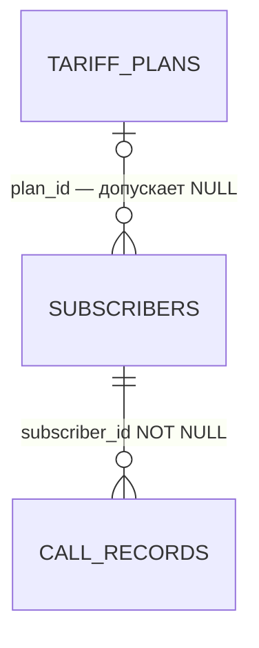
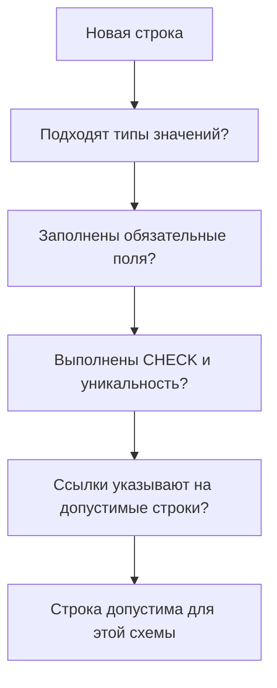
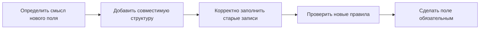

# 03. DDL, типы данных и ограничения

[[Лекции/02. Базы данных и информационные системы|← Предыдущая]] · [[index|Обложка]] · [[01. Карта курса|Карта]] · [[Лекции/04. Архитектуры СУБД и модели данных|Следующая →]]

> [!abstract] Зачем читать
> Схема задаёт допустимые состояния данных. Тип, DEFAULT, NOT NULL, CHECK, UNIQUE, PK и FK решают разные задачи. В billing внешний ключ идёт от subscribers к tariff\_plans. VIEW хранит запрос, а ALTER TABLE развивает схему с учётом уже накопленных данных.

> [!info] Основа конспекта
> [[lecture/BDC_3.pdf#page=1|Исходная лекция: BDC_3.pdf]], 19 страниц PDF. Пояснения, разборы и упражнения добавлены к материалу курса. Номера страниц ниже — страницы PDF, а не цифры внизу слайдов.

## 1. DDL задаёт правила мира

DDL описывает объекты БД: таблицы, представления, индексы и ограничения. Хорошая схема не просто перечисляет столбцы. Она отделяет допустимые состояния от недопустимых. Например, телефон абонента обязателен и уникален, а `plan_id` должен указывать на существующий тариф.

В исходном `create_billing.sql` сначала создаются справочники, затем абоненты, затем события и платежи. Причина — зависимости внешних ключей: нельзя сослаться на ещё не созданную таблицу. При циклических зависимостях сначала создают таблицы, а затем добавляют связи через `ALTER TABLE`.

## 2. Как выбирать тип столбца

| Тип PostgreSQL | Для чего | Пример в billing |
|---|---|---|
| `integer`, `bigint` | Целые числа | ID, секунды, мегабайты |
| `numeric(p,s)` / `decimal` | Точные десятичные значения | Стоимость и баланс |
| `real`, `double precision` | Приближённые вычисления | Измерения с погрешностью |
| `varchar(n)`, `text` | Текст | Телефон, фамилия, описание |
| `boolean` | Логическое значение | Активен ли тариф |
| `date` | Календарная дата | Регистрация |
| `timestamp` | Дата и время без часового пояса | В исходной схеме — время звонка |
| `timestamptz` | Момент времени с преобразованием часового пояса | Возможное улучшение для распределённой системы |
| Массивы, `jsonb` | Составные значения | Дополнительные возможности PostgreSQL |

Телефон хранят строкой: знак `+`, ведущие нули и формат — часть идентификатора; арифметика над ним не нужна. Деньги в исходной схеме используют `DECIMAL`, чтобы избежать двоичной погрешности дробей. В AlaSQL тренажёра `NUMBER` имеет другие свойства — точный финансовый расчёт там не моделируется.

Тип не заменяет бизнес-правила. `INT` допускает отрицательную длительность, пока не задан `CHECK`. А тип `DATE` не знает, допустима ли будущая дата регистрации.

## 3. CREATE TABLE на понятном примере

```sql
-- PostgreSQL: дополнительная учебная таблица, её нет в исходном дампе.
CREATE TABLE training_adjustments (
    adjustment_id integer GENERATED BY DEFAULT AS IDENTITY PRIMARY KEY,
    subscriber_id integer NOT NULL REFERENCES subscribers(subscriber_id),
    amount numeric(10,2) NOT NULL CHECK (amount <> 0),
    reason text NOT NULL,
    created_at timestamptz NOT NULL DEFAULT CURRENT_TIMESTAMP
);
```

Каждая строка — отдельная корректировка. `IDENTITY` генерирует ID; `PRIMARY KEY` проверяет уникальность и отсутствие `NULL`; внешний ключ проверяет существование абонента; `CHECK` исключает бессмысленную нулевую корректировку. Обязательность причины не гарантирует содержательный текст: пустую строку можно запретить дополнительным правилом.

В исходной БД используется `SERIAL`/`BIGSERIAL`. Это удобная запись создания целочисленного столбца с последовательностью, а не самостоятельный механизм уникальности. Уникальность обеспечивает PK. Пропуски ID после откатов допустимы: последовательность не обещает сплошную нумерацию.

## 4. Ограничения: что именно они проверяют

| Ограничение | Обещание | Частая ловушка |
|---|---|---|
| `NOT NULL` | Значение обязательно | Не запрещает пустую строку |
| `UNIQUE` | Комбинация значений не повторяется | По умолчанию PostgreSQL допускает несколько `NULL` |
| `PRIMARY KEY` | Выбранный идентификатор уникален и определён | Не делает остальные поля уникальными |
| `FOREIGN KEY` | Ссылка ведёт на допустимую строку | Сам по себе не запрещает `NULL` в ссылке |
| `CHECK` | Условие не должно быть ложным | Неизвестный результат из-за `NULL` проходит |
| `DEFAULT` | Значение подставляется при пропуске | Явный `NULL` не заменяется автоматически |

```sql
CREATE TABLE training_prices (
    code text PRIMARY KEY,
    price numeric(10,2) NOT NULL CHECK (price >= 0),
    is_active boolean NOT NULL DEFAULT TRUE
);
```

Здесь `NOT NULL` и `CHECK` дополняют друг друга. Если оставить только `CHECK(price >= 0)`, неизвестная цена пройдёт проверку: условие не ложно. А `DEFAULT TRUE` применяется, когда значение столбца не передано или явно написано `DEFAULT`.

## 5. Направление внешнего ключа



В реальном дампе **`subscribers.plan_id` ссылается на `tariff_plans.plan_id`**. Абонент — ссылающаяся строка, тариф — строка, на которую ссылаются. Один тариф обслуживает многих абонентов, у одного абонента в текущей строке максимум один тариф. История смен хранится отдельно.

> [!warning] Уточнение к страницам 13–14
> В тексте слайдов направление ссылки между абонентами и тарифами перепутано. Проверять нужно DDL базы. Также SQL допускает таблицы без PK и ссылки на подходящие уникальные ключи; наличие PK — хорошее решение схемы, а не обязательное синтаксическое условие создания любой таблицы.

Удаление тарифа, на который ссылаются абоненты, обычно запрещается. `ON DELETE CASCADE` у внешнего ключа может удалять дочерние строки, а `ON DELETE SET NULL` — обнулять ссылку. Выбор зависит от предметной области: история финансовых событий обычно не должна исчезать вслед за удалением абонента.

## 6. Естественный, суррогатный и составной ключи

**Естественный** ключ имеет смысл в предметной области, например телефон. **Суррогатный** создаётся для идентификации, например `subscriber_id`. **Составной** включает несколько атрибутов, например пару «абонент — период» при правиле «один счёт за месяц».

Суррогатный PK не заменяет ограничения на естественные комбинации. В исходном дампе телефон уникален, а `invoices(subscriber_id, billing_period)` уникальностью не защищён. Если бизнес требует один счёт за период, это отдельное правило, которое сначала нужно проверить на существующих данных.

```sql
SELECT subscriber_id, billing_period, COUNT(*) AS copies
FROM invoices
GROUP BY subscriber_id, billing_period
HAVING COUNT(*) > 1;
```

## 7. ALTER TABLE: схема тоже развивается

```sql
-- PostgreSQL: примеры изменений учебной копии.
ALTER TABLE plan_changes ADD COLUMN initiated_by varchar(20);
ALTER TABLE plan_changes
    ALTER COLUMN initiated_by SET DEFAULT 'customer';
ALTER TABLE plan_changes
    ADD CONSTRAINT chk_initiated_by
    CHECK (initiated_by IN ('customer', 'operator'));
```

Установка нового `DEFAULT` сама по себе не заполняет старые `NULL` в уже существующем столбце. Для обязательного поля обычно последовательно добавляют столбец, заполняют старые строки, проверяют данные и устанавливают `NOT NULL`. Новое ограничение может не установиться, если уже есть нарушающие его строки.

> [!tip] Читай ошибку как сообщение о правиле
> `duplicate key` — конфликт уникальности; `foreign key violation` — нарушена ссылка; `not-null violation` — не заполнено обязательное поле. Исправляй причину в данных или модели, а не удаляй ограничение ради одного INSERT.

## 8. DROP и CASCADE

`DROP TABLE` удаляет таблицу. По умолчанию зависимости мешают удалению. `DROP TABLE ... CASCADE` удаляет также зависимые объекты, например представления и внешние ключи других таблиц. Это **не то же самое**, что `ON DELETE CASCADE`, который относится к удалению строк. Автоматического удаления всех зависимых таблиц здесь обещать нельзя.

## 9. Представление — сохранённый запрос

```sql
CREATE VIEW v_subscriber_tariffs AS
SELECT s.subscriber_id, s.phone_number, t.plan_name
FROM subscribers AS s
LEFT JOIN tariff_plans AS t ON t.plan_id = s.plan_id;

SELECT * FROM v_subscriber_tariffs ORDER BY subscriber_id;
```

Обычное `VIEW` хранит определение запроса, а не отдельную копию результата. Оно упрощает интерфейс и может участвовать в разграничении доступа при правильных правах. Само наличие VIEW не гарантирует ускорения. **Материализованное представление** сохраняет результат физически и требует обновления; это другой объект.

## Проверяем ограничения на одной строке

Пусть создаётся учебная запись корректировки с обязательным абонентом и положительной суммой. Удобно проверить не только успешный INSERT, но и каждый способ нарушить контракт.

| Попытка | Какое правило участвует | Что должна сделать схема |
|---|---|---|
| Пропущена сумма без DEFAULT | NOT NULL | Отказать |
| Сумма равна нулю | CHECK(amount > 0) | Отказать |
| Передан неизвестный subscriber\_id | FOREIGN KEY | Отказать |
| Повторён внешний ID операции | UNIQUE | Отказать, если такая уникальность задана |
| Передан корректный новый факт | Все правила | Разрешить |

Успех одного примера не доказывает качество схемы. Попробуй построить контрпример для каждого заявленного правила. Особенно полезны NULL, пустая строка, граничное число и повтор комбинации полей.



Схема показывает логические группы проверок, а не обещает точный внутренний порядок их выполнения. Проверка бизнес-смысла, не выраженного ограничениями, остаётся задачей проектирования.

## Составной внешний ключ проверяет сочетание фактов

В исходной БД платежи отдельно ссылаются на абонента и на счёт. Это проверяет существование обеих строк, но не равенство их владельца. Платёж абонента 1 технически может сослаться на существующий счёт абонента 2.

Один способ усилить модель — добавить уникальную комбинацию `(invoice_id, subscriber_id)` в invoices и составную ссылку из payments. Тогда пара проверяется как единое значение отношения.

```sql
-- PostgreSQL: проектный пример, сначала требуется аудит существующих данных.
ALTER TABLE invoices
ADD CONSTRAINT invoices_id_subscriber_uk
UNIQUE (invoice_id, subscriber_id);

ALTER TABLE payments
ADD CONSTRAINT payments_invoice_owner_fk
FOREIGN KEY (invoice_id, subscriber_id)
REFERENCES invoices (invoice_id, subscriber_id);
```

Необязательный invoice\_id при обычном режиме сопоставления FK оставляет возможность пополнения без счёта. Правило «платёж всегда погашает счёт» было бы другим бизнес-решением. Прежде чем менять DDL, нужно понять, какие сценарии система обязана поддерживать.

## Миграция схемы — несколько проверяемых этапов

Нужно добавить обязательное поле `initiated_by` к истории смен тарифа. Если просто добавить NOT NULL без значения для старых строк, миграция может остановиться. Если всем старым строкам бездумно поставить `'customer'`, данные станут формально допустимыми, но, возможно, ложными.



Иногда правильнее временно разрешить `'unknown'`, чем придумывать неизвестного инициатора. Это зависит от требований. После заполнения нужно проверить число NULL и недопустимых значений, затем устанавливать ограничения. Для больших таблиц важны блокировки и длительность проверки; даже транзакционное изменение схемы может задержать другие запросы.

## ON DELETE: три разных бизнес-смысла

`RESTRICT` или стандартное запрещающее поведение полезно, если удаление родителя не должно оставлять зависимые факты. `SET NULL` сохраняет дочернюю строку, но теряет прямую привязку. `CASCADE` удаляет зависимые строки вместе с родителем.

Выбор не определяется тем, какая команда короче. Удалить вместе с черновым заказом его временные позиции может быть правильно. Удалить вместе с абонентом всю финансовую историю часто неправильно. Для некоторых сущностей вместо физического удаления используют состояние «архивирован» или «прекращён».

| Что хотим сохранить | Подход, который стоит обсудить |
|---|---|
| Самостоятельный исторический факт | Ограничить удаление родителя или хранить устойчивый исторический ключ |
| Временные детали, бессмысленные без владельца | Управляемый CASCADE |
| Необязательную связь с сохранением факта | SET NULL, если допускается потеря привязки |

## Типы и единицы: где происходит тихая ошибка

`numeric(10,2)` задаёт допустимую точность и масштаб, но не решает, разрешён ли кредит. `varchar(7)` ограничивает длину строки периода, но не доказывает формат YYYY-MM. `timestamp` в исходной схеме не содержит часового пояса, поэтому одинаковая запись времени от двух регионов требует дополнительных договорённостей.

Проверки типа и предметной области дополняют друг друга. Для номера телефона не подходит арифметическое целое, а для точной суммы нежелательно полагаться на двоичное приближение дроби. Слишком широкий тип может пропустить ошибку; слишком узкий — запретить корректный будущий сценарий.

## Представление как договорённость с потребителем

VIEW удобно выдаёт стабильные имена и нужные поля. Если во внутреннюю таблицу добавили технический столбец, явный список полей в представлении не обязан открывать его потребителям. Но VIEW не является универсальной границей безопасности: нужны правильно настроенные права и понимание режима выполнения.

Материализованный результат нужен для другого компромисса: быстрый повторный анализ ценой хранения и обновления. Перед выбором спроси, насколько свежим должен быть отчёт и кто будет отвечать за его REFRESH. Обычное представление и материализованное нельзя сравнивать только по сходству названий.

## Где это в PDF

[[lecture/BDC_3.pdf#page=3|Типы и литералы: 3–6]] · [[lecture/BDC_3.pdf#page=7|Ограничения: 7–14]] · [[lecture/BDC_3.pdf#page=15|CREATE, DROP, ALTER: 15–17]] · [[lecture/BDC_3.pdf#page=18|VIEW: 18–19]].

## Проверь себя без подсказки

Сначала закрой пояснения и ответь вслух. Для сложного ответа приведи свой пример или контрпример.

1. Почему CHECK(price >= 0) не заменяет NOT NULL?
2. Чем DEFAULT отличается от автоматической замены NULL?
3. В какую сторону направлен FK между subscribers и tariff\_plans?
4. Почему IDENTITY не заменяет PRIMARY KEY?
5. Чем DROP ... CASCADE отличается от ON DELETE CASCADE?
6. Построй таблицу допустимых и недопустимых вставок для нового ограничения.
7. Как составной FK может проверить владельца счёта?
8. Почему для старых строк иногда честнее unknown, чем придуманный инициатор?
9. Когда SET NULL лучше CASCADE, а когда оба решения не подходят?
10. Почему varchar(7) не доказывает формат периода YYYY-MM?
11. Как миграция может повлиять на параллельные запросы?
12. Какие обязанности появляются у материализованного представления?

## Вопросы с выбором ответа

Выбери ответ: результат появится сразу. Затем раскрой пояснение и разбери, почему остальные варианты не подходят.

```text
#quiz
? Что произойдёт с явным NULL в столбце с DEFAULT 0, если NOT NULL отсутствует?
- NULL автоматически заменится нулём
+ Будет сохранён NULL
- Всегда возникнет ошибка
```

```text
#quiz
? Какое ограничение проверяет существование тарифа у переданного plan_id?
- CHECK
+ FOREIGN KEY
- DEFAULT
```

```text
#quiz
? Почему CHECK(amount > 0) дополняют NOT NULL?
+ UNKNOWN не нарушает CHECK как FALSE
- CHECK всегда удаляет строку с NULL
- NOT NULL ускоряет любую сортировку
```

> [!explain]- Почему так
> CHECK и обязательность значения задают разные части контракта.

```text
#quiz
? Что обычно происходит при UNIQUE над необязательным полем PostgreSQL без специальных настроек NULL?
- Всегда разрешён ровно один NULL
+ Несколько NULL могут быть допустимы
- NULL превращается в пустую строку
```

> [!explain]- Почему так
> Стандартная уникальность PostgreSQL не считает все NULL равными для этой проверки.

```text
#quiz
? Два независимых FK платежа на абонента и счёт проверяют владельца счёта?
- Да, одинаковое имя subscriber_id делает это автоматически
- Да, если добавить DEFAULT
+ Нет, они проверяют существование отдельных ссылок
```

> [!explain]- Почему так
> Для проверки сочетания нужен согласованный составной контракт или другая специально заданная логика.

```text
#quiz
? Установка DEFAULT для уже существующего столбца обязательно заполнит старые NULL?
+ Нет
- Да, всегда немедленно
- Да, но только у PRIMARY KEY
```

> [!explain]- Почему так
> Новое значение по умолчанию само по себе не является командой обновления старых строк.

```text
#quiz
? Почему телефон удобно хранить текстом?
- Текст автоматически проверяет номер оператора
+ Для него значимы формат и знак, а арифметика не нужна
- Любое целое хранит плюс и ведущие нули
```

> [!explain]- Почему так
> Тип выбирают по смыслу и операциям, а не по наличию цифр в записи.

```text
#quiz
? Что создаёт обычное VIEW?
- Обязательную физическую копию всех строк
- Автоматический резервный сервер
+ Сохранённое определение запроса
```

> [!explain]- Почему так
> Материализованное представление является другим объектом с отдельным обновлением.

```text
#quiz
? Почему новая миграция с ограничением может не пройти?
+ Существующие данные могут нарушать правило
- ALTER TABLE не работает после INSERT вообще
- Каждая миграция требует удаления базы
```

> [!explain]- Почему так
> Перед установкой правила анализируют уже накопленные состояния.

```text
#quiz
? Какой вопрос определяет выбор ON DELETE CASCADE?
- Какая команда выглядит короче
+ Должны ли зависимые факты исчезать с владельцем
- Сколько букв в имени таблицы
```

> [!explain]- Почему так
> Каскадное удаление является бизнес-решением о жизненном цикле, а не косметикой DDL.

## Закрепить тему на практике

- [[Практика/01. SELECT и сортировка]]
- [[Практика/02. WHERE, NULL и CASE]]
- [[Практика/08. DDL и нормализация]]

Здесь остаются вопросы на понимание. В тренировках — ввод запросов, проверка результатов и серверные задачи с разбором.

## Чек-лист понимания

- [ ] Прочитал лекцию и разобрал схему.
- [ ] Ответил на вопросы вслух без конспекта.
- [ ] Ответил на десять тестовых вопросов и объяснил неверные варианты.

## Суть за минуту

Схема задаёт допустимые состояния данных. Тип, DEFAULT, NOT NULL, CHECK, UNIQUE, PK и FK решают разные задачи. В billing внешний ключ идёт от subscribers к tariff\_plans. VIEW хранит запрос, а ALTER TABLE развивает схему с учётом уже накопленных данных.

^summary-l03

## Куда дальше

Связи и ключи: [[Лекции/05. ER-модель — сущности и связи]] и [[Лекции/06. Реляционная модель и реляционная алгебра]]. Источник схемы: [[Практика/База billing — устройство и запуск]].

[[Лекции/02. Базы данных и информационные системы|← Предыдущая]] · [[index|Обложка]] · [[01. Карта курса|Карта]] · [[Лекции/04. Архитектуры СУБД и модели данных|Следующая →]]
