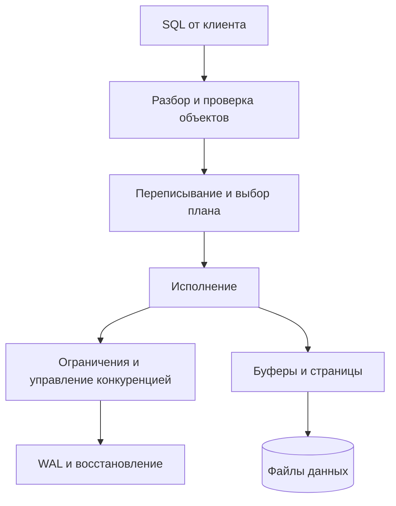
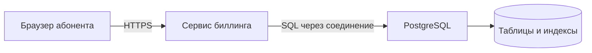
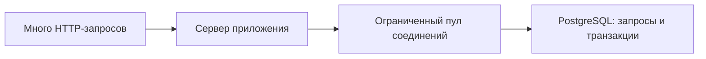
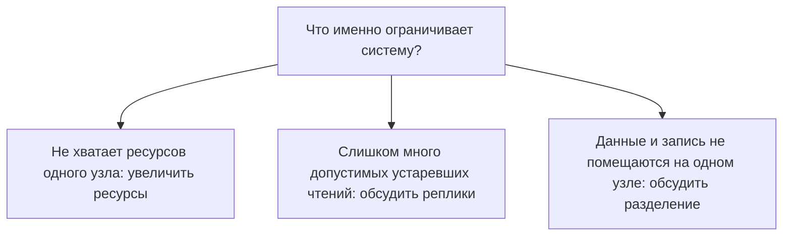

# 04. Архитектуры СУБД и модели данных

[[Лекции/03. DDL, типы данных и ограничения|← Предыдущая]] · [[index|Обложка]] · [[01. Карта курса|Карта]] · [[Лекции/05. ER-модель — сущности и связи|Следующая →]]

> [!abstract] Зачем читать
> Архитектура определяет взаимодействие компонентов, модель данных — организацию фактов, а уровни проектирования — переход от предметной области к реализации. Клиент-сервер, три звена, распределение и облако могут сочетаться. СУБД обеспечивает запросы, ограничения, конкуренцию и восстановление.

> [!info] Основа конспекта
> [[lecture/BDC_4.pdf#page=1|Исходная лекция: BDC_4.pdf]], 21 страниц PDF. Пояснения, разборы и упражнения добавлены к материалу курса. Номера страниц ниже — страницы PDF, а не цифры внизу слайдов.

## 1. Что делает СУБД кроме SELECT

СУБД проверяет структуру запросов, права и ограничения, выбирает план выполнения, координирует параллельную работу, управляет страницами и журналом изменений. Поэтому мысль «это просто программа для чтения таблиц» слишком узкая.

Например, при записи платежа нужно проверить тип суммы, существование абонента, допустимость операции и согласовать изменение баланса с другой параллельной записью. После сбоя должна сохраняться возможность восстановить согласованное состояние.



Это схема ответственности, а не перечень отдельных обязательных процессов ОС. Конкретная реализация PostgreSQL сложнее, и проверки могут происходить на нескольких этапах.

## 2. Люди и роли в работе с БД

| Роль | Основные вопросы | Пример задачи |
|---|---|---|
| Архитектор данных | Что моделируем и как связаны факты? | Выделить абонентов, счета, платежи |
| Разработчик | Как приложение использует БД? | Реализовать проведение платежа |
| DBA | Как обеспечить работу и восстановление? | Настроить резервирование и доступ |
| Аналитик | Какие выводы следуют из данных? | Посчитать выручку по тарифам |
| Инженер данных | Как поступают и преобразуются данные? | Загрузить и очистить логи |
| Пользователь | Как решить рабочую задачу? | Уточнить начисление по номеру |

В небольшой команде один человек может выполнять несколько ролей. Название должности не определяет права автоматически: доступ выдаётся конкретной учётной записи через механизмы СУБД. DBA не обязан лично вводить каждую бизнес-запись, а архитектор не освобождается от проверки работоспособности решений.

## 3. Архитектура доступа: где выполняется работа

### Файл-сервер

Сервер предоставляет общий файл, а клиентское ПО выполняет значительную часть работы с ним. Это повышает требования к сетевому обмену и согласованию конкурентного доступа. Детали зависят от формата и движка: не нужно представлять, что при любом чтении обязательно передаётся весь файл целиком.

### Клиент-сервер

Сервер СУБД принимает запрос и исполняет его рядом с данными. Клиенту возвращается результат. `psql → PostgreSQL` — простой пример. При запросе одного баланса не требуется пересылать клиенту всю таблицу абонентов.

### Многоуровневая архитектура

Пользовательское приложение общается с сервером приложения, а тот — с СУБД. Сервер приложения проверяет бизнес-действия, управляет сессиями и строит запросы. Это помогает не выдавать каждому браузеру прямые реквизиты БД.



**Три звена не означают ровно три компьютера**: приложение и СУБД могут жить на одной машине, а сервис приложения — масштабироваться на десятки узлов. Разделение логических обязанностей и физическое размещение — связанные, но разные решения.

### Распределённая система

Данные и обработка находятся на нескольких узлах. Возможны реплики одних данных или разделение разных данных по узлам. Это помогает доступности и масштабу, но добавляет сетевые задержки, отказы соединений и задачи согласования.

**Репликация** копирует изменения; **шардинг** разделяет набор данных. Копия полного справочника в двух регионах и хранение абонентов разных регионов на разных узлах — разные ситуации. Подробнее — [[Лекции/14. Резервирование и восстановление]].

### Облачное размещение

Облако определяет, кто предоставляет инфраструктуру и обслуживание. Управляемый PostgreSQL остаётся клиент-серверной СУБД и может иметь реплики. Это не отдельная логическая модель данных.

## 4. Модель данных: что разрешено описывать

Модель данных определяет структуры, связи, операции и ограничения. Архитектура отвечает на вопрос «кто с кем взаимодействует», модель — «как устроены факты и допустимые действия над ними».

| Модель | Представление | Подходящий образ | Ограничение образа |
|---|---|---|---|
| Иерархическая | Дерево родитель–потомок | Каталог подразделений | Несколько родителей усложняют схему |
| Сетевая | Записи и явные связи | Сеть взаимосвязанных объектов | Навигационная работа сложнее |
| Реляционная | Отношения и связи по значениям | Таблицы с ключами | SQL-таблицы имеют свои отличия от теории |
| Объектная | Объекты, идентичность, поведение | Объекты приложения | Нужны специальные средства запросов |
| Многомерная | Измерения и показатели | Аналитический куб | Ориентирована на анализ |
| Документная | Документы с полями и вложенностью | JSON-документ | Связи и ограничения решаются иначе |
| Графовая | Вершины, рёбра, свойства | Маршруты и взаимосвязи | Нужна задача, в которой полезен граф |

Векторное представление используется для поиска по близости числовых векторов. Оно может существовать как в специальной системе, так и как дополнительная возможность другой СУБД. Само название модели не гарантирует скорость для любого запроса.

## 5. Три этапа проектирования


На **инфологическом** этапе говорим: абонент выбирает тариф; платёж относится к абоненту и может погашать счёт. Ещё не требуется выбирать тип `varchar(15)`.

На **логическом / даталогическом** этапе появляются таблицы, атрибуты, ключи и ограничения выбранной модели. На этапе привязки к СУБД выбираются конкретные типы и синтаксис. В учебных материалах границы этих этапов иногда объединяют; полезно сохранять различие между бизнес-смыслом и способом реализации.

На **физическом** этапе решаем, какие индексы нужны, как организовать хранение больших логов и какие операции чаще выполняются. Добавление индекса обычно не меняет смысла отношения «абонент имеет тариф».

## 6. Один пример на всех уровнях

Бизнес-правило: у платежа обязательно есть плательщик. ER-модель показывает обязательную связь платежа с абонентом. Реляционная схема задаёт `payments.subscriber_id`. PostgreSQL реализует `NOT NULL REFERENCES subscribers(subscriber_id)`. Индекс на этом поле может ускорить поиск платежей абонента, но **не является** самой связью и не заменяет ограничение.

> [!tip] Проверка понимания
> Если решение «нужен PostgreSQL на втором сервере» принято раньше ответа «какие факты храним и что должно быть согласованным», проектирование началось с инфраструктуры. Вернись к предметной области и запиши правила.

## 7. Как выбирать архитектуру без магии

Запиши нагрузку чтения и записи, требования к доступности, допустимой потере данных и задержке. Определи, какие действия требуют атомарности, кто отвечает за поддержку и как выглядит восстановление. Затем сравни варианты по этим условиям.

Для учебной БД локальный PostgreSQL в Docker удобен и достаточен. Распределённый кластер добавит материал для администрирования, но не поможет понять ошибку `GROUP BY`. Сложность должна появляться вслед за задачей.

## Где заканчивается ответственность приложения и начинается СУБД

Пользователь видит кнопку «Пополнить баланс», но действие проходит через несколько слоёв. Интерфейс собирает данные, сервер приложения проверяет полномочия и сценарий, СУБД обеспечивает работу с сохранённым состоянием. Сетевое расположение этих частей само по себе не делает бизнес-операцию корректной.

| Проверка | Удобное место | Почему одного этого слоя недостаточно |
|---|---|---|
| Сумма похожа на число | Интерфейс | Другой клиент может обойти форму |
| Пользователь имеет право платить за этот счёт | Сервер приложения и правила доступа | Наличие строки в таблице не означает полномочие пользователя |
| Абонент существует | FK и логика операции | Интерфейс может показать устаревший список |
| Баланс и история меняются вместе | Транзакция | Два отдельных HTTP-запроса не дают автоматической атомарности |
| Запись переживает предусмотренный сбой | СУБД и инфраструктура | Один COMMIT не заменяет резервную копию всего сервера |

Идея разделения слоёв — не в том, чтобы одну проверку запретить во всех остальных местах. Быстрая проверка формы и строгое правило БД могут дополнять друг друга. Главное, чтобы последнее место принятия решения не полагалось только на необязательный клиентский интерфейс.

## Пул соединений и граница запроса

Соединение с PostgreSQL — не то же самое, что HTTP-запрос. Приложение может переиспользовать соединения через пул. Это уменьшает издержки, но требует корректно завершать транзакции и возвращать соединение в ожидаемом состоянии.



Если запрос пользователя открыл BEGIN и завершился раньше COMMIT/ROLLBACK, соединение может остаться с незавершённой транзакцией. Следующий пользователь не должен случайно продолжить чужую работу. Поэтому транзакционная граница является частью реализации сервиса, а не декоративной командой в конспекте.

Пул также не создаёт бесконечную производительность: слишком много одновременно активных запросов способны перегрузить сервер. Нужно управлять очередью и временем ожидания, а не просто увеличивать число соединений.

## Три способа разложить нагрузку

**Вертикальное масштабирование** — дать узлу больше памяти, процессоров или более быстрые накопители. **Реплика чтения** — направить часть чтений на копию данных. **Шардинг** — распределить разные части данных по узлам. Это разные инструменты с разной ценой сложности.



Если чтение отправили на отстающую реплику, пользователь сразу после платежа может временно увидеть старый баланс. Это не обязательно потеря записи: возможно, ещё не дошло воспроизведение журнала. Для сценария «прочитать собственное только что проведённое действие» маршрут чтения выбирают специально.

## Централизация управления и распределённое размещение

Данные могут физически находиться в разных местах и при этом управляться общими правилами. И наоборот, все файлы могут лежать на одном диске, но разные программы будут менять их без согласованной модели. Поэтому «централизованная БД» не обязана означать один единственный жёсткий диск.

При распределении добавляются вопросы: кто является источником истины, что делать при потере связи, как избежать двойного проведения операции, как различать старое значение и отсутствие данных. Ответ «поставим второй сервер» не закрывает ни один из этих вопросов автоматически.

## Небольшой проектный разбор

Есть учебный биллинг на одном сервере. Пользователи жалуются на задержку при формировании годового отчёта. До покупки второго сервера проверь: сколько данных просматривается, верен ли запрос, есть ли подходящая статистика, требуется ли весь год на каждом экране. Возможно, достаточно предварительной агрегации, индекса или отдельной витрины.

Если же причина — требование пережить полную потерю узла, ускорение запроса не решит задачу доступности. Тогда обсуждают реплику, резервные копии и процедуру переключения. Один симптом «система плохая» нужно разложить на измеримые требования.

## Список вопросов архитектора

Кто пишет данные? Какие изменения должны быть атомарными? Как долго допустима недоступность? Можно ли показывать устаревшие сведения? Какой объём нужен сейчас и через год? Что считается восстановлением: запущенный процесс или корректно работающий сервис?

Ответы связывают архитектуру с бизнесом. Названия технологий полезны после этого: они являются средствами выполнения требований. На защите гораздо убедительнее объяснить, почему счёт и платёж должны согласовываться, чем просто перечислить пять популярных СУБД.

## Где это в PDF

[[lecture/BDC_4.pdf#page=3|Состав СУБД и роли: 3–8]] · [[lecture/BDC_4.pdf#page=9|Архитектуры: 9–13]] · [[lecture/BDC_4.pdf#page=15|Уровни и модели: 15–21]].

## Проверь себя без подсказки

Сначала закрой пояснения и ответь вслух. Для сложного ответа приведи свой пример или контрпример.

1. Почему облако и реляционная модель описывают разные стороны системы?
2. Чем три уровня ANSI/SPARC отличаются от трёх звеньев приложения?
3. В чём отличие репликации от шардинга?
4. Как правило об обязательном плательщике превращается в DDL?
5. Почему FK и индекс на том же столбце решают разные задачи?
6. Какова разница между HTTP-запросом и сессией PostgreSQL?
7. Почему соединение из пула должно возвращаться с завершённой транзакцией?
8. Как объяснить старый баланс сразу после платежа при чтении реплики?
9. Сравни вертикальное масштабирование, реплику и шардинг под конкретную нагрузку.
10. Какие вопросы нужно задать до покупки второго сервера?
11. Приведи пример централизованных правил при распределённых данных.
12. Почему проверка интерфейса и ограничение БД могут дополнять друг друга?

## Вопросы с выбором ответа

Выбери ответ: результат появится сразу. Затем раскрой пояснение и разбери, почему остальные варианты не подходят.

```text
#quiz
? Что описывает трёхзвенную архитектуру приложения?
+ Клиент → сервер приложения → СУБД
- Внешний → концептуальный → внутренний уровень схемы
- Таблица → строка → столбец
```

```text
#quiz
? Что означает шардинг?
- Полное копирование всех данных на каждый узел
+ Разделение разных частей данных между узлами
- Создание индекса
```

```text
#quiz
? HTTP-запрос и соединение с PostgreSQL — одно и то же?
- Да, всегда одно на один
+ Нет, соединения могут переиспользоваться через пул
- Да, если используется HTTPS
```

> [!explain]- Почему так
> Протокол приложения и сессия СУБД находятся на разных уровнях.

```text
#quiz
? Что может означать старый баланс сразу после платежа при чтении с реплики?
- Платёж обязательно исчез
- Таблица перестала существовать
+ Реплика ещё не применила новое изменение
```

> [!explain]- Почему так
> При выборе маршрута чтения учитывают допустимость отставания.

```text
#quiz
? Вертикальное масштабирование — это что?
+ Усилить ресурсы одного узла
- Разделить таблицу между регионами
- Создать множество независимых копий CSV
```

> [!explain]- Почему так
> Количество ресурсов и распределение разных частей данных — разные инструменты.

```text
#quiz
? Что сначала выяснять при медленном годовом отчёте?
- Покупать любой второй сервер
+ План, объём и требуемый результат
- Удалять все ограничения
```

> [!explain]- Почему так
> Причиной может быть запрос или неверное зерно, а не недостаток узлов.

```text
#quiz
? Могут ли приложение и СУБД разных логических слоёв находиться на одной машине?
- Нет, нужны строго отдельные компьютеры
- Только при отсутствии сети вообще
+ Да
```

> [!explain]- Почему так
> Логическое разделение обязанностей не тождественно физическому размещению.

```text
#quiz
? Что нельзя делать с соединением после незавершённого BEGIN?
+ Возвращать его как чистое, не завершив транзакцию
- Повторно использовать после корректного завершения
- Закрыть с корректным освобождением ресурсов
```

> [!explain]- Почему так
> Следующий запрос не должен случайно продолжить состояние предыдущей операции.

```text
#quiz
? Централизованное управление обязательно означает единственный диск?
- Да, по определению PostgreSQL
+ Нет
- Да, иначе невозможны права доступа
```

> [!explain]- Почему так
> Общие правила и физическое размещение описывают разные свойства системы.

```text
#quiz
? Какой вопрос относится к модели данных, а не к размещению серверов?
- На какой машине запустить процесс
- Какой порт открыть для клиента
+ Какие факты различаем и как они связаны
```

> [!explain]- Почему так
> Модель фиксирует семантику структур, связей и ограничений.

## Закрепить тему на практике

- [[Практика/09. Транзакции и конкуренция]]

Здесь остаются вопросы на понимание. В тренировках — ввод запросов, проверка результатов и серверные задачи с разбором.

## Чек-лист понимания

- [ ] Прочитал лекцию и разобрал схему.
- [ ] Ответил на вопросы вслух без конспекта.
- [ ] Ответил на десять тестовых вопросов и объяснил неверные варианты.

## Суть за минуту

Архитектура определяет взаимодействие компонентов, модель данных — организацию фактов, а уровни проектирования — переход от предметной области к реализации. Клиент-сервер, три звена, распределение и облако могут сочетаться. СУБД обеспечивает запросы, ограничения, конкуренцию и восстановление.

^summary-l04

## Куда дальше

Проектирование: [[Лекции/05. ER-модель — сущности и связи]]. Производительность: [[Лекции/13. Производительность и индексы]]. Восстановление: [[Лекции/14. Резервирование и восстановление]].

[[Лекции/03. DDL, типы данных и ограничения|← Предыдущая]] · [[index|Обложка]] · [[01. Карта курса|Карта]] · [[Лекции/05. ER-модель — сущности и связи|Следующая →]]
