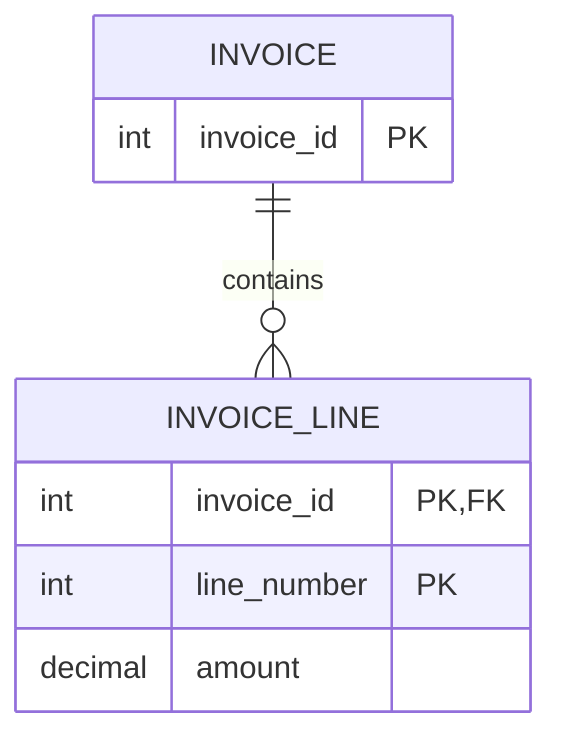
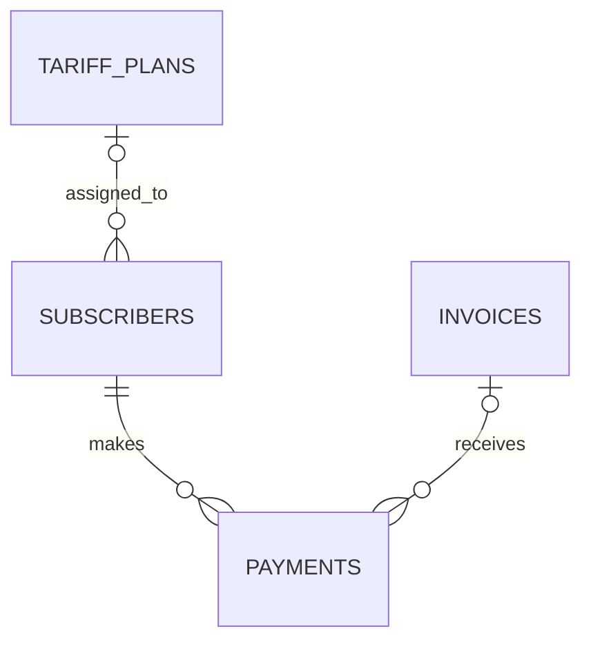
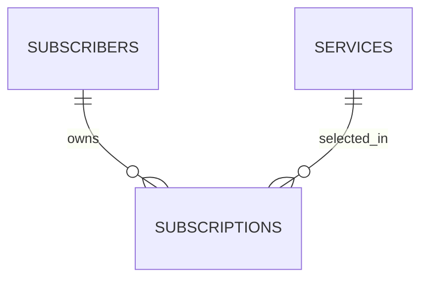
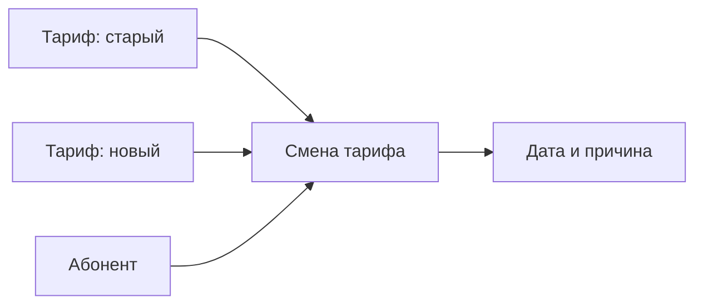
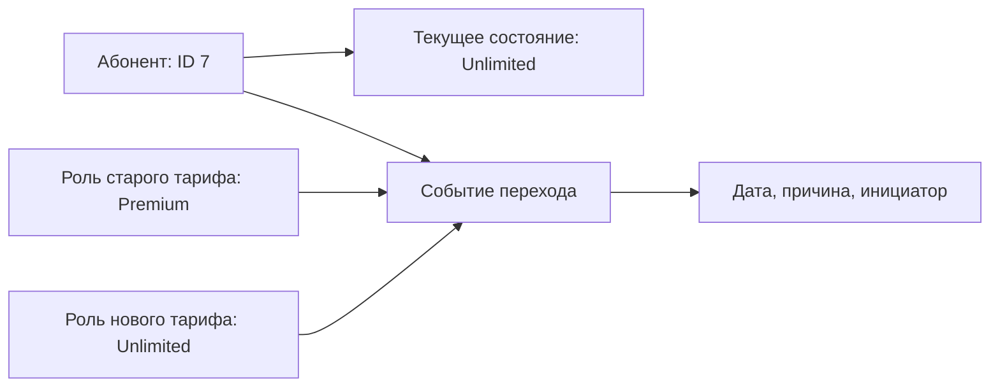
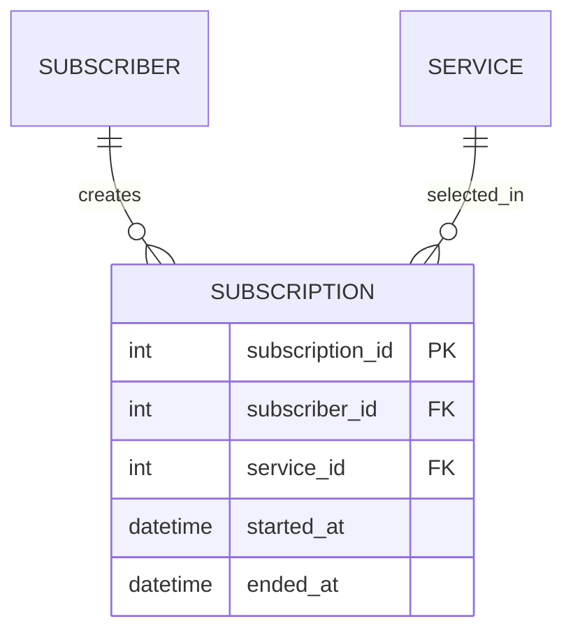

# 05. ER-модель — сущности и связи

[[Лекции/04. Архитектуры СУБД и модели данных|← Предыдущая]] · [[index|🏠 Старт]] · [[01. Карта курса|🧭 Карта]] · [[Лекции/06. Реляционная модель и реляционная алгебра|Следующая →]]

> [!abstract] Зачем читать
> ER-модель фиксирует бизнес-смысл через сущности, атрибуты и связи. У связи нужно указать минимальную и максимальную кратность с обеих сторон. M:N обычно превращается в отдельную связующую сущность. История событий и текущие значения отвечают на разные вопросы.

> [!info] Основа конспекта
> [[lecture/BDC_5.pdf#page=1|Исходная лекция: BDC_5.pdf]], 20 страниц PDF. Пояснения, разборы и упражнения добавлены к материалу курса. Номера страниц ниже — страницы PDF, а не цифры внизу слайдов.

## 1. Сначала понять мир, затем рисовать таблицы

ER-модель (**Entity–Relationship**, «сущность–связь») описывает предметную область через объекты, их свойства и отношения. На этом этапе обсуждают смысл, а не размер дисковых страниц. Модель нужна, чтобы разработчик и заказчик одинаково понимали, что означает запись.

Для биллинга естественны вопросы: кто абонент, что считается тарифом, может ли платёж не относиться к конкретному счёту, хранится ли история тарифа? Если ответы не зафиксировать, одни и те же поля начнут означать разные вещи в разных частях приложения.

Модель — само описание. Диаграмма — изображение модели. Нотация — графический язык диаграммы. Чен и «воронья лапка» могут изображать одни и те же бизнес-правила по-разному.

## 2. Сущность, тип и экземпляр

**Сущность** — различимый объект предметной области: конкретный абонент, платёж или счёт. **Тип сущности** объединяет похожие объекты. **Экземпляр** — отдельный представитель типа.

| Уровень | Пример |
|---|---|
| Тип сущности | Абонент |
| Экземпляр | Абонент с ID 1 |
| Атрибут | Номер телефона |
| Значение атрибута | `+79100000001` |

Не любое существительное обязано стать отдельной таблицей. «Статус абонента» может быть ограниченным значением поля, отдельным справочником или полноценной историей состояний — решение зависит от задач. Если нужны даты переходов и причины, одного текущего `status` уже мало.

## 3. Атрибуты и их разновидности

| Вид | Смысл | Пример |
|---|---|---|
| Простой | В модели не делится на части | Длительность звонка |
| Составной | Имеет осмысленные части | ФИО как имя и фамилия |
| Однозначный | Одно значение у экземпляра | Дата регистрации |
| Многозначный | Несколько значений | Несколько контактных адресов |
| Производный | Вычисляется по другим данным | Сумма платежей за период |

Атомарность зависит от модели и операций. Фамилию можно считать одним значением, хотя строка состоит из символов. Массив в PostgreSQL — допустимый тип, но если каждый элемент должен участвовать в собственных связях и проверках, отдельные строки часто удобнее.

Производные значения не всегда нужно хранить. Возраст устаревает со временем, а дата рождения остаётся фактом. Но стоимость уже проведённого звонка может быть важным историческим фактом, даже если первоначально вычислена: пересчёт по **сегодняшнему** тарифу изменил бы прошлое.

> [!tip] Вопрос к каждому полю
> Это первичный факт, текущая настройка или вычисляемый итог? От ответа зависит, нужно ли хранить историю и когда допустимо пересчитывать значение.

## 4. Ключи: как отличить один объект от другого

Ключ однозначно идентифицирует экземпляр. Хороший идентификатор стабилен, определён и не содержит лишних атрибутов. Телефон может быть естественным уникальным ключом текущего абонентского номера, а `subscriber_id` — суррогатным идентификатором строки.

Нельзя считать, что любой ключ запрещено изменять физически: СУБД допускает изменения при соблюдении ограничений. Стабильность — желательное проектное свойство. Переиспользование телефонного номера особенно хорошо показывает, почему технический ID и реальная личность человека — разные понятия.

## 5. Сильная и слабая сущности

Сильная сущность имеет собственный способ идентификации. Слабая идентифицируется только вместе с владельцем. Дополнительный пример: позиция счёта с номером 3 уникальна **внутри конкретного счёта**, поэтому её ключ может быть `(invoice_id, line_number)`.



Таблицы `invoice_line` в исходной БД нет: это учебное расширение. Наличие FK само по себе ещё не делает сущность слабой в смысле идентификации. В `payments` есть собственный `payment_id`, хотя платёж связан с абонентом.

## 6. Связь имеет имя, кратность и обязательность

Связь описывает ассоциацию. Читай её как предложение: «абонент совершает платёж», «платёж погашает счёт». Для каждого конца нужны два вопроса: **сколько максимум** и **может ли не быть ни одного**?

| Обозначение Mermaid | Чтение |
|---|---|
| `||` | Ровно один |
| `o|` | Ноль или один |
| `|{` | Один или много |
| `o{` | Ноль или много |

Для `subscribers → payments`: платёж относится к одному абоненту, а у абонента может быть ноль или много платежей. В DDL это отражается через обязательный FK на стороне платежа. В `payments.invoice_id` ссылка необязательна: пополнение может ещё не быть привязано к счёту.



Минимальная кратность важна. Правило «каждый тариф имеет хотя бы одного абонента» не следует из простого FK: свободный тариф может существовать без абонентов.

## 7. Связи 1:1, 1:N и M:N

**1:1**: отдельный профиль настроек принадлежит одному абоненту, и каждому абоненту разрешён максимум один такой профиль. В реляционной схеме FK на профиль дополняют `UNIQUE`.

**1:N**: один тариф у многих абонентов. FK находится на стороне N: `subscribers.plan_id`.

**M:N**: абонент может подключить несколько дополнительных услуг, а услугу используют многие абоненты. Появляется связующая сущность, например `subscriptions(subscriber_id, service_id, connected_at)`.



В исходной БД таблицы подписок нет. Не следует подменять её `service_types`: справочник типов событий не доказывает существования подписки на услугу. Пример «покупатель — товарный чек» на странице 19 исходника соответствует 1:N при описанных условиях, хотя заголовок слайда говорит M:N.

## 8. Атрибуты связи и роли

Если сумма и дата относятся к факту оплаты, это свойства связи оплаты. В реализации такой факт удобно выделить в сущность `payments` с собственным ID и атрибутами.

Роль помогает различать участие одного типа сущности несколько раз. В `plan_changes` и старый, и новый тариф ссылаются на `tariff_plans`, но имеют роли **до** и **после**. В переводе между абонентами были бы роли «отправитель» и «получатель».



## 9. Чен и воронья лапка

У Чена сущности рисуются прямоугольниками, атрибуты — овалами, связи — ромбами; слабые сущности имеют специальное обозначение. «Воронья лапка» компактно помещает атрибуты внутрь прямоугольников, а кратность показывает концами линий. Mermaid ER использует близкое обозначение кратностей и подходит для редактируемого конспекта.

Выбирай нотацию, которую участники обсуждения умеют читать. Красивые стрелки без объяснения обязательности хуже простой подписанной схемы.

## 10. Алгоритм проверки ER-модели

1. Выпиши факты и действия предметной области.
2. Выдели типы сущностей, их атрибуты и идентификаторы.
3. Назови связи глаголами.
4. Задай минимальную и максимальную кратность с обеих сторон.
5. Найди историю и события, которые нельзя заменить текущим значением.
6. Проверь модель на примерах: новый абонент без звонков, частичная оплата, смена тарифа.
7. Только затем переходи к таблицам и ограничениям.

> [!question]- Может ли один счёт иметь несколько платежей?
> Да, в исходном DDL `payments.invoice_id` не уникален. Поэтому допустимы частичные платежи. Но два независимых FK в payments не проверяют, что счёт и платёж относятся к одному абоненту: это дополнительное правило целостности.

## Читаем кратность в обе стороны

Фраза «у абонента есть тариф» недостаточно точна. Допускается ли абонент без тарифа? Может ли один тариф быть выбран сотней абонентов? Существует ли тариф, который пока никто не выбрал? В исходном DDL `subscribers.plan_id` допускает NULL, поэтому модель должна показывать необязательность текущей привязки.

| Вопрос | Ответ по исходной схеме | Как выразить |
|---|---|---|
| Сколько текущих тарифов у строки subscribers? | Ноль или один | Необязательная одиночная ссылка |
| Сколько абонентов может использовать тариф? | Ноль или много | Необязательный набор |
| Может ли платёж не иметь счёта? | Да | invoice\_id допускает NULL |
| Может ли платёж не иметь абонента? | Нет | subscriber\_id NOT NULL + FK |

Не нужно добавлять обязательность только потому, что на картинке «так красивее». Диаграмма обязана отражать договорённость, а не предположение читателя.

## Разбор жизненного сценария: смена тарифа

Пусть абонент 7 переходит с Premium на Unlimited. Текущий тариф нужен для оперативного обслуживания, а событие перехода — для истории и разборов. Это два разных факта.



Одна запись `subscribers.plan_id = 4` не расскажет, когда произошёл переход и какой тариф был раньше. Если для тарификации важен план на момент звонка, одной истории дат может оказаться недостаточно: потребуются точность времени, правила границ периода и версия условий.

На концептуальном этапе важно заметить саму необходимость историчности. Конкретный вариант реализации — история назначений с интервалами действия или фиксация применённой версии тарифа в событии — выбирается далее.

## Из связи M:N вырастает самостоятельный факт

Дополнительный пример: абоненты подключают пакеты услуг. Одно подключение имеет дату начала, дату окончания и состояние. Эти атрибуты нельзя честно положить только в справочник услуги: разные абоненты подключили её в разные дни. Нельзя положить их и в один столбец абонента: подключений несколько.



Если одна услуга может подключаться повторно, составной ключ только из `(subscriber_id, service_id)` уже не идентифицирует отдельное подключение. Можно добавить дату начала в естественную комбинацию или использовать собственный ID и отдельные ограничения. Ключ выбирают под идентичность факта, а не автоматически по шаблону M:N.

## Ключ человека, ключ номера и ключ договора

В учебной схеме строка subscribers удобна как «абонентская запись». В реальной системе человек может иметь несколько номеров, а один номер со временем переходит к другому владельцу. Если назвать всё это одной сущностью «пользователь», легко потерять историю и перепутать персональные сведения с состоянием услуги.

| Что хотим отличать | Возможная сущность |
|---|---|
| Физическое лицо | Person |
| Договор обслуживания | Contract |
| Телефонный номер как ресурс | PhoneNumber |
| Назначение номера по договору | Assignment |

Эти таблицы не объявляются существующими в учебной БД. Пример показывает метод расширения модели: сначала различаем факты и их время жизни, затем выбираем структуру. Не следует выводить полную модель оператора связи из одного названия subscribers.

## Сильная зависимость существования и слабая идентификация

У позиции счёта может не быть смысла без счёта. Но если ей выдан самостоятельный line\_id, идентификация технически стала независимой от номера позиции. Это не отменяет бизнес-зависимость существования. Два разных свойства полезно проговаривать отдельно: «может ли объект существовать без владельца?» и «можно ли его однозначно назвать без ключа владельца?».

Для слабой идентификации пример `(invoice_id, line_number)` особенно нагляден: позиция 2 сама по себе неоднозначна, а позиция 2 счёта 100 уже определена. Ограничение удаления владельца и способ идентификации решают связанные, но не одинаковые задачи.

## Как проводить проверку модели с собеседником

Возьми не только обычный успешный сценарий. Спроси про нового абонента без событий, два платежа к одному счёту, перевод номера другому владельцу, повторное подключение одной услуги, отмену ошибочной операции. Если модель выдерживает только пример «у каждого есть ровно один объект», её правила, вероятно, недоописаны.

> [!question]- Почему атрибут связи иногда становится сущностью?
> Когда у взаимодействия появляется собственная история, состояние, идентификатор и повторяемость, его удобно рассматривать как самостоятельный факт. Платёж является хорошим примером: его нельзя свести к галочке «абонент оплатил счёт».

## Где это в PDF

[[lecture/BDC_5.pdf#page=5|ER и этап моделирования: 5–6]] · [[lecture/BDC_5.pdf#page=7|Атрибуты и ключи: 7–11]] · [[lecture/BDC_5.pdf#page=12|Связи и роли: 12–15]] · [[lecture/BDC_5.pdf#page=16|Нотации: 16–20]].

## Проверь себя без подсказки

Сначала закрой пояснения и ответь вслух. Для сложного ответа приведи свой пример или контрпример.

1. Чем экземпляр сущности отличается от её типа?
2. Что означает ноль на конце связи и как он связан с NULL?
3. Почему наличие FK не делает любую сущность слабой?
4. Где хранить атрибут даты подключения в связи M:N?
5. Почему два FK платежа не гарантируют совпадение владельца счёта и плательщика?
6. Прочитай связь payments → invoices в обе стороны с минимумом и максимумом.
7. Как изменится ключ подключения, если одну услугу можно подключить повторно?
8. Почему текущий тариф не заменяет событие смены тарифа?
9. Когда нужно различать человека, договор и номер?
10. Какие сценарии проверяют слабое место модели?
11. Как отличить зависимость существования от слабой идентификации?
12. Почему финансовый платёж нельзя свести к одной галочке оплачено?

## Вопросы с выбором ответа

На сайте выбор сразу показывает результат. В Obsidian ответ отмечен знаком `+` в блоке; сначала попробуй ответить, затем проверь себя.

```text
#quiz
? Где обычно располагается FK при связи тариф 1:N абоненты?
- В tariff_plans со списком ID всех абонентов
+ В subscribers как plan_id
- Только в нарисованной диаграмме
```

```text
#quiz
? Чем в plan_changes различаются old_plan_id и new_plan_id?
+ Ролями участия тарифа в одном событии
- Ссылаются на разные типы сущностей
- Один всегда PK, а другой FK
```

```text
#quiz
? Почему дата подключения услуги является атрибутом факта подключения?
- Дата всегда принадлежит справочнику услуг
- Любая дата должна храниться только у пользователя
+ У разных абонентов одна услуга подключена в разное время
```

> [!explain]- Почему так
> Характеристика относится к взаимодействию конкретных участников.

```text
#quiz
? Повторное подключение той же услуги допустимо. Достаточен ли ключ из subscriber_id и service_id для отдельного события?
+ Не обязательно: нужен признак конкретного подключения
- Всегда достаточен
- Любой FK автоматически различит повторы
```

> [!explain]- Почему так
> Ключ должен идентифицировать экземпляр реального факта, а не только пару типов объектов.

```text
#quiz
? Что потеряется, если хранить только текущий plan_id?
- Возможность узнать текущий тариф
+ История времени и оснований переходов
- Любой первичный ключ
```

> [!explain]- Почему так
> Текущее состояние не описывает все предыдущие события.

```text
#quiz
? Чем отличается роль от типа сущности в plan_changes?
- Роль всегда означает отдельный тип данных SQL
- Роль заменяет внешний ключ
+ Один тип тарифа участвует как старый и как новый
```

> [!explain]- Почему так
> Роли различают участие одной сущности в разных позициях связи.

```text
#quiz
? Что означает необязательный invoice_id у payments?
+ Пополнение может не быть привязано к счёту
- Платёж не имеет суммы
- Каждый платёж должен удалить счёт
```

> [!explain]- Почему так
> Минимальная кратность и NULL описывают допустимое отсутствие связи.

```text
#quiz
? Наличие самостоятельного ID отменяет зависимость объекта от владельца?
- Да, всегда отменяет бизнес-зависимость
+ Не обязательно
- Да, если ID большой
```

> [!explain]- Почему так
> Идентификация и зависимость существования являются разными вопросами.

```text
#quiz
? Почему человек и абонентская запись не обязаны быть одной сущностью?
- У человека всегда только один номер
- Номер телефона является неизменным паспортом
+ У человека могут быть несколько номеров и договоров
```

> [!explain]- Почему так
> Нужно различать объекты с разной идентичностью и временем жизни.

```text
#quiz
? Какой сценарий особенно полезен для проверки ER-модели?
+ Частичный платёж и абонент без событий
- Только один идеальный объект со всеми полями
- Только пустая диаграмма
```

> [!explain]- Почему так
> Граничные случаи проявляют необязательность, повторяемость и историю связей.

## Закрепить тему на практике

- [[Практика/04. JOIN и отсутствие связанных строк]]
- [[Практика/08. DDL и нормализация]]

Здесь остаются вопросы на понимание. В тренировках — ввод запросов, проверка результатов и серверные задачи с разбором.

## Чек-лист понимания

- [ ] Прочитал лекцию и разобрал схему.
- [ ] Ответил на вопросы вслух без конспекта.
- [ ] Ответил на десять тестовых вопросов и объяснил неверные варианты.
- [ ] В свойстве `confidence` поставил число от 0 до 5.
- [ ] Поставил дату следующего повторения в `review_next`.

## Суть за минуту

ER-модель фиксирует бизнес-смысл через сущности, атрибуты и связи. У связи нужно указать минимальную и максимальную кратность с обеих сторон. M:N обычно превращается в отдельную связующую сущность. История событий и текущие значения отвечают на разные вопросы.

^summary-l05

## Куда дальше

Логическая реализация: [[Лекции/06. Реляционная модель и реляционная алгебра]]. Полная ER-схема: [[Практика/База billing — устройство и запуск#Схема связей]].

[[Лекции/04. Архитектуры СУБД и модели данных|← Предыдущая]] · [[index|🏠 Старт]] · [[01. Карта курса|🧭 Карта]] · [[Лекции/06. Реляционная модель и реляционная алгебра|Следующая →]]
