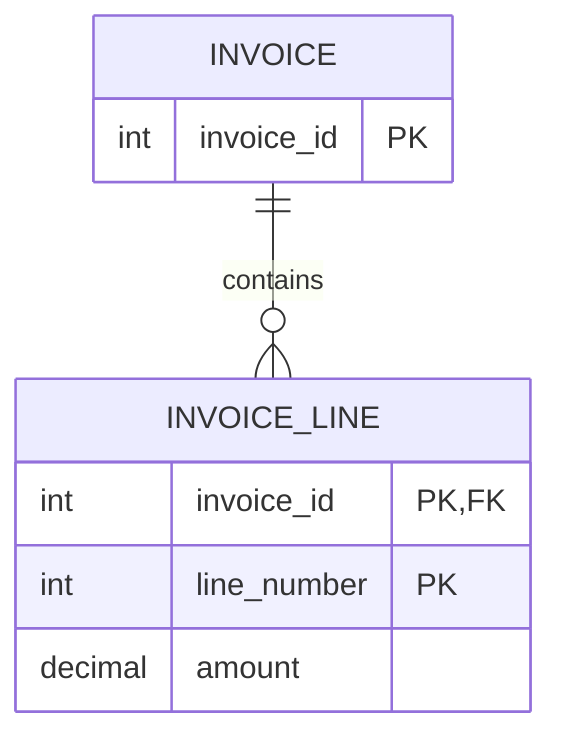
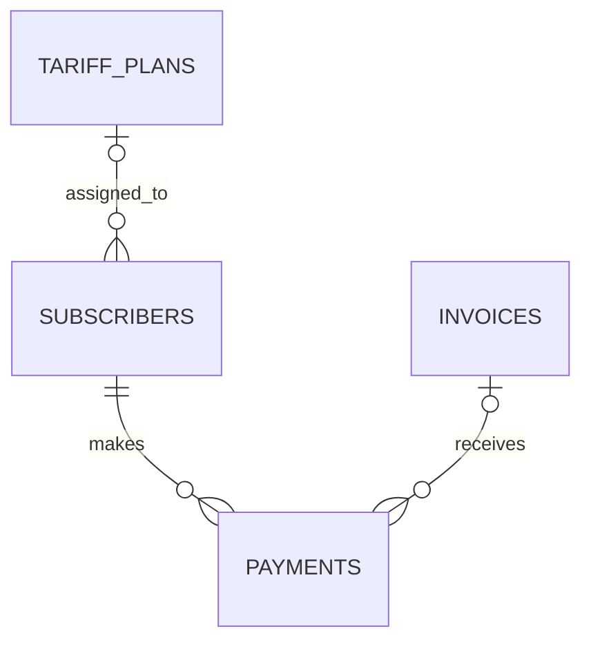
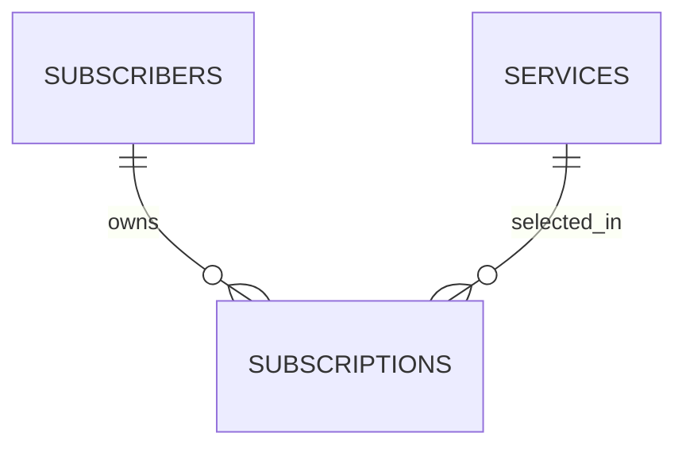
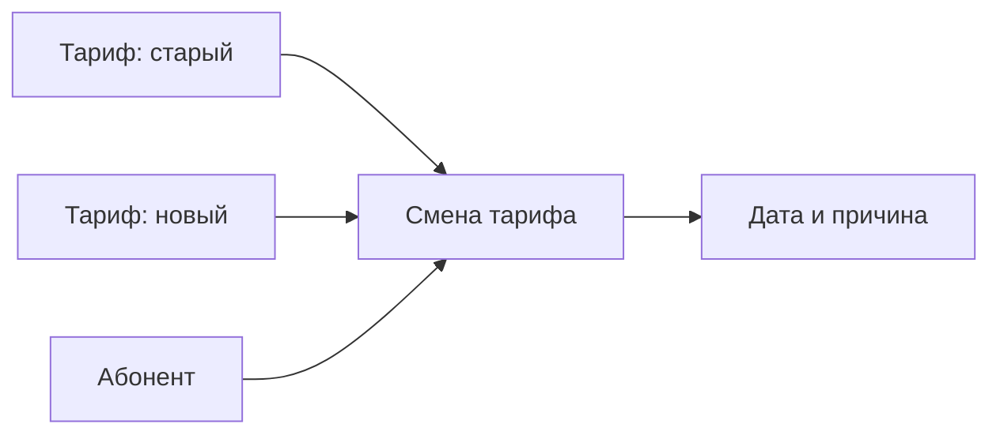

# 05. ER-модель — сущности и связи

[[Лекции/04. Архитектуры СУБД и модели данных|← Предыдущая]] · [[index|🏠 Старт]] · [[01. Карта курса|🧭 Карта]] · [[Лекции/06. Реляционная модель и реляционная алгебра|Следующая →]]

> [!abstract] Зачем читать
> ER-модель фиксирует бизнес-смысл через сущности, атрибуты и связи. У связи нужно указать минимальную и максимальную кратность с обеих сторон. M:N обычно превращается в отдельную связующую сущность. История событий и текущие значения отвечают на разные вопросы.

> [!info] Основа конспекта
> [[lecture/BDC_5.pdf#page=1|Исходная лекция: BDC_5.pdf]], 20 страниц PDF. Пояснения, разборы и упражнения добавлены к материалу курса. Номера страниц ниже — страницы PDF, а не цифры внизу слайдов.

## 1. Сначала понять мир, затем рисовать таблицы

ER-модель (**Entity–Relationship**, «сущность–связь») описывает предметную область через объекты, их свойства и отношения. На этом этапе обсуждают смысл, а не размер дисковых страниц. Модель нужна, чтобы разработчик и заказчик одинаково понимали, что означает запись.

Для биллинга естественны вопросы: кто абонент, что считается тарифом, может ли платёж не относиться к конкретному счёту, хранится ли история тарифа? Если ответы не зафиксировать, одни и те же поля начнут означать разные вещи в разных частях приложения.

Модель — само описание. Диаграмма — изображение модели. Нотация — графический язык диаграммы. Чен и «воронья лапка» могут изображать одни и те же бизнес-правила по-разному.

## 2. Сущность, тип и экземпляр

**Сущность** — различимый объект предметной области: конкретный абонент, платёж или счёт. **Тип сущности** объединяет похожие объекты. **Экземпляр** — отдельный представитель типа.

| Уровень | Пример |
|---|---|
| Тип сущности | Абонент |
| Экземпляр | Абонент с ID 1 |
| Атрибут | Номер телефона |
| Значение атрибута | `+79100000001` |

Не любое существительное обязано стать отдельной таблицей. «Статус абонента» может быть ограниченным значением поля, отдельным справочником или полноценной историей состояний — решение зависит от задач. Если нужны даты переходов и причины, одного текущего `status` уже мало.

## 3. Атрибуты и их разновидности

| Вид | Смысл | Пример |
|---|---|---|
| Простой | В модели не делится на части | Длительность звонка |
| Составной | Имеет осмысленные части | ФИО как имя и фамилия |
| Однозначный | Одно значение у экземпляра | Дата регистрации |
| Многозначный | Несколько значений | Несколько контактных адресов |
| Производный | Вычисляется по другим данным | Сумма платежей за период |

Атомарность зависит от модели и операций. Фамилию можно считать одним значением, хотя строка состоит из символов. Массив в PostgreSQL — допустимый тип, но если каждый элемент должен участвовать в собственных связях и проверках, отдельные строки часто удобнее.

Производные значения не всегда нужно хранить. Возраст устаревает со временем, а дата рождения остаётся фактом. Но стоимость уже проведённого звонка может быть важным историческим фактом, даже если первоначально вычислена: пересчёт по **сегодняшнему** тарифу изменил бы прошлое.

> [!tip] Вопрос к каждому полю
> Это первичный факт, текущая настройка или вычисляемый итог? От ответа зависит, нужно ли хранить историю и когда допустимо пересчитывать значение.

## 4. Ключи: как отличить один объект от другого

Ключ однозначно идентифицирует экземпляр. Хороший идентификатор стабилен, определён и не содержит лишних атрибутов. Телефон может быть естественным уникальным ключом текущего абонентского номера, а `subscriber_id` — суррогатным идентификатором строки.

Нельзя считать, что любой ключ запрещено изменять физически: СУБД допускает изменения при соблюдении ограничений. Стабильность — желательное проектное свойство. Переиспользование телефонного номера особенно хорошо показывает, почему технический ID и реальная личность человека — разные понятия.

## 5. Сильная и слабая сущности

Сильная сущность имеет собственный способ идентификации. Слабая идентифицируется только вместе с владельцем. Дополнительный пример: позиция счёта с номером 3 уникальна **внутри конкретного счёта**, поэтому её ключ может быть `(invoice_id, line_number)`.



Таблицы `invoice_line` в исходной БД нет: это учебное расширение. Наличие FK само по себе ещё не делает сущность слабой в смысле идентификации. В `payments` есть собственный `payment_id`, хотя платёж связан с абонентом.

## 6. Связь имеет имя, кратность и обязательность

Связь описывает ассоциацию. Читай её как предложение: «абонент совершает платёж», «платёж погашает счёт». Для каждого конца нужны два вопроса: **сколько максимум** и **может ли не быть ни одного**?

| Обозначение Mermaid | Чтение |
|---|---|
| `||` | Ровно один |
| `o|` | Ноль или один |
| `|{` | Один или много |
| `o{` | Ноль или много |

Для `subscribers → payments`: платёж относится к одному абоненту, а у абонента может быть ноль или много платежей. В DDL это отражается через обязательный FK на стороне платежа. В `payments.invoice_id` ссылка необязательна: пополнение может ещё не быть привязано к счёту.



Минимальная кратность важна. Правило «каждый тариф имеет хотя бы одного абонента» не следует из простого FK: свободный тариф может существовать без абонентов.

## 7. Связи 1:1, 1:N и M:N

**1:1**: отдельный профиль настроек принадлежит одному абоненту, и каждому абоненту разрешён максимум один такой профиль. В реляционной схеме FK на профиль дополняют `UNIQUE`.

**1:N**: один тариф у многих абонентов. FK находится на стороне N: `subscribers.plan_id`.

**M:N**: абонент может подключить несколько дополнительных услуг, а услугу используют многие абоненты. Появляется связующая сущность, например `subscriptions(subscriber_id, service_id, connected_at)`.



В исходной БД таблицы подписок нет. Не следует подменять её `service_types`: справочник типов событий не доказывает существования подписки на услугу. Пример «покупатель — товарный чек» на странице 19 исходника соответствует 1:N при описанных условиях, хотя заголовок слайда говорит M:N.

## 8. Атрибуты связи и роли

Если сумма и дата относятся к факту оплаты, это свойства связи оплаты. В реализации такой факт удобно выделить в сущность `payments` с собственным ID и атрибутами.

Роль помогает различать участие одного типа сущности несколько раз. В `plan_changes` и старый, и новый тариф ссылаются на `tariff_plans`, но имеют роли **до** и **после**. В переводе между абонентами были бы роли «отправитель» и «получатель».



## 9. Чен и воронья лапка

У Чена сущности рисуются прямоугольниками, атрибуты — овалами, связи — ромбами; слабые сущности имеют специальное обозначение. «Воронья лапка» компактно помещает атрибуты внутрь прямоугольников, а кратность показывает концами линий. Mermaid ER использует близкое обозначение кратностей и подходит для редактируемого конспекта.

Выбирай нотацию, которую участники обсуждения умеют читать. Красивые стрелки без объяснения обязательности хуже простой подписанной схемы.

## 10. Алгоритм проверки ER-модели

1. Выпиши факты и действия предметной области.
2. Выдели типы сущностей, их атрибуты и идентификаторы.
3. Назови связи глаголами.
4. Задай минимальную и максимальную кратность с обеих сторон.
5. Найди историю и события, которые нельзя заменить текущим значением.
6. Проверь модель на примерах: новый абонент без звонков, частичная оплата, смена тарифа.
7. Только затем переходи к таблицам и ограничениям.

> [!question]- Может ли один счёт иметь несколько платежей?
> Да, в исходном DDL `payments.invoice_id` не уникален. Поэтому допустимы частичные платежи. Но два независимых FK в payments не проверяют, что счёт и платёж относятся к одному абоненту: это дополнительное правило целостности.

## Где это в PDF

[[lecture/BDC_5.pdf#page=5|ER и этап моделирования: 5–6]] · [[lecture/BDC_5.pdf#page=7|Атрибуты и ключи: 7–11]] · [[lecture/BDC_5.pdf#page=12|Связи и роли: 12–15]] · [[lecture/BDC_5.pdf#page=16|Нотации: 16–20]].

## Проверь себя без подсказки

1. Чем экземпляр сущности отличается от её типа?
2. Что означает ноль на конце связи и как он связан с NULL?
3. Почему наличие FK не делает любую сущность слабой?
4. Где хранить атрибут даты подключения в связи M:N?
5. Почему два FK платежа не гарантируют совпадение владельца счёта и плательщика?

## Мини-тренажёр

> [!tip] Два режима
> В Obsidian это редактируемые блоки с условиями и эталонами. На Quartz блоки превращаются в интерактивные задания после подключения [[Справочники/Интерактив и Quartz|обработчика]]. SQL-песочница использует маленький учебный набор, описанный в [[Практика/Учебный набор|паспорте данных]]. Он отличается от полного дампа.

```sql
-- setup
CREATE TABLE tariff_plans (plan_id INT, plan_name STRING, monthly_fee NUMBER, minutes_included INT, sms_included INT, data_gb_included INT, price_per_minute NUMBER, price_per_sms NUMBER, price_per_gb NUMBER, is_active BOOLEAN);
INSERT INTO tariff_plans VALUES (1,'Basic',300,100,50,5,2,2.5,200,true),(2,'Standard',500,300,100,15,1.5,2,150,true),(3,'Premium',800,1000,500,50,1,1.5,100,true),(4,'Unlimited',1200,999999,999999,100,0,0,50,true),(5,'Student',350,200,100,10,1.8,2,180,true),(6,'Senior',250,150,100,3,2,2,250,false);
CREATE TABLE service_types (service_type_id INT, service_name STRING, description STRING);
INSERT INTO service_types VALUES (1,'Outgoing Call','Исходящий звонок'),(2,'Incoming Call','Входящий звонок'),(3,'SMS','Сообщение'),(4,'MMS','Мультимедийное сообщение'),(5,'Data','Интернет');
CREATE TABLE subscribers (subscriber_id INT, phone_number STRING, first_name STRING, last_name STRING, email STRING, plan_id, registration_date STRING, status STRING, balance NUMBER);
INSERT INTO subscribers VALUES (1,'+79100000001','Анна','Волкова','anna@example.test',1,'2025-09-01','ACTIVE',250),(2,'+79100000002','Борис','Орлов',NULL,2,'2025-09-03','ACTIVE',-20),(3,'+79100000003','Вера','Иванова','vera@example.test',3,'2025-10-01','SUSPENDED',0),(4,'+79100000004','Глеб','Соколов','gleb@example.test',1,'2025-10-10','ACTIVE',500),(5,'+79100000005','Дина','Белова',NULL,5,'2025-11-01','ACTIVE',100),(6,'+79100000006','Егор','Петров','egor@example.test',NULL,'2025-11-02','TERMINATED',-50),(7,'+79100000007','Жанна','Миронова','zhanna@example.test',4,'2025-11-03','ACTIVE',1000),(8,'+79100000008','Зоя','Зайцева',NULL,2,'2025-11-04','SUSPENDED',100);
CREATE TABLE call_records (record_id INT, subscriber_id INT, service_type_id INT, call_date STRING, destination_number STRING, duration_seconds INT, quantity INT, cost NUMBER);
INSERT INTO call_records VALUES (1,1,1,'2025-11-01 10:00:00','+79000000001',60,1,2),(2,1,1,'2025-11-02 10:00:00','+79000000002',120,1,4),(3,2,1,'2025-11-01 11:00:00','+79000000003',30,1,1.5),(4,2,3,'2025-11-03 11:00:00','900',0,1,2),(5,3,1,'2025-11-02 12:00:00','+79000000004',300,1,5),(6,4,1,'2025-11-03 13:00:00','+79000000005',180,1,6),(7,4,1,'2025-11-04 13:00:00','+79000000006',60,1,2),(8,7,1,'2025-11-05 14:00:00','+79000000007',600,1,0);
CREATE TABLE data_usage (usage_id INT, subscriber_id INT, usage_date STRING, data_mb INT, cost NUMBER);
INSERT INTO data_usage VALUES (1,1,'2025-11-01',1024,150),(2,1,'2025-11-02',512,75),(3,2,'2025-11-01',2048,300),(4,4,'2025-11-02',0,0),(5,7,'2025-11-03',4096,200);
CREATE TABLE invoices (invoice_id INT, subscriber_id INT, billing_period STRING, issue_date STRING, due_date STRING, monthly_fee NUMBER, usage_charges NUMBER, total_amount NUMBER, status STRING);
INSERT INTO invoices VALUES (1,1,'2025-11','2025-11-01','2025-11-10',300,6,306,'PAID'),(2,2,'2025-11','2025-11-01','2025-11-10',500,3.5,503.5,'OVERDUE'),(3,3,'2025-11','2025-11-01','2025-11-10',800,5,805,'PENDING'),(4,4,'2025-11','2025-11-01','2025-11-10',300,8,308,'PAID'),(5,7,'2025-11','2025-11-01','2025-11-10',1200,0,1200,'PENDING');
CREATE TABLE payments (payment_id INT, subscriber_id INT, invoice_id, payment_date STRING, amount NUMBER, payment_method STRING, transaction_id STRING);
INSERT INTO payments VALUES (1,1,1,'2025-11-02 09:00:00',200,'CARD','tx-1'),(2,1,1,'2025-11-03 09:00:00',106,'CARD','tx-2'),(3,4,4,'2025-11-04 09:00:00',308,'CARD','tx-3'),(4,5,NULL,'2025-11-05 09:00:00',100,'CASH','tx-4');
CREATE TABLE plan_changes (change_id INT, subscriber_id INT, old_plan_id INT, new_plan_id INT, change_date STRING, reason STRING);
INSERT INTO plan_changes VALUES (1,1,2,1,'2025-10-01','Экономия'),(2,2,1,2,'2025-10-10','Больше минут'),(3,7,3,4,'2025-11-01','Безлимит');
```

```text
#quiz
? Где обычно располагается FK при связи тариф 1:N абоненты?
- В tariff_plans со списком ID всех абонентов
+ В subscribers как plan_id
- Только в нарисованной диаграмме
```

```text
#quiz
? Чем в plan_changes различаются old_plan_id и new_plan_id?
+ Ролями участия тарифа в одном событии
- Ссылаются на разные типы сущностей
- Один всегда PK, а другой FK
```

```text
#order
Описать бизнес-правило обычным предложением
Выделить сущности и их ключи
Указать связи, роли и кратности
Проверить модель на граничных примерах
Перенести модель в таблицы и ограничения
```

```text
#task
Выведи change_id, old_plan_id и new_plan_id всех смен тарифов.
Сортировка по change_id.
= SELECT change_id, old_plan_id, new_plan_id FROM plan_changes ORDER BY change_id;
```

## Чек-лист понимания

- [ ] Прочитал лекцию и разобрал схему.
- [ ] Ответил на вопросы вслух без конспекта.
- [ ] Решил задания и разобрал ошибки.
- [ ] В свойстве `confidence` поставил число от 0 до 5.
- [ ] Поставил дату следующего повторения в `review_next`.

## Суть за минуту

ER-модель фиксирует бизнес-смысл через сущности, атрибуты и связи. У связи нужно указать минимальную и максимальную кратность с обеих сторон. M:N обычно превращается в отдельную связующую сущность. История событий и текущие значения отвечают на разные вопросы.

^summary-l05

## Куда дальше

Логическая реализация: [[Лекции/06. Реляционная модель и реляционная алгебра]]. Полная ER-схема: [[Практика/База billing — устройство и запуск#Схема связей]].

[[Лекции/04. Архитектуры СУБД и модели данных|← Предыдущая]] · [[index|🏠 Старт]] · [[01. Карта курса|🧭 Карта]] · [[Лекции/06. Реляционная модель и реляционная алгебра|Следующая →]]
