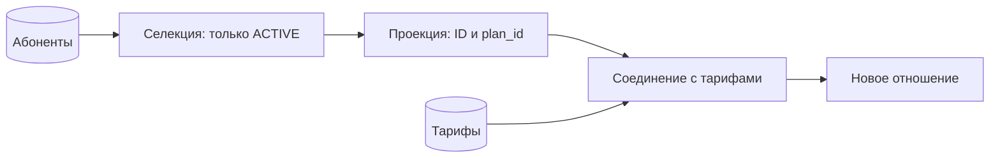

# 06. Реляционная модель и реляционная алгебра

[[Лекции/05. ER-модель — сущности и связи|← Предыдущая]] · [[index|🏠 Старт]] · [[01. Карта курса|🧭 Карта]] · [[Лекции/07. Запросы, JOIN и подзапросы|Следующая →]]

> [!abstract] Зачем читать
> Отношение — множество кортежей с заданными атрибутами. Селекция выбирает строки, проекция — столбцы, произведение — все пары, JOIN — пары по условию. Множественные операции требуют совместимых схем. Деление выражает «для всех», а EXISTS удобно выражает полусоединение.

> [!info] Основа конспекта
> [[lecture/BDC_6.pdf#page=1|Исходная лекция: BDC_6.pdf]], 20 страниц PDF. Пояснения, разборы и упражнения добавлены к материалу курса. Номера страниц ниже — страницы PDF, а не цифры внизу слайдов.

## 1. От ER-мира к отношениям

После ER-модели нужно выбрать логическую организацию данных. Реляционная модель представляет факты отношениями. Связь определяется значениями атрибутов, а не обязательной навигацией по физическим указателям.

В учебной БД строка абонента содержит `plan_id`, и по совпадению значения с ключом тарифов мы узнаём название плана. Перенос файла таблицы на другой диск не меняет этот смысл. Внутри индексов указатели могут существовать, но это уровень реализации.

## 2. Строгие слова без сложной оболочки

| Теория | Практическая аналогия | Что важно |
|---|---|---|
| Отношение | Таблица | В теории это множество кортежей |
| Кортеж | Строка | Набор значений атрибутов |
| Атрибут | Столбец | Имеет имя и домен |
| Домен | Допустимые значения | Не только физический тип |
| Схема отношения | Описание атрибутов | Отличается от текущих данных |
| Тело отношения | Набор кортежей | Меняется со временем |
| Степень | Количество атрибутов | У subscribers в исходнике 9 |
| Кардинальность | Количество кортежей | Зависит от состояния данных |

Степень запроса `SELECT subscriber_id, balance` равна 2. Его кардинальность может быть 0, 1 или много строк. В ER-схеме слово «кардинальность» также используют для кратности связи — контекст важен.

## 3. Принципы отношений и реалии SQL

В отношении нет повторяющихся кортежей; порядок строк и атрибутов не задаёт смысл. Значения атрибута принадлежат одному домену. Названия атрибутов внутри схемы различны.

SQL допускает дубликаты и `NULL`, а позиция столбца влияет на некоторые операции и интерфейсы. Поэтому «SQL-таблица» и «математическое отношение» — удобные аналоги, но не полные синонимы.

Первичный ключ обеспечивает уникальность строк таблицы, однако проекция части столбцов может снова дать повторы. `DISTINCT` приводит такой результат к набору уникальных комбинаций.

## 4. Суперключ, потенциальный ключ, первичный ключ

**Суперключ** — набор атрибутов, который однозначно определяет строку. **Потенциальный ключ** минимален: нельзя убрать часть и сохранить идентификацию. **Первичный ключ** — один выбранный потенциальный ключ. Остальные могут поддерживаться `UNIQUE` и `NOT NULL`.

Если ID уже уникален, набор `(ID, фамилия)` является суперключом, но не минимальным ключом. Это различие понадобится в нормализации: зависимости анализируют относительно всех потенциальных ключей, а не только выбранного PK.

## 5. Реляционная алгебра замкнута

Операция получает отношения и возвращает отношение. Поэтому операции можно соединять в выражения: отфильтровать, спроецировать, соединить и снова отфильтровать.



У алгебры есть строгая семантика. Оптимизатор может использовать эквивалентные преобразования, чтобы получить тот же результат дешевле. Но операции с внешними соединениями и `NULL` требуют аккуратности: перестановка фильтра может изменить результат.

## 6. Селекция и проекция

**Селекция** `σ` отбирает строки по условию. Степень сохраняется, кардинальность может уменьшиться.

```sql
SELECT * FROM subscribers WHERE balance < 0;
```

**Проекция** `π` выбирает атрибуты. В теоретической проекции одинаковые кортежи результата объединяются.

```sql
SELECT DISTINCT plan_id FROM subscribers;
```

> [!tip] Запомнить визуально
> Селекция — горизонтальный отбор строк. Проекция — вертикальный отбор столбцов. Английское слово SELECT в синтаксисе SQL может сбить с толку: оно не является прямым названием только одной алгебраической операции.

## 7. Произведение и соединение

Декартово произведение `R × S` создаёт каждую комбинацию строк. Если в R 8 строк, а в S 5, получится 40 комбинаций. Степени складываются с учётом различения одинаковых имён атрибутов.

```sql
SELECT s.subscriber_id, st.service_name
FROM subscribers AS s CROSS JOIN service_types AS st;
```

Соединение можно понимать как произведение с условием и нужным набором столбцов. В обычном `INNER JOIN` остаются **совпавшие пары строк**, а не просто общие элементы исходных множеств.

```sql
SELECT s.subscriber_id, s.first_name, t.plan_name
FROM subscribers AS s
JOIN tariff_plans AS t ON t.plan_id = s.plan_id;
```

Если у абонента два звонка, соединение с звонками вернёт две строки. Количество результата определяется числом подходящих пар. Поэтому рисунки Венна полезны для напоминания о сохранении сторон, но плохо показывают размножение строк.

## 8. UNION, INTERSECT и EXCEPT

Для операций над множествами нужны совместимые схемы. В SQL важны число столбцов и совместимость типов по соответствующим позициям; совпадение имён результата не обязательно.

```sql
-- PostgreSQL: абоненты с платежами или интернет-трафиком.
SELECT subscriber_id FROM payments
UNION
SELECT subscriber_id FROM data_usage;

-- Те, кто присутствует в обоих наборах.
SELECT subscriber_id FROM payments
INTERSECT
SELECT subscriber_id FROM data_usage;

-- Платили, но в наборе интернет-трафика не встречались.
SELECT subscriber_id FROM payments
EXCEPT
SELECT subscriber_id FROM data_usage;
```

`UNION` удаляет повторы, `UNION ALL` сохраняет их. В PostgreSQL варианты `INTERSECT ALL` и `EXCEPT ALL` учитывают кратности. По умолчанию порядок вывода не гарантируется и после этих операций.

## 9. Деление: «для каждого», а не «хотя бы один»

Реляционное деление отвечает на вопросы вида «кто использовал **все** требуемые услуги?». Пусть отношение R хранит пары `(абонент, услуга)`, а S — требуемые услуги. В результат попадут абоненты, у которых есть каждая пара с услугами из S.

В SQL такую универсальную проверку можно выразить через двойное отрицание:

```sql
-- PostgreSQL. Кто использовал каждый тип из справочника service_types?
SELECT s.subscriber_id
FROM subscribers AS s
WHERE NOT EXISTS (
    SELECT 1
    FROM service_types AS st
    WHERE NOT EXISTS (
        SELECT 1 FROM call_records AS c
        WHERE c.subscriber_id = s.subscriber_id
          AND c.service_type_id = st.service_type_id
    )
);
```

Читаем: «нет требуемой услуги, для которой у абонента нет записи». Это математическое «для всех» через «не существует контрпримера». Справочник в этом примере включает Data, тогда как часть трафика хранится отдельно: реальное бизнес-определение «использовал все услуги» требует сначала договориться об источниках событий.

## 10. Внешние соединения и полусоединение

`LEFT JOIN` сохраняет строки слева и дополняет отсутствующие значения справа `NULL`. `RIGHT JOIN` симметричен. `FULL JOIN` сохраняет обе стороны. Это расширения практической SQL-работы с неполным совпадением.

**Полусоединение** возвращает только столбцы одной стороны для строк, имеющих совпадение; удобная SQL-запись — `WHERE EXISTS (...)`. **Антисоединение** ищет отсутствие совпадения — `NOT EXISTS`.

> [!warning] Уточнение к страницам 18–19
> LEFT/RIGHT OUTER JOIN не называют полусоединениями. У внешнего соединения в результате могут быть столбцы обеих таблиц и дополненные NULL строки. У полусоединения возвращается одна сторона без размножения из-за количества совпадений справа.

## Где это в PDF

[[lecture/BDC_6.pdf#page=3|Проектирование и термины: 3–7]] · [[lecture/BDC_6.pdf#page=8|Алгебра: 8–16]] · [[lecture/BDC_6.pdf#page=17|Виды JOIN: 17–20]].

## Проверь себя без подсказки

1. Как изменяются степень и кардинальность при селекции и проекции?
2. Почему суперключ может не быть потенциальным ключом?
3. Почему JOIN не равен пересечению множеств?
4. Как прочитать двойной NOT EXISTS обычными словами?
5. Чем LEFT JOIN отличается от полусоединения?

## Мини-тренажёр

> [!tip] Два режима
> В Obsidian это редактируемые блоки с условиями и эталонами. На Quartz блоки превращаются в интерактивные задания после подключения [[Справочники/Интерактив и Quartz|обработчика]]. SQL-песочница использует маленький учебный набор, описанный в [[Практика/Учебный набор|паспорте данных]]. Он отличается от полного дампа.

```sql
-- setup
CREATE TABLE tariff_plans (plan_id INT, plan_name STRING, monthly_fee NUMBER, minutes_included INT, sms_included INT, data_gb_included INT, price_per_minute NUMBER, price_per_sms NUMBER, price_per_gb NUMBER, is_active BOOLEAN);
INSERT INTO tariff_plans VALUES (1,'Basic',300,100,50,5,2,2.5,200,true),(2,'Standard',500,300,100,15,1.5,2,150,true),(3,'Premium',800,1000,500,50,1,1.5,100,true),(4,'Unlimited',1200,999999,999999,100,0,0,50,true),(5,'Student',350,200,100,10,1.8,2,180,true),(6,'Senior',250,150,100,3,2,2,250,false);
CREATE TABLE service_types (service_type_id INT, service_name STRING, description STRING);
INSERT INTO service_types VALUES (1,'Outgoing Call','Исходящий звонок'),(2,'Incoming Call','Входящий звонок'),(3,'SMS','Сообщение'),(4,'MMS','Мультимедийное сообщение'),(5,'Data','Интернет');
CREATE TABLE subscribers (subscriber_id INT, phone_number STRING, first_name STRING, last_name STRING, email STRING, plan_id, registration_date STRING, status STRING, balance NUMBER);
INSERT INTO subscribers VALUES (1,'+79100000001','Анна','Волкова','anna@example.test',1,'2025-09-01','ACTIVE',250),(2,'+79100000002','Борис','Орлов',NULL,2,'2025-09-03','ACTIVE',-20),(3,'+79100000003','Вера','Иванова','vera@example.test',3,'2025-10-01','SUSPENDED',0),(4,'+79100000004','Глеб','Соколов','gleb@example.test',1,'2025-10-10','ACTIVE',500),(5,'+79100000005','Дина','Белова',NULL,5,'2025-11-01','ACTIVE',100),(6,'+79100000006','Егор','Петров','egor@example.test',NULL,'2025-11-02','TERMINATED',-50),(7,'+79100000007','Жанна','Миронова','zhanna@example.test',4,'2025-11-03','ACTIVE',1000),(8,'+79100000008','Зоя','Зайцева',NULL,2,'2025-11-04','SUSPENDED',100);
CREATE TABLE call_records (record_id INT, subscriber_id INT, service_type_id INT, call_date STRING, destination_number STRING, duration_seconds INT, quantity INT, cost NUMBER);
INSERT INTO call_records VALUES (1,1,1,'2025-11-01 10:00:00','+79000000001',60,1,2),(2,1,1,'2025-11-02 10:00:00','+79000000002',120,1,4),(3,2,1,'2025-11-01 11:00:00','+79000000003',30,1,1.5),(4,2,3,'2025-11-03 11:00:00','900',0,1,2),(5,3,1,'2025-11-02 12:00:00','+79000000004',300,1,5),(6,4,1,'2025-11-03 13:00:00','+79000000005',180,1,6),(7,4,1,'2025-11-04 13:00:00','+79000000006',60,1,2),(8,7,1,'2025-11-05 14:00:00','+79000000007',600,1,0);
CREATE TABLE data_usage (usage_id INT, subscriber_id INT, usage_date STRING, data_mb INT, cost NUMBER);
INSERT INTO data_usage VALUES (1,1,'2025-11-01',1024,150),(2,1,'2025-11-02',512,75),(3,2,'2025-11-01',2048,300),(4,4,'2025-11-02',0,0),(5,7,'2025-11-03',4096,200);
CREATE TABLE invoices (invoice_id INT, subscriber_id INT, billing_period STRING, issue_date STRING, due_date STRING, monthly_fee NUMBER, usage_charges NUMBER, total_amount NUMBER, status STRING);
INSERT INTO invoices VALUES (1,1,'2025-11','2025-11-01','2025-11-10',300,6,306,'PAID'),(2,2,'2025-11','2025-11-01','2025-11-10',500,3.5,503.5,'OVERDUE'),(3,3,'2025-11','2025-11-01','2025-11-10',800,5,805,'PENDING'),(4,4,'2025-11','2025-11-01','2025-11-10',300,8,308,'PAID'),(5,7,'2025-11','2025-11-01','2025-11-10',1200,0,1200,'PENDING');
CREATE TABLE payments (payment_id INT, subscriber_id INT, invoice_id, payment_date STRING, amount NUMBER, payment_method STRING, transaction_id STRING);
INSERT INTO payments VALUES (1,1,1,'2025-11-02 09:00:00',200,'CARD','tx-1'),(2,1,1,'2025-11-03 09:00:00',106,'CARD','tx-2'),(3,4,4,'2025-11-04 09:00:00',308,'CARD','tx-3'),(4,5,NULL,'2025-11-05 09:00:00',100,'CASH','tx-4');
CREATE TABLE plan_changes (change_id INT, subscriber_id INT, old_plan_id INT, new_plan_id INT, change_date STRING, reason STRING);
INSERT INTO plan_changes VALUES (1,1,2,1,'2025-10-01','Экономия'),(2,2,1,2,'2025-10-10','Больше минут'),(3,7,3,4,'2025-11-01','Безлимит');
```

```text
#quiz
? В отношении 100 строк и 4 атрибута. Какова его степень?
+ 4
- 100
- 400
```

```text
#quiz
? Что вернёт CROSS JOIN таблиц из 8 и 5 строк без фильтров?
- 13 строк
+ 40 строк
- Не более 8 строк
```

```text
#order
Взять отношение абонентов
Отобрать строки со статусом ACTIVE
Соединить по plan_id с тарифами
Спроецировать subscriber_id и plan_name
Убрать одинаковые кортежи проекции
```

```text
#task
Получи уникальные непустые plan_id, используемые абонентами.
Сортировка по plan_id.
= SELECT DISTINCT plan_id FROM subscribers WHERE plan_id IS NOT NULL ORDER BY plan_id;
```

## Чек-лист понимания

- [ ] Прочитал лекцию и разобрал схему.
- [ ] Ответил на вопросы вслух без конспекта.
- [ ] Решил задания и разобрал ошибки.
- [ ] В свойстве `confidence` поставил число от 0 до 5.
- [ ] Поставил дату следующего повторения в `review_next`.

## Суть за минуту

Отношение — множество кортежей с заданными атрибутами. Селекция выбирает строки, проекция — столбцы, произведение — все пары, JOIN — пары по условию. Множественные операции требуют совместимых схем. Деление выражает «для всех», а EXISTS удобно выражает полусоединение.

^summary-l06

## Куда дальше

Практическое продолжение: [[Лекции/07. Запросы, JOIN и подзапросы]]. Зависимости и нормальные формы: [[Лекции/08. Нормализация и физическое хранение]].

[[Лекции/05. ER-модель — сущности и связи|← Предыдущая]] · [[index|🏠 Старт]] · [[01. Карта курса|🧭 Карта]] · [[Лекции/07. Запросы, JOIN и подзапросы|Следующая →]]
