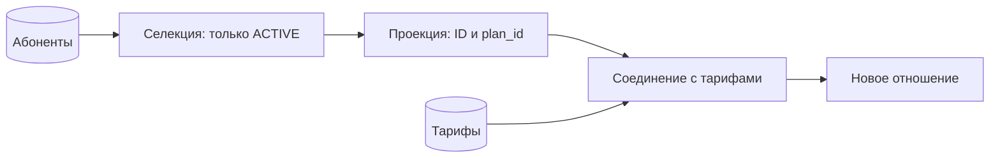
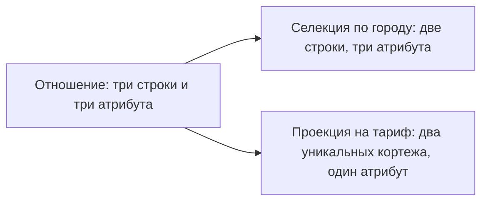
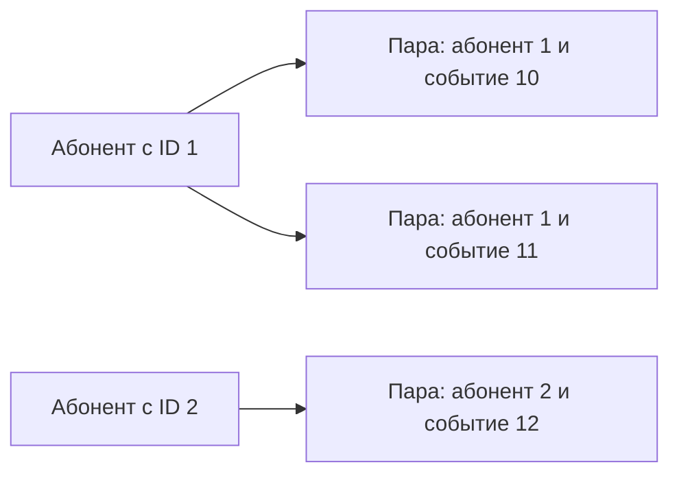

# 06. Реляционная модель и реляционная алгебра

[[Лекции/05. ER-модель — сущности и связи|← Предыдущая]] · [[index|Обложка]] · [[01. Карта курса|Карта]] · [[Лекции/07. Запросы, JOIN и подзапросы|Следующая →]]

> [!abstract] Зачем читать
> Отношение — множество кортежей с заданными атрибутами. Селекция выбирает строки, проекция — столбцы, произведение — все пары, JOIN — пары по условию. Множественные операции требуют совместимых схем. Деление выражает «для всех», а EXISTS удобно выражает полусоединение.

> [!info] Основа конспекта
> [[lecture/BDC_6.pdf#page=1|Исходная лекция: BDC_6.pdf]], 20 страниц PDF. Пояснения, разборы и упражнения добавлены к материалу курса. Номера страниц ниже — страницы PDF, а не цифры внизу слайдов.

## 1. От ER-мира к отношениям

После ER-модели нужно выбрать логическую организацию данных. Реляционная модель представляет факты отношениями. Связь определяется значениями атрибутов, а не обязательной навигацией по физическим указателям.

В учебной БД строка абонента содержит `plan_id`, и по совпадению значения с ключом тарифов мы узнаём название плана. Перенос файла таблицы на другой диск не меняет этот смысл. Внутри индексов указатели могут существовать, но это уровень реализации.

## 2. Строгие слова без сложной оболочки

| Теория | Практическая аналогия | Что важно |
|---|---|---|
| Отношение | Таблица | В теории это множество кортежей |
| Кортеж | Строка | Набор значений атрибутов |
| Атрибут | Столбец | Имеет имя и домен |
| Домен | Допустимые значения | Не только физический тип |
| Схема отношения | Описание атрибутов | Отличается от текущих данных |
| Тело отношения | Набор кортежей | Меняется со временем |
| Степень | Количество атрибутов | У subscribers в исходнике 9 |
| Кардинальность | Количество кортежей | Зависит от состояния данных |

Степень запроса `SELECT subscriber_id, balance` равна 2. Его кардинальность может быть 0, 1 или много строк. В ER-схеме слово «кардинальность» также используют для кратности связи — контекст важен.

## 3. Принципы отношений и реалии SQL

В отношении нет повторяющихся кортежей; порядок строк и атрибутов не задаёт смысл. Значения атрибута принадлежат одному домену. Названия атрибутов внутри схемы различны.

SQL допускает дубликаты и `NULL`, а позиция столбца влияет на некоторые операции и интерфейсы. Поэтому «SQL-таблица» и «математическое отношение» — удобные аналоги, но не полные синонимы.

Первичный ключ обеспечивает уникальность строк таблицы, однако проекция части столбцов может снова дать повторы. `DISTINCT` приводит такой результат к набору уникальных комбинаций.

## 4. Суперключ, потенциальный ключ, первичный ключ

**Суперключ** — набор атрибутов, который однозначно определяет строку. **Потенциальный ключ** минимален: нельзя убрать часть и сохранить идентификацию. **Первичный ключ** — один выбранный потенциальный ключ. Остальные могут поддерживаться `UNIQUE` и `NOT NULL`.

Если ID уже уникален, набор `(ID, фамилия)` является суперключом, но не минимальным ключом. Это различие понадобится в нормализации: зависимости анализируют относительно всех потенциальных ключей, а не только выбранного PK.

## 5. Реляционная алгебра замкнута

Операция получает отношения и возвращает отношение. Поэтому операции можно соединять в выражения: отфильтровать, спроецировать, соединить и снова отфильтровать.



У алгебры есть строгая семантика. Оптимизатор может использовать эквивалентные преобразования, чтобы получить тот же результат дешевле. Но операции с внешними соединениями и `NULL` требуют аккуратности: перестановка фильтра может изменить результат.

## 6. Селекция и проекция

**Селекция** `σ` отбирает строки по условию. Степень сохраняется, кардинальность может уменьшиться.

```sql
SELECT * FROM subscribers WHERE balance < 0;
```

**Проекция** `π` выбирает атрибуты. В теоретической проекции одинаковые кортежи результата объединяются.

```sql
SELECT DISTINCT plan_id FROM subscribers;
```

> [!tip] Запомнить визуально
> Селекция — горизонтальный отбор строк. Проекция — вертикальный отбор столбцов. Английское слово SELECT в синтаксисе SQL может сбить с толку: оно не является прямым названием только одной алгебраической операции.

## 7. Произведение и соединение

Декартово произведение `R × S` создаёт каждую комбинацию строк. Если в R 8 строк, а в S 5, получится 40 комбинаций. Степени складываются с учётом различения одинаковых имён атрибутов.

```sql
SELECT s.subscriber_id, st.service_name
FROM subscribers AS s CROSS JOIN service_types AS st;
```

Соединение можно понимать как произведение с условием и нужным набором столбцов. В обычном `INNER JOIN` остаются **совпавшие пары строк**, а не просто общие элементы исходных множеств.

```sql
SELECT s.subscriber_id, s.first_name, t.plan_name
FROM subscribers AS s
JOIN tariff_plans AS t ON t.plan_id = s.plan_id;
```

Если у абонента два звонка, соединение с звонками вернёт две строки. Количество результата определяется числом подходящих пар. Поэтому рисунки Венна полезны для напоминания о сохранении сторон, но плохо показывают размножение строк.

## 8. UNION, INTERSECT и EXCEPT

Для операций над множествами нужны совместимые схемы. В SQL важны число столбцов и совместимость типов по соответствующим позициям; совпадение имён результата не обязательно.

```sql
-- PostgreSQL: абоненты с платежами или интернет-трафиком.
SELECT subscriber_id FROM payments
UNION
SELECT subscriber_id FROM data_usage;

-- Те, кто присутствует в обоих наборах.
SELECT subscriber_id FROM payments
INTERSECT
SELECT subscriber_id FROM data_usage;

-- Платили, но в наборе интернет-трафика не встречались.
SELECT subscriber_id FROM payments
EXCEPT
SELECT subscriber_id FROM data_usage;
```

`UNION` удаляет повторы, `UNION ALL` сохраняет их. В PostgreSQL варианты `INTERSECT ALL` и `EXCEPT ALL` учитывают кратности. По умолчанию порядок вывода не гарантируется и после этих операций.

## 9. Деление: «для каждого», а не «хотя бы один»

Реляционное деление отвечает на вопросы вида «кто использовал **все** требуемые услуги?». Пусть отношение R хранит пары `(абонент, услуга)`, а S — требуемые услуги. В результат попадут абоненты, у которых есть каждая пара с услугами из S.

В SQL такую универсальную проверку можно выразить через двойное отрицание:

```sql
-- PostgreSQL. Кто использовал каждый тип из справочника service_types?
SELECT s.subscriber_id
FROM subscribers AS s
WHERE NOT EXISTS (
    SELECT 1
    FROM service_types AS st
    WHERE NOT EXISTS (
        SELECT 1 FROM call_records AS c
        WHERE c.subscriber_id = s.subscriber_id
          AND c.service_type_id = st.service_type_id
    )
);
```

Читаем: «нет требуемой услуги, для которой у абонента нет записи». Это математическое «для всех» через «не существует контрпримера». Справочник в этом примере включает Data, тогда как часть трафика хранится отдельно: реальное бизнес-определение «использовал все услуги» требует сначала договориться об источниках событий.

## 10. Внешние соединения и полусоединение

`LEFT JOIN` сохраняет строки слева и дополняет отсутствующие значения справа `NULL`. `RIGHT JOIN` симметричен. `FULL JOIN` сохраняет обе стороны. Это расширения практической SQL-работы с неполным совпадением.

**Полусоединение** возвращает только столбцы одной стороны для строк, имеющих совпадение; удобная SQL-запись — `WHERE EXISTS (...)`. **Антисоединение** ищет отсутствие совпадения — `NOT EXISTS`.

> [!warning] Уточнение к страницам 18–19
> LEFT/RIGHT OUTER JOIN не называют полусоединениями. У внешнего соединения в результате могут быть столбцы обеих таблиц и дополненные NULL строки. У полусоединения возвращается одна сторона без размножения из-за количества совпадений справа.

## Алгебра на таблице из нескольких кортежей

Возьмём отношение абонентов A с атрибутами `(id, tariff, city)`.

| id | tariff | city |
|---:|---|---|
| 1 | Basic | Омск |
| 2 | Basic | Томск |
| 3 | Premium | Омск |

Селекция по городу Омск оставляет строки 1 и 3, сохраняя все три атрибута. Проекция на tariff даёт Basic и Premium: повтор Basic исчезает, потому что результат теоретической проекции является множеством. В SQL для такого поведения нужен DISTINCT.



Если после селекции сделать проекцию на tariff, результат здесь тот же. Но такое совпадение не означает, что операции всегда можно менять местами: проекция должна сохранить атрибуты, нужные последующему условию. После удаления city уже нельзя применить фильтр по city без возвращения к исходному отношению.

## Замкнутость объясняет вложенные запросы

Результат одной операции можно подать на вход другой, поскольку он снова является отношением. На практике это напоминает подзапрос или CTE, результат которого используется как источник данных.

Важно следить за схемой промежуточного отношения. Если удалён столбец subscriber\_id, следующий шаг не сможет честно соединиться по нему. Если агрегация уже изменила зерно на «тариф», нельзя затем трактовать строку как отдельного абонента.

| Этап | Одна строка означает | Какой ключ ожидаем |
|---|---|---|
| Исходные события | Отдельное событие | record\_id |
| Итог по абоненту | Совокупность событий абонента | subscriber\_id |
| Итог по тарифу | Совокупность по тарифу | plan\_id |

Одна из частых ошибок аналитики — потерять это изменение смысла между шагами. Имя промежуточной таблицы `events_by_subscriber` уже помогает читателю проверить, на каком уровне выполнена агрегация.

## Почему JOIN не заменяется рисунком пересечения

Пусть у абонента 1 есть два события, а у абонента 2 одно. Соединение абонентов с событиями по ID создаёт три пары. При этом результат включает атрибуты обеих сторон. Нельзя представить его просто как «общие строки двух таблиц»: схемы у таблиц разные, а совпадает значение выбранного атрибута.



Даже соединение по условию равенства не обязано быть связью PK/FK: можно соединять по региону или диапазону времени. Но тогда нужно особенно внимательно оценивать количество совпадающих пар. FK контролирует допустимость хранимой ссылки; ON описывает условие конкретного запроса.

## Множество и мультимножество дают разные арифметики

Пусть первый результат содержит `1, 1, 2`, а второй `1, 3`. Обычный UNION даёт уникальные `1, 2, 3`. UNION ALL сохраняет обе кратности и даёт пять элементов: три единицы, двойку и тройку. Без ORDER BY порядок их предъявления не является частью обещания.

Для пересечения множеств остаётся `1`. В мультимножественном пересечении с ALL число повторов определяется меньшей кратностью. В разности с ALL повторы вычитаются, но не становятся отрицательными. Эти правила важны при объединении событий: одинаковые суммы двух платежей могут отражать два разных факта.

Прежде чем убирать дубли, спроси, почему они появились. Иногда это естественные разные события, иногда ошибочная загрузка, иногда размножение из-за JOIN. Одна команда DISTINCT скрывает различие между этими причинами.

## Универсальное условие «для всех» через контрпример

Вопрос «кто использовал все требуемые типы услуг?» полезно перевести так: «для кого не существует требуемого типа без соответствующего события». Такая логическая переформулировка объясняет двойной NOT EXISTS, а не заставляет заучивать скобки.

Если список требований пуст, условие «использовал каждый из требуемых типов» логически выполняется для всех рассматриваемых абонентов. Это называется пустой истинностью универсального условия. Но бизнес может хотеть дополнительное правило «список требований не должен быть пустым». Математический результат и бизнес-проверка должны быть согласованы.

## Реляционное описание и физический план

Алгебра объясняет смысл преобразования, а не предписывает исполнять огромное декартово произведение целиком перед фильтрацией. Оптимизатор может подобрать эквивалентный порядок и алгоритм. Аналог «JOIN = произведение плюс селекция» полезен для понимания результата, но не является описанием обязательного расхода памяти.

На защите отделяй два ответа: что означает операция и как конкретная СУБД может её выполнить. Первый проверяется на маленьких кортежах, второй — по плану и измерениям.

## Где это в PDF

[[lecture/BDC_6.pdf#page=3|Проектирование и термины: 3–7]] · [[lecture/BDC_6.pdf#page=8|Алгебра: 8–16]] · [[lecture/BDC_6.pdf#page=17|Виды JOIN: 17–20]].

## Проверь себя без подсказки

Сначала закрой пояснения и ответь вслух. Для сложного ответа приведи свой пример или контрпример.

1. Как изменяются степень и кардинальность при селекции и проекции?
2. Почему суперключ может не быть потенциальным ключом?
3. Почему JOIN не равен пересечению множеств?
4. Как прочитать двойной NOT EXISTS обычными словами?
5. Чем LEFT JOIN отличается от полусоединения?
6. Покажи селекцию и проекцию на отношении из трёх кортежей.
7. Когда перестановка операций потребует сохранить дополнительный атрибут?
8. Проследи изменение зерна от события к итогу по тарифу.
9. Вручную вычисли UNION и UNION ALL для наборов с повторами.
10. Как читать результат деления при пустом наборе требований?
11. Почему равенство в ON не обязано соответствовать FK?
12. Что различает алгебраический смысл и физическое выполнение JOIN?

## Вопросы с выбором ответа

Выбери ответ: результат появится сразу. Затем раскрой пояснение и разбери, почему остальные варианты не подходят.

```text
#quiz
? В отношении 100 строк и 4 атрибута. Какова его степень?
+ 4
- 100
- 400
```

```text
#quiz
? Что вернёт CROSS JOIN таблиц из 8 и 5 строк без фильтров?
- 13 строк
+ 40 строк
- Не более 8 строк
```

```text
#quiz
? У отношения три атрибута. Что меняет селекция строк?
+ Может изменить кардинальность, сохраняя степень
- Обязательно увеличивает степень
- Удаляет все имена атрибутов
```

> [!explain]- Почему так
> Селекция отбирает кортежи, а не схему результата.

```text
#quiz
? Почему проекция может уменьшить число кортежей?
- Проекция всегда удаляет случайную половину строк
+ После удаления атрибутов некоторые кортежи совпадают
- Любой SELECT запрещает повторения
```

> [!explain]- Почему так
> В теории отношение остаётся множеством уникальных кортежей.

```text
#quiz
? Что произойдёт с условием по city, если предыдущий шаг удалил city?
- Имя города будет восстановлено автоматически
- GROUP BY вернёт исходную схему
+ Нужно пересмотреть порядок или сохранить атрибут
```

> [!explain]- Почему так
> Следующая операция располагает только схемой своего входа.

```text
#quiz
? Что означает замкнутость реляционной алгебры?
+ Результат операции снова является отношением
- Нельзя использовать несколько операций подряд
- Каждая таблица физически закрыта для записи
```

> [!explain]- Почему так
> Замкнутость позволяет составлять выражения и промежуточные отношения.

```text
#quiz
? Сколько элементов у UNION ALL наборов 1,1,2 и 1,3?
- Три
+ Пять
- Всегда один
```

> [!explain]- Почему так
> ALL сохраняет число повторов: три единицы, двойку и тройку.

```text
#quiz
? Почему JOIN не обязан физически материализовать всё декартово произведение?
- SQL не имеет соединений
- СУБД всегда удаляет условие ON
+ Оптимизатор выбирает эквивалентный способ выполнения
```

> [!explain]- Почему так
> Алгебраическое объяснение смысла не предписывает обязательный физический план.

```text
#quiz
? При пустом списке требований универсальное условие для каждого требования логически истинно?
+ Да, но бизнес может добавить запрет пустого списка
- Нет, всегда ложно
- Только при CROSS JOIN
```

> [!explain]- Почему так
> Отсутствует контрпример среди требований; дополнительное правило задают отдельно.

```text
#quiz
? Почему строка итога по тарифу не равна строке события?
- Потому что её шрифт другой
+ Агрегация изменила зерно и схему
- Потому что COUNT меняет исходную таблицу
```

> [!explain]- Почему так
> Нужно отслеживать смысл одной строки на каждом промежуточном этапе.

## Закрепить тему на практике

- [[Практика/04. JOIN и отсутствие связанных строк]]
- [[Практика/05. Подзапросы и EXISTS]]
- [[Практика/06. Множества и повторения]]
- [[Практика/08. DDL и нормализация]]

Здесь остаются вопросы на понимание. В тренировках — ввод запросов, проверка результатов и серверные задачи с разбором.

## Чек-лист понимания

- [ ] Прочитал лекцию и разобрал схему.
- [ ] Ответил на вопросы вслух без конспекта.
- [ ] Ответил на десять тестовых вопросов и объяснил неверные варианты.

## Суть за минуту

Отношение — множество кортежей с заданными атрибутами. Селекция выбирает строки, проекция — столбцы, произведение — все пары, JOIN — пары по условию. Множественные операции требуют совместимых схем. Деление выражает «для всех», а EXISTS удобно выражает полусоединение.

^summary-l06

## Куда дальше

Практическое продолжение: [[Лекции/07. Запросы, JOIN и подзапросы]]. Зависимости и нормальные формы: [[Лекции/08. Нормализация и физическое хранение]].

[[Лекции/05. ER-модель — сущности и связи|← Предыдущая]] · [[index|Обложка]] · [[01. Карта курса|Карта]] · [[Лекции/07. Запросы, JOIN и подзапросы|Следующая →]]
