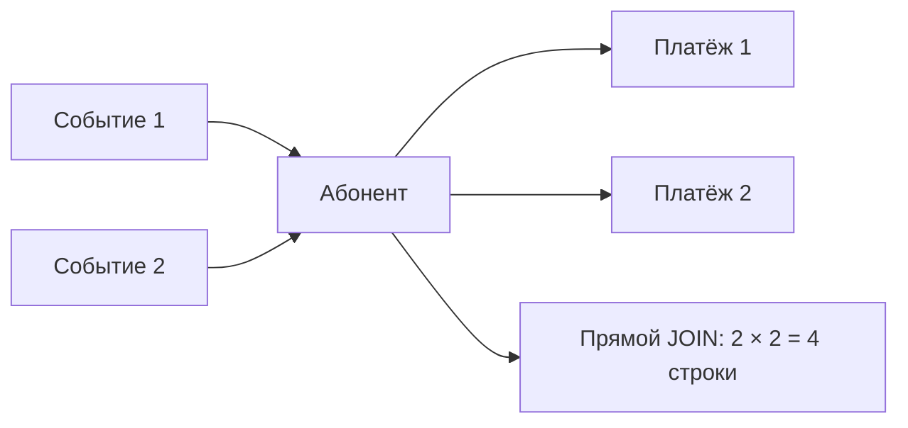
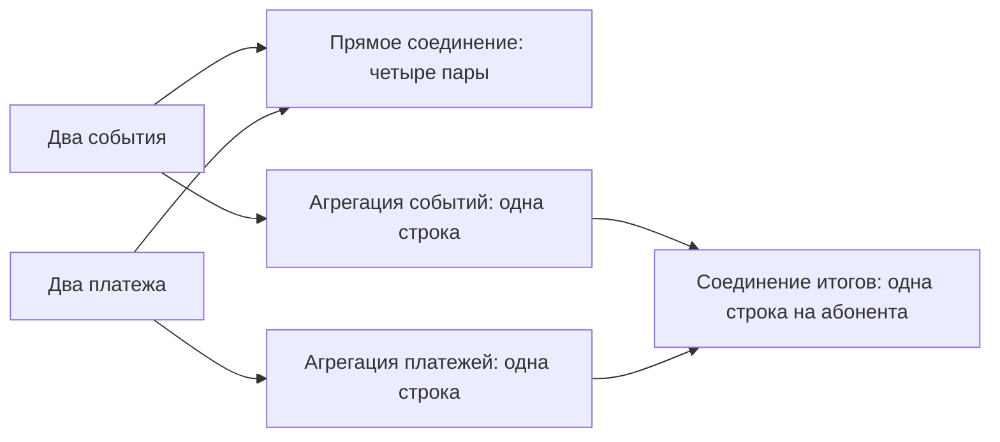
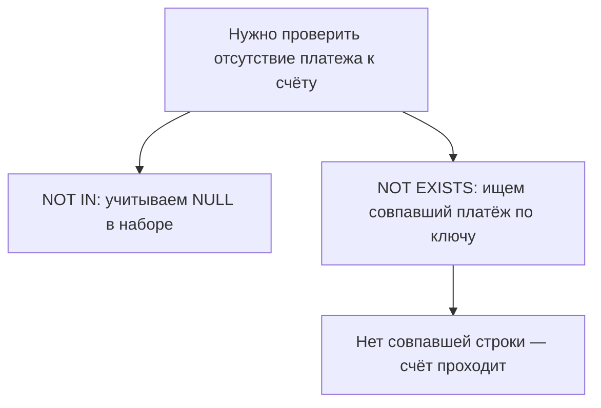

# 07. Запросы, JOIN и подзапросы

[[Лекции/06. Реляционная модель и реляционная алгебра|← Предыдущая]] · [[index|Обложка]] · [[01. Карта курса|Карта]] · [[Лекции/08. Нормализация и физическое хранение|Следующая →]]

> [!abstract] Зачем читать
> Сначала определяй, чему соответствует строка результата. JOIN создаёт пары и может размножать строки. LEFT JOIN сохраняет левую сторону только до последующей фильтрации WHERE. EXISTS проверяет наличие, NOT EXISTS — отсутствие; предварительная агрегация защищает суммы от умножения при нескольких связях 1:N.

> [!info] Основа конспекта
> [[lecture/BDC_7.pdf#page=1|Исходная лекция: BDC_7.pdf]], 19 страниц PDF. Пояснения, разборы и упражнения добавлены к материалу курса. Номера страниц ниже — страницы PDF, а не цифры внизу слайдов.

## 1. Начни с формы результата

Перед сложным запросом сформулируй: **одна строка результата соответствует чему?** Абоненту, звонку, тарифу или месяцу? Это «зерно» отчёта. Если нужен один итог на абонента, прямое соединение его звонков и платежей может создать много строк и раздуть суммы.

Далее выбери поля, фильтры и источники. Чёткая форма результата уменьшает число случайных `DISTINCT`, которыми часто пытаются скрыть неверное соединение.

## 2. DISTINCT и LIKE

```sql
SELECT DISTINCT plan_id
FROM subscribers
WHERE plan_id IS NOT NULL
ORDER BY plan_id;

SELECT plan_id, plan_name
FROM tariff_plans
WHERE plan_name LIKE 'S%'
ORDER BY plan_id;
```

`DISTINCT` действует на **всю выбранную комбинацию**, а не только на первый столбец. `SELECT DISTINCT plan_id, subscriber_id` не даст один тариф на строку, если ID абонентов различаются.

В `LIKE` символ `%` означает любую последовательность, включая пустую, а `_` — один символ. PostgreSQL также предоставляет `ILIKE` для поиска без учёта регистра. Экранирование специальных символов нужно задавать осознанно, например `LIKE '%!_%' ESCAPE '!'` для поиска подчёркивания.

`NULL NOT LIKE 'S%'` не истинно: если нужно включить отсутствующие значения, добавь `OR ... IS NULL`. Регистры и правила сравнения строк могут различаться между PostgreSQL и браузерным AlaSQL.

## 3. JOIN — это сопоставление пар

```sql
SELECT s.subscriber_id, s.first_name, t.plan_name
FROM subscribers AS s
INNER JOIN tariff_plans AS t ON t.plan_id = s.plan_id
ORDER BY s.subscriber_id;
```

Абонент без тарифа не попадёт в этот результат. `LEFT JOIN` позволит сохранить его:

```sql
SELECT s.subscriber_id, s.first_name, t.plan_name
FROM subscribers AS s
LEFT JOIN tariff_plans AS t ON t.plan_id = s.plan_id
ORDER BY s.subscriber_id;
```

| Соединение | Что сохраняет |
|---|---|
| INNER | Только подходящие пары |
| LEFT | Все строки слева и подходящие пары |
| RIGHT | Все строки справа и подходящие пары |
| FULL | Обе стороны, в том числе без пары |
| CROSS | Все возможные пары |

При внешнем соединении недостающая сторона заполняется `NULL`. В `FULL JOIN` для общего ключа часто используют `COALESCE(a.id, b.id)`, чтобы показать идентификатор независимо от стороны.

> [!warning] Уточнение к слайду 5
> `INNER JOIN` в PostgreSQL требует условие `ON` или `USING` либо вариант `NATURAL`. Простое удаление `ON` обычно даёт синтаксическую ошибку. Декартово произведение задают `CROSS JOIN`, перечислением таблиц через запятую или условием `ON TRUE`.

## 4. WHERE может «съесть» LEFT JOIN

Нужно показать **всех абонентов** и только исходящие звонки. Ограничение на правую сторону следует поставить в `ON`:

```sql
SELECT s.subscriber_id, c.record_id
FROM subscribers AS s
LEFT JOIN call_records AS c
  ON c.subscriber_id = s.subscriber_id
 AND c.service_type_id = 1
ORDER BY s.subscriber_id, c.record_id;
```

Если перенести `c.service_type_id = 1` в `WHERE`, строки без звонков будут удалены, потому что сравнение с дополненным `NULL` не истинно. Условие в `ON` отвечает за поиск пары; условие в `WHERE` — за окончательный отбор строк результата соединения.

## 5. Считать нужно правильный объект

```sql
SELECT s.subscriber_id, s.first_name,
       COUNT(c.record_id) AS event_count,
       COALESCE(SUM(c.cost), 0) AS total_cost
FROM subscribers AS s
LEFT JOIN call_records AS c ON c.subscriber_id = s.subscriber_id
GROUP BY s.subscriber_id, s.first_name
ORDER BY s.subscriber_id;
```

У абонента без событий `COUNT(c.record_id)` равен нулю, а `COUNT(*)` был бы равен одному: внешнее соединение сохраняет одну строку с `NULL` справа. Также таблица `call_records` содержит тип услуги; если нужны именно голосовые вызовы, фильтруй `service_type_id`, а не называй каждую запись звонком автоматически.

## 6. Ловушка двух независимых связей 1:N

У Анны два события и два платежа. Соединение `subscribers → call_records → payments` по абоненту даст **четыре** комбинации. Каждая стоимость события и сумма платежа повторятся по два раза.



Правильный приём — сначала независимо агрегировать каждую сторону до одной строки на абонента, а потом соединить итоги:

```sql
WITH call_totals AS (
    SELECT subscriber_id, SUM(cost) AS call_total
    FROM call_records GROUP BY subscriber_id
), payment_totals AS (
    SELECT subscriber_id, SUM(amount) AS payment_total
    FROM payments GROUP BY subscriber_id
)
SELECT s.subscriber_id,
       COALESCE(c.call_total, 0) AS call_total,
       COALESCE(p.payment_total, 0) AS payment_total
FROM subscribers AS s
LEFT JOIN call_totals AS c ON c.subscriber_id = s.subscriber_id
LEFT JOIN payment_totals AS p ON p.subscriber_id = s.subscriber_id
ORDER BY s.subscriber_id;
```

Это пример PostgreSQL. В тренажёре используется проверенная базовая часть SQL; CTE и сложные случаи не следует переносить в другой диалект без проверки.

## 7. Подзапросы: четыре формы

**Скалярный** возвращает один столбец и максимум одну строку. В PostgreSQL ноль строк означает `NULL`, а больше одной — ошибку.

```sql
SELECT subscriber_id, balance
FROM subscribers
WHERE balance > (SELECT AVG(balance) FROM subscribers);
```

**Табличный** возвращает набор строк, например во `FROM`. Дай ему понятный алиас: это обязательно в PostgreSQL 15, который указан в Dockerfile курса, и улучшает читаемость на других версиях.

**Коррелированный** использует значения внешней строки:

```sql
SELECT s.subscriber_id, s.balance
FROM subscribers AS s
WHERE s.balance > (
    SELECT AVG(other.balance)
    FROM subscribers AS other
    WHERE other.plan_id = s.plan_id
);
```

**Подзапрос существования** нужен, когда важен только факт наличия строки:

```sql
SELECT s.subscriber_id
FROM subscribers AS s
WHERE NOT EXISTS (
    SELECT 1 FROM payments AS p
    WHERE p.subscriber_id = s.subscriber_id
);
```

`SELECT 1` здесь не возвращается пользователю: `EXISTS` проверяет, существует ли хотя бы одна подходящая строка.

## 8. IN, ANY, ALL и опасность NOT IN

`IN` проверяет принадлежность набору. `> ANY (...)` означает «больше хотя бы одного», `> ALL (...)` — «больше каждого». Пустые наборы и `NULL` требуют отдельного разбора: логика здесь трёхзначная.

Особенно опасен `NOT IN`, если подзапрос возвращает `NULL`. Например, поиск счетов «без платежа» через `invoice_id NOT IN (SELECT invoice_id FROM payments)` может не вернуть ожидаемые строки, потому что у пополнения без счёта `invoice_id IS NULL`. Надёжнее выражать отсутствие через коррелированный `NOT EXISTS`.

> [!question]- EXISTS всегда быстрее IN?
> Нет. Планировщик PostgreSQL может преобразовать оба варианта в похожие планы. Сначала выбери правильную семантику, затем сравни реальные планы через EXPLAIN. Коррелированный подзапрос также не обязан физически запускаться ровно один раз на каждую внешнюю строку: возможны преобразования.

## 9. HAVING и CTE помогают читать аналитику

`WHERE` отбирает исходные строки; `HAVING` — группы после агрегации. Порог может вычисляться подзапросом. `WITH` даёт имя промежуточному результату и позволяет разделить задачу на шаги.

CTE не является обещанием «всегда вычислить один раз и сохранить в памяти». PostgreSQL может встроить его в основной запрос; поведение зависит от запроса и версии. `MATERIALIZED` управляет этим отдельно. Подробности производительности — в [[Лекции/13. Производительность и индексы]].

## Проследим размножение строк руками

У абонента есть события стоимостью 2 и 4 рубля и платежи на 200 и 106 рублей. Если соединить обе таблицы событий напрямую по абоненту, получится следующая промежуточная таблица.

| Событие | Его cost | Платёж | Его amount |
|---|---:|---|---:|
| Первое | 2 | Первый | 200 |
| Первое | 2 | Второй | 106 |
| Второе | 4 | Первый | 200 |
| Второе | 4 | Второй | 106 |

Сумма cost станет 12 вместо 6, сумма amount — 612 вместо 306. DISTINCT по всей строке не поможет: все четыре пары действительно различны. SUM(DISTINCT amount) тоже не универсальное решение: два настоящих платежа одинакового размера должны считаться дважды.



Это один из лучших контрпримеров для проверки отчёта. Если тестовые данные содержат только по одному событию каждой категории, неверный запрос случайно выглядит правильным.

## Переход от вопроса к семантике запроса

| Нужен ответ | Обычно начинаем с |
|---|---|
| Какие события имеют подходящего абонента? | INNER JOIN |
| Все абоненты и их события, даже если событий нет | LEFT JOIN |
| Абоненты, у которых есть хотя бы один платёж | EXISTS или осмысленная уникальная проекция |
| Абоненты без единого платежа | NOT EXISTS или корректное антисоединение |
| Итог расходов на абонента | GROUP BY на нужном зерне |
| Расхождение двух агрегированных источников | Сверка итогов, иногда FULL JOIN |

Это отправные точки, а не правило выбирать синтаксис без анализа. Например, JOIN ради одного факта существования может вернуть абонента несколько раз. EXISTS сразу выражает, что число совпадений справа не должно размножать строку слева.

## Скалярный подзапрос и ошибочное ожидание одной строки

Условие `balance > (SELECT monthly_fee FROM tariff_plans)` не выбирает автоматически «нужный» тариф. Если подзапрос возвращает несколько строк, PostgreSQL выдаёт ошибку. Нужно определить отношение между внешней строкой и справочником либо агрегировать справочник по смыслу задачи.

Вопросы «баланс больше средней месячной платы» и «баланс больше платы своего тарифа» различаются. Первый допускает один общий AVG. Второй требует связать тариф именно с абонентом. Случайный LIMIT 1 убирает ошибку количества строк, но подменяет смысл задачи.

## NOT IN: ловушка с пустой привязкой

В учебном наборе у пополнения без счёта `invoice_id IS NULL`. Проверка `invoice_id NOT IN (SELECT invoice_id FROM payments)` может дать UNKNOWN для счетов, которые по-человечески кажутся «не найденными». В PostgreSQL сравнение с неизвестным элементом мешает доказать отсутствие совпадения.



Если применяешь LEFT JOIN для поиска отсутствия, проверяй NULL в столбце правой стороны, который не может быть NULL у существующей строки, например PK. Проверка необязательного `payment_method IS NULL` может спутать отсутствие платежа с существующим платежом без метода.

## Корреляция — зависимость смысла, а не приговор скорости

Подзапрос коррелирован, когда использует атрибут внешнего уровня. Это описание зависимости. Реальный планировщик может преобразовать часть таких запросов в соединения, использовать индекс или иначе избежать наивного полного повторного поиска.

Поэтому сначала сформулируй корректный запрос. Затем смотри EXPLAIN. Утверждение «подзапрос плохой, JOIN хороший» скрывает два риска: можно поменять кратность результата и можно заменить один эффективный план другим неудачным.

## Сверяем деньги и события по одному смыслу

Чтобы найти недоплаченный счёт, сопоставляй платежи по `invoice_id`, а не только по абоненту. Иначе пополнение другого счёта или свободное пополнение будет ошибочно засчитано в погашение нужного счёта.

При этом состояние `status = 'PAID'` в учебных данных не следует считать вычисленным доказательством равенства сумм. Для аудита полезно сравнить фактическую сумму связанных платежей с total\_amount. Если обнаружилось расхождение, сначала выясни правила частичных платежей, возвратов и смены состояния, затем решай, ошибка ли это.

## Проверка запроса по инвариантам

После получения результата проверь простые отношения: сумма по группам должна согласовываться с общей суммой того же исходного набора; число различных ID не должно неожиданно изменяться; абоненты без событий должны сохраняться, если это обещано условием. Эти проверки не доказывают всё, но быстро обнаруживают типичные ошибки.

Хорошая последовательность объяснения решения: зерно результата → источники → кратности связей → место фильтров → агрегация → проверка на абоненте без событий и абоненте с несколькими событиями.

## Где это в PDF

[[lecture/BDC_7.pdf#page=3|DISTINCT, LIKE, JOIN: 3–10]] · [[lecture/BDC_7.pdf#page=11|Подзапросы: 11–16]] · [[lecture/BDC_7.pdf#page=17|CTE и конвейер: 17–19]]. Примеры с вышками и таблицей `Calls` из PDF адаптированы к реальным `call_records`, `subscribers`, `payments`; таблиц вышек в дампе нет.

## Проверь себя без подсказки

Сначала закрой пояснения и ответь вслух. Для сложного ответа приведи свой пример или контрпример.

1. Почему COUNT(\*) после LEFT JOIN может дать 1 у абонента без звонков?
2. Чем условие в ON отличается от такого же условия в WHERE?
3. Как два звонка и три платежа превращаются в шесть строк?
4. Почему NOT IN с NULL опасен?
5. Что произойдёт со скалярным подзапросом при нуле и при двух строках?
6. Покажи таблицу четырёх пар для двух событий и двух платежей.
7. Почему SUM(DISTINCT amount) не исправляет задачу в общем случае?
8. По какому атрибуту нужно проверять отсутствие правой строки и почему?
9. Как свободное пополнение влияет на сверку конкретного счёта?
10. Почему LIMIT 1 может скрыть неверно сформулированный скалярный подзапрос?
11. Какие инварианты результата помогают обнаружить ошибку?
12. Как построить контрпример для отчёта, который проверяли только на единичных событиях?

## Вопросы с выбором ответа

Выбери ответ: результат появится сразу. Затем раскрой пояснение и разбери, почему остальные варианты не подходят.

```text
#quiz
? Два события и три платежа абонента соединены по subscriber_id без агрегации. Сколько пар получится?
- 5
+ 6
- 3
```

```text
#quiz
? Как сохранить абонентов без платежей при подсчёте числа платежей?
+ LEFT JOIN и COUNT(payment_id)
- INNER JOIN и COUNT(*)
- CROSS JOIN и COUNT(*)
```

```text
#quiz
? У абонента два события и два платежа. SUM(DISTINCT amount) — универсальное исправление размножения?
- Да, всегда
+ Нет: два настоящих платежа могут иметь одинаковую сумму
- Да, если оба столбца numeric
```

> [!explain]- Почему так
> Устранять нужно неверное зерно соединения, а не случайно одинаковые значения.

```text
#quiz
? Какую NULL-проверку выбирать для антисоединения?
- Любое необязательное поле правой таблицы
- Только текстовое поле слева
+ PK правой стороны, который определён у существующей строки
```

> [!explain]- Почему так
> Необязательное поле может быть NULL и у реально найденной строки.

```text
#quiz
? По какому полю нужно связывать платежи с конкретным счётом при сверке?
+ По invoice_id
- Только по имени абонента
- По одинаковой сумме
```

> [!explain]- Почему так
> Совпадение абонента не означает, что платёж погашает именно выбранный счёт.

```text
#quiz
? Что не так с LIMIT 1 в скалярном подзапросе без бизнес-обоснования?
- Он всегда вычисляет среднее
+ Он может скрыть ошибку связи и выбрать произвольное значение
- Он проверяет владельца строки
```

> [!explain]- Почему так
> Сначала нужно определить требуемый единственный факт, а не просто убрать ошибку числа строк.

```text
#quiz
? Почему два одинаковых платежа по 100 должны иногда считаться дважды?
- Одинаковое число означает одну и ту же операцию
- UNION всегда знает бизнес-идентификатор
+ Это могут быть два самостоятельных события
```

> [!explain]- Почему так
> Факт идентифицируется ключом и смыслом, а не одной суммой.

```text
#quiz
? Что предсказывает логическая корреляция подзапроса?
+ Зависимость от внешней строки, но не единственный физический алгоритм
- Обязательно экспоненциальное время
- Обязательное отсутствие индексов
```

> [!explain]- Почему так
> Стоимость оценивают по реальному плану, а не только форме текста.

```text
#quiz
? Как проверить, что все абоненты сохранились в отчёте?
- Смотреть только на красивую таблицу
+ Сопоставить набор их ID с исходным требуемым набором
- Считать только максимальный баланс
```

> [!explain]- Почему так
> Инварианты количества и идентификаторов помогают обнаружить потерю строк.

```text
#quiz
? Где фильтровать правые события, чтобы сохранить абонента без подходящего события?
- Всегда в финальном WHERE по правому полю
- В имени псевдонима
+ В ON соответствующего LEFT JOIN
```

> [!explain]- Почему так
> Условие в WHERE может удалить дополненную NULL строку.

## Закрепить тему на практике

- [[Практика/02. WHERE, NULL и CASE]]
- [[Практика/03. Агрегаты и HAVING]]
- [[Практика/04. JOIN и отсутствие связанных строк]]
- [[Практика/05. Подзапросы и EXISTS]]
- [[Практика/06. Множества и повторения]]
- [[Практика/07. Аналитика биллинга]]

Здесь остаются вопросы на понимание. В тренировках — ввод запросов, проверка результатов и серверные задачи с разбором.

## Чек-лист понимания

- [ ] Прочитал лекцию и разобрал схему.
- [ ] Ответил на вопросы вслух без конспекта.
- [ ] Ответил на десять тестовых вопросов и объяснил неверные варианты.

## Суть за минуту

Сначала определяй, чему соответствует строка результата. JOIN создаёт пары и может размножать строки. LEFT JOIN сохраняет левую сторону только до последующей фильтрации WHERE. EXISTS проверяет наличие, NOT EXISTS — отсутствие; предварительная агрегация защищает суммы от умножения при нескольких связях 1:N.

^summary-l07

## Куда дальше

Алгебра: [[Лекции/06. Реляционная модель и реляционная алгебра]]. Шпаргалка: [[Справочники/SQL и psql — шпаргалка]]. Тренировка: [[Практика/00. Тренировки по темам]].

[[Лекции/06. Реляционная модель и реляционная алгебра|← Предыдущая]] · [[index|Обложка]] · [[01. Карта курса|Карта]] · [[Лекции/08. Нормализация и физическое хранение|Следующая →]]
