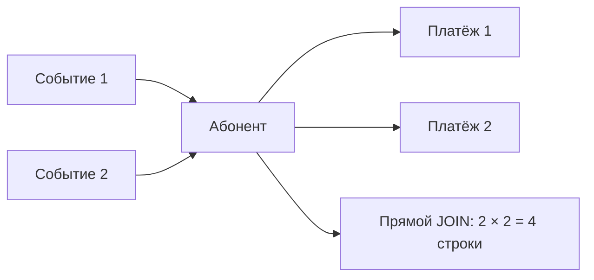

# 07. Запросы, JOIN и подзапросы

[[Лекции/06. Реляционная модель и реляционная алгебра|← Предыдущая]] · [[index|🏠 Старт]] · [[01. Карта курса|🧭 Карта]] · [[Лекции/08. Нормализация и физическое хранение|Следующая →]]

> [!abstract] Зачем читать
> Сначала определяй, чему соответствует строка результата. JOIN создаёт пары и может размножать строки. LEFT JOIN сохраняет левую сторону только до последующей фильтрации WHERE. EXISTS проверяет наличие, NOT EXISTS — отсутствие; предварительная агрегация защищает суммы от умножения при нескольких связях 1:N.

> [!info] Основа конспекта
> [[lecture/BDC_7.pdf#page=1|Исходная лекция: BDC_7.pdf]], 19 страниц PDF. Пояснения, разборы и упражнения добавлены к материалу курса. Номера страниц ниже — страницы PDF, а не цифры внизу слайдов.

## 1. Начни с формы результата

Перед сложным запросом сформулируй: **одна строка результата соответствует чему?** Абоненту, звонку, тарифу или месяцу? Это «зерно» отчёта. Если нужен один итог на абонента, прямое соединение его звонков и платежей может создать много строк и раздуть суммы.

Далее выбери поля, фильтры и источники. Чёткая форма результата уменьшает число случайных `DISTINCT`, которыми часто пытаются скрыть неверное соединение.

## 2. DISTINCT и LIKE

```sql
SELECT DISTINCT plan_id
FROM subscribers
WHERE plan_id IS NOT NULL
ORDER BY plan_id;

SELECT plan_id, plan_name
FROM tariff_plans
WHERE plan_name LIKE 'S%'
ORDER BY plan_id;
```

`DISTINCT` действует на **всю выбранную комбинацию**, а не только на первый столбец. `SELECT DISTINCT plan_id, subscriber_id` не даст один тариф на строку, если ID абонентов различаются.

В `LIKE` символ `%` означает любую последовательность, включая пустую, а `_` — один символ. PostgreSQL также предоставляет `ILIKE` для поиска без учёта регистра. Экранирование специальных символов нужно задавать осознанно, например `LIKE '%!_%' ESCAPE '!'` для поиска подчёркивания.

`NULL NOT LIKE 'S%'` не истинно: если нужно включить отсутствующие значения, добавь `OR ... IS NULL`. Регистры и правила сравнения строк могут различаться между PostgreSQL и браузерным AlaSQL.

## 3. JOIN — это сопоставление пар

```sql
SELECT s.subscriber_id, s.first_name, t.plan_name
FROM subscribers AS s
INNER JOIN tariff_plans AS t ON t.plan_id = s.plan_id
ORDER BY s.subscriber_id;
```

Абонент без тарифа не попадёт в этот результат. `LEFT JOIN` позволит сохранить его:

```sql
SELECT s.subscriber_id, s.first_name, t.plan_name
FROM subscribers AS s
LEFT JOIN tariff_plans AS t ON t.plan_id = s.plan_id
ORDER BY s.subscriber_id;
```

| Соединение | Что сохраняет |
|---|---|
| INNER | Только подходящие пары |
| LEFT | Все строки слева и подходящие пары |
| RIGHT | Все строки справа и подходящие пары |
| FULL | Обе стороны, в том числе без пары |
| CROSS | Все возможные пары |

При внешнем соединении недостающая сторона заполняется `NULL`. В `FULL JOIN` для общего ключа часто используют `COALESCE(a.id, b.id)`, чтобы показать идентификатор независимо от стороны.

> [!warning] Уточнение к слайду 5
> `INNER JOIN` в PostgreSQL требует условие `ON` или `USING` либо вариант `NATURAL`. Простое удаление `ON` обычно даёт синтаксическую ошибку. Декартово произведение задают `CROSS JOIN`, перечислением таблиц через запятую или условием `ON TRUE`.

## 4. WHERE может «съесть» LEFT JOIN

Нужно показать **всех абонентов** и только исходящие звонки. Ограничение на правую сторону следует поставить в `ON`:

```sql
SELECT s.subscriber_id, c.record_id
FROM subscribers AS s
LEFT JOIN call_records AS c
  ON c.subscriber_id = s.subscriber_id
 AND c.service_type_id = 1
ORDER BY s.subscriber_id, c.record_id;
```

Если перенести `c.service_type_id = 1` в `WHERE`, строки без звонков будут удалены, потому что сравнение с дополненным `NULL` не истинно. Условие в `ON` отвечает за поиск пары; условие в `WHERE` — за окончательный отбор строк результата соединения.

## 5. Считать нужно правильный объект

```sql
SELECT s.subscriber_id, s.first_name,
       COUNT(c.record_id) AS event_count,
       COALESCE(SUM(c.cost), 0) AS total_cost
FROM subscribers AS s
LEFT JOIN call_records AS c ON c.subscriber_id = s.subscriber_id
GROUP BY s.subscriber_id, s.first_name
ORDER BY s.subscriber_id;
```

У абонента без событий `COUNT(c.record_id)` равен нулю, а `COUNT(*)` был бы равен одному: внешнее соединение сохраняет одну строку с `NULL` справа. Также таблица `call_records` содержит тип услуги; если нужны именно голосовые вызовы, фильтруй `service_type_id`, а не называй каждую запись звонком автоматически.

## 6. Ловушка двух независимых связей 1:N

У Анны два события и два платежа. Соединение `subscribers → call_records → payments` по абоненту даст **четыре** комбинации. Каждая стоимость события и сумма платежа повторятся по два раза.



Правильный приём — сначала независимо агрегировать каждую сторону до одной строки на абонента, а потом соединить итоги:

```sql
WITH call_totals AS (
    SELECT subscriber_id, SUM(cost) AS call_total
    FROM call_records GROUP BY subscriber_id
), payment_totals AS (
    SELECT subscriber_id, SUM(amount) AS payment_total
    FROM payments GROUP BY subscriber_id
)
SELECT s.subscriber_id,
       COALESCE(c.call_total, 0) AS call_total,
       COALESCE(p.payment_total, 0) AS payment_total
FROM subscribers AS s
LEFT JOIN call_totals AS c ON c.subscriber_id = s.subscriber_id
LEFT JOIN payment_totals AS p ON p.subscriber_id = s.subscriber_id
ORDER BY s.subscriber_id;
```

Это пример PostgreSQL. В тренажёре используется проверенная базовая часть SQL; CTE и сложные случаи не следует переносить в другой диалект без проверки.

## 7. Подзапросы: четыре формы

**Скалярный** возвращает один столбец и максимум одну строку. В PostgreSQL ноль строк означает `NULL`, а больше одной — ошибку.

```sql
SELECT subscriber_id, balance
FROM subscribers
WHERE balance > (SELECT AVG(balance) FROM subscribers);
```

**Табличный** возвращает набор строк, например во `FROM`. Дай ему понятный алиас: это обязательно в PostgreSQL 15, который указан в Dockerfile курса, и улучшает читаемость на других версиях.

**Коррелированный** использует значения внешней строки:

```sql
SELECT s.subscriber_id, s.balance
FROM subscribers AS s
WHERE s.balance > (
    SELECT AVG(other.balance)
    FROM subscribers AS other
    WHERE other.plan_id = s.plan_id
);
```

**Подзапрос существования** нужен, когда важен только факт наличия строки:

```sql
SELECT s.subscriber_id
FROM subscribers AS s
WHERE NOT EXISTS (
    SELECT 1 FROM payments AS p
    WHERE p.subscriber_id = s.subscriber_id
);
```

`SELECT 1` здесь не возвращается пользователю: `EXISTS` проверяет, существует ли хотя бы одна подходящая строка.

## 8. IN, ANY, ALL и опасность NOT IN

`IN` проверяет принадлежность набору. `> ANY (...)` означает «больше хотя бы одного», `> ALL (...)` — «больше каждого». Пустые наборы и `NULL` требуют отдельного разбора: логика здесь трёхзначная.

Особенно опасен `NOT IN`, если подзапрос возвращает `NULL`. Например, поиск счетов «без платежа» через `invoice_id NOT IN (SELECT invoice_id FROM payments)` может не вернуть ожидаемые строки, потому что у пополнения без счёта `invoice_id IS NULL`. Надёжнее выражать отсутствие через коррелированный `NOT EXISTS`.

> [!question]- EXISTS всегда быстрее IN?
> Нет. Планировщик PostgreSQL может преобразовать оба варианта в похожие планы. Сначала выбери правильную семантику, затем сравни реальные планы через EXPLAIN. Коррелированный подзапрос также не обязан физически запускаться ровно один раз на каждую внешнюю строку: возможны преобразования.

## 9. HAVING и CTE помогают читать аналитику

`WHERE` отбирает исходные строки; `HAVING` — группы после агрегации. Порог может вычисляться подзапросом. `WITH` даёт имя промежуточному результату и позволяет разделить задачу на шаги.

CTE не является обещанием «всегда вычислить один раз и сохранить в памяти». PostgreSQL может встроить его в основной запрос; поведение зависит от запроса и версии. `MATERIALIZED` управляет этим отдельно. Подробности производительности — в [[Лекции/13. Производительность и индексы]].

## Где это в PDF

[[lecture/BDC_7.pdf#page=3|DISTINCT, LIKE, JOIN: 3–10]] · [[lecture/BDC_7.pdf#page=11|Подзапросы: 11–16]] · [[lecture/BDC_7.pdf#page=17|CTE и конвейер: 17–19]]. Примеры с вышками и таблицей `Calls` из PDF адаптированы к реальным `call_records`, `subscribers`, `payments`; таблиц вышек в дампе нет.

## Проверь себя без подсказки

1. Почему COUNT(\*) после LEFT JOIN может дать 1 у абонента без звонков?
2. Чем условие в ON отличается от такого же условия в WHERE?
3. Как два звонка и три платежа превращаются в шесть строк?
4. Почему NOT IN с NULL опасен?
5. Что произойдёт со скалярным подзапросом при нуле и при двух строках?

## Мини-тренажёр

> [!tip] Два режима
> В Obsidian это редактируемые блоки с условиями и эталонами. На Quartz блоки превращаются в интерактивные задания после подключения [[Справочники/Интерактив и Quartz|обработчика]]. SQL-песочница использует маленький учебный набор, описанный в [[Практика/Учебный набор|паспорте данных]]. Он отличается от полного дампа.

```sql
-- setup
CREATE TABLE tariff_plans (plan_id INT, plan_name STRING, monthly_fee NUMBER, minutes_included INT, sms_included INT, data_gb_included INT, price_per_minute NUMBER, price_per_sms NUMBER, price_per_gb NUMBER, is_active BOOLEAN);
INSERT INTO tariff_plans VALUES (1,'Basic',300,100,50,5,2,2.5,200,true),(2,'Standard',500,300,100,15,1.5,2,150,true),(3,'Premium',800,1000,500,50,1,1.5,100,true),(4,'Unlimited',1200,999999,999999,100,0,0,50,true),(5,'Student',350,200,100,10,1.8,2,180,true),(6,'Senior',250,150,100,3,2,2,250,false);
CREATE TABLE service_types (service_type_id INT, service_name STRING, description STRING);
INSERT INTO service_types VALUES (1,'Outgoing Call','Исходящий звонок'),(2,'Incoming Call','Входящий звонок'),(3,'SMS','Сообщение'),(4,'MMS','Мультимедийное сообщение'),(5,'Data','Интернет');
CREATE TABLE subscribers (subscriber_id INT, phone_number STRING, first_name STRING, last_name STRING, email STRING, plan_id, registration_date STRING, status STRING, balance NUMBER);
INSERT INTO subscribers VALUES (1,'+79100000001','Анна','Волкова','anna@example.test',1,'2025-09-01','ACTIVE',250),(2,'+79100000002','Борис','Орлов',NULL,2,'2025-09-03','ACTIVE',-20),(3,'+79100000003','Вера','Иванова','vera@example.test',3,'2025-10-01','SUSPENDED',0),(4,'+79100000004','Глеб','Соколов','gleb@example.test',1,'2025-10-10','ACTIVE',500),(5,'+79100000005','Дина','Белова',NULL,5,'2025-11-01','ACTIVE',100),(6,'+79100000006','Егор','Петров','egor@example.test',NULL,'2025-11-02','TERMINATED',-50),(7,'+79100000007','Жанна','Миронова','zhanna@example.test',4,'2025-11-03','ACTIVE',1000),(8,'+79100000008','Зоя','Зайцева',NULL,2,'2025-11-04','SUSPENDED',100);
CREATE TABLE call_records (record_id INT, subscriber_id INT, service_type_id INT, call_date STRING, destination_number STRING, duration_seconds INT, quantity INT, cost NUMBER);
INSERT INTO call_records VALUES (1,1,1,'2025-11-01 10:00:00','+79000000001',60,1,2),(2,1,1,'2025-11-02 10:00:00','+79000000002',120,1,4),(3,2,1,'2025-11-01 11:00:00','+79000000003',30,1,1.5),(4,2,3,'2025-11-03 11:00:00','900',0,1,2),(5,3,1,'2025-11-02 12:00:00','+79000000004',300,1,5),(6,4,1,'2025-11-03 13:00:00','+79000000005',180,1,6),(7,4,1,'2025-11-04 13:00:00','+79000000006',60,1,2),(8,7,1,'2025-11-05 14:00:00','+79000000007',600,1,0);
CREATE TABLE data_usage (usage_id INT, subscriber_id INT, usage_date STRING, data_mb INT, cost NUMBER);
INSERT INTO data_usage VALUES (1,1,'2025-11-01',1024,150),(2,1,'2025-11-02',512,75),(3,2,'2025-11-01',2048,300),(4,4,'2025-11-02',0,0),(5,7,'2025-11-03',4096,200);
CREATE TABLE invoices (invoice_id INT, subscriber_id INT, billing_period STRING, issue_date STRING, due_date STRING, monthly_fee NUMBER, usage_charges NUMBER, total_amount NUMBER, status STRING);
INSERT INTO invoices VALUES (1,1,'2025-11','2025-11-01','2025-11-10',300,6,306,'PAID'),(2,2,'2025-11','2025-11-01','2025-11-10',500,3.5,503.5,'OVERDUE'),(3,3,'2025-11','2025-11-01','2025-11-10',800,5,805,'PENDING'),(4,4,'2025-11','2025-11-01','2025-11-10',300,8,308,'PAID'),(5,7,'2025-11','2025-11-01','2025-11-10',1200,0,1200,'PENDING');
CREATE TABLE payments (payment_id INT, subscriber_id INT, invoice_id, payment_date STRING, amount NUMBER, payment_method STRING, transaction_id STRING);
INSERT INTO payments VALUES (1,1,1,'2025-11-02 09:00:00',200,'CARD','tx-1'),(2,1,1,'2025-11-03 09:00:00',106,'CARD','tx-2'),(3,4,4,'2025-11-04 09:00:00',308,'CARD','tx-3'),(4,5,NULL,'2025-11-05 09:00:00',100,'CASH','tx-4');
CREATE TABLE plan_changes (change_id INT, subscriber_id INT, old_plan_id INT, new_plan_id INT, change_date STRING, reason STRING);
INSERT INTO plan_changes VALUES (1,1,2,1,'2025-10-01','Экономия'),(2,2,1,2,'2025-10-10','Больше минут'),(3,7,3,4,'2025-11-01','Безлимит');
```

```text
#quiz
? Два события и три платежа абонента соединены по subscriber_id без агрегации. Сколько пар получится?
- 5
+ 6
- 3
```

```text
#quiz
? Как сохранить абонентов без платежей при подсчёте числа платежей?
+ LEFT JOIN и COUNT(payment_id)
- INNER JOIN и COUNT(*)
- CROSS JOIN и COUNT(*)
```

```text
#order
Определить зерно итоговой строки
Независимо сгруппировать звонки по абоненту
Независимо сгруппировать платежи по абоненту
Соединить полученные итоги с абонентами
Заменить отсутствующие суммы нулями и проверить результат
```

```sql
-- run
SELECT s.subscriber_id, s.first_name, COUNT(c.record_id) AS event_count
FROM subscribers AS s
LEFT JOIN call_records AS c ON c.subscriber_id = s.subscriber_id
GROUP BY s.subscriber_id, s.first_name
ORDER BY s.subscriber_id;
```

```text
#task
Найди абонентов без записей в call_records.
Выведи subscriber_id и first_name, сортировка по subscriber_id.
= SELECT s.subscriber_id, s.first_name FROM subscribers AS s LEFT JOIN call_records AS c ON c.subscriber_id = s.subscriber_id WHERE c.record_id IS NULL ORDER BY s.subscriber_id;
```

## Чек-лист понимания

- [ ] Прочитал лекцию и разобрал схему.
- [ ] Ответил на вопросы вслух без конспекта.
- [ ] Решил задания и разобрал ошибки.
- [ ] В свойстве `confidence` поставил число от 0 до 5.
- [ ] Поставил дату следующего повторения в `review_next`.

## Суть за минуту

Сначала определяй, чему соответствует строка результата. JOIN создаёт пары и может размножать строки. LEFT JOIN сохраняет левую сторону только до последующей фильтрации WHERE. EXISTS проверяет наличие, NOT EXISTS — отсутствие; предварительная агрегация защищает суммы от умножения при нескольких связях 1:N.

^summary-l07

## Куда дальше

Алгебра: [[Лекции/06. Реляционная модель и реляционная алгебра]]. Шпаргалка: [[Справочники/SQL и psql — шпаргалка]]. Тренировка: [[Практика/SQL-практикум]].

[[Лекции/06. Реляционная модель и реляционная алгебра|← Предыдущая]] · [[index|🏠 Старт]] · [[01. Карта курса|🧭 Карта]] · [[Лекции/08. Нормализация и физическое хранение|Следующая →]]
