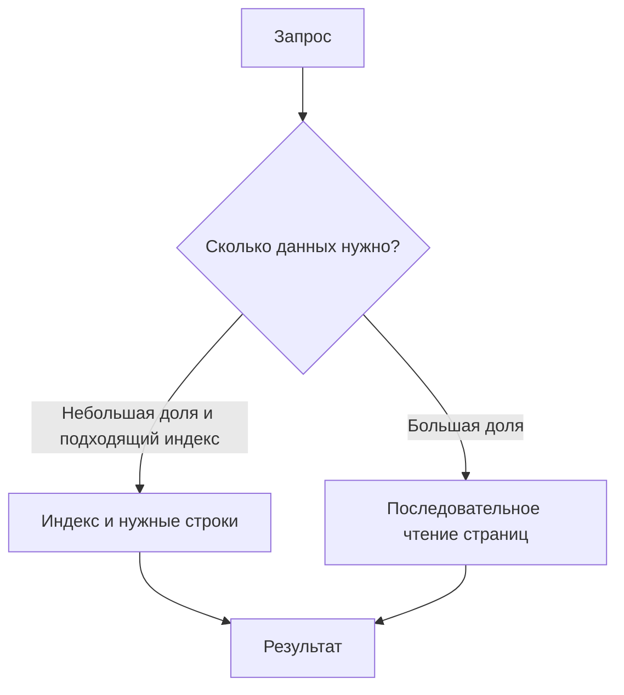
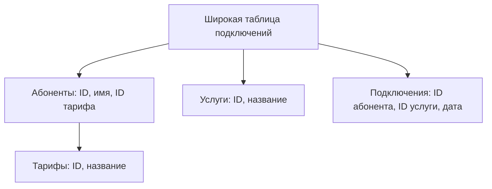

# 08. Нормализация и физическое хранение

[[Лекции/07. Запросы, JOIN и подзапросы|← Предыдущая]] · [[index|🏠 Старт]] · [[01. Карта курса|🧭 Карта]] · [[Лекции/09. Транзакции, MVCC и изоляция|Следующая →]]

> [!abstract] Зачем читать
> Нормализация устраняет аномалии через анализ зависимостей: 1NF, 2NF, 3NF, BCNF и 4NF решают разные проблемы. Важны все потенциальные ключи и разложение без потерь. Физическое хранение и индексы — следующий уровень: они ускоряют доступ, но имеют цену при записи.

> [!info] Основа конспекта
> [[lecture/BDC_8.pdf#page=1|Исходная лекция: BDC_8.pdf]], 19 страниц PDF. Пояснения, разборы и упражнения добавлены к материалу курса. Номера страниц ниже — страницы PDF, а не цифры внизу слайдов.

## 1. Нормализация лечит аномалии

Предположим, в каждой записи звонка хранятся имя абонента, название тарифа и его текущая абонентская плата. Изменение названия тарифа потребует обновить тысячи строк. Часть обновилась, часть — нет: появился конфликт.

**Аномалия обновления** — один факт приходится править в нескольких местах. **Аномалия вставки** — нельзя записать тариф, пока нет звонка. **Аномалия удаления** — удалив последний звонок, случайно теряем сведения о тарифе.

Нормализация организует отношения с учётом зависимостей между атрибутами. Цель — убрать нежелательную избыточность и эти аномалии. Механическое «разбить всё на много таблиц» без сохранения смысла целью не является.

## 2. Функциональная зависимость

Запись `X → Y` означает: одинаковым значениям X всегда соответствует одинаковое Y во всех допустимых состояниях отношения. Например, `plan_id → plan_name, monthly_fee` в текущем справочнике тарифов.

Это **бизнес-правило**, а не случайное свойство текущей выборки. Если два человека сегодня имеют разные фамилии, это не делает фамилию потенциальным ключом. Наблюдение над одной загрузкой данных не доказывает зависимость.

## 3. Первая нормальная форма

1NF требует отсутствия повторяющихся групп и одного значения выбранного домена в позиции кортежа. Практическая рекомендация: не хранить список телефонов строкой `'111,222,333'`, если номера нужно независимо искать и проверять.

| До | После |
|---|---|
| `subscriber_id, phones='111,222'` | `subscriber_id, phone='111'` и отдельная строка `'222'` |

PostgreSQL умеет работать с массивами и JSON; возможность поиска в них есть. Поэтому фраза «несколько значений делают поиск невозможным» слишком сильная. Вопрос — какая модель нужна, как задавать ссылки и ограничения, и не прячутся ли самостоятельные сущности в одном поле.

## 4. Вторая нормальная форма

2NF: отношение находится в 1NF, и ни один **неключевой атрибут** не зависит от собственной части какого-либо потенциального ключа. Под неключевым здесь понимается атрибут, не входящий ни в один потенциальный ключ.

Учебное отношение `Subscription(subscriber_id, service_id, service_name, connected_at)` имеет ключ `(subscriber_id, service_id)`. Название услуги зависит только от `service_id`, а дата подключения — от всей пары. Выносим название в `Services(service_id, service_name)`.

> [!warning] Уточнение к слайду 5
> Анализировать нужно все потенциальные ключи. Даже при выбранном простом суррогатном PK могут существовать другие составные потенциальные ключи. Добавление столбца ID не устраняет смысловые зависимости автоматически.

## 5. Третья нормальная форма и BCNF

Практический образ 3NF: неключевые атрибуты не должны описывать другие неключевые атрибуты вместо самой сущности. Если хранить в `subscribers` и `plan_id`, и текущие `plan_name, monthly_fee`, получим зависимость `subscriber_id → plan_id → plan_name`.

Разделяем данные: тарифные свойства остаются в `tariff_plans`, у абонента — ссылка. Для строгой 3NF при каждой нетривиальной зависимости `X → A` либо X является суперключом, либо A входит в некоторый потенциальный ключ.

**BCNF** требует, чтобы детерминант каждой нетривиальной функциональной зависимости был суперключом. Это сильнее 3NF. «Потенциальным ключом» — удобное упрощение слайдов, но формально нужен именно суперключ, который может содержать избыточные атрибуты.


## 6. Четвёртая нормальная форма

4NF относится к **многозначным зависимостям**. Пусть у абонента независимо есть несколько устройств и несколько контактных адресов. Если хранить `(абонент, устройство, адрес)` одной таблицей, для двух устройств и трёх адресов понадобятся шесть комбинаций.

Разделяем независимые факты на `SubscriberDevice` и `SubscriberAddress`. Формальное условие 4NF: для каждой нетривиальной многозначной зависимости её детерминант является суперключом.

Не любая связь M:N нарушает 4NF. Например, факт «данное устройство использовалось именно по этому адресу» связывает значения, и разбиение на независимые списки может потерять смысл.

## 7. Разложение должно быть без потерь

После декомпозиции соединение таблиц должно восстанавливать исходные допустимые факты **без появления ложных комбинаций**. Желательно также сохранять возможность проверять исходные зависимости локальными ограничениями.

Разделить три столбца на произвольные пары недостаточно: обратный JOIN может добавить факты, которых не существовало. Поэтому нормализация — работа с зависимостями, а не с количеством полей.

## 8. Историческая стоимость — не обязательно ошибка нормализации

`call_records.cost` хранит стоимость события, `invoices.monthly_fee` — сумму, предъявленную за период. Даже если их когда-то вычислили по тарифу, это может быть корректным **историческим снимком**. Изменение текущего `tariff_plans.monthly_fee` не должно переписать уже выставленный счёт.

Отличай нежелательные дубли текущего справочника от самостоятельного факта «что было начислено тогда». Нормализованность нельзя оценить только по одинаковым названиям полей.

## 9. SQL работает с кратностями

`UNION` убирает дубли строк, `UNION ALL` сохраняет. Если объединить платежи за два дня и одинаковые суммы схлопнуть через `UNION`, можно потерять факт двух разных платежей. Сначала определи, нужны уникальные значения или все события.

`DISTINCT` часто требует дополнительной работы, но план может получить уникальность и другими способами. Обещание «всегда будет сортировка» неверно.

## 10. От логики к страницам

Таблица физически хранится в файлах и страницах; типичный размер страницы PostgreSQL — 8 KiB при стандартной сборке. СУБД читает и кеширует страницы, а не обязательно каждую строку отдельной операцией диска.

**Tablespace** задаёт расположение объектов хранения. **Heap** — основное хранение строк таблицы. **Материализованное представление** физически хранит результат запроса. Термин «экстент» встречается в общем описании СУБД; конкретную организацию PostgreSQL не следует без проверки переносить из другой системы.

## 11. Почему индекс помогает не всегда

Индекс — дополнительная структура поиска. B-tree поддерживает равенство, диапазоны и определённые варианты сортировки. Hash ориентирован на равенство. Индексы занимают место и требуют обслуживания при изменениях.



Верхняя оценка поиска в сбалансированном дереве похожа на `O(log N + m)`, где m — число совпадений. Но реальное время зависит от страниц, кеша, расположения строк и объёма результата. Универсального порога «индекс до 5%, Seq Scan после 20%» нет.

> [!tip] Разделяй две оптимизации
> Нормализация отвечает за корректную организацию фактов. Индексирование — за стоимость доступа. Плохое бизнес-разложение не исправляется добавлением индекса, а хорошая нормальная форма не отменяет измерения производительности.

## Нормализация одной таблицы шаг за шагом

Представим учебное отношение `SubscriberService(subscriber_id, service_id, subscriber_name, service_name, connected_at, plan_id, plan_name)`. Предположим, один абонент подключает каждую услугу не более одного раза. Тогда естественный ключ факта подключения — `(subscriber_id, service_id)`.

| Зависимость | Какой факт выражает | Почему это важно |
|---|---|---|
| subscriber\_id → subscriber\_name, plan\_id | Текущие сведения об абоненте | Зависит только от части составного ключа |
| service\_id → service\_name | Свойства услуги | Тоже частичная зависимость |
| subscriber\_id, service\_id → connected\_at | Факт конкретного подключения | Зависит от всей пары |
| plan\_id → plan\_name | Свойства тарифа | Возможна транзитивная зависимость |

Сначала отделяем факты об абоненте, услуге и подключении. Затем из текущей записи абонента выносим название тарифа в справочник. Названия перестают дублироваться в каждой строке подключения.



На каждом переходе нужно проверить, что мы не потеряли смысл. Если повторное подключение допускается, первоначальное предположение о ключе неверно. Нельзя доказывать нормальную форму относительно ключа, который не идентифицирует реальный факт.

## Аномалии в виде маленького эксперимента

**Вставка**: нужно завести услугу, пока её никто не подключил. Широкая таблица заставляет либо придумать абонента, либо допустить набор неопределённых полей. Отдельный справочник услуг решает это естественно.

**Обновление**: услуга переименована. В широкой таблице надо заменить название во всех подключениях. Если одна строка пропущена, получится два названия одного ID.

**Удаление**: отключён последний пользователь услуги. Удаление его подключения не должно означать исчезновение самой услуги из каталога. Отдельные отношения разделяют эти жизненные циклы.

Такое объяснение полезнее правила «в таблице должно быть поменьше столбцов». В нормализованном отношении может быть много атрибутов, если они описывают один факт и соответствуют зависимостям.

## Проверка декомпозиции без потерь

Пусть известны только пары «абонент — услуга» и «абонент — устройство». Их JOIN по абоненту создаёт все комбинации услуг и устройств этого человека. Если исходная таблица означала «услуга используется именно на этом устройстве», появятся ложные факты.

Нормализация не разрешает объявить зависимые сведения независимыми ради сокращения столбцов. Для корректного разложения нужны правила, при которых обратное соединение восстанавливает ровно исходную допустимую информацию.


На конкретных примерах проверка удобна, но формальное обоснование опирается на зависимости. Отсутствие ошибки в сегодняшних трёх строках не доказывает её отсутствие в любом допустимом будущем состоянии.

## Когда допустима денормализация

Для тяжёлого отчёта можно сохранить вычисленный итог или сформировать витрину. Но тогда появляются вопросы: кто обновляет копию, как быстро она должна отражать изменения, что делать при ошибке пересчёта, как отличить актуальный итог от устаревшего?

Контролируемая денормализация — осознанный компромисс, а не отмена правил. Например, можно хранить аналитический итог по месяцу и отдельно исходные события. При этом надо знать, какая часть считается первичным источником, и уметь сверить агрегат с исходником.

Историческая стоимость звонка отличается от случайной копии текущей цены. Она может быть самостоятельным фактом проведённого начисления. Вопрос «почему хранится вычисленное?» требует ответа о времени и правилах, а не автоматического удаления столбца.

## Что лежит между строкой и диском

В PostgreSQL строка содержит не только пользовательские поля, но и служебные данные. Страницы помещаются в буферы, индексы ссылаются на расположение строк, старые версии живут до допустимой уборки. Большой текст может храниться с использованием TOAST — это один из примеров того, что физическое представление сложнее нарисованной таблицы.

Логический SELECT не обещает одно дисковое чтение на одну строку. Страницы могут уже находиться в памяти; одна страница содержит несколько строк; индексный доступ может потребовать дополнительных обращений. Поэтому объём результата и объём прочитанных данных — разные величины.

## Почему маленькая таблица — особый случай

Если вся таблица занимает несколько страниц, последовательное чтение может быть дешевле обхода индекса и дополнительных проверок видимости. Отказ планировщика от индекса не означает, что он «забыл про ключ». Для небольшой учебной выборки правильнее сначала понять смысл запроса, а затем измерять на подходящем объёме.

> [!tip] Три независимых вопроса
> Нормализация: правильно ли разложены факты? Ограничения: какие недопустимые состояния запрещены? Индексы: как дёшево найти нужные данные? У одного отношения ответы на эти вопросы связаны, но не взаимозаменяемы.

## Где это в PDF

[[lecture/BDC_8.pdf#page=3|Нормальные формы: 3–8]] · [[lecture/BDC_8.pdf#page=9|Мультимножества: 9–10]] · [[lecture/BDC_8.pdf#page=11|Страницы, индексы, сканирование: 11–19]].

## Проверь себя без подсказки

Сначала закрой пояснения и ответь вслух. Для сложного ответа приведи свой пример или контрпример.

1. Какие три аномалии возникают при повторении текущего названия тарифа во всех событиях?
2. Почему добавление суррогатного PK само по себе не доказывает 2NF?
3. Чем 3NF отличается от BCNF?
4. Почему не каждая M:N-связь нарушает 4NF?
5. Почему сохранённая стоимость старого звонка может быть самостоятельным фактом?
6. Разложи широкую таблицу подключений с частичными и транзитивными зависимостями.
7. Какие допущения о повторном подключении определяют ключ?
8. Покажи, как неудачное разложение создаёт ложные комбинации.
9. Какие вопросы нужны при контролируемой денормализации?
10. Почему маленькая таблица может читаться без индекса?
11. Чем физическая страница отличается от строки результата?
12. Раздели задачи нормализации, ограничений и индексов на одном примере.

## Вопросы с выбором ответа

На сайте выбор сразу показывает результат. В Obsidian ответ отмечен знаком `+` в блоке; сначала попробуй ответить, затем проверь себя.

```text
#quiz
? В строке абонента хранятся plan_id и текущее plan_name. Название определяется только plan_id. Что стоит проверить?
+ Транзитивную зависимость и 3NF
- Только число строк таблицы
- Только размер индекса
```

```text
#quiz
? Какое утверждение об индексах верно?
- Любой индекс ускоряет все запросы
+ Индекс требует места и обслуживания при записи
- Индекс заменяет нормализацию
```

```text
#quiz
? Как определить функциональную зависимость?
- Только по уникальности сегодняшних трёх строк
- По порядку сортировки
+ По бизнес-правилу всех допустимых состояний
```

> [!explain]- Почему так
> Наблюдение над одной выборкой не доказывает правило будущих данных.

```text
#quiz
? Можно ли нормализовать, не выяснив допустимые повторные подключения?
+ Надёжно нельзя: можно ошибиться в ключе
- Да, достаточно добавить ID
- Да, любое разбиение без потерь
```

> [!explain]- Почему так
> Нормальные формы проверяются относительно действительных зависимостей и ключей.

```text
#quiz
? Что означает разложение без потерь?
- После него никогда не нужен JOIN
+ Обратное соединение восстанавливает исходные допустимые факты без ложных комбинаций
- Удалена половина столбцов
```

> [!explain]- Почему так
> Сохранение информации важнее механического уменьшения ширины таблиц.

```text
#quiz
? Почему отдельный справочник позволяет завести услугу без абонентов?
- Потому что NULL всегда запрещён
- Потому что FK удаляет все записи
+ У сущностей разные жизненные циклы
```

> [!explain]- Почему так
> Это устраняет аномалию вставки широкой таблицы подключений.

```text
#quiz
? Что обязательно продумать при сохранении аналитического итога?
+ Обновление, свежесть и сверку с источником
- Только цвет заголовка
- Удаление всех исходных событий
```

> [!explain]- Почему так
> Контролируемая денормализация добавляет обязанность поддерживать копию результата.

```text
#quiz
? Является ли сохранённая историческая цена обязательно нежелательным дублем?
- Да, её всегда нужно удалить
+ Нет, она может быть фактом проведённого начисления
- Да, если есть текущий тариф
```

> [!explain]- Почему так
> Зависимости и смысл нужно анализировать с учётом времени.

```text
#quiz
? Что означает одна страница PostgreSQL?
- Одну строку SELECT
- Одну обязательную таблицу
+ Физическую единицу хранения, содержащую служебные данные и строки
```

> [!explain]- Почему так
> Физический доступ и логическая кардинальность имеют разные масштабы.

```text
#quiz
? Почему нормализация не заменяет индексы?
+ Она отвечает за структуру фактов, а индексы — за доступ
- Нормализация автоматически создаёт все индексы
- Индексы делают любую модель правильной
```

> [!explain]- Почему так
> Корректность модели и стоимость поиска рассматриваются отдельно.

## Закрепить тему на практике

- [[Практика/03. Агрегаты и HAVING]]
- [[Практика/06. Множества и повторения]]
- [[Практика/07. Аналитика биллинга]]
- [[Практика/08. DDL и нормализация]]
- [[Практика/11. Планы и индексы]]

Здесь остаются вопросы на понимание. В тренировках — ввод запросов, проверка результатов и серверные задачи с разбором.

## Чек-лист понимания

- [ ] Прочитал лекцию и разобрал схему.
- [ ] Ответил на вопросы вслух без конспекта.
- [ ] Ответил на десять тестовых вопросов и объяснил неверные варианты.
- [ ] В свойстве `confidence` поставил число от 0 до 5.
- [ ] Поставил дату следующего повторения в `review_next`.

## Суть за минуту

Нормализация устраняет аномалии через анализ зависимостей: 1NF, 2NF, 3NF, BCNF и 4NF решают разные проблемы. Важны все потенциальные ключи и разложение без потерь. Физическое хранение и индексы — следующий уровень: они ускоряют доступ, но имеют цену при записи.

^summary-l08

## Куда дальше

Проектирование: [[Лекции/05. ER-модель — сущности и связи]]. Планы и индексы подробнее: [[Лекции/13. Производительность и индексы]]. Разбор заблуждений: [[Справочники/Ловушки и уточнения]].

[[Лекции/07. Запросы, JOIN и подзапросы|← Предыдущая]] · [[index|🏠 Старт]] · [[01. Карта курса|🧭 Карта]] · [[Лекции/09. Транзакции, MVCC и изоляция|Следующая →]]
