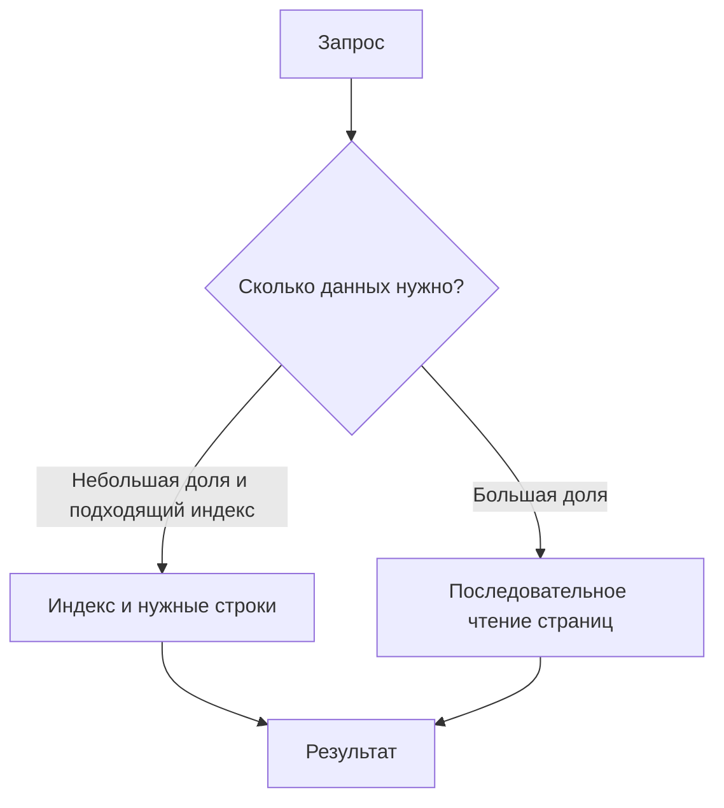

# 08. Нормализация и физическое хранение

[[Лекции/07. Запросы, JOIN и подзапросы|← Предыдущая]] · [[index|🏠 Старт]] · [[01. Карта курса|🧭 Карта]] · [[Лекции/09. Транзакции, MVCC и изоляция|Следующая →]]

> [!abstract] Зачем читать
> Нормализация устраняет аномалии через анализ зависимостей: 1NF, 2NF, 3NF, BCNF и 4NF решают разные проблемы. Важны все потенциальные ключи и разложение без потерь. Физическое хранение и индексы — следующий уровень: они ускоряют доступ, но имеют цену при записи.

> [!info] Основа конспекта
> [[lecture/BDC_8.pdf#page=1|Исходная лекция: BDC_8.pdf]], 19 страниц PDF. Пояснения, разборы и упражнения добавлены к материалу курса. Номера страниц ниже — страницы PDF, а не цифры внизу слайдов.

## 1. Нормализация лечит аномалии

Предположим, в каждой записи звонка хранятся имя абонента, название тарифа и его текущая абонентская плата. Изменение названия тарифа потребует обновить тысячи строк. Часть обновилась, часть — нет: появился конфликт.

**Аномалия обновления** — один факт приходится править в нескольких местах. **Аномалия вставки** — нельзя записать тариф, пока нет звонка. **Аномалия удаления** — удалив последний звонок, случайно теряем сведения о тарифе.

Нормализация организует отношения с учётом зависимостей между атрибутами. Цель — убрать нежелательную избыточность и эти аномалии. Механическое «разбить всё на много таблиц» без сохранения смысла целью не является.

## 2. Функциональная зависимость

Запись `X → Y` означает: одинаковым значениям X всегда соответствует одинаковое Y во всех допустимых состояниях отношения. Например, `plan_id → plan_name, monthly_fee` в текущем справочнике тарифов.

Это **бизнес-правило**, а не случайное свойство текущей выборки. Если два человека сегодня имеют разные фамилии, это не делает фамилию потенциальным ключом. Наблюдение над одной загрузкой данных не доказывает зависимость.

## 3. Первая нормальная форма

1NF требует отсутствия повторяющихся групп и одного значения выбранного домена в позиции кортежа. Практическая рекомендация: не хранить список телефонов строкой `'111,222,333'`, если номера нужно независимо искать и проверять.

| До | После |
|---|---|
| `subscriber_id, phones='111,222'` | `subscriber_id, phone='111'` и отдельная строка `'222'` |

PostgreSQL умеет работать с массивами и JSON; возможность поиска в них есть. Поэтому фраза «несколько значений делают поиск невозможным» слишком сильная. Вопрос — какая модель нужна, как задавать ссылки и ограничения, и не прячутся ли самостоятельные сущности в одном поле.

## 4. Вторая нормальная форма

2NF: отношение находится в 1NF, и ни один **неключевой атрибут** не зависит от собственной части какого-либо потенциального ключа. Под неключевым здесь понимается атрибут, не входящий ни в один потенциальный ключ.

Учебное отношение `Subscription(subscriber_id, service_id, service_name, connected_at)` имеет ключ `(subscriber_id, service_id)`. Название услуги зависит только от `service_id`, а дата подключения — от всей пары. Выносим название в `Services(service_id, service_name)`.

> [!warning] Уточнение к слайду 5
> Анализировать нужно все потенциальные ключи. Даже при выбранном простом суррогатном PK могут существовать другие составные потенциальные ключи. Добавление столбца ID не устраняет смысловые зависимости автоматически.

## 5. Третья нормальная форма и BCNF

Практический образ 3NF: неключевые атрибуты не должны описывать другие неключевые атрибуты вместо самой сущности. Если хранить в `subscribers` и `plan_id`, и текущие `plan_name, monthly_fee`, получим зависимость `subscriber_id → plan_id → plan_name`.

Разделяем данные: тарифные свойства остаются в `tariff_plans`, у абонента — ссылка. Для строгой 3NF при каждой нетривиальной зависимости `X → A` либо X является суперключом, либо A входит в некоторый потенциальный ключ.

**BCNF** требует, чтобы детерминант каждой нетривиальной функциональной зависимости был суперключом. Это сильнее 3NF. «Потенциальным ключом» — удобное упрощение слайдов, но формально нужен именно суперключ, который может содержать избыточные атрибуты.


## 6. Четвёртая нормальная форма

4NF относится к **многозначным зависимостям**. Пусть у абонента независимо есть несколько устройств и несколько контактных адресов. Если хранить `(абонент, устройство, адрес)` одной таблицей, для двух устройств и трёх адресов понадобятся шесть комбинаций.

Разделяем независимые факты на `SubscriberDevice` и `SubscriberAddress`. Формальное условие 4NF: для каждой нетривиальной многозначной зависимости её детерминант является суперключом.

Не любая связь M:N нарушает 4NF. Например, факт «данное устройство использовалось именно по этому адресу» связывает значения, и разбиение на независимые списки может потерять смысл.

## 7. Разложение должно быть без потерь

После декомпозиции соединение таблиц должно восстанавливать исходные допустимые факты **без появления ложных комбинаций**. Желательно также сохранять возможность проверять исходные зависимости локальными ограничениями.

Разделить три столбца на произвольные пары недостаточно: обратный JOIN может добавить факты, которых не существовало. Поэтому нормализация — работа с зависимостями, а не с количеством полей.

## 8. Историческая стоимость — не обязательно ошибка нормализации

`call_records.cost` хранит стоимость события, `invoices.monthly_fee` — сумму, предъявленную за период. Даже если их когда-то вычислили по тарифу, это может быть корректным **историческим снимком**. Изменение текущего `tariff_plans.monthly_fee` не должно переписать уже выставленный счёт.

Отличай нежелательные дубли текущего справочника от самостоятельного факта «что было начислено тогда». Нормализованность нельзя оценить только по одинаковым названиям полей.

## 9. SQL работает с кратностями

`UNION` убирает дубли строк, `UNION ALL` сохраняет. Если объединить платежи за два дня и одинаковые суммы схлопнуть через `UNION`, можно потерять факт двух разных платежей. Сначала определи, нужны уникальные значения или все события.

`DISTINCT` часто требует дополнительной работы, но план может получить уникальность и другими способами. Обещание «всегда будет сортировка» неверно.

## 10. От логики к страницам

Таблица физически хранится в файлах и страницах; типичный размер страницы PostgreSQL — 8 KiB при стандартной сборке. СУБД читает и кеширует страницы, а не обязательно каждую строку отдельной операцией диска.

**Tablespace** задаёт расположение объектов хранения. **Heap** — основное хранение строк таблицы. **Материализованное представление** физически хранит результат запроса. Термин «экстент» встречается в общем описании СУБД; конкретную организацию PostgreSQL не следует без проверки переносить из другой системы.

## 11. Почему индекс помогает не всегда

Индекс — дополнительная структура поиска. B-tree поддерживает равенство, диапазоны и определённые варианты сортировки. Hash ориентирован на равенство. Индексы занимают место и требуют обслуживания при изменениях.



Верхняя оценка поиска в сбалансированном дереве похожа на `O(log N + m)`, где m — число совпадений. Но реальное время зависит от страниц, кеша, расположения строк и объёма результата. Универсального порога «индекс до 5%, Seq Scan после 20%» нет.

> [!tip] Разделяй две оптимизации
> Нормализация отвечает за корректную организацию фактов. Индексирование — за стоимость доступа. Плохое бизнес-разложение не исправляется добавлением индекса, а хорошая нормальная форма не отменяет измерения производительности.

## Где это в PDF

[[lecture/BDC_8.pdf#page=3|Нормальные формы: 3–8]] · [[lecture/BDC_8.pdf#page=9|Мультимножества: 9–10]] · [[lecture/BDC_8.pdf#page=11|Страницы, индексы, сканирование: 11–19]].

## Проверь себя без подсказки

1. Какие три аномалии возникают при повторении текущего названия тарифа во всех событиях?
2. Почему добавление суррогатного PK само по себе не доказывает 2NF?
3. Чем 3NF отличается от BCNF?
4. Почему не каждая M:N-связь нарушает 4NF?
5. Почему сохранённая стоимость старого звонка может быть самостоятельным фактом?

## Мини-тренажёр

> [!tip] Два режима
> В Obsidian это редактируемые блоки с условиями и эталонами. На Quartz блоки превращаются в интерактивные задания после подключения [[Справочники/Интерактив и Quartz|обработчика]]. SQL-песочница использует маленький учебный набор, описанный в [[Практика/Учебный набор|паспорте данных]]. Он отличается от полного дампа.

```sql
-- setup
CREATE TABLE tariff_plans (plan_id INT, plan_name STRING, monthly_fee NUMBER, minutes_included INT, sms_included INT, data_gb_included INT, price_per_minute NUMBER, price_per_sms NUMBER, price_per_gb NUMBER, is_active BOOLEAN);
INSERT INTO tariff_plans VALUES (1,'Basic',300,100,50,5,2,2.5,200,true),(2,'Standard',500,300,100,15,1.5,2,150,true),(3,'Premium',800,1000,500,50,1,1.5,100,true),(4,'Unlimited',1200,999999,999999,100,0,0,50,true),(5,'Student',350,200,100,10,1.8,2,180,true),(6,'Senior',250,150,100,3,2,2,250,false);
CREATE TABLE service_types (service_type_id INT, service_name STRING, description STRING);
INSERT INTO service_types VALUES (1,'Outgoing Call','Исходящий звонок'),(2,'Incoming Call','Входящий звонок'),(3,'SMS','Сообщение'),(4,'MMS','Мультимедийное сообщение'),(5,'Data','Интернет');
CREATE TABLE subscribers (subscriber_id INT, phone_number STRING, first_name STRING, last_name STRING, email STRING, plan_id, registration_date STRING, status STRING, balance NUMBER);
INSERT INTO subscribers VALUES (1,'+79100000001','Анна','Волкова','anna@example.test',1,'2025-09-01','ACTIVE',250),(2,'+79100000002','Борис','Орлов',NULL,2,'2025-09-03','ACTIVE',-20),(3,'+79100000003','Вера','Иванова','vera@example.test',3,'2025-10-01','SUSPENDED',0),(4,'+79100000004','Глеб','Соколов','gleb@example.test',1,'2025-10-10','ACTIVE',500),(5,'+79100000005','Дина','Белова',NULL,5,'2025-11-01','ACTIVE',100),(6,'+79100000006','Егор','Петров','egor@example.test',NULL,'2025-11-02','TERMINATED',-50),(7,'+79100000007','Жанна','Миронова','zhanna@example.test',4,'2025-11-03','ACTIVE',1000),(8,'+79100000008','Зоя','Зайцева',NULL,2,'2025-11-04','SUSPENDED',100);
CREATE TABLE call_records (record_id INT, subscriber_id INT, service_type_id INT, call_date STRING, destination_number STRING, duration_seconds INT, quantity INT, cost NUMBER);
INSERT INTO call_records VALUES (1,1,1,'2025-11-01 10:00:00','+79000000001',60,1,2),(2,1,1,'2025-11-02 10:00:00','+79000000002',120,1,4),(3,2,1,'2025-11-01 11:00:00','+79000000003',30,1,1.5),(4,2,3,'2025-11-03 11:00:00','900',0,1,2),(5,3,1,'2025-11-02 12:00:00','+79000000004',300,1,5),(6,4,1,'2025-11-03 13:00:00','+79000000005',180,1,6),(7,4,1,'2025-11-04 13:00:00','+79000000006',60,1,2),(8,7,1,'2025-11-05 14:00:00','+79000000007',600,1,0);
CREATE TABLE data_usage (usage_id INT, subscriber_id INT, usage_date STRING, data_mb INT, cost NUMBER);
INSERT INTO data_usage VALUES (1,1,'2025-11-01',1024,150),(2,1,'2025-11-02',512,75),(3,2,'2025-11-01',2048,300),(4,4,'2025-11-02',0,0),(5,7,'2025-11-03',4096,200);
CREATE TABLE invoices (invoice_id INT, subscriber_id INT, billing_period STRING, issue_date STRING, due_date STRING, monthly_fee NUMBER, usage_charges NUMBER, total_amount NUMBER, status STRING);
INSERT INTO invoices VALUES (1,1,'2025-11','2025-11-01','2025-11-10',300,6,306,'PAID'),(2,2,'2025-11','2025-11-01','2025-11-10',500,3.5,503.5,'OVERDUE'),(3,3,'2025-11','2025-11-01','2025-11-10',800,5,805,'PENDING'),(4,4,'2025-11','2025-11-01','2025-11-10',300,8,308,'PAID'),(5,7,'2025-11','2025-11-01','2025-11-10',1200,0,1200,'PENDING');
CREATE TABLE payments (payment_id INT, subscriber_id INT, invoice_id, payment_date STRING, amount NUMBER, payment_method STRING, transaction_id STRING);
INSERT INTO payments VALUES (1,1,1,'2025-11-02 09:00:00',200,'CARD','tx-1'),(2,1,1,'2025-11-03 09:00:00',106,'CARD','tx-2'),(3,4,4,'2025-11-04 09:00:00',308,'CARD','tx-3'),(4,5,NULL,'2025-11-05 09:00:00',100,'CASH','tx-4');
CREATE TABLE plan_changes (change_id INT, subscriber_id INT, old_plan_id INT, new_plan_id INT, change_date STRING, reason STRING);
INSERT INTO plan_changes VALUES (1,1,2,1,'2025-10-01','Экономия'),(2,2,1,2,'2025-10-10','Больше минут'),(3,7,3,4,'2025-11-01','Безлимит');
```

```text
#quiz
? В строке абонента хранятся plan_id и текущее plan_name. Название определяется только plan_id. Что стоит проверить?
+ Транзитивную зависимость и 3NF
- Только число строк таблицы
- Только размер индекса
```

```text
#quiz
? Какое утверждение об индексах верно?
- Любой индекс ускоряет все запросы
+ Индекс требует места и обслуживания при записи
- Индекс заменяет нормализацию
```

```text
#order
Зафиксировать бизнес-правила и функциональные зависимости
Найти потенциальные ключи
Проверить частичные и транзитивные зависимости
Выполнить разложение без потерь
Проверить восстановление фактов соединением
```

```sql
-- run
SELECT plan_id, COUNT(*) AS subscriber_count
FROM subscribers WHERE plan_id IS NOT NULL
GROUP BY plan_id ORDER BY plan_id;
```

```text
#task
Выведи тарифы, у которых больше одного абонента.
Нужны plan_id и subscriber_count; учитывай только непустые plan_id, сортируй по plan_id.
= SELECT plan_id, COUNT(*) AS subscriber_count FROM subscribers WHERE plan_id IS NOT NULL GROUP BY plan_id HAVING COUNT(*) > 1 ORDER BY plan_id;
```

## Чек-лист понимания

- [ ] Прочитал лекцию и разобрал схему.
- [ ] Ответил на вопросы вслух без конспекта.
- [ ] Решил задания и разобрал ошибки.
- [ ] В свойстве `confidence` поставил число от 0 до 5.
- [ ] Поставил дату следующего повторения в `review_next`.

## Суть за минуту

Нормализация устраняет аномалии через анализ зависимостей: 1NF, 2NF, 3NF, BCNF и 4NF решают разные проблемы. Важны все потенциальные ключи и разложение без потерь. Физическое хранение и индексы — следующий уровень: они ускоряют доступ, но имеют цену при записи.

^summary-l08

## Куда дальше

Проектирование: [[Лекции/05. ER-модель — сущности и связи]]. Планы и индексы подробнее: [[Лекции/13. Производительность и индексы]]. Разбор заблуждений: [[Справочники/Ловушки и уточнения]].

[[Лекции/07. Запросы, JOIN и подзапросы|← Предыдущая]] · [[index|🏠 Старт]] · [[01. Карта курса|🧭 Карта]] · [[Лекции/09. Транзакции, MVCC и изоляция|Следующая →]]
