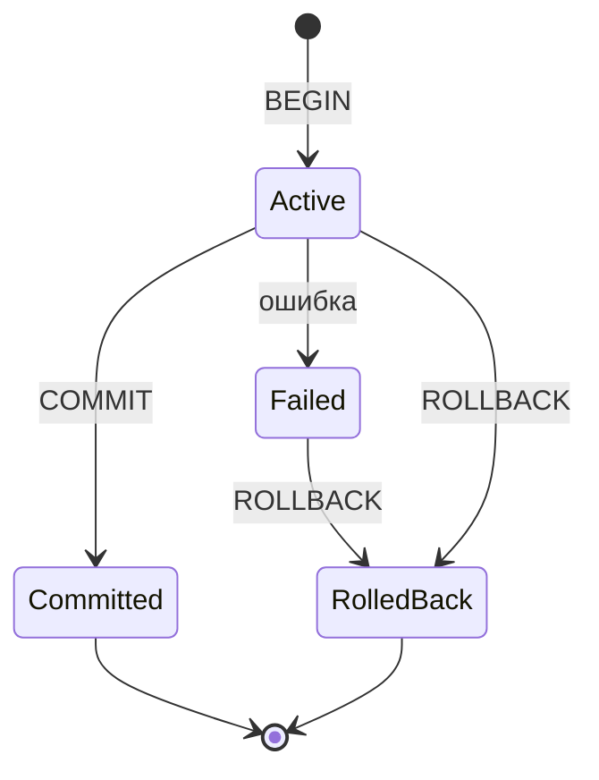
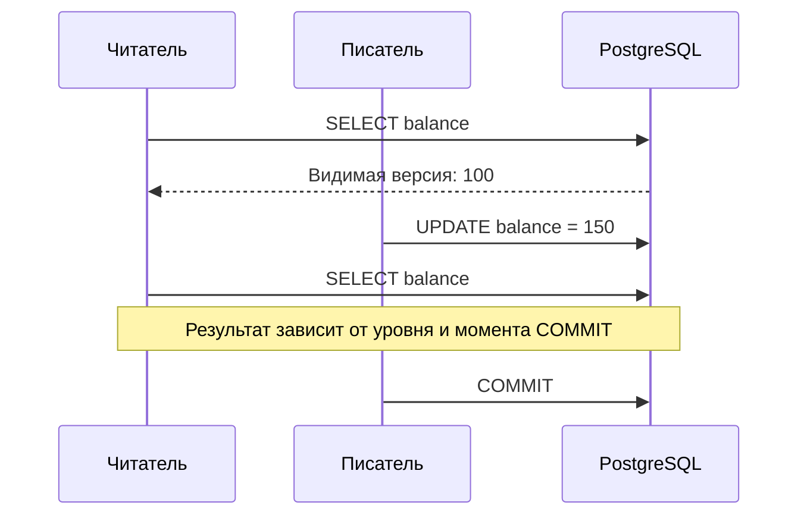
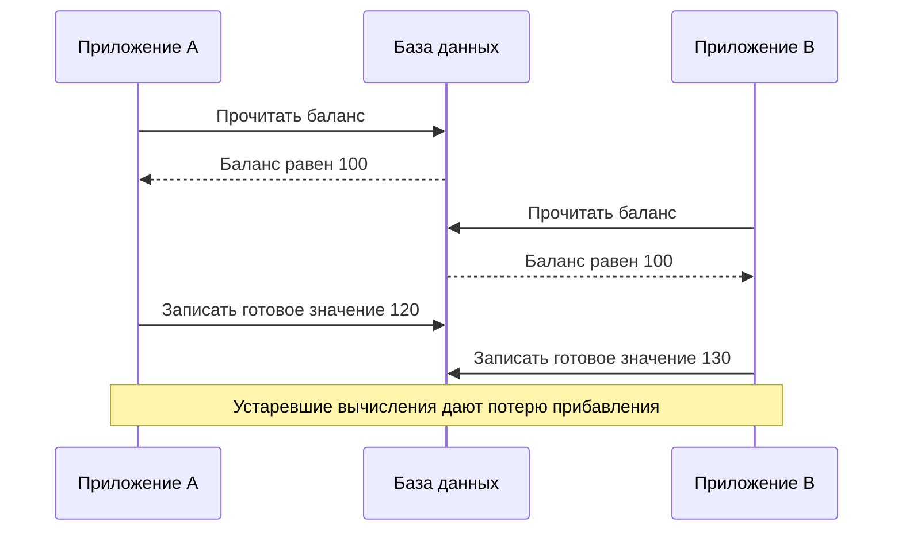
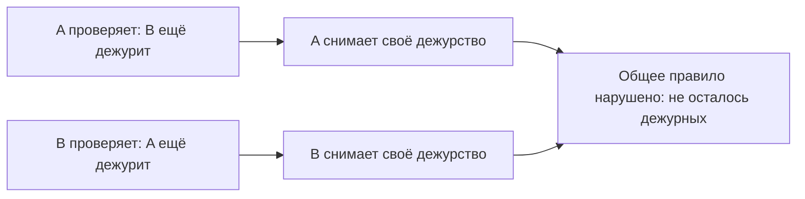

# 09. Транзакции, MVCC и изоляция

[[Лекции/08. Нормализация и физическое хранение|← Предыдущая]] · [[index|Обложка]] · [[01. Карта курса|Карта]] · [[Лекции/10. Функции и процедуры PostgreSQL|Следующая →]]

> [!abstract] Зачем читать
> Транзакция связывает изменения в один итог. MVCC определяет видимые версии, а уровень изоляции — границы снимка и допустимые аномалии. Read Committed не защищает любое вычисление баланса в приложении. Для финансовых действий важны атомарные обновления, ограничения, короткие транзакции и повторы при конфликте.

> [!info] Основа конспекта
> [[lecture/BDC_9.pdf#page=1|Исходная лекция: BDC_9.pdf]], 20 страниц PDF. Пояснения, разборы и упражнения добавлены к материалу курса. Номера страниц ниже — страницы PDF, а не цифры внизу слайдов.

## 1. Транзакция — граница завершённого действия

Платёж должен создать запись в `payments` и увеличить `subscribers.balance`. Если первое действие выполнилось, а второе потерялось из-за сбоя, история и баланс разошлись. Транзакция объединяет действия: наружу должен выйти их согласованный итог.

```sql
-- PostgreSQL, учебная копия. Изменения отменяются.
BEGIN;
UPDATE subscribers
SET balance = balance + 100
WHERE subscriber_id = 1;
INSERT INTO payments (subscriber_id, amount, payment_method, transaction_id)
VALUES (1, 100, 'TRAINING', 'lecture-09-example');
SELECT subscriber_id, balance
FROM subscribers WHERE subscriber_id = 1;
ROLLBACK;
```

Здесь `ROLLBACK` отменяет изменения таблиц. Для реального проведения использовался бы `COMMIT` после проверок. Одна команда SQL тоже выполняется в транзакционном контексте; в режиме autocommit клиент обычно завершает каждую команду отдельно.

## 2. ACID без заклинаний

| Свойство | Что обещает | Пример |
|---|---|---|
| Atomicity | Все изменения транзакции фиксируются вместе | Платёж и баланс не расходятся из-за частичного завершения |
| Consistency | Успех не нарушает заданные правила | FK запрещает платёж несуществующему абоненту |
| Isolation | Контролируемое взаимодействие параллельных транзакций | Два платежа не должны затереть друг друга |
| Durability | Зафиксированные изменения сохраняются при предусмотренных сбоях | COMMIT переживает перезапуск при надлежащей конфигурации |

**Согласованность не означает, что СУБД угадывает бизнес-логику**. Если разработчик забыл увеличить баланс, транзакция с одной корректной вставкой может успешно завершиться. Нужное правило должно быть выражено алгоритмом и ограничениями.

Долговечность зависит от настроек фиксации, исправности носителей и модели отказов. WAL не заменяет резервную копию от потери всего диска или ошибочного удаления.

## 3. Жизненный цикл и точки сохранения



После необработанной ошибки PostgreSQL обычно оставляет явную транзакцию в аварийном состоянии до отката. Для управляемого частичного отката есть savepoint:

```sql
BEGIN;
SAVEPOINT before_optional_part;
-- Здесь может быть дополнительная операция.
ROLLBACK TO SAVEPOINT before_optional_part;
-- Можно продолжать основную работу.
ROLLBACK;
```

Это не нарушение атомарности: фиксируется выбранный итог транзакции, а отменённая часть в него не входит. Изменения последовательностей (`nextval`, SERIAL/IDENTITY) при откате назад не возвращаются, поэтому пропуски ID нормальны.

## 4. MVCC и снимок данных

MVCC хранит версии строк и определяет, какая версия видима транзакции. Снимок — правила видимости на основе состояния транзакций, а не полная копия файлов БД.

Обычное чтение в PostgreSQL обычно не блокирует изменение той же строки, а запись не мешает обычному чтению увидеть подходящую версию. Однако конфликтующие записи, явные блокировки и некоторые изменения схемы могут ждать друг друга.



Не превращай фразу «чтение не блокирует запись» в абсолютное «в PostgreSQL никогда нет блокировок». Например, `SELECT ... FOR UPDATE` как раз берёт блокировку строки.

## 5. Пять аномалий на коротких историях

**Грязное чтение**: A прочитала незакоммиченную запись B, а B откатилась. В PostgreSQL обычные уровни изоляции этого не допускают.

**Неповторяющееся чтение**: A дважды прочитала баланс; между чтениями B изменила его и зафиксировалась. Значение стало другим.

**Фантом**: A дважды выбирает должников; между запросами B добавила подходящую строку. Изменился набор строк. Сюда относятся и изменения существующих строк, из-за которых они входят в условие или выходят из него.

**Потерянное обновление**: две программы прочитали 100. Одна рассчитала 120, другая 130; обе записали готовое число. Итог 130 вместо 150.

**Аномалия сериализации**: взаимозависимые решения параллельных транзакций дали итог, невозможный при любом последовательном порядке. Например, каждый из двух дежурных увидел, что второй ещё дежурит, и оба отключились.

## 6. Что реально гарантируют уровни PostgreSQL

| Уровень | Грязное чтение | Изменение видимого значения между SELECT | Фантомы | Аномалия сериализации |
|---|---|---|---|---|
| Read Uncommitted | Нет: работает как RC | Возможно | Возможны | Возможна |
| Read Committed | Нет | Возможно | Возможны | Возможна |
| Repeatable Read | Нет | Нет | Нет в реализации PostgreSQL | Возможна |
| Serializable | Нет | Нет | Нет | Не допускается для успешно завершённых транзакций |

В **Read Committed** снимок обычного запроса создаётся на начало команды. В **Repeatable Read** используется снимок первого оператора, требующего снимка, внутри транзакции. Собственные предыдущие изменения транзакция видит.

**Serializable** может отменить конфликтующую транзакцию с SQLSTATE `40001`. Приложение должно повторить **всю** бизнес-транзакцию, а не только последнюю команду. Ошибка сериализации — рабочий механизм защиты, а не доказательство поломки сервера.

## 7. Потерянное обновление: важное уточнение

> [!warning] Уточнение к странице 12
> Блокировка строки при UPDATE не защищает любой алгоритм «прочитал → посчитал в приложении → записал готовое значение» на Read Committed. Устаревшее вычисление можно записать после ожидания блокировки. Безопаснее атомарное относительное изменение, блокировка до чтения либо оптимистическая проверка версии.

```sql
UPDATE subscribers
SET balance = balance + 20
WHERE subscriber_id = 1;
```

Два таких обновления одной строки согласуются через блокировки и используют актуальное значение. А две команды `SET balance = 120` и `SET balance = 130` не выражают сумму двух пополнений.

Для списания с проверкой остатка удобно объединить правило в одну команду:

```sql
UPDATE subscribers
SET balance = balance - 50
WHERE subscriber_id = 1 AND balance >= 50
RETURNING subscriber_id, balance;
```

Отсутствие строки в `RETURNING` требует обработки: абонент не найден, баланс неизвестен или денег недостаточно. Запись платежа/события и изменение баланса всё равно должны входить в общую транзакцию.

## 8. Лабораторный опыт в двух сессиях

В окне A:

```sql
BEGIN ISOLATION LEVEL REPEATABLE READ;
SELECT balance FROM subscribers WHERE subscriber_id = 1;
-- Дождись действий в окне B.
SELECT balance FROM subscribers WHERE subscriber_id = 1;
ROLLBACK;
```

В окне B между двумя SELECT:

```sql
BEGIN;
UPDATE subscribers SET balance = balance + 1 WHERE subscriber_id = 1;
COMMIT;
```

A продолжает видеть прежний снимок. Повтори с Read Committed: второй SELECT увидит новое зафиксированное значение. Изменение в B действительно сохраняется, поэтому проводи опыт в отдельной учебной копии и после опыта восстанови её исходное состояние.

## 9. Блокировки и взаимные ожидания

`SELECT ... FOR UPDATE` блокирует выбранные строки от конкурирующих изменений до завершения транзакции. Если две операции захватывают несколько строк в разном порядке, возможна взаимная блокировка (**deadlock**). PostgreSQL прерывает одну из транзакций; приложение обрабатывает ошибку и при необходимости повторяет действие.

> [!tip] Делай транзакции короткими
> Не оставляй BEGIN открытым на время размышлений пользователя. Читай и изменяй нужные строки в устойчивом порядке. Проверяй число затронутых строк, а не только отсутствие SQL-ошибки.

## Разбираем потерянное обновление по времени

Начальный баланс — 100. Приложение A хочет прибавить 20, приложение B — 30. Оба сначала читают значение, считают у себя и затем записывают готовое число.

| Момент | A | B | Сохранённый баланс |
|---|---|---|---:|
| До работы | | | 100 |
| Чтение | Читает 100 | Читает 100 | 100 |
| Вычисление | Получает 120 | Получает 130 | 100 |
| Первая запись | Записывает 120, COMMIT | | 120 |
| Вторая запись | | Записывает 130, COMMIT | 130 |

Ожидалось 150, но прибавление A исчезло. Блокировка во время записи B не восстановит утраченный смысл «прибавить 30»: команда уже принесла абсолютное значение 130. Это объясняет, почему безопасность нужно анализировать для всего алгоритма, а не для отдельно взятого слова UPDATE.



Относительное обновление `SET balance = balance + amount` выражает требуемое действие внутри СУБД. Другие варианты — захватить блокировку до чтения или использовать оптимистическую проверку ожидаемой версии. Каждый подход требует обработки ситуации, когда операция не смогла выполниться.

## Три способа защищать изменение

| Подход | Идея | Что должен обработать вызывающий код |
|---|---|---|
| Атомарный относительный UPDATE | Рассчитать новое состояние из текущего внутри команды | Отсутствие подходящей строки и ошибки ограничений |
| SELECT FOR UPDATE, затем изменение | Заблокировать строку перед чтением для решения | Ожидание, deadlock, время удержания блокировки |
| Условное обновление версии | Менять только если version совпадает с прочитанной | Ноль обновлённых строк и повтор чтения/операции |

Нельзя просто повторять любой неудачный внешний платёж без идентификатора операции. Повтор бизнес-действия и повтор технического запроса должны быть согласованы, иначе защита от потери обновления превратится в двойное зачисление.

## Снимок Read Committed и Repeatable Read

Пусть A читает баланс 100. B меняет его на 150 и фиксируется. Затем A читает снова.

| Уровень A | Первый SELECT | Второй SELECT | Объяснение |
|---|---:|---:|---|
| Read Committed | 100 | 150 | Новый снимок на новую команду |
| Repeatable Read | 100 | 100 | Прежний снимок транзакции |

A при этом видит собственные предыдущие изменения. Снимок не означает, что транзакция «заморозила всю базу для всех»: другие участники продолжают работать со своими правилами видимости.

Если A на Repeatable Read попытается изменить строку, которую после её снимка изменила и зафиксировала B, может понадобиться прерывание A с повтором. Изоляция достигается не обещанием бесконечно разрешать любые изменения, а контролем допустимого результата.

## Write skew: когда строки разные, а правило общее

Есть два дежурных оператора. Бизнес требует хотя бы одного дежурного. A видит B на дежурстве и выключает себя. B одновременно видит A на дежурстве и выключает себя. Они обновляют разные строки, поэтому прямой конфликт записи одной строки не объясняет проблему.



Такой сценарий показывает, зачем отличать повторяемость чтения от сериализуемости. Правило связывает набор строк. Для его защиты могут понадобиться корректные блокировки общей точки согласования или Serializable с обработкой повторов.

## Deadlock на переводе между двумя строками

A блокирует абонента 1 и хочет заблокировать 2. B уже заблокировала 2 и хочет 1. Получился цикл ожидания. Участники не могут решить его простым «подождём ещё», пока никто не освободит ресурсы.

Практическая профилактика — брать несколько объектов в одном устойчивом порядке, например по возрастанию ID. Но даже хороший порядок не исключает все возможные конфликты большой системы: ошибки взаимной блокировки нужно распознавать, корректно откатывать действие и при необходимости повторять его целиком.

## SAVEPOINT и EXCEPTION не отменяют смысла атомарности

Точка сохранения позволяет отказаться от части промежуточной работы до окончательной фиксации транзакции. Внешний COMMIT сохраняет выбранный итог, а не каждую попытку, которая когда-то происходила внутри.

Например, обязательное проведение платежа может сопровождаться необязательным вычислением дополнительной рекомендации. Нельзя бездумно ловить ошибку в обязательной части и сообщать об успехе. Сначала отдели, какая часть действия определяет его бизнес-результат. «Ловить все ошибки» — не замена этому решению.

## Как объяснить ACID на одном платеже

Атомарность связывает историю и баланс. Согласованность означает соблюдение заданных правил. Изоляция задаёт допустимое взаимодействие с другими платежами и списаниями. Долговечность относится к подтверждённому результату при предусмотренной модели сбоя. Эти четыре свойства смотрят на один и тот же процесс с разных сторон; они не являются четырьмя разными командами SQL.

## Где это в PDF

[[lecture/BDC_9.pdf#page=3|Транзакции, MVCC и ACID: 3–10]] · [[lecture/BDC_9.pdf#page=11|Аномалии: 11–16]] · [[lecture/BDC_9.pdf#page=17|Уровни и блокировки: 17–20]]. Двухсессионные опыты выполняются в PostgreSQL, AlaSQL не моделирует его MVCC.

## Проверь себя без подсказки

Сначала закрой пояснения и ответь вслух. Для сложного ответа приведи свой пример или контрпример.

1. Почему две команды в одном приложении ещё не образуют одну транзакцию?
2. Какая разница между снимками RC и RR?
3. Как потерять обновление даже при блокировках UPDATE?
4. Почему PostgreSQL RR защищает от фантомов, но не от всех аномалий сериализации?
5. Зачем после 40001 повторять всю бизнес-операцию?
6. Распиши по времени потерю прибавления при двух абсолютных UPDATE.
7. Сравни атомарный UPDATE, пессимистическую блокировку и проверку версии.
8. Придумай write skew на разных строках с общим правилом.
9. Как порядок блокировки двух ID влияет на deadlock?
10. Почему потеря ответа о COMMIT требует отдельного контракта повторения?
11. Что видит транзакция о своих собственных изменениях?
12. Какая часть операции может быть необязательной и как это связано с SAVEPOINT?

## Вопросы с выбором ответа

Выбери ответ: результат появится сразу. Затем раскрой пояснение и разбери, почему остальные варианты не подходят.

```text
#quiz
? Что увидит обычный SELECT в PostgreSQL от незавершённого UPDATE другой транзакции?
- Новое незакоммиченное значение
+ Подходящую видимую версию по правилам снимка
- Всегда ошибку блокировки
```

```text
#quiz
? Как безопаснее выразить прибавление 100 к балансу одной строкой?
+ UPDATE subscribers SET balance = balance + 100 WHERE subscriber_id = 1
- Прочитать баланс заранее и всегда записать 100
- Заменить UPDATE на SELECT
```

```text
#quiz
? Обе программы прочитали 100 и записали 120 и 130. Какой итог возможен?
+ 130 с потерянным прибавлением
- Обязательно 150
- Обязательно ошибка UNIQUE
```

> [!explain]- Почему так
> Блокировка записи не исправляет заранее вычисленное абсолютное значение.

```text
#quiz
? Какой контрпример показывает проблему общего правила на разных строках?
- Чтение одного PK
+ Оба дежурных одновременно сняли своё дежурство
- Сортировка одинаковых чисел
```

> [!explain]- Почему так
> Write skew связывает независимые записи общим условием.

```text
#quiz
? Что помогает избежать deadlock при захвате нескольких абонентов?
- Держать транзакцию открытой во время разговора
- Чаще менять порядок ID
+ Брать строки в одном устойчивом порядке
```

> [!explain]- Почему так
> Единый порядок уменьшает возможность цикла взаимного ожидания.

```text
#quiz
? Что нужно делать приложению после ошибки сериализации?
+ Повторить бизнес-транзакцию целиком с корректным контрактом
- Всегда повторить только COMMIT
- Игнорировать ошибку и сообщить успех
```

> [!explain]- Почему так
> Решение могло опираться на все прочитанные значения, поэтому повторяют весь алгоритм.

```text
#quiz
? FOR UPDATE берёт блокировку на обычный SELECT?
- Нет, MVCC запрещает любые блокировки
+ Да, это специально запрошенное блокирующее чтение
- Только если нет PRIMARY KEY
```

> [!explain]- Почему так
> Обычное чтение и явно блокирующее чтение имеют разные свойства.

```text
#quiz
? Возвращается ли последовательность SERIAL назад при ROLLBACK?
- Всегда да
- ID превращается в NULL
+ Обычно нет, пропуски допустимы
```

> [!explain]- Почему так
> Последовательность не обещает непрерывную нумерацию подтверждённых строк.

```text
#quiz
? Что делает оптимистическое обновление версии при несовпадении?
+ Может обновить ноль строк, что нужно обработать
- Молча должно записать устаревшие данные
- Удаляет всю таблицу
```

> [!explain]- Почему так
> Сравнение версии обнаруживает, что исходное состояние уже изменилось.

```text
#quiz
? Нужно ли повтор платежа защищать от двойного эффекта?
- Нет, любой BEGIN различает банковские операции
+ Да, транзакционность не заменяет идемпотентность
- Нет, одинаковая сумма всегда отбрасывается
```

> [!explain]- Почему так
> Повтор доставки и новое самостоятельное действие должны иметь различимые идентификаторы.

## Закрепить тему на практике

- [[Практика/07. Аналитика биллинга]]
- [[Практика/09. Транзакции и конкуренция]]
- [[Практика/12. Копии и восстановление]]

Здесь остаются вопросы на понимание. В тренировках — ввод запросов, проверка результатов и серверные задачи с разбором.

## Чек-лист понимания

- [ ] Прочитал лекцию и разобрал схему.
- [ ] Ответил на вопросы вслух без конспекта.
- [ ] Ответил на десять тестовых вопросов и объяснил неверные варианты.

## Суть за минуту

Транзакция связывает изменения в один итог. MVCC определяет видимые версии, а уровень изоляции — границы снимка и допустимые аномалии. Read Committed не защищает любое вычисление баланса в приложении. Для финансовых действий важны атомарные обновления, ограничения, короткие транзакции и повторы при конфликте.

^summary-l09

## Куда дальше

Серверная реализация: [[Лекции/10. Функции и процедуры PostgreSQL]] и [[Лекции/11. Триггеры и планирование задач]]. Журнал WAL и долговечность: [[Лекции/14. Резервирование и восстановление]].

[[Лекции/08. Нормализация и физическое хранение|← Предыдущая]] · [[index|Обложка]] · [[01. Карта курса|Карта]] · [[Лекции/10. Функции и процедуры PostgreSQL|Следующая →]]
