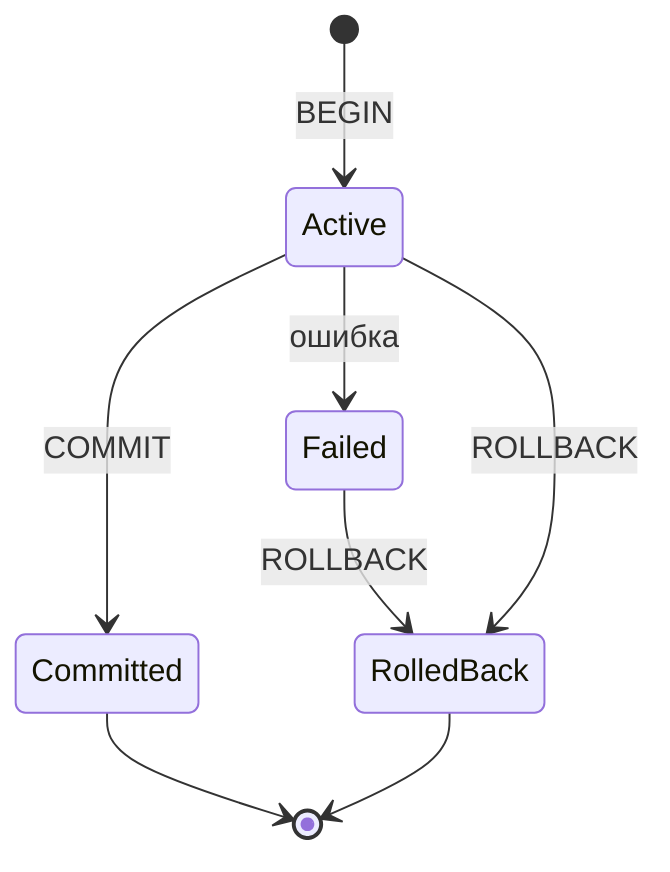
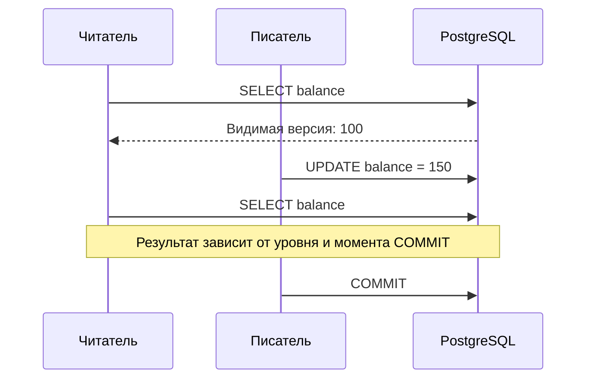

# 09. Транзакции, MVCC и изоляция

[[Лекции/08. Нормализация и физическое хранение|← Предыдущая]] · [[index|🏠 Старт]] · [[01. Карта курса|🧭 Карта]] · [[Лекции/10. Функции и процедуры PostgreSQL|Следующая →]]

> [!abstract] Зачем читать
> Транзакция связывает изменения в один итог. MVCC определяет видимые версии, а уровень изоляции — границы снимка и допустимые аномалии. Read Committed не защищает любое вычисление баланса в приложении. Для финансовых действий важны атомарные обновления, ограничения, короткие транзакции и повторы при конфликте.

> [!info] Основа конспекта
> [[lecture/BDC_9.pdf#page=1|Исходная лекция: BDC_9.pdf]], 20 страниц PDF. Пояснения, разборы и упражнения добавлены к материалу курса. Номера страниц ниже — страницы PDF, а не цифры внизу слайдов.

## 1. Транзакция — граница завершённого действия

Платёж должен создать запись в `payments` и увеличить `subscribers.balance`. Если первое действие выполнилось, а второе потерялось из-за сбоя, история и баланс разошлись. Транзакция объединяет действия: наружу должен выйти их согласованный итог.

```sql
-- PostgreSQL, учебная копия. Изменения отменяются.
BEGIN;
UPDATE subscribers
SET balance = balance + 100
WHERE subscriber_id = 1;
INSERT INTO payments (subscriber_id, amount, payment_method, transaction_id)
VALUES (1, 100, 'TRAINING', 'lecture-09-example');
SELECT subscriber_id, balance
FROM subscribers WHERE subscriber_id = 1;
ROLLBACK;
```

Здесь `ROLLBACK` отменяет изменения таблиц. Для реального проведения использовался бы `COMMIT` после проверок. Одна команда SQL тоже выполняется в транзакционном контексте; в режиме autocommit клиент обычно завершает каждую команду отдельно.

## 2. ACID без заклинаний

| Свойство | Что обещает | Пример |
|---|---|---|
| Atomicity | Все изменения транзакции фиксируются вместе | Платёж и баланс не расходятся из-за частичного завершения |
| Consistency | Успех не нарушает заданные правила | FK запрещает платёж несуществующему абоненту |
| Isolation | Контролируемое взаимодействие параллельных транзакций | Два платежа не должны затереть друг друга |
| Durability | Зафиксированные изменения сохраняются при предусмотренных сбоях | COMMIT переживает перезапуск при надлежащей конфигурации |

**Согласованность не означает, что СУБД угадывает бизнес-логику**. Если разработчик забыл увеличить баланс, транзакция с одной корректной вставкой может успешно завершиться. Нужное правило должно быть выражено алгоритмом и ограничениями.

Долговечность зависит от настроек фиксации, исправности носителей и модели отказов. WAL не заменяет резервную копию от потери всего диска или ошибочного удаления.

## 3. Жизненный цикл и точки сохранения



После необработанной ошибки PostgreSQL обычно оставляет явную транзакцию в аварийном состоянии до отката. Для управляемого частичного отката есть savepoint:

```sql
BEGIN;
SAVEPOINT before_optional_part;
-- Здесь может быть дополнительная операция.
ROLLBACK TO SAVEPOINT before_optional_part;
-- Можно продолжать основную работу.
ROLLBACK;
```

Это не нарушение атомарности: фиксируется выбранный итог транзакции, а отменённая часть в него не входит. Изменения последовательностей (`nextval`, SERIAL/IDENTITY) при откате назад не возвращаются, поэтому пропуски ID нормальны.

## 4. MVCC и снимок данных

MVCC хранит версии строк и определяет, какая версия видима транзакции. Снимок — правила видимости на основе состояния транзакций, а не полная копия файлов БД.

Обычное чтение в PostgreSQL обычно не блокирует изменение той же строки, а запись не мешает обычному чтению увидеть подходящую версию. Однако конфликтующие записи, явные блокировки и некоторые изменения схемы могут ждать друг друга.



Не превращай фразу «чтение не блокирует запись» в абсолютное «в PostgreSQL никогда нет блокировок». Например, `SELECT ... FOR UPDATE` как раз берёт блокировку строки.

## 5. Пять аномалий на коротких историях

**Грязное чтение**: A прочитала незакоммиченную запись B, а B откатилась. В PostgreSQL обычные уровни изоляции этого не допускают.

**Неповторяющееся чтение**: A дважды прочитала баланс; между чтениями B изменила его и зафиксировалась. Значение стало другим.

**Фантом**: A дважды выбирает должников; между запросами B добавила подходящую строку. Изменился набор строк. Сюда относятся и изменения существующих строк, из-за которых они входят в условие или выходят из него.

**Потерянное обновление**: две программы прочитали 100. Одна рассчитала 120, другая 130; обе записали готовое число. Итог 130 вместо 150.

**Аномалия сериализации**: взаимозависимые решения параллельных транзакций дали итог, невозможный при любом последовательном порядке. Например, каждый из двух дежурных увидел, что второй ещё дежурит, и оба отключились.

## 6. Что реально гарантируют уровни PostgreSQL

| Уровень | Грязное чтение | Изменение видимого значения между SELECT | Фантомы | Аномалия сериализации |
|---|---|---|---|---|
| Read Uncommitted | Нет: работает как RC | Возможно | Возможны | Возможна |
| Read Committed | Нет | Возможно | Возможны | Возможна |
| Repeatable Read | Нет | Нет | Нет в реализации PostgreSQL | Возможна |
| Serializable | Нет | Нет | Нет | Не допускается для успешно завершённых транзакций |

В **Read Committed** снимок обычного запроса создаётся на начало команды. В **Repeatable Read** используется снимок первого оператора, требующего снимка, внутри транзакции. Собственные предыдущие изменения транзакция видит.

**Serializable** может отменить конфликтующую транзакцию с SQLSTATE `40001`. Приложение должно повторить **всю** бизнес-транзакцию, а не только последнюю команду. Ошибка сериализации — рабочий механизм защиты, а не доказательство поломки сервера.

## 7. Потерянное обновление: важное уточнение

> [!warning] Уточнение к странице 12
> Блокировка строки при UPDATE не защищает любой алгоритм «прочитал → посчитал в приложении → записал готовое значение» на Read Committed. Устаревшее вычисление можно записать после ожидания блокировки. Безопаснее атомарное относительное изменение, блокировка до чтения либо оптимистическая проверка версии.

```sql
UPDATE subscribers
SET balance = balance + 20
WHERE subscriber_id = 1;
```

Два таких обновления одной строки согласуются через блокировки и используют актуальное значение. А две команды `SET balance = 120` и `SET balance = 130` не выражают сумму двух пополнений.

Для списания с проверкой остатка удобно объединить правило в одну команду:

```sql
UPDATE subscribers
SET balance = balance - 50
WHERE subscriber_id = 1 AND balance >= 50
RETURNING subscriber_id, balance;
```

Отсутствие строки в `RETURNING` требует обработки: абонент не найден, баланс неизвестен или денег недостаточно. Запись платежа/события и изменение баланса всё равно должны входить в общую транзакцию.

## 8. Лабораторный опыт в двух сессиях

В окне A:

```sql
BEGIN ISOLATION LEVEL REPEATABLE READ;
SELECT balance FROM subscribers WHERE subscriber_id = 1;
-- Дождись действий в окне B.
SELECT balance FROM subscribers WHERE subscriber_id = 1;
ROLLBACK;
```

В окне B между двумя SELECT:

```sql
BEGIN;
UPDATE subscribers SET balance = balance + 1 WHERE subscriber_id = 1;
COMMIT;
```

A продолжает видеть прежний снимок. Повтори с Read Committed: второй SELECT увидит новое зафиксированное значение. Изменение в B действительно сохраняется, поэтому проводи опыт в отдельной учебной копии и после опыта восстанови её исходное состояние.

## 9. Блокировки и взаимные ожидания

`SELECT ... FOR UPDATE` блокирует выбранные строки от конкурирующих изменений до завершения транзакции. Если две операции захватывают несколько строк в разном порядке, возможна взаимная блокировка (**deadlock**). PostgreSQL прерывает одну из транзакций; приложение обрабатывает ошибку и при необходимости повторяет действие.

> [!tip] Делай транзакции короткими
> Не оставляй BEGIN открытым на время размышлений пользователя. Читай и изменяй нужные строки в устойчивом порядке. Проверяй число затронутых строк, а не только отсутствие SQL-ошибки.

## Где это в PDF

[[lecture/BDC_9.pdf#page=3|Транзакции, MVCC и ACID: 3–10]] · [[lecture/BDC_9.pdf#page=11|Аномалии: 11–16]] · [[lecture/BDC_9.pdf#page=17|Уровни и блокировки: 17–20]]. Двухсессионные опыты выполняются в PostgreSQL, AlaSQL не моделирует его MVCC.

## Проверь себя без подсказки

1. Почему две команды в одном приложении ещё не образуют одну транзакцию?
2. Какая разница между снимками RC и RR?
3. Как потерять обновление даже при блокировках UPDATE?
4. Почему PostgreSQL RR защищает от фантомов, но не от всех аномалий сериализации?
5. Зачем после 40001 повторять всю бизнес-операцию?

## Мини-тренажёр

> [!tip] Два режима
> В Obsidian это редактируемые блоки с условиями и эталонами. На Quartz блоки превращаются в интерактивные задания после подключения [[Справочники/Интерактив и Quartz|обработчика]]. SQL-песочница использует маленький учебный набор, описанный в [[Практика/Учебный набор|паспорте данных]]. Он отличается от полного дампа.

```text
#quiz
? Что увидит обычный SELECT в PostgreSQL от незавершённого UPDATE другой транзакции?
- Новое незакоммиченное значение
+ Подходящую видимую версию по правилам снимка
- Всегда ошибку блокировки
```

```text
#quiz
? Как безопаснее выразить прибавление 100 к балансу одной строкой?
+ UPDATE subscribers SET balance = balance + 100 WHERE subscriber_id = 1
- Прочитать баланс заранее и всегда записать 100
- Заменить UPDATE на SELECT
```

```text
#order
Начать транзакцию
Проверить и изменить баланс атомарной операцией
Записать связанное финансовое событие
Проверить ожидаемый результат
Зафиксировать COMMIT либо отменить ROLLBACK
```

## Чек-лист понимания

- [ ] Прочитал лекцию и разобрал схему.
- [ ] Ответил на вопросы вслух без конспекта.
- [ ] Решил задания и разобрал ошибки.
- [ ] В свойстве `confidence` поставил число от 0 до 5.
- [ ] Поставил дату следующего повторения в `review_next`.

## Суть за минуту

Транзакция связывает изменения в один итог. MVCC определяет видимые версии, а уровень изоляции — границы снимка и допустимые аномалии. Read Committed не защищает любое вычисление баланса в приложении. Для финансовых действий важны атомарные обновления, ограничения, короткие транзакции и повторы при конфликте.

^summary-l09

## Куда дальше

Серверная реализация: [[Лекции/10. Функции и процедуры PostgreSQL]] и [[Лекции/11. Триггеры и планирование задач]]. Журнал WAL и долговечность: [[Лекции/14. Резервирование и восстановление]].

[[Лекции/08. Нормализация и физическое хранение|← Предыдущая]] · [[index|🏠 Старт]] · [[01. Карта курса|🧭 Карта]] · [[Лекции/10. Функции и процедуры PostgreSQL|Следующая →]]
