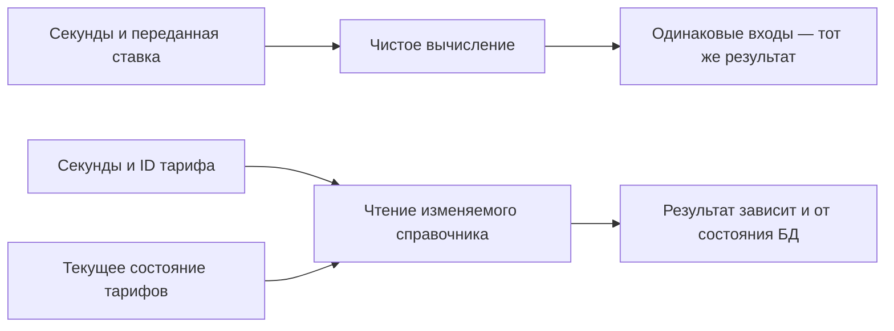
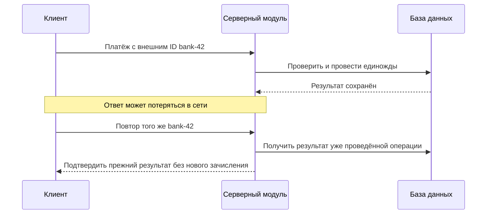

# 10. Функции и процедуры PostgreSQL

[[Лекции/09. Транзакции, MVCC и изоляция|← Предыдущая]] · [[index|🏠 Старт]] · [[01. Карта курса|🧭 Карта]] · [[Лекции/11. Триггеры и планирование задач|Следующая →]]

> [!abstract] Зачем читать
> Функцию вызывают в выражении, процедуру — через CALL. IMMUTABLE подходит чистому вычислению по аргументам, STABLE — чтению изменяемых таблиц по снимку запроса, VOLATILE — изменяющей или непредсказуемой логике. Перенос платежа на сервер требует проверок, общей транзакции и отдельного решения задачи повторной доставки.

> [!info] Основа конспекта
> [[lecture/BDC_10.pdf#page=1|Исходная лекция: BDC_10.pdf]], 17 страниц PDF. Пояснения, разборы и упражнения добавлены к материалу курса. Номера страниц ниже — страницы PDF, а не цифры внизу слайдов.

## 1. Почему вычисления переносят на сервер

Если приложению нужно посчитать общую стоимость миллионов событий, пересылать все строки по сети невыгодно. SQL и серверные функции могут выполнить работу рядом с данными. Единая реализация также помогает нескольким приложениям одинаково проводить платежи.

Однако серверная функция не делает систему автоматически быстрой или защищённой. Важны алгоритм, права, индексы и границы транзакций. Логику, которую удобно выразить одним запросом, обычно не стоит заменять построчным циклом.

## 2. Функция и процедура: похожи, но вызываются по-разному

| Свойство PostgreSQL | Функция | Процедура |
|---|---|---|
| Создание | `CREATE FUNCTION` | `CREATE PROCEDURE` |
| Вызов | В выражении, `SELECT` | `CALL` |
| Результат | Скаляр, запись, таблица, `void` | Выходные параметры при необходимости |
| Изменение данных | Возможно, например у VOLATILE | Возможно |
| Управление транзакциями | Не завершает вызывающую транзакцию | Допускается только при выполнении условий вызова |

«Функции вычисляют, процедуры действуют» — полезная архитектурная рекомендация, но функции PostgreSQL тоже могут изменять таблицы. Объявление возвращаемого типа обязательно, а полезный результат может отсутствовать при `RETURNS void`.

## 3. Простая SQL-функция расчёта стоимости

```sql
-- PostgreSQL. Упрощённая посекундная цена без пакетов и округления минут вверх.
CREATE OR REPLACE FUNCTION training_call_cost(
    p_seconds integer,
    p_price_per_minute numeric
) RETURNS numeric
LANGUAGE sql
IMMUTABLE
STRICT
AS $$
    SELECT round(p_seconds / 60.0 * p_price_per_minute, 2)
$$;

SELECT training_call_cost(90, 2.00); -- 3.00
```

Параметры передаются по значению. `60.0` помогает избежать целочисленного деления. `round(..., 2)` округляет денежный итог до двух знаков. `STRICT` означает, что при `NULL` среди входов PostgreSQL вернёт `NULL` без исполнения тела.

Пример намеренно **не моделирует весь биллинг**: нет включённых минут, роуминга, бесплатных периодов и исторических версий тарифа. Отрицательные аргументы нужно исключать отдельной проверкой или определённым контрактом вызова.

`$$ ... $$` — долларовые кавычки, удобный способ записать тело функции без экранирования каждой одинарной кавычки. Команда `DELIMITER` из MySQL в PostgreSQL не нужна.

## 4. Функция, читающая тариф

```sql
CREATE OR REPLACE FUNCTION training_cost_by_plan(
    p_seconds integer, p_plan_id integer
) RETURNS numeric
LANGUAGE sql
STABLE
AS $$
    SELECT training_call_cost(p_seconds, t.price_per_minute)
    FROM tariff_plans AS t
    WHERE t.plan_id = p_plan_id
$$;
```

Почему `STABLE`, а не `IMMUTABLE`? Цена зависит от содержимого `tariff_plans`. После изменения тарифа одинаковые аргументы могут дать другой результат. Если тариф не найден, SQL-функция с таким скалярным результатом возвращает `NULL`; если это недопустимо, напиши явную проверку в PL/pgSQL.

> [!warning] Уточнение к странице 5
> Функция, которая получает ID тарифа и читает его цену из изменяемой таблицы, не должна объявляться IMMUTABLE. «Одинаковый ID» не означает «одинаковая цена навсегда». Ошибочная пометка позволяет планировщику использовать устаревшее вычисление.

## 5. Изменчивость — обещание оптимизатору

| Категория | Гарантия одинаковых аргументов | Примеры |
|---|---|---|
| `VOLATILE` | Гарантии постоянства нет, возможны изменения БД | `random()`, функция с INSERT |
| `STABLE` | Один результат в рамках одного оператора | Чтение справочника по снимку запроса |
| `IMMUTABLE` | Результат зависит только от аргументов и не меняется со временем | Чистый расчёт цены по переданной ставке |

По умолчанию используется `VOLATILE`: это наиболее осторожное объявление с точки зрения оптимизации. `STABLE` не обещает ровно один физический вызов. `IMMUTABLE` тоже не является пользовательским кешем «на все будущие запросы»; пометка разрешает оптимизатору определённые преобразования.

Для **выражения индекса** PostgreSQL требует неизменчивости используемых функций. При поиске по уже существующему индексу `STABLE` может быть допустима как вычисляемое значение условия. Это разные случаи.

## 6. Ветвление: CASE и IF

В обычном SELECT применяют выражение CASE:

```sql
SELECT subscriber_id,
       CASE WHEN balance < 0 THEN 'Долг'
            WHEN balance = 0 THEN 'Ноль'
            ELSE 'Положительный остаток' END AS balance_group
FROM subscribers;
```

В PL/pgSQL есть управляющий `IF ... THEN ... ELSIF ... ELSE ... END IF`. Он выбирает блок операторов. `CASE` в SQL возвращает значение, а процедурное ветвление управляет выполнением. Примеры с `NULL` требуют отдельной ветки, если значение должно отличаться от категории «прочее».

## 7. Сигнатура и перегрузка

PostgreSQL различает функции по имени и входным типам. Можно иметь `lookup(integer)` и `lookup(text)`. Тип результата сам по себе не позволяет создать ещё одну перегрузку с теми же входами.

```sql
-- Удаление конкретного варианта при необходимости:
DROP FUNCTION IF EXISTS training_call_cost(integer, numeric);
```

Параметры OUT не используются для различения входной сигнатуры. При неоднозначных строковых литералах помогают явные преобразования типов. Избегай избыточных перегрузок: читатель должен понимать, какая реализация будет вызвана.

## 8. OUT, RETURNS TABLE и VARIADIC

Функция возвращает один результат, но этот результат может быть **структурированной записью** с несколькими полями или набором записей.

```sql
CREATE OR REPLACE FUNCTION training_balance_stats(
    OUT subscriber_count bigint,
    OUT total_balance numeric
) LANGUAGE sql STABLE
AS $$
    SELECT count(*), sum(balance) FROM subscribers
$$;

SELECT * FROM training_balance_stats();
```

`VARIADIC` позволяет принять переменное количество аргументов выбранного типа как массив:

```sql
CREATE OR REPLACE FUNCTION training_balances(VARIADIC p_ids integer[])
RETURNS TABLE(subscriber_id integer, balance numeric)
LANGUAGE sql STABLE
AS $$
    SELECT s.subscriber_id, s.balance
    FROM subscribers AS s
    WHERE s.subscriber_id = ANY(p_ids)
$$;

SELECT * FROM training_balances(1, 2, 3);
```

`OUT`-аргументы не передают в вызов функции как входные значения. Для процедуры правила вызова OUT отличаются; не переноси синтаксис механически.

## 9. Процедура проведения учебного платежа

```sql
CREATE OR REPLACE PROCEDURE training_add_payment(
    p_subscriber_id integer,
    p_amount numeric
)
LANGUAGE plpgsql
AS $$
BEGIN
    IF p_amount IS NULL OR p_amount <= 0 THEN
        RAISE EXCEPTION 'Сумма должна быть положительной';
    END IF;

    UPDATE subscribers
    SET balance = COALESCE(balance, 0) + p_amount
    WHERE subscriber_id = p_subscriber_id;

    IF NOT FOUND THEN
        RAISE EXCEPTION 'Абонент % не найден', p_subscriber_id;
    END IF;

    INSERT INTO payments (subscriber_id, amount, payment_method)
    VALUES (p_subscriber_id, p_amount, 'TRAINING');
END;
$$;

BEGIN;
CALL training_add_payment(1, 100);
ROLLBACK;
```

Процедура не делает внутренний `COMMIT`, поэтому её можно включить в более широкую транзакцию. Если INSERT завершается ошибкой, вызов не должен оставить отдельное увеличение баланса. Здесь `COALESCE` трактует неизвестный баланс как нулевой — это явное учебное бизнес-решение, которое в реальной системе надо согласовать.

**Повторная доставка платежа** остаётся отдельной задачей. Этот простой пример не обеспечивает идемпотентность: повторный CALL добавит сумму снова. Надёжный API принимает внешний ID операции, хранит его с уникальностью и корректно обрабатывает повтор. В исходном дампе `transaction_id` не уникален.

## 10. Границы возможностей процедуры

В PostgreSQL процедура может завершать транзакции только при допустимом контексте: например, подходящий вызов верхнего уровня `CALL`, без внешнего явного блока транзакции и без ряда ограничений определения процедуры. Поэтому «любая процедура всегда может COMMIT» неверно.

По умолчанию функции исполняются с правами вызывающего (`SECURITY INVOKER`). Вариант `SECURITY DEFINER` требует аккуратных прав и безопасного `search_path`; само размещение функции на сервере не препятствует прямому UPDATE для пользователя, которому он разрешён.

## Контракт функции важнее её короткого имени

Для функции расчёта стоимости нужно явно определить единицы аргументов, способ округления и поведение на неизвестных данных. Один и тот же 90-секундный звонок может тарифицироваться посекундно, как две начатые минуты или с учётом пакета. Синтаксически похожие функции дадут разные корректные результаты для разных правил.

| Условие | Что требуется решить |
|---|---|
| seconds = 90, ставка = 2 рубля | Посекундно получится 3, поминутно с округлением вверх — 4 |
| seconds = NULL | Вернуть NULL или выдать ошибку? |
| seconds < 0 | Запретить или определить специальный смысл? |
| Тариф изменился после звонка | Использовать историческую ставку или текущую? |
| Результат имеет дробные копейки | Где и как округлять? |

Правильный контракт позволяет написать тесты до реализации. Формула, которая работает на одном примере «60 секунд по 2 рубля», ещё не проверяет границы и историчность.

## Чистое вычисление и чтение состояния

Функция `cost(seconds, rate)` получает все существенные входы явно. Если она использует только детерминированную арифметику, результат не должен меняться со временем. Функция `cost(seconds, plan_id)` дополнительно зависит от содержимого таблицы тарифов.



Объявление IMMUTABLE не замораживает таблицу и не проверяет истинность обещания за разработчика. Оно разрешает оптимизатору рассчитывать на неизменность. Поэтому ошибочная категория может повредить корректности результатов, особенно при сохранённых и повторно используемых планах.

## Функция как интерфейс к правилу

Разные клиенты — сайт, касса, мобильное приложение — могут обращаться к одному серверному модулю. Это уменьшает риск разъезда формул. Но правило можно обойти прямым UPDATE, если у клиента есть соответствующие права. Следовательно, единый модуль должен сопровождаться осмысленной моделью доступа.

| Компонент | Что знает |
|---|---|
| Клиентская форма | Как собрать и показать данные |
| Серверный модуль | Как выполнить действие по контракту |
| Ограничения | Какие хранимые состояния запрещены |
| Права | Кто может вызывать модуль и менять таблицы |
| Транзакция | Какие изменения завершаются вместе |

Эти механизмы дополняют друг друга. Функция с красивым названием не заменяет FK, а FK не проверяет, что клиент имел право проводить операцию от чужого имени.

## Идемпотентность платежа на последовательности событий

Платёж с внешним ID `bank-42` пришёл, баланс увеличился, но подтверждение клиенту потерялось. Клиент прислал тот же ID ещё раз. Нужно отличить повтор доставки от нового платежа такого же размера.



Обычно нужен уникальный внешний идентификатор и атомарный алгоритм проверки/записи. Схема «сначала SELECT, потом INSERT» без защиты от конкуренции недостаточна: две транзакции могут одновременно не увидеть запись. Уникальность в БД служит важной последней границей, а код должен осмысленно обработать конфликт.

В исходной учебной БД transaction\_id не имеет UNIQUE. Поэтому описанная защита является задачей проектирования, а не уже готовой возможностью дампа.

## Результат функции и результат действия

Функция может возвращать скаляр, запись или набор. Возврат нескольких полей через OUT не означает несколько независимых результатов: это один структурированный результат. RETURNS TABLE описывает набор строк известной структуры.

Процедура удобна как команда «выполни действие». Нельзя заключать из отсутствия обычного RETURNS, что вызывающий код совсем не получит сведений: возможны выходные параметры и ошибки. Для интерфейса важно определить, как различаются успешное выполнение, отсутствие нужного объекта и повтор ранее проведённой операции.

## Перегрузка и неоднозначность типов

Литерал `'1'` выглядит как строка, но в момент разрешения вызова PostgreSQL может рассматривать литералы с ещё не определённым типом по специальным правилам. Если существуют варианты lookup(integer) и lookup(text), лучше не заставлять читателя угадывать выбор: применяй явные типы там, где это важно для интерфейса.

Не используй одинаковое имя для логически разных действий только ради перегрузки. Поиск абонента по ID и по телефону — понятные варианты одного действия. «Найти абонента» и «списать деньги» под одним именем с разными типами создают опасную неоднозначность для человека.

## Набор проверок перед использованием модуля

Проверь обычный вызов, границу, NULL, отсутствие объекта, повтор операции, конкурирующий вызов и ошибку второй части транзакции. Для вычислений добавь случай с дробью и правило округления. Для чтения справочника проверь изменение данных между вызовами. Именно такие проверки связывают объявленные характеристики с настоящим поведением функции.

## Где это в PDF

[[lecture/BDC_10.pdf#page=3|Серверная логика и функции: 3–7]] · [[lecture/BDC_10.pdf#page=8|Сигнатуры, OUT, VARIADIC: 8–10]] · [[lecture/BDC_10.pdf#page=11|Изменчивость: 11–13]] · [[lecture/BDC_10.pdf#page=14|Процедуры: 14–17]]. Блок процедур повторяется в начале следующего PDF.

## Проверь себя без подсказки

Сначала закрой пояснения и ответь вслух. Для сложного ответа приведи свой пример или контрпример.

1. Почему расчёт по переданной цене можно сделать IMMUTABLE, а чтение цены по ID тарифа — нельзя?
2. Что отличает SQL-функцию от PL/pgSQL-функции?
3. Чем вызов SELECT функции отличается от CALL процедуры?
4. Что такое сигнатура и почему OUT не различает перегрузки?
5. Почему простой повтор CALL может дважды увеличить баланс?
6. Сравни стоимость 90 секунд при двух правилах округления.
7. Составь контракт входных единиц и поведения функции на NULL.
8. Почему чистое вычисление и чтение тарифа имеют разную изменчивость?
9. Где возникает гонка между проверкой внешнего ID и его вставкой?
10. Как отличить повтор платежа от нового платежа той же суммы?
11. Почему лишние перегрузки ухудшают понятность API?
12. Какие проверки нужны при сбое после первого изменения внутри процедуры?

## Вопросы с выбором ответа

На сайте выбор сразу показывает результат. В Obsidian ответ отмечен знаком `+` в блоке; сначала попробуй ответить, затем проверь себя.

```text
#quiz
? Функция читает цену из изменяемой tariff_plans и ничего не меняет. Какую категорию обычно выбирают?
- IMMUTABLE
+ STABLE
- Категория не имеет значения
```

```text
#quiz
? Как вызвать процедуру PostgreSQL?
+ CALL training_add_payment(1, 100)
- SELECT training_add_payment(1, 100)
- EXECUTE TRIGGER training_add_payment
```

```text
#quiz
? Что сначала уточнять для функции стоимости 90-секундного звонка?
- Только имя функции
+ Правило единиц и округления
- Только число строк справочника
```

> [!explain]- Почему так
> Посекундная и поминутная тарификация дают разные осмысленные результаты.

```text
#quiz
? Что означает STRICT у функции PostgreSQL?
- Проверить все бизнес-правила автоматически
- Запретить перегрузки
+ При NULL во входе вернуть NULL без исполнения тела
```

> [!explain]- Почему так
> Это контракт обработки NULL, а не универсальный валидатор аргументов.

```text
#quiz
? IMMUTABLE замораживает таблицу тарифов?
+ Нет, это обещание оптимизатору
- Да, делает все строки read-only
- Да, пока открыт SELECT
```

> [!explain]- Почему так
> Неверная пометка не меняет данные, но может разрешить некорректные оптимизации.

```text
#quiz
? Почему два одновременных SELECT перед INSERT не гарантируют идемпотентность?
- SELECT всегда блокирует всю БД
+ Оба могут не увидеть ещё не записанную операцию
- INSERT не поддерживает уникальность
```

> [!explain]- Почему так
> Нужны атомарный алгоритм и защита уникальности внешнего идентификатора.

```text
#quiz
? Возврат OUT-полей означает что?
- Несколько несвязанных транзакций
- Автоматический COMMIT
+ Один структурированный результат
```

> [!explain]- Почему так
> Составная запись по-прежнему является результатом одного вызова.

```text
#quiz
? Можно ли вызывать процедуру PostgreSQL как выражение SELECT?
+ Обычно нет, для процедуры используется CALL
- Да, как любую скалярную функцию
- Только если она не имеет параметров
```

> [!explain]- Почему так
> Процедуры и функции имеют разные способы вызова.

```text
#quiz
? Что проверять после ошибки второго действия платежа?
- Только название процедуры
+ Не остался ли частичный бизнес-эффект
- Только код успешного первого UPDATE
```

> [!explain]- Почему так
> Внешняя транзакция должна охватывать согласованное действие целиком.

```text
#quiz
? Гарантирует ли серверная функция невозможность прямого UPDATE?
- Да, всегда
- Да, при любом имени с префиксом
+ Нет, нужны соответствующие права доступа
```

> [!explain]- Почему так
> Интерфейс модуля и разрешения пользователя должны быть согласованы.

## Закрепить тему на практике

- [[Практика/07. Аналитика биллинга]]
- [[Практика/09. Транзакции и конкуренция]]
- [[Практика/10. Функции, процедуры и триггеры]]

Здесь остаются вопросы на понимание. В тренировках — ввод запросов, проверка результатов и серверные задачи с разбором.

## Чек-лист понимания

- [ ] Прочитал лекцию и разобрал схему.
- [ ] Ответил на вопросы вслух без конспекта.
- [ ] Ответил на десять тестовых вопросов и объяснил неверные варианты.
- [ ] В свойстве `confidence` поставил число от 0 до 5.
- [ ] Поставил дату следующего повторения в `review_next`.

## Суть за минуту

Функцию вызывают в выражении, процедуру — через CALL. IMMUTABLE подходит чистому вычислению по аргументам, STABLE — чтению изменяемых таблиц по снимку запроса, VOLATILE — изменяющей или непредсказуемой логике. Перенос платежа на сервер требует проверок, общей транзакции и отдельного решения задачи повторной доставки.

^summary-l10

## Куда дальше

Реакции на события: [[Лекции/11. Триггеры и планирование задач]]. Язык программирования: [[Лекции/12. Программирование на PLpgSQL]].

[[Лекции/09. Транзакции, MVCC и изоляция|← Предыдущая]] · [[index|🏠 Старт]] · [[01. Карта курса|🧭 Карта]] · [[Лекции/11. Триггеры и планирование задач|Следующая →]]
