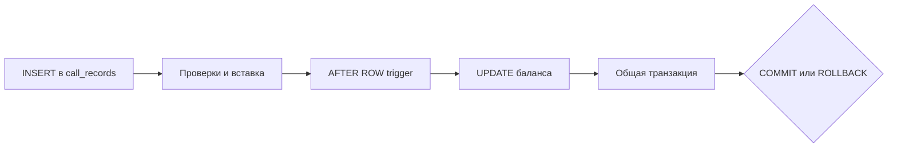
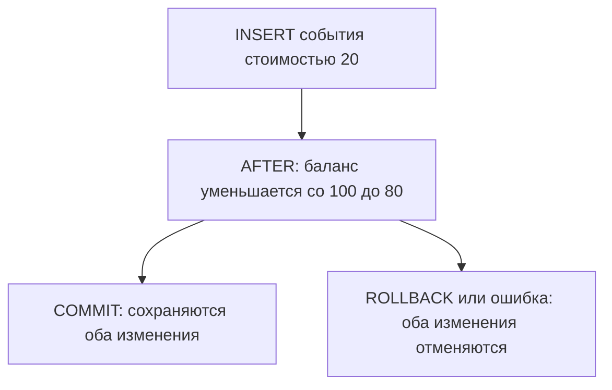
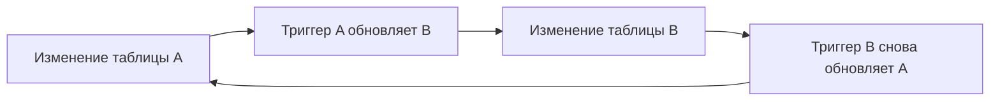

# 11. Триггеры и планирование задач

[[Лекции/10. Функции и процедуры PostgreSQL|← Предыдущая]] · [[index|Обложка]] · [[01. Карта курса|Карта]] · [[Лекции/12. Программирование на PLpgSQL|Следующая →]]

> [!abstract] Зачем читать
> Триггер — реакция на событие, планировщик — запуск по времени. BEFORE ROW может изменить или пропустить текущую строку, AFTER выполняется в той же транзакции, а не после COMMIT. При проектировании нужно учитывать INSERT, UPDATE, DELETE, повторную доставку событий и массовые изменения.

> [!info] Основа конспекта
> [[lecture/BDC_11.pdf#page=1|Исходная лекция: BDC_11.pdf]], 12 страниц PDF. Пояснения, разборы и упражнения добавлены к материалу курса. Номера страниц ниже — страницы PDF, а не цифры внизу слайдов.

## 1. Автоматически — по событию или по времени?

Два разных механизма часто смешивают. **Триггер** запускает функцию при событии над таблицей или представлением. **Планировщик** запускает команду в заданное время. «После INSERT списать стоимость события» — триггер. «Каждый день в 03:00 сформировать отчёт» — задача планировщика.

В начале `BDC_11.pdf` повторяются страницы о процедурах из предыдущего файла. Здесь акцент на автоматических реакциях, а синтаксис функций и CALL разобран в [[Лекции/10. Функции и процедуры PostgreSQL]].

## 2. Триггер состоит из двух частей

Сначала создаётся **триггерная функция** с `RETURNS trigger`, затем объект **CREATE TRIGGER** связывает её с таблицей, событием и моментом срабатывания. Обычный клиент не вызывает триггер по имени: он делает INSERT/UPDATE/DELETE, а СУБД запускает реакцию.



> [!warning] AFTER не означает после COMMIT
> Обычный AFTER-триггер выполняется в транзакции вызвавшей команды. Ошибка в нём может откатить и исходное изменение. Это не отдельная фоновая задача, которая запускается после окончательной фиксации.

## 3. Событие, момент и уровень

| Измерение | Варианты | Что определяет |
|---|---|---|
| Событие | INSERT, UPDATE, DELETE, TRUNCATE | На что реагировать |
| Момент | BEFORE, AFTER, INSTEAD OF | В какой фазе выполнить |
| Уровень | FOR EACH ROW / STATEMENT | На каждую строку или команду |
| Условие | WHEN (...) | Когда реакция действительно нужна |

**BEFORE ROW** подходит для проверки и корректировки `NEW`. Возврат `NULL` пропускает действие над **текущей строкой**, но не обязан отменять всю команду. `RAISE EXCEPTION` выдаёт ошибку и имеет иные последствия.

**AFTER ROW** видит результат изменения и удобно подходит для связанного действия. Возвращаемое значение такой функции игнорируется, поэтому `RETURN NEW` там не означает дополнительную запись строки.

**INSTEAD OF ROW** применяется к представлениям и реализует действие вместо исходного изменения представления. `TRUNCATE` поддерживает триггеры уровня команды, а не отдельных удалённых строк.

## 4. NEW, OLD и TG\_OP

| Событие ROW | NEW | OLD |
|---|---|---|
| INSERT | Новая строка | Нет строки |
| UPDATE | Новая версия | Предыдущая версия |
| DELETE | Нет строки | Удаляемая строка |

`TG_OP` содержит имя операции; `TG_TABLE_NAME` — имя таблицы. Это специальные переменные триггерного контекста. Триггерная функция объявляется без обычных входных аргументов; параметры объекта триггера при необходимости доступны отдельно через `TG_ARGV`.

При `BEFORE UPDATE` можно изменить `NEW.some_field` и вернуть `NEW`. При `BEFORE DELETE` обычно возвращают `OLD`, чтобы разрешить удаление текущей строки.

## 5. Пример: запрет отрицательной стоимости

```sql
-- PostgreSQL. Для простой проверки CHECK обычно предпочтительнее.
CREATE OR REPLACE FUNCTION training_validate_cost()
RETURNS trigger LANGUAGE plpgsql AS $$
BEGIN
    IF NEW.cost IS NULL OR NEW.cost < 0 THEN
        RAISE EXCEPTION 'Некорректная стоимость события: %', NEW.cost;
    END IF;
    RETURN NEW;
END;
$$;

CREATE TRIGGER training_validate_cost_trigger
BEFORE INSERT OR UPDATE ON call_records
FOR EACH ROW EXECUTE FUNCTION training_validate_cost();
```

Это обучающий пример механизма. Для локального правила `cost >= 0` проще прозрачное ограничение `NOT NULL CHECK (cost >= 0)`. Триггер полезен, когда реакция сложнее декларативного ограничения. Не нужно переносить в триггеры всё только потому, что они автоматические.

## 6. Пример: списание стоимости события

```sql
CREATE OR REPLACE FUNCTION training_deduct_cost()
RETURNS trigger LANGUAGE plpgsql AS $$
BEGIN
    IF NEW.cost IS NULL OR NEW.cost < 0 THEN
        RAISE EXCEPTION 'Стоимость должна быть неотрицательной';
    END IF;

    UPDATE subscribers
    SET balance = COALESCE(balance, 0) - NEW.cost
    WHERE subscriber_id = NEW.subscriber_id;

    IF NOT FOUND THEN
        RAISE EXCEPTION 'Абонент % не найден', NEW.subscriber_id;
    END IF;
    RETURN NEW;
END;
$$;

CREATE TRIGGER training_deduct_cost_trigger
AFTER INSERT ON call_records
FOR EACH ROW EXECUTE FUNCTION training_deduct_cost();
```

В дампе таблица называется `call_records`, а связь задаётся через `subscriber_id`. Слайды используют другие краткие имена; здесь пример приведён к реальной схеме. Создание триггера не списывает стоимость уже имеющихся событий: он действует на последующие INSERT.

Пример разрешает отрицательный баланс, как и исходная схема. Он также считает неизвестный баланс нулевым — это учебное допущение. Реальный контракт работы с `NULL` должен быть определён явно.

> [!tip] Проверь всю цепочку изменений
> Если разрешить изменение `cost` старого события или его DELETE, одного AFTER INSERT недостаточно: баланс уже был списан и не скорректируется. Либо события неизменяемы и корректируются отдельными операциями, либо нужны согласованные обработчики всех разрешённых изменений.

## 7. ROW и STATEMENT на конкретных числах

Если UPDATE затронул 100 абонентов, ROW-триггер вызовется для каждой из 100 строк, STATEMENT — один раз для команды. При UPDATE, не затронувшем ни одной строки, ROW не вызовется, а соответствующий STATEMENT вызовется.

Для массовой обработки PostgreSQL предоставляет переходные таблицы (`REFERENCING OLD TABLE / NEW TABLE`) в допустимых вариантах AFTER-триггеров. Они позволяют обработать набор изменений целиком. Это развитие идеи «не делай миллион одинаковых операций, если можно выразить одну операцию над набором».

## 8. Триггеры не решают всё за приложение

Триггер может усложнить отладку: исходный INSERT меняет ещё несколько объектов. Нужны понятные названия, документация и учёт порядка реакций. Косвенные циклы изменений могут вызвать рекурсию. Пользователи с достаточными административными правами могут менять или отключать механизмы, поэтому «невозможно обойти никогда» — слишком сильное утверждение.

Повторно присланное одинаковое событие всё равно может списать деньги дважды. Для защиты нужен устойчивый ID события и уникальность. Это задача **идемпотентности**, а не выбора BEFORE или AFTER.

## 9. Планирование через pg\_cron

`pg_cron` — отдельное расширение PostgreSQL, а не встроенный SQL-оператор `CREATE EVENT` из другого продукта. Нужны установка серверного пакета и настройка, включая `shared_preload_libraries`, права и выбор БД. В контейнере `postgres:15-alpine` из репозитория наличие pg\_cron не гарантировано.

```sql
-- PostgreSQL, только после установки и настройки расширения администратором.
CREATE EXTENSION IF NOT EXISTS pg_cron;

-- Ежедневно в 03:00 пометить просроченные неоплаченные счета.
SELECT cron.schedule(
    'training-mark-overdue',
    '0 3 * * *',
    $$UPDATE invoices
      SET status = 'OVERDUE'
      WHERE status = 'PENDING' AND due_date < CURRENT_DATE$$
);
```

Это **шаблон настройки**, его не нужно выполнять в браузерной песочнице. Для запуска по расписанию можно также использовать системный cron или внешний оркестратор. Укажи часовой пояс расписания, проверь права, журнал запусков и поведение при повторе. «Поставили расписание» ещё не означает, что задача успешно выполняется.

## 10. Разделение ответственности

VIEW формирует интерфейс чтения. Функция инкапсулирует вычисление. Процедура оформляет действие. Триггер реагирует на изменение. Планировщик реагирует на время. Они сочетаются: задача планировщика вызывает процедуру, та пишет строки, а триггер создаёт аудит в той же транзакции.

## Один INSERT и две возможные развязки

Начальный баланс — 100, стоимость события — 20. AFTER INSERT добавляет связанное списание. Пока внешняя транзакция не завершена, эти изменения не являются двумя независимо подтверждёнными действиями.

| Этап | Событие в текущей транзакции | Баланс в текущей транзакции |
|---|---|---:|
| До INSERT | Нет нового события | 100 |
| После вставки и AFTER | Есть новое событие | 80 |
| После COMMIT | Факт сохраняется | 80 |
| Вместо COMMIT выполнен ROLLBACK | Новый факт отменён | Снова 100 |

Если внутри триггера возникла необработанная ошибка, нельзя считать событие окончательно записанным лишь потому, что выбран момент AFTER. Название описывает фазу относительно операции, а не отдельную транзакцию после фиксации.



## BEFORE: изменить, пропустить или отказать

Эти варианты имеют разную семантику. Можно нормализовать значение NEW, вернуть NULL для пропуска текущей строки или выдать исключение. Нельзя подменять один вариант другим, если вызывающий код должен заметить ошибку.

| Реакция BEFORE ROW | Эффект | Когда это может быть уместно |
|---|---|---|
| Изменить NEW и вернуть NEW | Записать скорректированную строку | Вычислить служебное поле по согласованному правилу |
| Вернуть NULL | Пропустить текущую строку | Специальный договорённый механизм отбора |
| RAISE EXCEPTION | Прервать поток с ошибкой | Недопустимый факт нельзя молча проигнорировать |

Представь пакет из ста событий, одно из которых содержит отрицательную стоимость. Молчаливый пропуск и явный отказ от всего пакета — два разных контракта загрузки. Их надо выбирать до написания обработчика.

## Как обнаружить скрытую рекурсию

Триггер таблицы A обновляет B. Триггер B снова обновляет A. Если обновление действительно повторно запускает ту же цепочку, можно получить рекурсию и неожиданные расходы. Даже без бесконечного цикла эффект команды становится трудно увидеть по исходному INSERT.



Средства защиты зависят от задачи: убрать ненужное встречное изменение, ограничить реакцию осмысленным WHEN, обновлять только действительно изменившиеся значения, пересмотреть расположение бизнес-логики. Проверка глубины вызова сама по себе может скрыть неверную архитектуру, поэтому сначала пойми причину повторения.

## Событие неизменяемо или исправляется?

Если стоимость события разрешено менять после вставки, обработчик только INSERT оставит баланс неверным. При старой стоимости 20 и новой 25 нужно либо списать разницу 5, либо использовать другой согласованный механизм коррекции. Повторное списание всей новой суммы 25 даст лишние расходы.

Для финансовой истории часто выбирают отдельные корректирующие факты: исходное событие остаётся, а исправление имеет собственное основание и идентификатор. Это не универсальный закон для всех систем, но полезный способ сохранить объяснимость истории.

| Что разрешено приложению | Что нужно продумать |
|---|---|
| Только INSERT событий | Уникальность события и повторная доставка |
| UPDATE стоимости | Корректировка разницы и аудит |
| DELETE события | Возврат эффекта или запрет удаления |
| Массовая загрузка | Цена ROW-триггеров и согласованность пакета |

## Когда STATEMENT выигрывает по смыслу

Если нужно записать «выполнен пакетный пересчёт», одна запись аудита на команду может быть уместнее тысячи одинаковых сообщений на строки. Если нужно проверить новое значение конкретного поля каждой строки, ROW даёт естественный контекст NEW/OLD.

Для массовых наборов переходные таблицы в допустимых вариантах AFTER помогают обрабатывать изменения как отношение. Но один STATEMENT-триггер не превращает задачу автоматически в дешёвую: внутри всё ещё можно написать тяжёлый запрос. Важны и уровень запуска, и алгоритм тела.

## Расписание требует повторяемого действия

Ночная задача может запуститься повторно после сбоя, пропустить запуск или пересечься с долгим предыдущим выполнением. Поэтому полезно заранее определить: за какой период она отвечает, что считается завершением, можно ли выполнить её второй раз и где смотреть результат.

Пример «пометить просроченные PENDING-счета как OVERDUE» часто допускает повтор без дополнительного эффекта. Пример «каждый запуск списать monthly\_fee» без уникального ключа периода может списать деньги повторно. Выбор cron-выражения не решает эту разницу.

## Что проверять при отладке

Запиши исходную команду, ожидаемый набор строк, момент и уровень триггера, изменения связанных таблиц и исход транзакции. Проверь ноль строк, одну строку, массовое изменение и ошибку обработчика. Если понять эффект можно только чтением нескольких скрытых цепочек, возможно, часть действия лучше оформить явной процедурой.

## Где это в PDF

[[lecture/BDC_11.pdf#page=1|Повторение процедур: 1–4]] · [[lecture/BDC_11.pdf#page=5|Планировщик: 5–6]] · [[lecture/BDC_11.pdf#page=7|Триггеры: 7–12]].

## Проверь себя без подсказки

Сначала закрой пояснения и ответь вслух. Для сложного ответа приведи свой пример или контрпример.

1. Что произойдёт с исходным INSERT при необработанной ошибке AFTER-триггера?
2. Чем RETURN NULL в BEFORE ROW отличается от RAISE EXCEPTION?
3. Сколько вызовов ROW и STATEMENT будет у UPDATE с нулём затронутых строк?
4. Почему списание только по INSERT требует запрета или обработки изменений старых событий?
5. Почему CREATE EXTENSION pg\_cron может не сработать на исходном контейнере?
6. Проследи баланс и наличие события после INSERT, AFTER и ROLLBACK.
7. Чем отличается молчаливый пропуск строки от явного отказа пакета?
8. Как корректировать эффект смены cost с 20 на 25?
9. Нарисуй возможную рекурсию между триггерами двух таблиц.
10. Какой смысл аудита соответствует STATEMENT, а какой ROW?
11. Почему задача начисления за месяц должна учитывать повторный запуск?
12. Какие пути UPDATE и DELETE нужно запретить или обработать?

## Вопросы с выбором ответа

Выбери ответ: результат появится сразу. Затем раскрой пояснение и разбери, почему остальные варианты не подходят.

```text
#quiz
? Когда выполняется обычный AFTER INSERT триггер PostgreSQL?
- После COMMIT отдельным фоновым процессом
+ В транзакции исходного INSERT после изменения строки
- Только при следующем SELECT
```

```text
#quiz
? UPDATE не изменил ни одной строки. Сколько вызовов соответствующего STATEMENT-триггера будет?
- 0
+ 1
- По одному на каждую строку таблицы
```

```text
#quiz
? При откате внешней транзакции сохраняется ли обычное списание из AFTER-триггера?
- Да, AFTER всегда автономен
- Только при положительной стоимости
+ Нет, оно входит в ту же транзакцию
```

> [!explain]- Почему так
> Момент запуска не отделяет реакцию от транзакционного исхода.

```text
#quiz
? Вернуть NULL и выдать исключение в BEFORE ROW — одинаковый контракт?
+ Нет: пропуск строки отличается от ошибки
- Да, всегда
- Да, если обновляется сто строк
```

> [!explain]- Почему так
> Вызывающий код должен различать допустимый пропуск и отказ операции.

```text
#quiz
? Старый cost = 20, новый = 25. Почему повторное полное списание 25 неверно?
- Потому что 25 не является numeric
+ Исходные 20 уже могли быть списаны
- Потому что UPDATE не вызывает триггеры
```

> [!explain]- Почему так
> Нужно продумать коррекцию разницы или отдельный корректирующий факт.

```text
#quiz
? Триггер A меняет B, а B снова A. Что проверить?
- Только цвет таблиц
- Обязательное отсутствие FK
+ Рекурсию и реальную необходимость взаимной реакции
```

> [!explain]- Почему так
> Скрытая цепочка может повторно запускать сама себя.

```text
#quiz
? Когда STATEMENT-триггер уместен для аудита?
+ Нужна одна запись о пакетной команде
- Всегда нужно отдельное NEW каждой строки
- Нужно вызвать триггер после потери сети
```

> [!explain]- Почему так
> Уровень запуска выбирается по единице наблюдаемого события.

```text
#quiz
? Задача расписания повторно списывает плату за тот же месяц. Чего не хватает?
- Более длинного cron-выражения
+ Правила единственности начисления за период
- Дополнительного SELECT *
```

> [!explain]- Почему так
> Расписание определяет время, но не защищает бизнес-действие от повторного эффекта.

```text
#quiz
? Может ли триггер INSERT защитить от любого исправления старого события?
- Да, любое изменение считается INSERT
- Да, если функция возвращает NEW
+ Нет, нужны правила разрешённых UPDATE и DELETE
```

> [!explain]- Почему так
> Все разрешённые жизненные переходы факта должны быть согласованы.

```text
#quiz
? Делает ли один STATEMENT-триггер тело автоматически дешёвым?
+ Нет, внутри может быть тяжёлый запрос
- Да, оно всегда выполняется за константу
- Да, потому что нет строк
```

> [!explain]- Почему так
> Цена определяется ещё и алгоритмом выполняемой реакции.

## Закрепить тему на практике

- [[Практика/07. Аналитика биллинга]]
- [[Практика/09. Транзакции и конкуренция]]
- [[Практика/10. Функции, процедуры и триггеры]]

Здесь остаются вопросы на понимание. В тренировках — ввод запросов, проверка результатов и серверные задачи с разбором.

## Чек-лист понимания

- [ ] Прочитал лекцию и разобрал схему.
- [ ] Ответил на вопросы вслух без конспекта.
- [ ] Ответил на десять тестовых вопросов и объяснил неверные варианты.

## Суть за минуту

Триггер — реакция на событие, планировщик — запуск по времени. BEFORE ROW может изменить или пропустить текущую строку, AFTER выполняется в той же транзакции, а не после COMMIT. При проектировании нужно учитывать INSERT, UPDATE, DELETE, повторную доставку событий и массовые изменения.

^summary-l11

## Куда дальше

Тело обработчика: [[Лекции/12. Программирование на PLpgSQL]]. Транзакционные гарантии: [[Лекции/09. Транзакции, MVCC и изоляция]].

[[Лекции/10. Функции и процедуры PostgreSQL|← Предыдущая]] · [[index|Обложка]] · [[01. Карта курса|Карта]] · [[Лекции/12. Программирование на PLpgSQL|Следующая →]]
