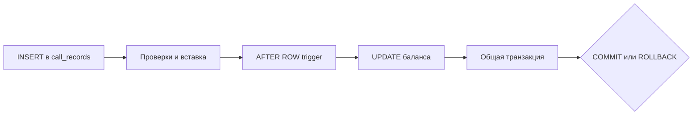

# 11. Триггеры и планирование задач

[[Лекции/10. Функции и процедуры PostgreSQL|← Предыдущая]] · [[index|🏠 Старт]] · [[01. Карта курса|🧭 Карта]] · [[Лекции/12. Программирование на PLpgSQL|Следующая →]]

> [!abstract] Зачем читать
> Триггер — реакция на событие, планировщик — запуск по времени. BEFORE ROW может изменить или пропустить текущую строку, AFTER выполняется в той же транзакции, а не после COMMIT. При проектировании нужно учитывать INSERT, UPDATE, DELETE, повторную доставку событий и массовые изменения.

> [!info] Основа конспекта
> [[lecture/BDC_11.pdf#page=1|Исходная лекция: BDC_11.pdf]], 12 страниц PDF. Пояснения, разборы и упражнения добавлены к материалу курса. Номера страниц ниже — страницы PDF, а не цифры внизу слайдов.

## 1. Автоматически — по событию или по времени?

Два разных механизма часто смешивают. **Триггер** запускает функцию при событии над таблицей или представлением. **Планировщик** запускает команду в заданное время. «После INSERT списать стоимость события» — триггер. «Каждый день в 03:00 сформировать отчёт» — задача планировщика.

В начале `BDC_11.pdf` повторяются страницы о процедурах из предыдущего файла. Здесь акцент на автоматических реакциях, а синтаксис функций и CALL разобран в [[Лекции/10. Функции и процедуры PostgreSQL]].

## 2. Триггер состоит из двух частей

Сначала создаётся **триггерная функция** с `RETURNS trigger`, затем объект **CREATE TRIGGER** связывает её с таблицей, событием и моментом срабатывания. Обычный клиент не вызывает триггер по имени: он делает INSERT/UPDATE/DELETE, а СУБД запускает реакцию.



> [!warning] AFTER не означает после COMMIT
> Обычный AFTER-триггер выполняется в транзакции вызвавшей команды. Ошибка в нём может откатить и исходное изменение. Это не отдельная фоновая задача, которая запускается после окончательной фиксации.

## 3. Событие, момент и уровень

| Измерение | Варианты | Что определяет |
|---|---|---|
| Событие | INSERT, UPDATE, DELETE, TRUNCATE | На что реагировать |
| Момент | BEFORE, AFTER, INSTEAD OF | В какой фазе выполнить |
| Уровень | FOR EACH ROW / STATEMENT | На каждую строку или команду |
| Условие | WHEN (...) | Когда реакция действительно нужна |

**BEFORE ROW** подходит для проверки и корректировки `NEW`. Возврат `NULL` пропускает действие над **текущей строкой**, но не обязан отменять всю команду. `RAISE EXCEPTION` выдаёт ошибку и имеет иные последствия.

**AFTER ROW** видит результат изменения и удобно подходит для связанного действия. Возвращаемое значение такой функции игнорируется, поэтому `RETURN NEW` там не означает дополнительную запись строки.

**INSTEAD OF ROW** применяется к представлениям и реализует действие вместо исходного изменения представления. `TRUNCATE` поддерживает триггеры уровня команды, а не отдельных удалённых строк.

## 4. NEW, OLD и TG\_OP

| Событие ROW | NEW | OLD |
|---|---|---|
| INSERT | Новая строка | Нет строки |
| UPDATE | Новая версия | Предыдущая версия |
| DELETE | Нет строки | Удаляемая строка |

`TG_OP` содержит имя операции; `TG_TABLE_NAME` — имя таблицы. Это специальные переменные триггерного контекста. Триггерная функция объявляется без обычных входных аргументов; параметры объекта триггера при необходимости доступны отдельно через `TG_ARGV`.

При `BEFORE UPDATE` можно изменить `NEW.some_field` и вернуть `NEW`. При `BEFORE DELETE` обычно возвращают `OLD`, чтобы разрешить удаление текущей строки.

## 5. Пример: запрет отрицательной стоимости

```sql
-- PostgreSQL. Для простой проверки CHECK обычно предпочтительнее.
CREATE OR REPLACE FUNCTION training_validate_cost()
RETURNS trigger LANGUAGE plpgsql AS $$
BEGIN
    IF NEW.cost IS NULL OR NEW.cost < 0 THEN
        RAISE EXCEPTION 'Некорректная стоимость события: %', NEW.cost;
    END IF;
    RETURN NEW;
END;
$$;

CREATE TRIGGER training_validate_cost_trigger
BEFORE INSERT OR UPDATE ON call_records
FOR EACH ROW EXECUTE FUNCTION training_validate_cost();
```

Это обучающий пример механизма. Для локального правила `cost >= 0` проще прозрачное ограничение `NOT NULL CHECK (cost >= 0)`. Триггер полезен, когда реакция сложнее декларативного ограничения. Не нужно переносить в триггеры всё только потому, что они автоматические.

## 6. Пример: списание стоимости события

```sql
CREATE OR REPLACE FUNCTION training_deduct_cost()
RETURNS trigger LANGUAGE plpgsql AS $$
BEGIN
    IF NEW.cost IS NULL OR NEW.cost < 0 THEN
        RAISE EXCEPTION 'Стоимость должна быть неотрицательной';
    END IF;

    UPDATE subscribers
    SET balance = COALESCE(balance, 0) - NEW.cost
    WHERE subscriber_id = NEW.subscriber_id;

    IF NOT FOUND THEN
        RAISE EXCEPTION 'Абонент % не найден', NEW.subscriber_id;
    END IF;
    RETURN NEW;
END;
$$;

CREATE TRIGGER training_deduct_cost_trigger
AFTER INSERT ON call_records
FOR EACH ROW EXECUTE FUNCTION training_deduct_cost();
```

В дампе таблица называется `call_records`, а связь задаётся через `subscriber_id`. Слайды используют другие краткие имена; здесь пример приведён к реальной схеме. Создание триггера не списывает стоимость уже имеющихся событий: он действует на последующие INSERT.

Пример разрешает отрицательный баланс, как и исходная схема. Он также считает неизвестный баланс нулевым — это учебное допущение. Реальный контракт работы с `NULL` должен быть определён явно.

> [!tip] Проверь всю цепочку изменений
> Если разрешить изменение `cost` старого события или его DELETE, одного AFTER INSERT недостаточно: баланс уже был списан и не скорректируется. Либо события неизменяемы и корректируются отдельными операциями, либо нужны согласованные обработчики всех разрешённых изменений.

## 7. ROW и STATEMENT на конкретных числах

Если UPDATE затронул 100 абонентов, ROW-триггер вызовется для каждой из 100 строк, STATEMENT — один раз для команды. При UPDATE, не затронувшем ни одной строки, ROW не вызовется, а соответствующий STATEMENT вызовется.

Для массовой обработки PostgreSQL предоставляет переходные таблицы (`REFERENCING OLD TABLE / NEW TABLE`) в допустимых вариантах AFTER-триггеров. Они позволяют обработать набор изменений целиком. Это развитие идеи «не делай миллион одинаковых операций, если можно выразить одну операцию над набором».

## 8. Триггеры не решают всё за приложение

Триггер может усложнить отладку: исходный INSERT меняет ещё несколько объектов. Нужны понятные названия, документация и учёт порядка реакций. Косвенные циклы изменений могут вызвать рекурсию. Пользователи с достаточными административными правами могут менять или отключать механизмы, поэтому «невозможно обойти никогда» — слишком сильное утверждение.

Повторно присланное одинаковое событие всё равно может списать деньги дважды. Для защиты нужен устойчивый ID события и уникальность. Это задача **идемпотентности**, а не выбора BEFORE или AFTER.

## 9. Планирование через pg\_cron

`pg_cron` — отдельное расширение PostgreSQL, а не встроенный SQL-оператор `CREATE EVENT` из другого продукта. Нужны установка серверного пакета и настройка, включая `shared_preload_libraries`, права и выбор БД. В контейнере `postgres:15-alpine` из репозитория наличие pg\_cron не гарантировано.

```sql
-- PostgreSQL, только после установки и настройки расширения администратором.
CREATE EXTENSION IF NOT EXISTS pg_cron;

-- Ежедневно в 03:00 пометить просроченные неоплаченные счета.
SELECT cron.schedule(
    'training-mark-overdue',
    '0 3 * * *',
    $$UPDATE invoices
      SET status = 'OVERDUE'
      WHERE status = 'PENDING' AND due_date < CURRENT_DATE$$
);
```

Это **шаблон настройки**, его не нужно выполнять в браузерной песочнице. Для запуска по расписанию можно также использовать системный cron или внешний оркестратор. Укажи часовой пояс расписания, проверь права, журнал запусков и поведение при повторе. «Поставили расписание» ещё не означает, что задача успешно выполняется.

## 10. Разделение ответственности

VIEW формирует интерфейс чтения. Функция инкапсулирует вычисление. Процедура оформляет действие. Триггер реагирует на изменение. Планировщик реагирует на время. Они сочетаются: задача планировщика вызывает процедуру, та пишет строки, а триггер создаёт аудит в той же транзакции.

## Где это в PDF

[[lecture/BDC_11.pdf#page=1|Повторение процедур: 1–4]] · [[lecture/BDC_11.pdf#page=5|Планировщик: 5–6]] · [[lecture/BDC_11.pdf#page=7|Триггеры: 7–12]].

## Проверь себя без подсказки

1. Что произойдёт с исходным INSERT при необработанной ошибке AFTER-триггера?
2. Чем RETURN NULL в BEFORE ROW отличается от RAISE EXCEPTION?
3. Сколько вызовов ROW и STATEMENT будет у UPDATE с нулём затронутых строк?
4. Почему списание только по INSERT требует запрета или обработки изменений старых событий?
5. Почему CREATE EXTENSION pg\_cron может не сработать на исходном контейнере?

## Мини-тренажёр

> [!tip] Два режима
> В Obsidian это редактируемые блоки с условиями и эталонами. На Quartz блоки превращаются в интерактивные задания после подключения [[Справочники/Интерактив и Quartz|обработчика]]. SQL-песочница использует маленький учебный набор, описанный в [[Практика/Учебный набор|паспорте данных]]. Он отличается от полного дампа.

```sql
-- setup
CREATE TABLE tariff_plans (plan_id INT, plan_name STRING, monthly_fee NUMBER, minutes_included INT, sms_included INT, data_gb_included INT, price_per_minute NUMBER, price_per_sms NUMBER, price_per_gb NUMBER, is_active BOOLEAN);
INSERT INTO tariff_plans VALUES (1,'Basic',300,100,50,5,2,2.5,200,true),(2,'Standard',500,300,100,15,1.5,2,150,true),(3,'Premium',800,1000,500,50,1,1.5,100,true),(4,'Unlimited',1200,999999,999999,100,0,0,50,true),(5,'Student',350,200,100,10,1.8,2,180,true),(6,'Senior',250,150,100,3,2,2,250,false);
CREATE TABLE service_types (service_type_id INT, service_name STRING, description STRING);
INSERT INTO service_types VALUES (1,'Outgoing Call','Исходящий звонок'),(2,'Incoming Call','Входящий звонок'),(3,'SMS','Сообщение'),(4,'MMS','Мультимедийное сообщение'),(5,'Data','Интернет');
CREATE TABLE subscribers (subscriber_id INT, phone_number STRING, first_name STRING, last_name STRING, email STRING, plan_id, registration_date STRING, status STRING, balance NUMBER);
INSERT INTO subscribers VALUES (1,'+79100000001','Анна','Волкова','anna@example.test',1,'2025-09-01','ACTIVE',250),(2,'+79100000002','Борис','Орлов',NULL,2,'2025-09-03','ACTIVE',-20),(3,'+79100000003','Вера','Иванова','vera@example.test',3,'2025-10-01','SUSPENDED',0),(4,'+79100000004','Глеб','Соколов','gleb@example.test',1,'2025-10-10','ACTIVE',500),(5,'+79100000005','Дина','Белова',NULL,5,'2025-11-01','ACTIVE',100),(6,'+79100000006','Егор','Петров','egor@example.test',NULL,'2025-11-02','TERMINATED',-50),(7,'+79100000007','Жанна','Миронова','zhanna@example.test',4,'2025-11-03','ACTIVE',1000),(8,'+79100000008','Зоя','Зайцева',NULL,2,'2025-11-04','SUSPENDED',100);
CREATE TABLE call_records (record_id INT, subscriber_id INT, service_type_id INT, call_date STRING, destination_number STRING, duration_seconds INT, quantity INT, cost NUMBER);
INSERT INTO call_records VALUES (1,1,1,'2025-11-01 10:00:00','+79000000001',60,1,2),(2,1,1,'2025-11-02 10:00:00','+79000000002',120,1,4),(3,2,1,'2025-11-01 11:00:00','+79000000003',30,1,1.5),(4,2,3,'2025-11-03 11:00:00','900',0,1,2),(5,3,1,'2025-11-02 12:00:00','+79000000004',300,1,5),(6,4,1,'2025-11-03 13:00:00','+79000000005',180,1,6),(7,4,1,'2025-11-04 13:00:00','+79000000006',60,1,2),(8,7,1,'2025-11-05 14:00:00','+79000000007',600,1,0);
CREATE TABLE data_usage (usage_id INT, subscriber_id INT, usage_date STRING, data_mb INT, cost NUMBER);
INSERT INTO data_usage VALUES (1,1,'2025-11-01',1024,150),(2,1,'2025-11-02',512,75),(3,2,'2025-11-01',2048,300),(4,4,'2025-11-02',0,0),(5,7,'2025-11-03',4096,200);
CREATE TABLE invoices (invoice_id INT, subscriber_id INT, billing_period STRING, issue_date STRING, due_date STRING, monthly_fee NUMBER, usage_charges NUMBER, total_amount NUMBER, status STRING);
INSERT INTO invoices VALUES (1,1,'2025-11','2025-11-01','2025-11-10',300,6,306,'PAID'),(2,2,'2025-11','2025-11-01','2025-11-10',500,3.5,503.5,'OVERDUE'),(3,3,'2025-11','2025-11-01','2025-11-10',800,5,805,'PENDING'),(4,4,'2025-11','2025-11-01','2025-11-10',300,8,308,'PAID'),(5,7,'2025-11','2025-11-01','2025-11-10',1200,0,1200,'PENDING');
CREATE TABLE payments (payment_id INT, subscriber_id INT, invoice_id, payment_date STRING, amount NUMBER, payment_method STRING, transaction_id STRING);
INSERT INTO payments VALUES (1,1,1,'2025-11-02 09:00:00',200,'CARD','tx-1'),(2,1,1,'2025-11-03 09:00:00',106,'CARD','tx-2'),(3,4,4,'2025-11-04 09:00:00',308,'CARD','tx-3'),(4,5,NULL,'2025-11-05 09:00:00',100,'CASH','tx-4');
CREATE TABLE plan_changes (change_id INT, subscriber_id INT, old_plan_id INT, new_plan_id INT, change_date STRING, reason STRING);
INSERT INTO plan_changes VALUES (1,1,2,1,'2025-10-01','Экономия'),(2,2,1,2,'2025-10-10','Больше минут'),(3,7,3,4,'2025-11-01','Безлимит');
```

```text
#quiz
? Когда выполняется обычный AFTER INSERT триггер PostgreSQL?
- После COMMIT отдельным фоновым процессом
+ В транзакции исходного INSERT после изменения строки
- Только при следующем SELECT
```

```text
#quiz
? UPDATE не изменил ни одной строки. Сколько вызовов соответствующего STATEMENT-триггера будет?
- 0
+ 1
- По одному на каждую строку таблицы
```

```text
#order
Клиент выполняет INSERT
Выполняется BEFORE ROW при его наличии
Строка проходит проверки и вставляется
Выполняется AFTER ROW
Вызывающая транзакция завершается COMMIT или ROLLBACK
```

```text
#task
Посчитай общую стоимость событий для каждого subscriber_id в call_records.
Выведи subscriber_id и total_cost; сортировка по subscriber_id.
= SELECT subscriber_id, SUM(cost) AS total_cost FROM call_records GROUP BY subscriber_id ORDER BY subscriber_id;
```

## Чек-лист понимания

- [ ] Прочитал лекцию и разобрал схему.
- [ ] Ответил на вопросы вслух без конспекта.
- [ ] Решил задания и разобрал ошибки.
- [ ] В свойстве `confidence` поставил число от 0 до 5.
- [ ] Поставил дату следующего повторения в `review_next`.

## Суть за минуту

Триггер — реакция на событие, планировщик — запуск по времени. BEFORE ROW может изменить или пропустить текущую строку, AFTER выполняется в той же транзакции, а не после COMMIT. При проектировании нужно учитывать INSERT, UPDATE, DELETE, повторную доставку событий и массовые изменения.

^summary-l11

## Куда дальше

Тело обработчика: [[Лекции/12. Программирование на PLpgSQL]]. Транзакционные гарантии: [[Лекции/09. Транзакции, MVCC и изоляция]].

[[Лекции/10. Функции и процедуры PostgreSQL|← Предыдущая]] · [[index|🏠 Старт]] · [[01. Карта курса|🧭 Карта]] · [[Лекции/12. Программирование на PLpgSQL|Следующая →]]
