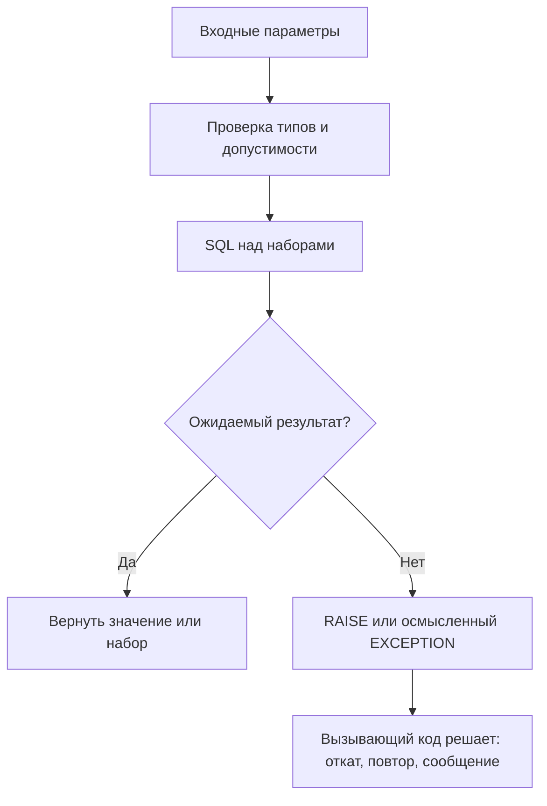
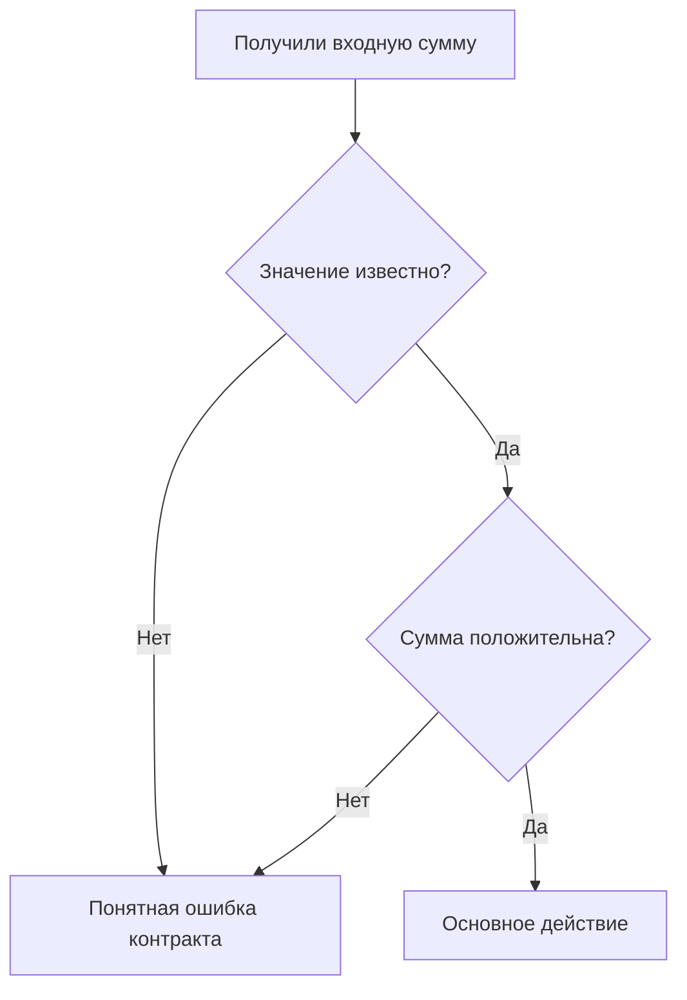

# 12. Программирование на PLpgSQL

[[Лекции/11. Триггеры и планирование задач|← Предыдущая]] · [[index|🏠 Старт]] · [[01. Карта курса|🧭 Карта]] · [[Лекции/13. Производительность и индексы|Следующая →]]

> [!abstract] Зачем читать
> PL/pgSQL добавляет блоки, переменные, условия, циклы и обработку ошибок к SQL. BEGIN блока не является новой транзакцией. SELECT INTO, FOUND и NULL требуют аккуратности. Для набора строк есть RETURN QUERY; для ошибок — осмысленные EXCEPTION и RAISE. Операция над набором часто лучше построчного цикла.

> [!info] Основа конспекта
> [[lecture/BDC_12.pdf#page=1|Исходная лекция: BDC_12.pdf]], 19 страниц PDF. Пояснения, разборы и упражнения добавлены к материалу курса. Номера страниц ниже — страницы PDF, а не цифры внизу слайдов.

## 1. Где заканчивается SQL и начинается PL/pgSQL

SQL хорошо описывает операции над наборами: отобрать, соединить, сгруппировать, изменить. PL/pgSQL добавляет переменные, ветвления, циклы и обработку ошибок. Он нужен, когда серверное действие состоит из нескольких зависимых шагов.

Например: проверить сумму; найти абонента; записать корректировку; вернуть новый баланс или понятную ошибку. При этом один `UPDATE ... WHERE ... RETURNING` может оказаться и проще, и безопаснее десятка строк процедурного кода.

`BDC_12.pdf` снова обращается к функциям, перегрузке и триггерам, а затем раскрывает процедурный язык. На титуле стоит «Лекция 10»; в этом конспекте сохраняется номер 12 по имени файла.

## 2. Анатомия блока

```sql
-- PostgreSQL: анонимный блок для знакомства с синтаксисом.
DO $$
DECLARE
    v_count bigint;
BEGIN
    SELECT count(*) INTO v_count FROM subscribers;
    RAISE NOTICE 'Абонентов: %', v_count;
END;
$$;
```

`DECLARE` содержит объявления переменных и необязателен, если переменных нет. `BEGIN ... END` ограничивает блок операторов. Внутри может быть `EXCEPTION` для обработки ошибок. Точка с запятой завершает оператор; `END;` внутри долларовых кавычек и завершающая `;` команды имеют разные роли.

> [!warning] Два разных BEGIN
> В PL/pgSQL `BEGIN ... END` обозначает блок кода и не начинает отдельную транзакцию. В интерактивном SQL `BEGIN; ... COMMIT;` управляет транзакцией. Вложенный блок PL/pgSQL не делает изменения независимо зафиксированными.

## 3. Переменные и привязка типов

```sql
DO $$
DECLARE
    v_id subscribers.subscriber_id%TYPE := 1;
    v_balance subscribers.balance%TYPE;
    v_subscriber subscribers%ROWTYPE;
BEGIN
    SELECT balance INTO v_balance
    FROM subscribers WHERE subscriber_id = v_id;
    SELECT * INTO v_subscriber
    FROM subscribers WHERE subscriber_id = v_id;
    RAISE NOTICE 'ID %, баланс %', v_id, v_balance;
END;
$$;
```

`%TYPE` использует тип столбца, `%ROWTYPE` — структуру строки таблицы. Это уменьшает ручное дублирование объявления типов. Но изменение схемы не гарантирует автоматическую корректность всего алгоритма: переименование поля, смена смысла или преобразование ID в UUID может потребовать изменения кода и повторной проверки.

Выбирай разные имена параметров, переменных и столбцов: `p_id`, `v_balance`, `s.balance`. Иначе выражение `WHERE id = id` легко станет либо неоднозначным, либо всегда истинным не в том смысле, который ожидался.

## 4. SELECT INTO, STRICT и FOUND

В PL/pgSQL `SELECT ... INTO variable` присваивает результат переменной. Это отличается от команды SQL `SELECT INTO new_table`, создающей таблицу.

Без `STRICT` выбирается первая строка, а при отсутствии результата переменные получают `NULL`. Для обязательного ровно одного результата полезен `INTO STRICT`: отсутствие строки и лишние строки вызывают разные ошибки.

```sql
DO $$
DECLARE
    v_balance numeric;
BEGIN
    SELECT balance INTO STRICT v_balance
    FROM subscribers WHERE subscriber_id = 1;
    RAISE NOTICE 'Баланс: %', v_balance;
EXCEPTION
    WHEN no_data_found THEN
        RAISE NOTICE 'Абонент не найден';
END;
$$;
```

`FOUND` показывает результат **последней подходящей операции**, а не хранит историю всех поисков. Проверяй его сразу после нужного SELECT/UPDATE. Для числа затронутых строк можно использовать `GET DIAGNOSTICS v_rows = ROW_COUNT`.

Для выполнения запроса, результат которого не нужен, внутри PL/pgSQL применяют `PERFORM`, например `PERFORM training_call_cost(60, 2)`.

## 5. Ветвления и NULL

```sql
IF p_amount IS NULL THEN
    RAISE EXCEPTION 'Не передана сумма';
ELSIF p_amount <= 0 THEN
    RAISE EXCEPTION 'Сумма должна быть больше нуля';
ELSE
    -- Основное действие.
END IF;
```

Условие IF должно быть истинным, чтобы выполниться. Если `p_amount IS NULL`, выражение `p_amount <= 0` не истинно; поэтому одной такой проверки недостаточно. Это та же трёхзначная логика, что и в WHERE, но ошибка теперь прячется в программном потоке.

`CASE` удобен для нескольких вариантов одного значения или нескольких условий. Держи правила простыми и явно обрабатывай неизвестные значения, если они недопустимы.

## 6. Циклы и операции над наборами

```sql
DO $$
DECLARE
    r record;
BEGIN
    FOR r IN
        SELECT subscriber_id, balance
        FROM subscribers
        WHERE balance < 0
        ORDER BY subscriber_id
    LOOP
        RAISE NOTICE 'Должник %, баланс %', r.subscriber_id, r.balance;
    END LOOP;
END;
$$;
```

Есть также числовой `FOR`, `WHILE`, безусловный `LOOP` с `EXIT` и обход массива `FOREACH`. Они полезны, когда шаги действительно зависят друг от друга.

Для массового изменения статуса лучше рассмотреть один UPDATE:

```sql
-- Пример бизнес-правила для отдельной учебной копии.
UPDATE subscribers
SET status = 'SUSPENDED'
WHERE status = 'ACTIVE' AND balance < 0;
```

Цикл не является обязательным способом построения отчёта. Агрегация SQL обычно понятнее и позволяет оптимизатору работать с набором целиком. Фраза «сложный отчёт невозможно выразить декларативно» требует доказательства для конкретной задачи.

## 7. Возврат набора строк

```sql
CREATE OR REPLACE FUNCTION training_debtors(p_limit numeric)
RETURNS TABLE(subscriber_id integer, phone_number varchar, balance numeric)
LANGUAGE plpgsql STABLE
AS $$
BEGIN
    RETURN QUERY
    SELECT s.subscriber_id, s.phone_number, s.balance
    FROM subscribers AS s
    WHERE s.balance < p_limit
    ORDER BY s.subscriber_id;
END;
$$;

SELECT * FROM training_debtors(0);
```

`RETURN QUERY` добавляет строки запроса в возвращаемый набор. `RETURN NEXT` добавляет отдельную строку. Обычный `RETURN` завершает функцию. Для чистого SELECT эта функция могла бы быть написана на `LANGUAGE sql`; PL/pgSQL выбран для демонстрации конструкции.

Возвращаемые столбцы `RETURNS TABLE` также создают переменные, поэтому внутри квалифицируй поля алиасом `s`. Большие наборы в PL/pgSQL могут буферизоваться с использованием памяти и временных файлов; не стоит обещать мгновенный поток строк без измерений.

## 8. Обработка ошибок и локальный откат

```sql
DO $$
BEGIN
    BEGIN
        INSERT INTO service_types (service_name, description)
        VALUES ('Training temporary', 'Будет отменено');
        RAISE EXCEPTION 'Учебный сбой';
    EXCEPTION WHEN raise_exception THEN
        RAISE NOTICE 'Внутренний блок отменён, внешний продолжает работу';
    END;
END;
$$;
```

Изменения внутри блока, в котором возникла перехваченная ошибка, откатываются к входу в этот блок. Код обработчика может продолжить внешний блок. Но если записать лог, а затем внешняя транзакция откатится, обычная запись лога в таблицу тоже исчезнет. Автономной транзакцией EXCEPTION не становится.

Лови ожидаемые категории ошибок и понимай, что делать дальше. `WHEN OTHERS THEN NULL` скрывает сбои и может превратить ошибку платежа в ложный успех. Для повторной передачи исходной ошибки из обработчика есть `RAISE;`.

## 9. RAISE — сообщение или ошибка

| Уровень | Типичное назначение |
|---|---|
| DEBUG | Детальная диагностика |
| INFO / NOTICE | Информация о ходе выполнения |
| WARNING | Предупреждение без обязательного прерывания |
| EXCEPTION | Ошибка с прерыванием текущего потока |

```sql
RAISE EXCEPTION 'Абонент % не найден', p_subscriber_id
    USING ERRCODE = 'P0002';
```

Видимость сообщений зависит от настроек клиента и сервера. Сообщение `NOTICE` не является доказательством успешного COMMIT. Для машинной обработки полезнее стабильный код ошибки и структурированный результат, а не поиск фразы в тексте.

## 10. Собираем серверный модуль осмысленно



Размещай в БД правила, которые должны одинаково выполняться для всех клиентов и зависят от согласованного состояния данных. Сохраняй явные контракты и минимально необходимые права. Для динамического SQL используй корректное параметризованное построение (`EXECUTE ... USING`, `format('%I', ...)` для имён), а не склеивание непроверенного текста.

## Присваивание и отсутствие строки — разные ситуации

В PL/pgSQL переменная может стать NULL потому, что значение в таблице неизвестно, либо потому, что SELECT не нашёл строку. Если это различие существенно, нужны FOUND или INTO STRICT. Проверка `v_balance IS NULL` сама по себе не различает причины.

| Ситуация | SELECT INTO без STRICT | Что помогает различить |
|---|---|---|
| Абонент найден, balance известен | Значение присвоено | Проверка обычного результата |
| Абонент найден, balance равен NULL | Переменная NULL | FOUND сообщает о найденной строке |
| Абонент не найден | Переменная NULL | FOUND или исключение no\_data\_found |
| Найдено неожиданно несколько строк | Берётся первая | STRICT вызывает too\_many\_rows |

Фраза «первая строка» без ORDER BY не задаёт устойчивого выбора. Если по контракту объект должен быть единственным, правильнее проверить уникальность и использовать строгую выборку, чем прятать проблему случайным ограничением результата.

## Условия: сначала исключаем неопределённость

Пусть функция получает сумму. `IF p_amount <= 0 THEN ...` не отвергает NULL: неизвестное условие не считается истинным. Для обязательного входа проверяют `p_amount IS NULL OR p_amount <= 0`. После этого основной код может опираться на более сильное утверждение «сумма известна и положительна».



Ранние проверки уменьшают число вариантов, которые нужно помнить внутри алгоритма. Но проверка входа не заменяет проверки конкурентно меняющегося состояния: между отдельным SELECT и UPDATE другой участник может изменить данные.

## Операции над наборами и циклы на одном примере

Нужно найти все просроченные неоплаченные счета. SELECT или UPDATE с условием может выразить задачу целиком. Цикл по каждой строке оправдан, если действительно существует индивидуальный последовательный шаг, который нельзя заменить операцией над набором.

| Вопрос | Предпочтение для начала анализа |
|---|---|
| Посчитать сумму по каждому абоненту | GROUP BY |
| Изменить один статус у всех подходящих строк | Один UPDATE |
| Вернуть отфильтрованный набор | RETURN QUERY или SQL-функция |
| Выполнить разную пошаговую логику для каждого результата | Обсудить цикл |

Даже когда цикл нужен, не помещай внутрь повторную загрузку неизменного справочника без причины. Иначе получится много лишних запросов вместо заранее подготовленных данных.

## Область видимости и имена

Вложенный блок может иметь собственные переменные. Одинаковые имена усложняют чтение: человек легко примет внутреннее значение за внешнее. Префиксы p\_ для параметров и v\_ для локальных переменных помогают отличать их от столбцов, а алиас таблицы делает ссылки на поля явными.

Объявление `%TYPE` сокращает дублирование типа, но не переносит весь бизнес-контракт столбца. Нельзя считать, что переменная автоматически получила все CHECK и NOT NULL исходного поля. Проверки входа и результата всё равно нужны там, где на них опирается алгоритм.

## Локальный откат в обработчике исключений

Рассмотрим внешний блок с двумя внутренними частями. Первая подготовила корректные данные. Во второй произошла ожидаемая ошибка, которую обработали. Изменения аварийного блока откатываются, но внешняя транзакция всё ещё решает судьбу общего результата.


Если обработчик записал сообщение в обычную таблицу, а затем внешний код сделал ROLLBACK, эта запись тоже может исчезнуть. EXCEPTION не является механизмом автономной фиксации аудита. Для сообщений и надёжного бизнес-аудита нужно определить отдельные требования.

## Ошибка как часть интерфейса

Клиенту полезно различать «абонент не существует», «сумма недопустима», «операция уже проводилась» и «конкурентный конфликт, можно повторить». Один текст «что-то пошло не так» не помогает автоматической обработке. Стабильный SQLSTATE и понятное сообщение дают разные уровни информации: код — программе, пояснение — человеку.

Не перехватывай ошибку только для того, чтобы вернуть красивое значение по умолчанию. Если процедура платежа поймала любой сбой и вернула успех, вызывающий код потерял возможность отличить проведённую операцию от отменённой.

## Динамический SQL: значения и имена

Параметры USING предназначены для значений. Если имя таблицы действительно определяется во время выполнения, для него используют корректное построение идентификатора, например `format('%I', name)`. Подстановка имени как строкового значения не превращает его в идентификатор.

Динамический SQL нужен не для каждого запроса. Когда структура известна заранее, статический SQL обычно понятнее, проще проверяется и лучше показывает зависимости. Не усложняй модуль только ради возможности собрать строку программы.

## Чек-проверка алгоритма до запуска

Проследи обычный путь, отсутствие строки, NULL, конфликт уникальности, ошибку после первой записи и повтор вызова. Для каждой ветви назови результат и состояние транзакции. Если этого нельзя сделать словами, код с несколькими IF и EXCEPTION, скорее всего, ещё не имеет достаточно ясного контракта.

## Где это в PDF

[[lecture/BDC_12.pdf#page=3|Повторение серверных модулей: 3–10]] · [[lecture/BDC_12.pdf#page=11|Блоки и типы: 11–13]] · [[lecture/BDC_12.pdf#page=14|Условия, циклы, таблицы: 14–16]] · [[lecture/BDC_12.pdf#page=17|EXCEPTION и RAISE: 17–19]].

## Проверь себя без подсказки

Сначала закрой пояснения и ответь вслух. Для сложного ответа приведи свой пример или контрпример.

1. Чем BEGIN блока PL/pgSQL отличается от BEGIN транзакции?
2. Что меняет INTO STRICT?
3. Почему FOUND стоит проверять сразу?
4. Что откатится в блоке с перехваченным исключением?
5. Почему цикл обновлений может быть хуже одного UPDATE?
6. Различи отсутствие строки и NULL в найденной строке с помощью FOUND.
7. Что происходит при INTO STRICT с нулём, одной и двумя строками?
8. Какие ограничения столбца нельзя автоматически приписывать переменной %TYPE?
9. Как проследить область видимости во вложенном блоке?
10. Что произойдёт с логом после последующего внешнего отката?
11. Почему код SQLSTATE является частью интерфейса?
12. Когда динамический SQL действительно нужен и как разделяются имена и значения?

## Вопросы с выбором ответа

На сайте выбор сразу показывает результат. В Obsidian ответ отмечен знаком `+` в блоке; сначала попробуй ответить, затем проверь себя.

```text
#quiz
? Что означает subscribers.balance%TYPE?
+ Тип, связанный с типом столбца balance
- Текущее значение баланса всех абонентов
- Процент от баланса
```

```text
#quiz
? Что делает RETURN QUERY в PL/pgSQL-функции, возвращающей набор?
- Начинает новую транзакцию
+ Добавляет строки результата запроса в возвращаемый набор
- Выполняет COMMIT
```

```text
#quiz
? Как отличить отсутствующего абонента от найденного с NULL balance?
+ Проверить FOUND или использовать подходящий строгий контракт
- Только v_balance IS NULL
- Посчитать длину SQL
```

> [!explain]- Почему так
> NULL в переменной может возникнуть по разным причинам.

```text
#quiz
? Что делает INTO STRICT при нескольких строках?
- Всегда берёт последнюю
+ Выдаёт too_many_rows
- Суммирует результаты
```

> [!explain]- Почему так
> STRICT выражает ожидание ровно одного результата.

```text
#quiz
? Наследует ли переменная %TYPE все CHECK столбца?
- Да, всегда полностью
- Да, вместе с индексом
+ Не следует считать, что она получила все ограничения
```

> [!explain]- Почему так
> Привязка типа не заменяет все правила хранения исходного столбца.

```text
#quiz
? Для массового одинакового изменения статуса с чего начать?
+ С операции UPDATE над набором
- С обязательного цикла по одному ID
- С удаления всех индексов
```

> [!explain]- Почему так
> Декларативная форма часто проще и предоставляет оптимизатору больше возможностей.

```text
#quiz
? Что случится с обычной записью лога при откате внешней транзакции?
- Она всегда автономна
+ Она тоже может откатиться
- Она превратится в NOTICE
```

> [!explain]- Почему так
> Таблица лога подчиняется транзакционным правилам, если не задана иная архитектура.

```text
#quiz
? Почему WHEN OTHERS THEN NULL может быть опасен?
- Всегда делает транзакцию быстрее
- Запрещает все ошибки СУБД
+ Скрывает отказ обязательной части операции
```

> [!explain]- Почему так
> Клиент может получить ложное впечатление успешно проведённого действия.

```text
#quiz
? Для чего предназначены параметры EXECUTE USING?
+ Для значений, не для произвольной подстановки имён таблиц
- Только для имён схем
- Для автоматической выдачи прав
```

> [!explain]- Почему так
> Идентификаторы строят отдельным корректным механизмом.

```text
#quiz
? Зачем задавать стабильный SQLSTATE?
- Чтобы заменить PRIMARY KEY
+ Чтобы программа различала категории ошибок
- Чтобы включить физическую репликацию
```

> [!explain]- Почему так
> Код ошибки является частью машинного интерфейса, текст поясняет её человеку.

## Закрепить тему на практике

- [[Практика/07. Аналитика биллинга]]
- [[Практика/10. Функции, процедуры и триггеры]]

Здесь остаются вопросы на понимание. В тренировках — ввод запросов, проверка результатов и серверные задачи с разбором.

## Чек-лист понимания

- [ ] Прочитал лекцию и разобрал схему.
- [ ] Ответил на вопросы вслух без конспекта.
- [ ] Ответил на десять тестовых вопросов и объяснил неверные варианты.
- [ ] В свойстве `confidence` поставил число от 0 до 5.
- [ ] Поставил дату следующего повторения в `review_next`.

## Суть за минуту

PL/pgSQL добавляет блоки, переменные, условия, циклы и обработку ошибок к SQL. BEGIN блока не является новой транзакцией. SELECT INTO, FOUND и NULL требуют аккуратности. Для набора строк есть RETURN QUERY; для ошибок — осмысленные EXCEPTION и RAISE. Операция над набором часто лучше построчного цикла.

^summary-l12

## Куда дальше

Функции и процедуры: [[Лекции/10. Функции и процедуры PostgreSQL]]. Триггеры: [[Лекции/11. Триггеры и планирование задач]]. План выполнения: [[Лекции/13. Производительность и индексы]].

[[Лекции/11. Триггеры и планирование задач|← Предыдущая]] · [[index|🏠 Старт]] · [[01. Карта курса|🧭 Карта]] · [[Лекции/13. Производительность и индексы|Следующая →]]
