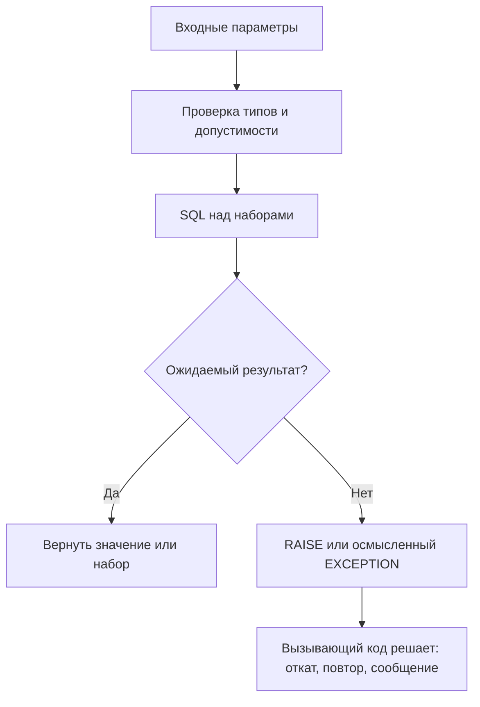

# 12. Программирование на PLpgSQL

[[Лекции/11. Триггеры и планирование задач|← Предыдущая]] · [[index|🏠 Старт]] · [[01. Карта курса|🧭 Карта]] · [[Лекции/13. Производительность и индексы|Следующая →]]

> [!abstract] Зачем читать
> PL/pgSQL добавляет блоки, переменные, условия, циклы и обработку ошибок к SQL. BEGIN блока не является новой транзакцией. SELECT INTO, FOUND и NULL требуют аккуратности. Для набора строк есть RETURN QUERY; для ошибок — осмысленные EXCEPTION и RAISE. Операция над набором часто лучше построчного цикла.

> [!info] Основа конспекта
> [[lecture/BDC_12.pdf#page=1|Исходная лекция: BDC_12.pdf]], 19 страниц PDF. Пояснения, разборы и упражнения добавлены к материалу курса. Номера страниц ниже — страницы PDF, а не цифры внизу слайдов.

## 1. Где заканчивается SQL и начинается PL/pgSQL

SQL хорошо описывает операции над наборами: отобрать, соединить, сгруппировать, изменить. PL/pgSQL добавляет переменные, ветвления, циклы и обработку ошибок. Он нужен, когда серверное действие состоит из нескольких зависимых шагов.

Например: проверить сумму; найти абонента; записать корректировку; вернуть новый баланс или понятную ошибку. При этом один `UPDATE ... WHERE ... RETURNING` может оказаться и проще, и безопаснее десятка строк процедурного кода.

`BDC_12.pdf` снова обращается к функциям, перегрузке и триггерам, а затем раскрывает процедурный язык. На титуле стоит «Лекция 10»; в этом конспекте сохраняется номер 12 по имени файла.

## 2. Анатомия блока

```sql
-- PostgreSQL: анонимный блок для знакомства с синтаксисом.
DO $$
DECLARE
    v_count bigint;
BEGIN
    SELECT count(*) INTO v_count FROM subscribers;
    RAISE NOTICE 'Абонентов: %', v_count;
END;
$$;
```

`DECLARE` содержит объявления переменных и необязателен, если переменных нет. `BEGIN ... END` ограничивает блок операторов. Внутри может быть `EXCEPTION` для обработки ошибок. Точка с запятой завершает оператор; `END;` внутри долларовых кавычек и завершающая `;` команды имеют разные роли.

> [!warning] Два разных BEGIN
> В PL/pgSQL `BEGIN ... END` обозначает блок кода и не начинает отдельную транзакцию. В интерактивном SQL `BEGIN; ... COMMIT;` управляет транзакцией. Вложенный блок PL/pgSQL не делает изменения независимо зафиксированными.

## 3. Переменные и привязка типов

```sql
DO $$
DECLARE
    v_id subscribers.subscriber_id%TYPE := 1;
    v_balance subscribers.balance%TYPE;
    v_subscriber subscribers%ROWTYPE;
BEGIN
    SELECT balance INTO v_balance
    FROM subscribers WHERE subscriber_id = v_id;
    SELECT * INTO v_subscriber
    FROM subscribers WHERE subscriber_id = v_id;
    RAISE NOTICE 'ID %, баланс %', v_id, v_balance;
END;
$$;
```

`%TYPE` использует тип столбца, `%ROWTYPE` — структуру строки таблицы. Это уменьшает ручное дублирование объявления типов. Но изменение схемы не гарантирует автоматическую корректность всего алгоритма: переименование поля, смена смысла или преобразование ID в UUID может потребовать изменения кода и повторной проверки.

Выбирай разные имена параметров, переменных и столбцов: `p_id`, `v_balance`, `s.balance`. Иначе выражение `WHERE id = id` легко станет либо неоднозначным, либо всегда истинным не в том смысле, который ожидался.

## 4. SELECT INTO, STRICT и FOUND

В PL/pgSQL `SELECT ... INTO variable` присваивает результат переменной. Это отличается от команды SQL `SELECT INTO new_table`, создающей таблицу.

Без `STRICT` выбирается первая строка, а при отсутствии результата переменные получают `NULL`. Для обязательного ровно одного результата полезен `INTO STRICT`: отсутствие строки и лишние строки вызывают разные ошибки.

```sql
DO $$
DECLARE
    v_balance numeric;
BEGIN
    SELECT balance INTO STRICT v_balance
    FROM subscribers WHERE subscriber_id = 1;
    RAISE NOTICE 'Баланс: %', v_balance;
EXCEPTION
    WHEN no_data_found THEN
        RAISE NOTICE 'Абонент не найден';
END;
$$;
```

`FOUND` показывает результат **последней подходящей операции**, а не хранит историю всех поисков. Проверяй его сразу после нужного SELECT/UPDATE. Для числа затронутых строк можно использовать `GET DIAGNOSTICS v_rows = ROW_COUNT`.

Для выполнения запроса, результат которого не нужен, внутри PL/pgSQL применяют `PERFORM`, например `PERFORM training_call_cost(60, 2)`.

## 5. Ветвления и NULL

```sql
IF p_amount IS NULL THEN
    RAISE EXCEPTION 'Не передана сумма';
ELSIF p_amount <= 0 THEN
    RAISE EXCEPTION 'Сумма должна быть больше нуля';
ELSE
    -- Основное действие.
END IF;
```

Условие IF должно быть истинным, чтобы выполниться. Если `p_amount IS NULL`, выражение `p_amount <= 0` не истинно; поэтому одной такой проверки недостаточно. Это та же трёхзначная логика, что и в WHERE, но ошибка теперь прячется в программном потоке.

`CASE` удобен для нескольких вариантов одного значения или нескольких условий. Держи правила простыми и явно обрабатывай неизвестные значения, если они недопустимы.

## 6. Циклы и операции над наборами

```sql
DO $$
DECLARE
    r record;
BEGIN
    FOR r IN
        SELECT subscriber_id, balance
        FROM subscribers
        WHERE balance < 0
        ORDER BY subscriber_id
    LOOP
        RAISE NOTICE 'Должник %, баланс %', r.subscriber_id, r.balance;
    END LOOP;
END;
$$;
```

Есть также числовой `FOR`, `WHILE`, безусловный `LOOP` с `EXIT` и обход массива `FOREACH`. Они полезны, когда шаги действительно зависят друг от друга.

Для массового изменения статуса лучше рассмотреть один UPDATE:

```sql
-- Пример бизнес-правила для отдельной учебной копии.
UPDATE subscribers
SET status = 'SUSPENDED'
WHERE status = 'ACTIVE' AND balance < 0;
```

Цикл не является обязательным способом построения отчёта. Агрегация SQL обычно понятнее и позволяет оптимизатору работать с набором целиком. Фраза «сложный отчёт невозможно выразить декларативно» требует доказательства для конкретной задачи.

## 7. Возврат набора строк

```sql
CREATE OR REPLACE FUNCTION training_debtors(p_limit numeric)
RETURNS TABLE(subscriber_id integer, phone_number varchar, balance numeric)
LANGUAGE plpgsql STABLE
AS $$
BEGIN
    RETURN QUERY
    SELECT s.subscriber_id, s.phone_number, s.balance
    FROM subscribers AS s
    WHERE s.balance < p_limit
    ORDER BY s.subscriber_id;
END;
$$;

SELECT * FROM training_debtors(0);
```

`RETURN QUERY` добавляет строки запроса в возвращаемый набор. `RETURN NEXT` добавляет отдельную строку. Обычный `RETURN` завершает функцию. Для чистого SELECT эта функция могла бы быть написана на `LANGUAGE sql`; PL/pgSQL выбран для демонстрации конструкции.

Возвращаемые столбцы `RETURNS TABLE` также создают переменные, поэтому внутри квалифицируй поля алиасом `s`. Большие наборы в PL/pgSQL могут буферизоваться с использованием памяти и временных файлов; не стоит обещать мгновенный поток строк без измерений.

## 8. Обработка ошибок и локальный откат

```sql
DO $$
BEGIN
    BEGIN
        INSERT INTO service_types (service_name, description)
        VALUES ('Training temporary', 'Будет отменено');
        RAISE EXCEPTION 'Учебный сбой';
    EXCEPTION WHEN raise_exception THEN
        RAISE NOTICE 'Внутренний блок отменён, внешний продолжает работу';
    END;
END;
$$;
```

Изменения внутри блока, в котором возникла перехваченная ошибка, откатываются к входу в этот блок. Код обработчика может продолжить внешний блок. Но если записать лог, а затем внешняя транзакция откатится, обычная запись лога в таблицу тоже исчезнет. Автономной транзакцией EXCEPTION не становится.

Лови ожидаемые категории ошибок и понимай, что делать дальше. `WHEN OTHERS THEN NULL` скрывает сбои и может превратить ошибку платежа в ложный успех. Для повторной передачи исходной ошибки из обработчика есть `RAISE;`.

## 9. RAISE — сообщение или ошибка

| Уровень | Типичное назначение |
|---|---|
| DEBUG | Детальная диагностика |
| INFO / NOTICE | Информация о ходе выполнения |
| WARNING | Предупреждение без обязательного прерывания |
| EXCEPTION | Ошибка с прерыванием текущего потока |

```sql
RAISE EXCEPTION 'Абонент % не найден', p_subscriber_id
    USING ERRCODE = 'P0002';
```

Видимость сообщений зависит от настроек клиента и сервера. Сообщение `NOTICE` не является доказательством успешного COMMIT. Для машинной обработки полезнее стабильный код ошибки и структурированный результат, а не поиск фразы в тексте.

## 10. Собираем серверный модуль осмысленно



Размещай в БД правила, которые должны одинаково выполняться для всех клиентов и зависят от согласованного состояния данных. Сохраняй явные контракты и минимально необходимые права. Для динамического SQL используй корректное параметризованное построение (`EXECUTE ... USING`, `format('%I', ...)` для имён), а не склеивание непроверенного текста.

## Где это в PDF

[[lecture/BDC_12.pdf#page=3|Повторение серверных модулей: 3–10]] · [[lecture/BDC_12.pdf#page=11|Блоки и типы: 11–13]] · [[lecture/BDC_12.pdf#page=14|Условия, циклы, таблицы: 14–16]] · [[lecture/BDC_12.pdf#page=17|EXCEPTION и RAISE: 17–19]].

## Проверь себя без подсказки

1. Чем BEGIN блока PL/pgSQL отличается от BEGIN транзакции?
2. Что меняет INTO STRICT?
3. Почему FOUND стоит проверять сразу?
4. Что откатится в блоке с перехваченным исключением?
5. Почему цикл обновлений может быть хуже одного UPDATE?

## Мини-тренажёр

> [!tip] Два режима
> В Obsidian это редактируемые блоки с условиями и эталонами. На Quartz блоки превращаются в интерактивные задания после подключения [[Справочники/Интерактив и Quartz|обработчика]]. SQL-песочница использует маленький учебный набор, описанный в [[Практика/Учебный набор|паспорте данных]]. Он отличается от полного дампа.

```sql
-- setup
CREATE TABLE tariff_plans (plan_id INT, plan_name STRING, monthly_fee NUMBER, minutes_included INT, sms_included INT, data_gb_included INT, price_per_minute NUMBER, price_per_sms NUMBER, price_per_gb NUMBER, is_active BOOLEAN);
INSERT INTO tariff_plans VALUES (1,'Basic',300,100,50,5,2,2.5,200,true),(2,'Standard',500,300,100,15,1.5,2,150,true),(3,'Premium',800,1000,500,50,1,1.5,100,true),(4,'Unlimited',1200,999999,999999,100,0,0,50,true),(5,'Student',350,200,100,10,1.8,2,180,true),(6,'Senior',250,150,100,3,2,2,250,false);
CREATE TABLE service_types (service_type_id INT, service_name STRING, description STRING);
INSERT INTO service_types VALUES (1,'Outgoing Call','Исходящий звонок'),(2,'Incoming Call','Входящий звонок'),(3,'SMS','Сообщение'),(4,'MMS','Мультимедийное сообщение'),(5,'Data','Интернет');
CREATE TABLE subscribers (subscriber_id INT, phone_number STRING, first_name STRING, last_name STRING, email STRING, plan_id, registration_date STRING, status STRING, balance NUMBER);
INSERT INTO subscribers VALUES (1,'+79100000001','Анна','Волкова','anna@example.test',1,'2025-09-01','ACTIVE',250),(2,'+79100000002','Борис','Орлов',NULL,2,'2025-09-03','ACTIVE',-20),(3,'+79100000003','Вера','Иванова','vera@example.test',3,'2025-10-01','SUSPENDED',0),(4,'+79100000004','Глеб','Соколов','gleb@example.test',1,'2025-10-10','ACTIVE',500),(5,'+79100000005','Дина','Белова',NULL,5,'2025-11-01','ACTIVE',100),(6,'+79100000006','Егор','Петров','egor@example.test',NULL,'2025-11-02','TERMINATED',-50),(7,'+79100000007','Жанна','Миронова','zhanna@example.test',4,'2025-11-03','ACTIVE',1000),(8,'+79100000008','Зоя','Зайцева',NULL,2,'2025-11-04','SUSPENDED',100);
CREATE TABLE call_records (record_id INT, subscriber_id INT, service_type_id INT, call_date STRING, destination_number STRING, duration_seconds INT, quantity INT, cost NUMBER);
INSERT INTO call_records VALUES (1,1,1,'2025-11-01 10:00:00','+79000000001',60,1,2),(2,1,1,'2025-11-02 10:00:00','+79000000002',120,1,4),(3,2,1,'2025-11-01 11:00:00','+79000000003',30,1,1.5),(4,2,3,'2025-11-03 11:00:00','900',0,1,2),(5,3,1,'2025-11-02 12:00:00','+79000000004',300,1,5),(6,4,1,'2025-11-03 13:00:00','+79000000005',180,1,6),(7,4,1,'2025-11-04 13:00:00','+79000000006',60,1,2),(8,7,1,'2025-11-05 14:00:00','+79000000007',600,1,0);
CREATE TABLE data_usage (usage_id INT, subscriber_id INT, usage_date STRING, data_mb INT, cost NUMBER);
INSERT INTO data_usage VALUES (1,1,'2025-11-01',1024,150),(2,1,'2025-11-02',512,75),(3,2,'2025-11-01',2048,300),(4,4,'2025-11-02',0,0),(5,7,'2025-11-03',4096,200);
CREATE TABLE invoices (invoice_id INT, subscriber_id INT, billing_period STRING, issue_date STRING, due_date STRING, monthly_fee NUMBER, usage_charges NUMBER, total_amount NUMBER, status STRING);
INSERT INTO invoices VALUES (1,1,'2025-11','2025-11-01','2025-11-10',300,6,306,'PAID'),(2,2,'2025-11','2025-11-01','2025-11-10',500,3.5,503.5,'OVERDUE'),(3,3,'2025-11','2025-11-01','2025-11-10',800,5,805,'PENDING'),(4,4,'2025-11','2025-11-01','2025-11-10',300,8,308,'PAID'),(5,7,'2025-11','2025-11-01','2025-11-10',1200,0,1200,'PENDING');
CREATE TABLE payments (payment_id INT, subscriber_id INT, invoice_id, payment_date STRING, amount NUMBER, payment_method STRING, transaction_id STRING);
INSERT INTO payments VALUES (1,1,1,'2025-11-02 09:00:00',200,'CARD','tx-1'),(2,1,1,'2025-11-03 09:00:00',106,'CARD','tx-2'),(3,4,4,'2025-11-04 09:00:00',308,'CARD','tx-3'),(4,5,NULL,'2025-11-05 09:00:00',100,'CASH','tx-4');
CREATE TABLE plan_changes (change_id INT, subscriber_id INT, old_plan_id INT, new_plan_id INT, change_date STRING, reason STRING);
INSERT INTO plan_changes VALUES (1,1,2,1,'2025-10-01','Экономия'),(2,2,1,2,'2025-10-10','Больше минут'),(3,7,3,4,'2025-11-01','Безлимит');
```

```text
#quiz
? Что означает subscribers.balance%TYPE?
+ Тип, связанный с типом столбца balance
- Текущее значение баланса всех абонентов
- Процент от баланса
```

```text
#quiz
? Что делает RETURN QUERY в PL/pgSQL-функции, возвращающей набор?
- Начинает новую транзакцию
+ Добавляет строки результата запроса в возвращаемый набор
- Выполняет COMMIT
```

```text
#order
Объявить переменные в DECLARE при необходимости
Открыть исполняемую часть BEGIN
Выполнить проверки и SQL-операции
Обработать ожидаемые ошибки в EXCEPTION при необходимости
Закрыть блок END
```

```text
#task
Выведи subscriber_id и balance должников с балансом меньше нуля.
Отсортируй по balance, затем subscriber_id.
= SELECT subscriber_id, balance FROM subscribers WHERE balance < 0 ORDER BY balance, subscriber_id;
```

## Чек-лист понимания

- [ ] Прочитал лекцию и разобрал схему.
- [ ] Ответил на вопросы вслух без конспекта.
- [ ] Решил задания и разобрал ошибки.
- [ ] В свойстве `confidence` поставил число от 0 до 5.
- [ ] Поставил дату следующего повторения в `review_next`.

## Суть за минуту

PL/pgSQL добавляет блоки, переменные, условия, циклы и обработку ошибок к SQL. BEGIN блока не является новой транзакцией. SELECT INTO, FOUND и NULL требуют аккуратности. Для набора строк есть RETURN QUERY; для ошибок — осмысленные EXCEPTION и RAISE. Операция над набором часто лучше построчного цикла.

^summary-l12

## Куда дальше

Функции и процедуры: [[Лекции/10. Функции и процедуры PostgreSQL]]. Триггеры: [[Лекции/11. Триггеры и планирование задач]]. План выполнения: [[Лекции/13. Производительность и индексы]].

[[Лекции/11. Триггеры и планирование задач|← Предыдущая]] · [[index|🏠 Старт]] · [[01. Карта курса|🧭 Карта]] · [[Лекции/13. Производительность и индексы|Следующая →]]
