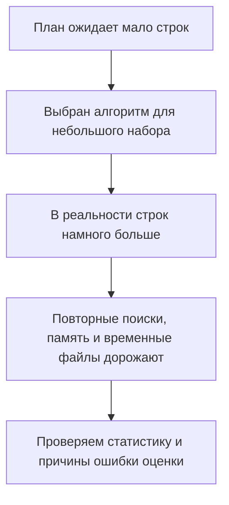

# 13. Производительность и индексы

[[Лекции/12. Программирование на PLpgSQL|← Предыдущая]] · [[index|🏠 Старт]] · [[01. Карта курса|🧭 Карта]] · [[Лекции/14. Резервирование и восстановление|Следующая →]]

> [!abstract] Зачем читать
> Оптимизация опирается на корректный результат и измеренный план. Cost не равен времени, shared read не обязательно означает физический диск, а Seq Scan не является ошибкой. Индекс выбирают под запрос и нагрузку; статистика, MVCC и видимость влияют на результат. Сравнивай изменения в одинаковых условиях.

> [!info] Основа конспекта
> [[lecture/BDC_13.pdf#page=1|Исходная лекция: BDC_13.pdf]], 18 страниц PDF. Пояснения, разборы и упражнения добавлены к материалу курса. Номера страниц ниже — страницы PDF, а не цифры внизу слайдов.

## 1. Оптимизация начинается с правильного результата

Быстро полученная неверная сумма не является успехом. Сначала проверь зерно отчёта, фильтры и количество строк. Особенно внимательно смотри на несколько связей 1:N: избыточное размножение записей одновременно портит суммы и увеличивает работу.

Затем сформулируй наблюдаемую проблему: какой запрос медленный, на каком объёме, при каком наборе параметров, в каком состоянии кеша и при какой параллельной нагрузке. «Добавим индекс на каждый столбец» — действие без диагноза.

## 2. Путь запроса


Планировщик сравнивает варианты по оценочной стоимости. Используются статистика распределения значений, размеры таблиц и параметры стоимости операций. Он не исполняет каждый возможный план, чтобы выбрать самый быстрый по секундомеру.

## 3. EXPLAIN и EXPLAIN ANALYZE

```sql
-- PostgreSQL. Только план, без обычного исполнения запроса.
EXPLAIN
SELECT * FROM subscribers WHERE phone_number = '+79100000001';

-- Реальное выполнение чтения с измерениями.
EXPLAIN (ANALYZE, BUFFERS)
SELECT * FROM call_records
WHERE subscriber_id = 1
  AND call_date >= TIMESTAMP '2025-11-01 00:00:00'
  AND call_date <  TIMESTAMP '2025-12-01 00:00:00';
```

`cost=startup..total` — условная оценка, не миллисекунды. `rows` — ожидаемое число строк, `width` — оценка среднего размера строки. При ANALYZE появляются `actual time`, фактические строки и `loops`.

> [!warning] ANALYZE в EXPLAIN запускает запрос
> `EXPLAIN ANALYZE UPDATE/DELETE/INSERT` изменяет данные. Для опытов используй отдельную копию. Даже откат таблиц не отменяет все возможные побочные эффекты, например продвижение последовательности или внешнее действие функции.

Обычный `ANALYZE table_name` без EXPLAIN — другая команда: она собирает статистику. Не путай две роли одного слова.

## 4. Как читать дерево

Начни с листьев и двигайся к родителям: какие строки считываются, как соединяются, где фильтруются и агрегируются. Узлы не обязательно исполняются как простой список «снизу вверх»: дерево отражает зависимости потока данных.

```text
Иллюстративная форма, не измерение на нашей БД:
Aggregate
  -> Hash Join
       -> Seq Scan on subscribers
       -> Hash
            -> Seq Scan on tariff_plans
```

Сравнивай ожидаемые и фактические строки. Большая разница может объяснить плохой порядок соединений, но не доказывает автоматически «сломанную статистику»: возможны корреляции полей, выражения и неподходящая оценочная модель.

`actual rows` и время узла при нескольких loops обычно показываются в среднем на один запуск. Произведение на loops помогает оценить суммарную работу узла, однако время родителей включает работу дочерних узлов. Складывать все времена дерева как независимые расходы нельзя, особенно при параллельном плане.

## 5. Что показывают BUFFERS

`shared hit` — страница найдена в shared buffers PostgreSQL. `shared read` — сервер загрузил страницу в эти буферы; данные могли прийти из файлового кеша ОС, поэтому это **не обязательно физическое чтение с диска**.

Важны также временные чтения/записи при сортировке и хешировании, число циклов и объём результата. Большое число прочитанных страниц может быть естественным для полной агрегации всей таблицы. Сам счётчик read не доказывает необходимость ещё одного индекса.

## 6. Четыре основных пути чтения

| План | Как работает | Когда полезен |
|---|---|---|
| Seq Scan | Проверяет строки страниц таблицы | Нужна большая доля данных, таблица мала |
| Index Scan | Находит совпадения в индексе, обращается к heap | Нужна небольшая подходящая часть |
| Index Only Scan | Берёт нужные значения из индекса, проверяет видимость | Данные покрыты индексом и страницы достаточно видимы |
| Bitmap Scan | Собирает карту подходящих страниц/строк и читает heap | Умеренная доля совпадений, комбинация условий |

У Index Only Scan могут быть `Heap Fetches`: проверка видимости всё ещё потребовала обращения к таблице. Наличие всех выбранных столбцов в индексе необходимо, но не всегда достаточно для чтения только индекса.

Отсутствие WHERE не заставляет СУБД всегда выбирать Seq Scan. Например, подходящий индекс может помочь `ORDER BY ... LIMIT` или Index Only Scan. План определяется всей задачей.

## 7. Какой индекс для какой задачи

**B-tree** — обычный выбор для равенства, диапазонов и сортировки. **Hash** — равенство. **BRIN** хранит компактные сведения по диапазонам страниц и полезен при корреляции значений с физическим порядком, например хронологически добавляемых логов. **GIN** индексирует элементы составных значений, например массивы, JSONB и полнотекстовые структуры.

```sql
-- PostgreSQL, учебная копия: пример под поиск событий абонента за период.
CREATE INDEX training_calls_subscriber_date_idx
ON call_records (subscriber_id, call_date);

ANALYZE call_records;
```

В составном B-tree важен порядок столбцов и условия запроса. Для `subscriber_id = ...` плюс диапазон по времени выбранный порядок естественен. Если задача — найти все события всех абонентов за день, нужно отдельно оценить другой индекс или BRIN.

В исходной БД PK и UNIQUE уже создают индексы. **FK на ссылающейся стороне не создаёт индекс автоматически**. В исходном скрипте отдельные индексы по многим FK созданы явно. Проверь существующие индексы перед созданием нового:

```sql
SELECT tablename, indexname, indexdef
FROM pg_indexes
WHERE schemaname = 'public'
ORDER BY tablename, indexname;
```

## 8. LIKE и выражения

Префиксный поиск `LIKE '+7910%'` иногда может использовать B-tree, но возможность зависит от сортировки, класса операторов и плана. Для некоторых локалей PostgreSQL нужен подходящий `text_pattern_ops`/`varchar_pattern_ops`. Поиск `LIKE '%910%'` не имеет известного начала строки; для него полезно рассмотреть `pg_trgm` и соответствующий GIN/GiST при подходящей задаче.

Вместо преобразования каждого значения времени:

```sql
-- Предпочтительная форма диапазона PostgreSQL:
WHERE call_date >= TIMESTAMP '2025-11-01 00:00:00'
  AND call_date <  TIMESTAMP '2025-12-01 00:00:00'
```

Такая форма сохраняет обычный индекс по `call_date` более доступным планировщику и корректно включает любое время внутри месяца. Само наличие функции над столбцом не запрещает любые индексы: существуют индексы по выражениям, но они должны соответствовать запросу.

## 9. JOIN и CTE не волшебные ускорители

Nested Loop может быть отличным выбором для нескольких внешних строк и быстрого индексного поиска внутри. Hash Join полезен для других объёмов и условий. Merge Join использует упорядоченные потоки. Замена подзапроса на JOIN не гарантирует смены алгоритма и может изменить кратность результата.

CTE помогает читать конвейер. В PostgreSQL он может встраиваться или материализоваться в зависимости от условий. Обещание «WITH обязательно один раз вычислится в памяти» неверно. Ключи для Hash Join не обязаны быть заранее проиндексированы.

## 10. Цена индекса и обслуживание

Каждый индекс занимает место и добавляет работу изменениям. Но правило «10 индексов = ровно 11 операций дискового I/O» не описывает реальное кеширование, WAL и пакетную запись. Измеряй влияние на нужную нагрузку.

`ANALYZE` обновляет статистику. `VACUUM` освобождает для повторного использования место от мёртвых версий и поддерживает служебную информацию, включая карту видимости. Обычный VACUUM обычно не уменьшает файл до минимального размера; `VACUUM FULL` переписывает таблицу и требует сильной блокировки. Долгие транзакции могут мешать уборке старых версий.


## 11. Практический разбор на полной базе

1. Посмотри исходные индексы и число строк `call_records`.
2. Выполни EXPLAIN ANALYZE BUFFERS для поиска одного абонента за период.
3. Создай учебный составной индекс на копии.
4. Повтори запрос с теми же параметрами и сравни строки, buffers и execution time.
5. Проверь запрос за широкий период: план может измениться.
6. Зафиксируй наблюдение и объясни, почему оно не является универсальным правилом для любого сервера.

В маленьком наборе тренажёра оценивать производительность PostgreSQL бессмысленно: другой движок и слишком мало данных. Там отрабатывается семантика запросов.

## Один запрос — несколько возможных цен

Представь таблицу из миллиона событий. Поиск одного record\_id, всех событий одного абонента за день и суммы всех расходов за год — три разных объёма работы. Один подходящий индекс не обязан одинаково ускорять их.

| Запрос | Ожидаемый объём | На что смотреть |
|---|---|---|
| Поиск уникального ID | Одна строка | Уникальный индекс и небольшое число обращений |
| События абонента за период | Ограниченная часть | Составной индекс, оценки строк, фильтры |
| Сумма по всей таблице | Почти весь набор | Скорость полного чтения и агрегации |

Планировщик оценивает стоимость пути. Чем больше строк нужно вернуть, тем меньше преимущество точечного поиска. Если индекс приводит к чтению почти всех страниц таблицы в неудобном порядке, последовательный путь может быть разумнее.

## Оценочные строки и фактические строки

Допустим, план ожидает 10 строк, а реально получает 100 000. Это влияет не только на размер результата: мог быть выбран неподходящий способ соединения или слишком небольшой хеш. Разбирать нужно место, где оценка впервые сильно разошлась с реальностью, а не только самый верхний узел.



ANALYZE обновляет статистику, но не является магической гарантией точного прогноза. Значения разных столбцов могут быть связаны между собой, условия могут содержать выражения, а параметры влияют на выбор. Иногда нужны расширенная статистика или другая форма запроса.

## Составной индекс объясняется порядком поиска

Для частого условия `subscriber_id = ...` и диапазона `call_date` естественно рассмотреть B-tree `(subscriber_id, call_date)`. Сначала ограничивается абонент, затем нужный участок времени внутри его записей.


Если запрос использует только дату для всех абонентов, полезность такого порядка уже другая. Возможности конкретного планировщика сложнее одной картинки, поэтому правило о левом префиксе — отправная точка рассуждения, а итог проверяют EXPLAIN.

Столбцы INCLUDE могут помочь покрыть результат без превращения их в ключ поиска. Частичный индекс может охватывать только интересующее подмножество, например активные записи. У обоих решений есть условия применимости и цена обслуживания; создавать их без устойчивой нагрузки не стоит.

## Nested Loop не означает автоматическую ошибку

Если внешняя сторона содержит три строки, а внутренняя быстро ищется по индексу, три адресных поиска могут быть отличным планом. Если внешних строк стало 100 000 и каждый внутренний поиск дорогой, результат другой.

Hash Join строит хеш по одной стороне, Merge Join использует упорядоченные потоки. Их преимущества зависят от размеров, условий и памяти. Поэтому сравнивать названия алгоритмов без контекста нельзя. Важнее число запусков, прочитанных страниц и размер промежуточных наборов.

## Почему время повторного запуска меняется

Первый запуск мог читать страницы, которых ещё не было в shared buffers; следующий получил их из памяти. На сервере могли одновременно работать другие запросы. Условия и распределение данных тоже могли отличаться. Если сравнить до и после на разных нагрузках, легко приписать индексу эффект прогретого кеша.

| Чтобы сравнение было полезным | Что фиксировать |
|---|---|
| Одинаковый смысл результата | Контрольные строки и агрегаты |
| Одинаковые параметры | ID, даты и диапазоны |
| Похожая нагрузка | Параллельные действия и время опыта |
| Понимание кеша | Повторные запуски и BUFFERS |
| Цена изменения | Размер индекса и влияние на запись |

Измерения лучше рассматривать серией, а не одним красивым числом. Случайный быстрый запуск не доказывает стабильного улучшения.

## VACUUM, длинная транзакция и невидимый долг

Старые версии строк должны оставаться, пока они нужны видимым снимкам. Долгая открытая транзакция может мешать уборке. Поэтому проблема обслуживания иногда начинается не с команды VACUUM, а с приложения, которое держит BEGIN открытым и ждёт пользователя.

Обычный VACUUM позволяет повторно использовать пространство и поддерживает служебные сведения. Он обычно не возвращает весь освобождённый объём файловой системе. VACUUM FULL — более тяжёлое переписывание с иной блокировкой. Это не две степени одной безобидной кнопки «почистить».

## Оптимизация объёма результата

Если интерфейсу нужны десять последних событий, не обязательно получать всю историю и обрезать её в приложении. Нужны определённая сортировка, подходящий LIMIT и при необходимости понятная схема постраничного чтения. Слишком большой OFFSET может оставлять серверу много работы по пропуску строк; подход по последнему ключу имеет другие свойства и требования к порядку.

Даже идеальный план не отменяет стоимости передачи миллиона строк по сети. Иногда улучшение начинается с вопроса, действительно ли пользователю нужен весь такой результат.

## Как сформулировать вывод после EXPLAIN

Хороший вывод: «Для поиска одного абонента за период составной индекс уменьшил число просмотренных страниц на нашем наборе; для широкой годовой агрегации планировщик оставил полный просмотр». Слабый вывод: «Индексы всегда быстрее». Первый ответ можно проверить и перенести на похожий сценарий, второй создаёт неверное общее правило.

## Где это в PDF

[[lecture/BDC_13.pdf#page=3|Путь запроса и EXPLAIN: 3–7]] · [[lecture/BDC_13.pdf#page=8|Сканирования: 8–11]] · [[lecture/BDC_13.pdf#page=12|Индексы: 12–16]] · [[lecture/BDC_13.pdf#page=17|Запросы и обслуживание: 17–18]]. На титуле исходника указан номер 12.

## Проверь себя без подсказки

Сначала закрой пояснения и ответь вслух. Для сложного ответа приведи свой пример или контрпример.

1. Чем cost отличается от actual time?
2. Почему нельзя складывать времена всех узлов плана?
3. Почему Index Only Scan может иметь Heap Fetches?
4. Как влияет порядок полей составного индекса?
5. Почему WITH и JOIN сами по себе не гарантируют ускорения?
6. Объясни выбор индекса для равенства по абоненту и диапазона по времени.
7. Где в плане нужно искать начало серьёзной ошибки оценки строк?
8. Приведи пример хорошего Nested Loop.
9. Как прогрев кеша может исказить сравнение?
10. Какие показатели нужно фиксировать кроме Execution Time?
11. Как длинный BEGIN может мешать VACUUM?
12. Почему сокращение результата иногда полезнее нового индекса?

## Вопросы с выбором ответа

На сайте выбор сразу показывает результат. В Obsidian ответ отмечен знаком `+` в блоке; сначала попробуй ответить, затем проверь себя.

```text
#quiz
? Что показывает EXPLAIN ANALYZE?
- Только предположение, без запуска
+ План и измерения реального выполнения
- Только структуру таблиц
```

```text
#quiz
? Всегда ли Seq Scan означает плохой план?
- Да, нужен индекс на каждый столбец
+ Нет, чтение большой доли таблицы может быть выгоднее целиком
- Да, PostgreSQL не умеет использовать индексы
```

```text
#quiz
? Когда Nested Loop может быть хорошим выбором?
- Никогда
+ Мало внешних строк и быстрый внутренний поиск
- Только при отсутствии таблиц
```

> [!explain]- Почему так
> Стоимость зависит от числа повторов и доступного пути поиска.

```text
#quiz
? Что означает расхождение expected rows = 10 и actual rows = 100000?
- Индекс обязательно повреждён
- Запрос гарантированно неверен по смыслу
+ Нужно выяснить причину ошибки оценки
```

> [!explain]- Почему так
> Неверная оценка может повлиять на выбор алгоритма, но не имеет одной универсальной причины.

```text
#quiz
? Почему один повторный запуск после индекса не доказывает ускорение?
+ Мог измениться кеш и параллельная нагрузка
- EXPLAIN запрещает повтор
- Индексы никогда не ускоряют SELECT
```

> [!explain]- Почему так
> Сравнивать нужно сопоставимые условия и несколько наблюдений.

```text
#quiz
? Какой индекс естественно рассмотреть для абонента и периода?
- Всегда Hash по cost
+ B-tree по subscriber_id, call_date
- Любой индекс по фамилии
```

> [!explain]- Почему так
> Равенство по абоненту и диапазон времени образуют осмысленный порядок поиска.

```text
#quiz
? Что может мешать уборке старых версий?
- Только имя таблицы
- Отсутствие ORDER BY в любом SELECT
+ Долгая транзакция с нужным ей снимком
```

> [!explain]- Почему так
> MVCC должен сохранять версии, которые ещё нужны допустимой видимости.

```text
#quiz
? Можно ли ускорить интерфейс, сократив ненужный объём результата?
+ Да, передача и обработка лишних строк тоже стоят времени
- Нет, сеть всегда бесплатна
- Нет, только размер PK влияет на скорость
```

> [!explain]- Почему так
> Оптимизация включает требования к результату, а не лишь внутренний план.

```text
#quiz
? INCLUDE-столбец индекса обязательно является ведущим ключом поиска?
- Да, по определению INCLUDE
+ Нет
- Только при NULL
```

> [!explain]- Почему так
> Покрытие результата и порядок поискового ключа — разные свойства.

```text
#quiz
? Что проверять после изменения запроса ради скорости?
- Только уменьшение длины SQL
- Только число индексов
+ Тот же смысл и результат, включая кратности
```

> [!explain]- Почему так
> Быстро полученная неправильная сумма не является улучшением.

## Закрепить тему на практике

- [[Практика/07. Аналитика биллинга]]
- [[Практика/11. Планы и индексы]]

Здесь остаются вопросы на понимание. В тренировках — ввод запросов, проверка результатов и серверные задачи с разбором.

## Чек-лист понимания

- [ ] Прочитал лекцию и разобрал схему.
- [ ] Ответил на вопросы вслух без конспекта.
- [ ] Ответил на десять тестовых вопросов и объяснил неверные варианты.
- [ ] В свойстве `confidence` поставил число от 0 до 5.
- [ ] Поставил дату следующего повторения в `review_next`.

## Суть за минуту

Оптимизация опирается на корректный результат и измеренный план. Cost не равен времени, shared read не обязательно означает физический диск, а Seq Scan не является ошибкой. Индекс выбирают под запрос и нагрузку; статистика, MVCC и видимость влияют на результат. Сравнивай изменения в одинаковых условиях.

^summary-l13

## Куда дальше

Хранение: [[Лекции/08. Нормализация и физическое хранение]]. MVCC: [[Лекции/09. Транзакции, MVCC и изоляция]]. Памятка: [[Справочники/SQL и psql — шпаргалка]].

[[Лекции/12. Программирование на PLpgSQL|← Предыдущая]] · [[index|🏠 Старт]] · [[01. Карта курса|🧭 Карта]] · [[Лекции/14. Резервирование и восстановление|Следующая →]]
