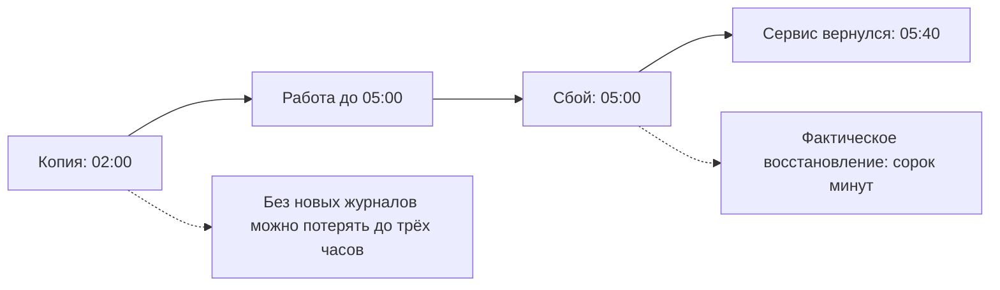

# 14. Резервирование и восстановление

[[Лекции/13. Производительность и индексы|← Предыдущая]] · [[index|Обложка]] · [[01. Карта курса|Карта]]

> [!abstract] Зачем читать
> RPO ограничивает допустимую потерю данных, RTO — время возврата сервиса. Логические и физические копии решают разные задачи; базовая копия с непрерывным WAL даёт PITR. Репликация не заменяет бэкапы, а синхронность требует правильной конфигурации и заданной модели отказов. Надёжность подтверждается тестовым восстановлением.

> [!info] Основа конспекта
> [[lecture/BDC_14.pdf#page=1|Исходная лекция: BDC_14.pdf]], 19 страниц PDF. Пояснения, разборы и упражнения добавлены к материалу курса. Номера страниц ниже — страницы PDF, а не цифры внизу слайдов.

## 1. Какие сбои мы собираемся пережить

Разные средства защищают от разных проблем. Перезапуск процесса, потеря диска, отказ дата-центра и ошибочный DELETE требуют разных сценариев. Реплика поможет быстро продолжить работу после отказа узла, но может немедленно повторить ошибочное удаление. Резервная копия помогает вернуться к сохранённому состоянию, но её восстановление требует времени.

Начинай с описания сценария отказа и нужного результата. «Бэкап есть где-то на этом же диске» не защищает от потери самого диска.

## 2. RPO и RTO

**RPO** — допустимая глубина потери данных по времени: насколько далеко назад можно оказаться после восстановления. **RTO** — допустимое время восстановления сервиса. Объём отставания в байтах полезен для мониторинга, но RPO обычно формулируют как временную цель.


Если копия сделана в 02:00, сбой в 05:00, а более новых WAL нет, потенциально потеряны три часа. Если восстановление занимает 40 минут, это фактическое время восстановления в данном опыте. Цели бизнеса нужно сравнивать с такими измерениями.

Нулевой RPO может быть требованием биллинга, но не универсальным фактом для любой системы. Его достижимость оценивают для конкретной модели отказов и конфигурации. У асинхронной реплики отставание может составлять секунды, минуты и больше — «всегда доли секунды» обещать нельзя.

## 3. Логическая и физическая копия

| Подход | Что сохраняет | Сильная сторона | Ограничения |
|---|---|---|---|
| Логический | Определения объектов и данные | Выбор объектов, переносимость, миграции | Время загрузки и построения индексов |
| Физический | Файлы кластера и нужный WAL | Восстановление большого кластера | Совместимость формата и окружения |
| WAL-архив | Журнал изменений после базовой копии | Непрерывная история для PITR | Нужна целая цепочка без пропусков |

Логическая копия может быть текстовой или архивной, не только файлом SQL. Физическая — это не безопасный произвольный `cp` работающего каталога PostgreSQL. Нужен согласованный метод, например `pg_basebackup`, либо корректно организованная остановка или согласованный снимок.

## 4. pg\_dump и pg\_restore

```bash
# Примеры для локальной учебной PostgreSQL, не команды браузерного тренажёра.
mkdir -p backups
pg_dump -h localhost -p 5432 -U billing_user -d billing_database \
  -Fc -f backups/billing.dump

# Восстановление в НОВУЮ тестовую БД; исходная не перезаписывается.
createdb -h localhost -p 5432 -U billing_user billing_restore_training
pg_restore -h localhost -p 5432 -U billing_user \
  -d billing_restore_training --exit-on-error --no-owner backups/billing.dump
```

Пароль вводится по запросу клиента или берётся из корректно настроенного `.pgpass`; не записывай его в общедоступный конспект. Для plain SQL вместо pg\_restore применяют `psql -f`. Восстановление кастомного архива и выполнение SQL-файла — разные маршруты.

`pg_dump` даёт согласованный снимок базы и обычно не блокирует обычные INSERT/UPDATE/DELETE. Но он берёт блокировки объектов и может конфликтовать с некоторыми DDL. Роли и другие глобальные объекты сохраняют отдельно, например через `pg_dumpall --globals-only`.

Версии утилит важны: клиент pg\_dump не должен быть старше сервера, который он не поддерживает. В учебном Dockerfile используется PostgreSQL 15; для повторяемых опытов подбирай совместимые утилиты.

## 5. Резервная копия считается проверенной после восстановления

После тестового восстановления проверь наличие объектов, число строк ключевых таблиц, ограничения и контрольные запросы. Для финансовых данных полезны суммы платежей и выборочные связи, а не только успешный exit code программы.

```sql
SELECT COUNT(*) AS subscribers_count FROM subscribers;
SELECT COUNT(*) AS payments_count, SUM(amount) AS payments_total FROM payments;
SELECT COUNT(*) AS broken_references
FROM payments AS p
LEFT JOIN subscribers AS s ON s.subscriber_id = p.subscriber_id
WHERE s.subscriber_id IS NULL;
```

Последний запрос должен давать ноль при соблюдении исходного FK. Проверка не доказывает все бизнес-правила, но ловит часть ошибок восстановления. Сохраняй дату копии, версию, журнал восстановления и измеренное время.

## 6. WAL и физическая базовая копия

WAL — журнал упреждающей записи. Он содержит записи, необходимые для воспроизведения изменений и восстановления, а не вечный полный бизнес-аудит в удобном табличном виде. Старые сегменты без архивации могут перерабатываться.

`pg_basebackup` создаёт физическую копию кластера через протокол репликации и может получить нужный поток WAL. Нужны права, настройки подключений и свободное место. Результат нужно проверять и хранить отдельно от единственного рабочего диска.

Роль `archive_mode` и `archive_command` — обеспечить сохранение завершённых WAL-сегментов. Архивирование должно обнаруживать ошибку копирования и не затирать имеющиеся сегменты неправильным содержимым. Произвольная shell-команда из примера без проверки результата — слабое место всей цепочки.

## 7. PITR: восстановить прошлое состояние

PITR использует базовую физическую копию и непрерывную цепочку WAL до целевой точки. Оно помогает вернуться до ошибочной транзакции, если нужный журнал доступен.


Укрупнённый сценарий: подготовить отдельный каталог или сервер, восстановить базовую копию, настроить получение WAL и цель (`recovery_target_time` или другую), запустить восстановление, проверить точку и данные, затем принять решение об открытии для работы. Конфигурация сигналов восстановления и команды зависят от версии и окружения.

PITR не означает возможность получить любую произвольную миллисекунду независимо от наличия журналов. Результат определяется доступной цепочкой и границами воспроизводимых транзакций. После продвижения формируется новая временная линия — **timeline**.

## 8. Репликация: доступность и копирование изменений

**Физическая потоковая репликация** передаёт WAL и воспроизводит кластер. Обычно требуются одна основная версия PostgreSQL, совместимая архитектура и формат данных. На hot standby доступны чтения с ограничениями; запись приложений выполняется на основном узле.

**Логическая репликация** передаёт изменения выбранных опубликованных таблиц через publication/subscription. Она полезна для выборочного распространения данных и некоторых миграций между версиями. Схему, последовательности и DDL нельзя считать автоматически полностью синхронизируемыми — ограничения нужно проверять для своей версии.

Репликация не равна шардингу, а наличие реплики не настраивает автоматический failover само по себе. Для безопасного переключения нужны обнаружение отказа, выбор узла и защита от двух одновременно активных основных серверов.

## 9. Синхронный и асинхронный режимы

Асинхронный основной узел может подтвердить локальный COMMIT до получения подтверждения реплики. При потере основного узла часть последних изменений может не оказаться на выбранной реплике.

Для ожидания синхронной реплики важны **и** `synchronous_standby_names`, **и** подходящий `synchronous_commit`, **и** реально подключённая реплика. Одного `synchronous_commit = on` без выбора синхронных standby недостаточно.

| Режим | Что ждёт подтверждение | Цена |
|---|---|---|
| Асинхронный | Обычно локальную надёжную запись при штатных настройках | Возможная потеря отставших изменений при failover |
| Синхронный | Нужное подтверждение выбранной реплики | Сетевая задержка и зависимость от её доступности |

При потере нужного синхронного подтверждения зависают прежде всего соответствующие фиксации, а не обязательно любой SELECT или вообще все действия сервера. Детали зависят от настроек кворума и режима подтверждения.

## 10. Слоты и мониторинг

Слот позволяет удерживать необходимый WAL для потребителя. Если потребитель надолго исчез, накопление может заполнить диск. Возможны ограничения удержания и инвалидирование слота: слот не гарантирует бесконечную сохранность при любом состоянии.

```sql
-- PostgreSQL: диагностические представления.
SELECT slot_name, slot_type, active, restart_lsn
FROM pg_replication_slots;

SELECT application_name, state, sync_state,
       sent_lsn, write_lsn, flush_lsn, replay_lsn
FROM pg_stat_replication;
```

Отставание можно оценивать по позициям LSN и временным метрикам. Следи за диском, успешностью архивации, возрастом копии и результатами восстановления. Наблюдение «реплика подключена» слабее проверки «реплика получила и применила нужные изменения».

> [!tip] Запомнить три защиты
> Реплика помогает доступности, резервная копия — возвращению к сохранённому состоянию, WAL-архив вместе с базовой копией — более точному восстановлению. Нужный набор определяется сценариями отказов и проверяется учениями восстановления.

## Сценарий сбоя определяет средство защиты

Одна резервная реплика может помочь при остановке основного узла, но быстро воспроизведёт ошибочный UPDATE. Логическая копия позволяет восстановить выбранный набор объектов, но может долго загружаться. Архив WAL полезен только вместе с подходящей базовой копией и непрерывной цепочкой журналов.

| Сбой | Что стоит предусмотреть | Почему одной реплики мало |
|---|---|---|
| Остановился процесс | Перезапуск и восстановление штатными средствами | Причина может быть в повреждении данных или окружения |
| Потерян основной узел | Подготовленный standby и процедура failover | Нужно безопасно выбрать новый основной |
| Ошибочно удалены данные | Бэкап, WAL и восстановление до ошибки | DELETE тоже реплицируется |
| Потерян весь диск с копией | Независимое размещение резервов | Копия на том же диске исчезла вместе с оригиналом |
| Копия повреждена | Проверка восстановления и несколько точек | Сам файл ещё не доказывает пригодность |

Надёжность — это набор проверенных сценариев. Нельзя заменить его одним словом «репликация» или «облако».

## RPO и RTO на конкретных часах

В 02:00 сделана копия. В 05:00 произошёл сбой. Если после копии нет пригодного WAL, потенциальное окно потери — до трёх часов. Если сервис удалось вернуть в 05:40, восстановление заняло 40 минут. Целевые RPO и RTO могли быть другими; задача — сравнить цель с фактическим результатом.



Если WAL доведён до 04:59, доступная точка данных стала свежее, но время подготовки среды и воспроизведения всё ещё влияет на RTO. Уменьшение окна потерь и сокращение простоя связаны, однако не являются одной и той же оптимизацией.

## Непрерывная цепочка важнее набора случайных файлов

Пусть есть базовая копия и WAL-сегменты A, B, D, а C отсутствует. Наличие более позднего D не гарантирует, что можно «перепрыгнуть» через пропущенное изменение. Для требуемого участка воспроизведения нужна непрерывность.


Архивирование должно обнаруживать ошибки передачи и не выдавать неподтверждённый успех. Мониторинг проверяет не только размер каталога, но и успешность архивации, возраст последней подходящей копии и способность действительно восстановить нужную точку.

## Восстановление в отдельную среду

При логической ошибке полезно сначала поднять восстановленное состояние отдельно. Тогда можно проверить выбранную точку, сравнить нужные записи и не уничтожить возможность вернуться к исходному состоянию. В некоторых случаях требуется извлечь отдельные данные, а не целиком заменить рабочий кластер прошлой копией.

Чек-проверка восстановления включает доступность ролей, структуру объектов, ограничения, число строк, финансовые контрольные суммы и возможность выполнить ключевые действия приложения. Если процесс PostgreSQL запустился, но приложение не может провести платёж из-за отсутствующих прав, сервис ещё не восстановлен в бизнес-смысле.

## Реплика и выбор нового основного узла

Потеря связи не всегда означает остановку сервера. Два узла могут перестать видеть друг друга, оставаясь работоспособными. Если оба начать принимать запись как основные, возникнет split-brain. Процедура failover должна учитывать изоляцию прежнего основного узла и единственность принимающего запись лидера.

Синхронная репликация уменьшает риск потери подтверждённых изменений при предусмотренных отказах, но не обеспечивает автоматически правильное переключение. Важны настройки ожидания, выбранные standby, поведение при потере сети и решение о допустимом компромиссе доступности.

## Логическая репликация — не полный перенос сервера

Публикация выбранных таблиц удобна для распределения справочников. При этом нужно отдельно следить за совместимой схемой, ключами для реплицируемых изменений, последовательностями и допустимыми отличиями версий. Нельзя предполагать, что любая DDL-команда на источнике автоматически появилась у подписчика.

Если подписчик локально меняет те же строки, которые получает из публикации, появляются конфликты. Требуется осмысленно определить владельца данных и порядок разрешения, а не надеяться, что синхронизация сама выберет «правильную» цену тарифа.

## Слот репликации как удержание долга

Слот помогает не удалить ещё нужный потребителю WAL. Но отставание потребителя превращается в расход диска на основном узле. Механизм удержания не отменяет конечность места. Настройки ограничения удержания также означают, что слишком отставший потребитель может потребовать нового начального состояния.

Смотри одновременно на активность слота, сохранённую позицию, объём удерживаемого WAL, свободное место и реальную необходимость потребителя. Неактивный слот, о котором никто не помнит, — технический долг с возможным влиянием на весь сервис.

## Что записывать после учебного восстановления

Зафиксируй источник копии, версию, точку восстановления, начало и конец работ, контрольные запросы и обнаруженные проблемы. В следующем опыте сравни результаты. Ценность учений — не в галочке «бэкап настроен», а в способности повторить восстановление за допустимое время с понятным состоянием данных.

## Где это в PDF

[[lecture/BDC_14.pdf#page=3|Цели и логические копии: 3–6]] · [[lecture/BDC_14.pdf#page=7|Физические копии, WAL, PITR: 7–10]] · [[lecture/BDC_14.pdf#page=11|Репликация и режимы: 11–17]] · [[lecture/BDC_14.pdf#page=18|Мониторинг и проверка: 18–19]]. На титуле указан номер 13.

## Проверь себя без подсказки

Сначала закрой пояснения и ответь вслух. Для сложного ответа приведи свой пример или контрпример.

1. Почему реплика не спасает от любого ошибочного DELETE?
2. Чем RPO отличается от RTO на конкретном временном примере?
3. Какая цепочка нужна для PITR?
4. Почему одного synchronous\_commit = on недостаточно для ожидания реплики?
5. Что контролировать у неактивного replication slot?
6. Раздели сценарии потери процесса, узла, диска и ошибочного DELETE.
7. Вычисли RPO и фактическое время восстановления на примере часов.
8. Объясни, почему более поздний WAL не лечит разрыв цепочки.
9. Какие проверки приложения нужны после запуска восстановленной БД?
10. Как сетевое разделение может привести к split-brain?
11. Какие вопросы о владельце данных нужны при логической репликации?
12. Что измерять и документировать после учений восстановления?

## Вопросы с выбором ответа

Выбери ответ: результат появится сразу. Затем раскрой пояснение и разбери, почему остальные варианты не подходят.

```text
#quiz
? Какой набор нужен для PITR?
- Только текстовый SELECT из таблицы
+ Базовая физическая копия и непрерывные нужные WAL
- Только работающий клиент psql
```

```text
#quiz
? Почему репликация не заменяет резервные копии?
+ Ошибочное удаление может распространиться на реплику
- На реплике никогда нет данных
- Репликация не передаёт UPDATE
```

```text
#quiz
? Копия на том же потерянном диске защищает от его полной потери?
- Да, если названа backup
- Да, если файл большой
+ Нет
```

> [!explain]- Почему так
> Нужно учитывать независимость места хранения и модель отказа.

```text
#quiz
? Есть WAL A, B и D, но нет C. Поздний D гарантирует воспроизведение всей цепочки?
+ Нет, может быть критический разрыв
- Да, более поздний всегда заменяет ранние
- Да, если есть индекс
```

> [!explain]- Почему так
> Для нужного участка требуется непрерывность журналов.

```text
#quiz
? Почему восстановленный процесс PostgreSQL ещё не доказывает восстановление сервиса?
- Потому что SELECT не важен
+ Могут отсутствовать права, данные или рабочие операции приложения
- Потому что все копии должны быть текстовыми
```

> [!explain]- Почему так
> RTO относится к возвращению требуемого обслуживания, а не только запуску процесса.

```text
#quiz
? Что такое split-brain в контексте переключения?
- Один индекс имеет две страницы
- Одна таблица содержит две одинаковые суммы
+ Два узла считают себя основными и принимают запись
```

> [!explain]- Почему так
> Безопасный failover требует единственности принимающего запись основного узла.

```text
#quiz
? Что означает рост удерживаемого WAL у слота?
+ Нужно проверить потребителя и свободное место
- Всё автоматически стало надёжнее без издержек
- Можно перестать делать копии
```

> [!explain]- Почему так
> Удержание журналов имеет конечную цену хранения.

```text
#quiz
? Логическая публикация гарантирует перенос любого DDL?
- Да, как полного файлового образа
+ Нет
- Да, если только один подписчик
```

> [!explain]- Почему так
> Совместимость схем и ограничения репликации проверяют отдельно.

```text
#quiz
? Копия в 02:00, сбой в 05:00 без новых журналов. Какое возможное окно потери?
- Ровно ноль секунд
- Всегда сорок минут
+ До трёх часов
```

> [!explain]- Почему так
> Окно данных относится к RPO; длительность восстановления является другой величиной.

```text
#quiz
? Что обязательно фиксировать после учебного восстановления?
+ Точку, время и результаты контрольных проверок
- Только название файла
- Только цвет панели администрирования
```

> [!explain]- Почему так
> Проверяемость и повторяемость сценария важнее факта существования копии.

## Закрепить тему на практике

- [[Практика/07. Аналитика биллинга]]
- [[Практика/12. Копии и восстановление]]

Здесь остаются вопросы на понимание. В тренировках — ввод запросов, проверка результатов и серверные задачи с разбором.

## Чек-лист понимания

- [ ] Прочитал лекцию и разобрал схему.
- [ ] Ответил на вопросы вслух без конспекта.
- [ ] Ответил на десять тестовых вопросов и объяснил неверные варианты.

## Суть за минуту

RPO ограничивает допустимую потерю данных, RTO — время возврата сервиса. Логические и физические копии решают разные задачи; базовая копия с непрерывным WAL даёт PITR. Репликация не заменяет бэкапы, а синхронность требует правильной конфигурации и заданной модели отказов. Надёжность подтверждается тестовым восстановлением.

^summary-l14

## Куда дальше

Связанные темы: [[Лекции/09. Транзакции, MVCC и изоляция]] и [[Лекции/13. Производительность и индексы]]. Повторение курса: [[Повторение/Перед зачётом]].

[[Лекции/13. Производительность и индексы|← Предыдущая]] · [[index|Обложка]] · [[01. Карта курса|Карта]]
