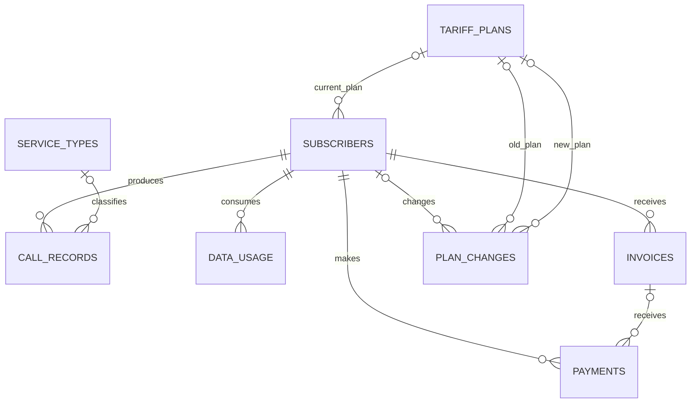

# 📡 База billing: устройство и запуск

[[index]] · [[Практика/Учебный набор|Браузерный набор]] · [[Практика/SQL-практикум]]

Источник: [db\_course\_sibsutis / pr1](https://github.com/shmblg4/db_course_sibsutis/tree/main/pr1), ревизия `668581b75165c9494ef93089c065dea4d6d116c9`, получена 21 ноября 2026. Локальная копия исходных файлов — `Практика/pr1/`.

Файл `create_billing.sql` содержит DDL и данные, а не дамп custom-формата pg\_dump. Его нужно исполнять как SQL в PostgreSQL. Он использует `SERIAL`, `BIGSERIAL`, `INTERVAL`, преобразования `::date` и индексы. В AlaSQL этот файл целиком не загружается.

## Схема связей



Необязательные концы отражают отсутствие NOT NULL у соответствующего FK. Все дочерние наборы могут быть пустыми. Стрелки старого и нового тарифов означают две разные роли одной таблицы.

## Таблицы и их зерно

| Таблица | Одна строка означает | PK | Ссылки |
|---|---|---|---|
| tariff\_plans | Тарифный план | plan\_id | — |
| service\_types | Тип услуги / события | service\_type\_id | — |
| subscribers | Абонентскую запись с текущим состоянием | subscriber\_id | plan\_id → тариф |
| call\_records | Событие услуги | record\_id | subscriber\_id, service\_type\_id |
| data\_usage | Запись интернет-трафика | usage\_id | subscriber\_id |
| invoices | Выставленный счёт | invoice\_id | subscriber\_id |
| payments | Платёж или пополнение | payment\_id | subscriber\_id, необязательный invoice\_id |
| plan\_changes | Событие смены тарифа | change\_id | subscriber\_id, old\_plan\_id, new\_plan\_id |

Не называй каждую запись `call_records` голосовым звонком без проверки `service_type_id`. Это важно для количества минут и статистики SMS.

## Словарь полей

**tariff\_plans:** `plan_name`, `monthly_fee`, `minutes_included`, `sms_included`, `data_gb_included`, `price_per_minute`, `price_per_sms`, `price_per_gb`, `is_active`. Значения по умолчанию не равны запрету NULL: у многих необязательных полей есть DEFAULT, но нет NOT NULL.

**service\_types:** `service_name` и `description`. Начальные типы: Outgoing Call, Incoming Call, SMS, MMS, Data.

**subscribers:** `phone_number` уникален и обязателен; `first_name`, `last_name` обязательны; `email` необязателен; `plan_id` может быть NULL; `registration_date`, `status`, `balance` имеют значения по умолчанию. CHECK ограничивает статус: ACTIVE, SUSPENDED, TERMINATED. Без NOT NULL явный NULL в status не запрещён одним CHECK.

**call\_records:** обязательны `subscriber_id`, `call_date`. `service_type_id`, `destination_number`, `duration_seconds`, `quantity`, `cost` могут быть неизвестны при явном NULL. Время хранится как timestamp без часового пояса.

**data\_usage:** обязательны `subscriber_id`, `usage_date`, `data_mb`; `cost` имеет DEFAULT 0. Единица data\_mb задана именем поля, а выбор 1000/1024 для преобразования нужно согласовать с заданием.

**invoices:** обязательны абонент, `billing_period` (строка длиной до 7), `total_amount`. Есть `issue_date`, `due_date`, `monthly_fee`, `usage_charges`, `status`. Разрешённые статусы: PENDING, PAID, OVERDUE, CANCELLED. Тип varchar(7) сам по себе не проверяет формат YYYY-MM.

**payments:** обязательны абонент и `amount`; `invoice_id` необязателен; есть `payment_date`, `payment_method`, `transaction_id`. У внешнего transaction\_id нет UNIQUE в исходном DDL.

**plan\_changes:** обязательным объявлен только PK; `subscriber_id`, `old_plan_id`, `new_plan_id` — необязательные ссылки. Есть дата и причина. В исходном файле нет INSERT в эту таблицу.

## Что реально содержится в исходном SQL

Числа ниже — количество строковых INSERT-операторов в полученном файле, каждый вставляет одну строку. Это аудит файла, а не результат подключения к уже работающему пользовательскому серверу.

| Таблица | Вставок в исходнике |
|---|---:|
| tariff\_plans | 6 |
| service\_types | 5 |
| subscribers | 1000 |
| call\_records | 79 426 |
| data\_usage | 23 838 |
| invoices | 3000 |
| payments | 2368 |
| plan\_changes | 0 |

Часть дат строится через CURRENT\_DATE и INTERVAL, поэтому восстановление файла в разные дни может дать разные календарные значения. Некоторые прочие даты зафиксированы в 2025 году. Нельзя ожидать, что фильтр «за текущий месяц» всегда вернёт показательную выборку. Сначала исследуй MIN/MAX дат и актуальные значения.

## Запуск в Docker по файлам курса

```bash
cd /home/fantik/BD_rep/Практика/pr1
# Требуются установленный Docker и Compose.
docker compose up -d --build
docker compose logs -f postgres-billing
```

Dockerfile использует `postgres:15-alpine`. Compose задаёт имя контейнера `postgres_billing_db`, базу `billing_database`, пользователя `billing_user` и локальный порт 5432. Пароль учебной конфигурации указан в исходном docker-compose.yml. Если порт уже занят другой БД, сначала выбери отдельный порт в учебной копии конфигурации.

SQL инициализации исполняется при создании **пустого** каталога данных. Повторный `up` с существующим volume не загружает файл с нуля. Команда `down -v` удаляет данные volume; её не следует использовать как обычную остановку. В рамках подготовки конспекта контейнер не запускался, существующие БД не изменялись.

```bash
# Подключение внутри контейнера:
docker exec -it postgres_billing_db psql -U billing_user -d billing_database

# Обычная остановка с сохранением volume:
docker compose down
```

## Первые исследования после подключения

```sql
-- Команды psql:
\conninfo
\dt
\d subscribers
\d+ call_records

-- Обычный SQL:
SELECT version();
SELECT plan_id, plan_name, monthly_fee FROM tariff_plans ORDER BY plan_id;
SELECT MIN(call_date), MAX(call_date), COUNT(*) FROM call_records;
SELECT status, COUNT(*) FROM subscribers GROUP BY status;
```

Файл можно импортировать и в отдельно созданную пустую PostgreSQL-базу через `psql -v ON_ERROR_STOP=1 -f create_billing.sql`. Не запускай его повторно поверх заполненной базы: CREATE TABLE и вставки не являются идемпотентной миграцией.

## Индексы в исходнике

Кроме PK и UNIQUE, явно создаются индексы по телефону, тарифу и статусу абонента; по абоненту, дате и типу события; по абоненту и дате трафика; по абоненту, периоду и статусу счёта; по абоненту, счёту и дате платежа. Дополнительный индекс по телефону потенциально дублирует индекс UNIQUE — это хороший вопрос для [[Лекции/13. Производительность и индексы|разбора производительности]].

## Что схема не гарантирует автоматически

Она не запрещает любые отрицательные суммы и длительности; не проверяет, что платёж и связанный счёт принадлежат одному абоненту; не гарантирует уникальность transaction\_id; не ограничивает счёт единственной строкой на период. Поля текущего баланса и истории не связываются готовыми процедурами и триггерами в исходном файле.

Это точки для обсуждения требований, а не повод незаметно переписывать учебную БД. Все предлагаемые расширения в конспекте помечены как учебные примеры.
